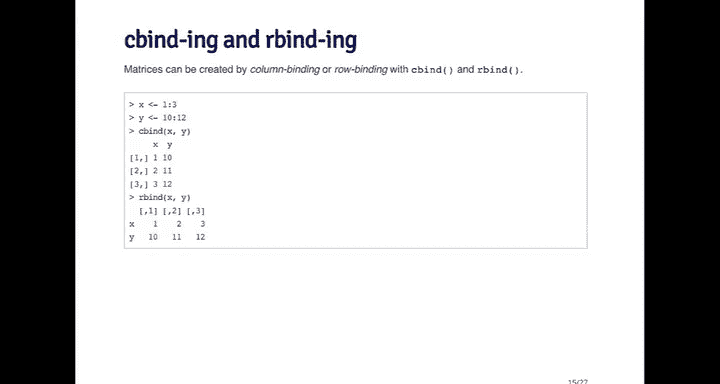

# 课程11：R语言中的矩阵数据类型 🧮


在本节课中，我们将要学习R语言中的一种重要数据结构——矩阵。我们将了解矩阵的本质、创建矩阵的多种方法以及其核心属性。

## 概述

矩阵是R语言中一种特殊的向量，它并非一个独立的对象类别，而是拥有一个名为“维度”属性的向量。这个维度属性是一个长度为2的整数向量，其中第一个数字代表矩阵的行数，第二个数字代表矩阵的列数。

## 矩阵的本质与创建

上一节我们介绍了矩阵的基本概念，本节中我们来看看如何创建一个矩阵。

创建矩阵的一种方法是使用 `matrix()` 函数。通过该函数，我们可以明确指定矩阵的行数和列数。

```r
M <- matrix(nrow = 2, ncol = 3)
```

输入对象名 `M` 并回车，可以自动打印这个矩阵。你会看到矩阵初始化为 `NA` 值，并且它有两行三列。括号中的数字用于标记行和列。

调用 `dim()` 函数可以获取矩阵的维度属性。

```r
dim(M)
```

该函数会返回一个向量，其中第一个数字是行数，第二个数字是列数。调用 `attributes()` 函数会返回一个列表，其第一个元素就是包含维度信息（例如 `c(2, 3)`）的 `dim` 属性。这些都体现了矩阵作为一个拥有维度属性的向量的特性。

## 矩阵的填充方式

矩阵是按列填充的。你可以将其理解为：矩阵接收一个向量，然后按列将所有数字插入矩阵中。首先填充第一列，当达到最大行数后，再开始填充第二列，依此类推。

以下是按列填充的示例：

```r
matrix(1:6, nrow = 2, ncol = 3)
```

这个矩阵的构造过程如下：首先取数字1和2（因为只有两行）构成第一列；然后取数字3和4构成第二列；最后取数字5和6构成第三列。

## 其他创建矩阵的方法

除了使用 `matrix()` 函数，还有其他方法可以创建矩阵。

一种方法是为向量添加维度属性。例如，先创建一个从1到10的序列向量，然后为其分配维度属性。

```r
m <- 1:10
dim(m) <- c(2, 5)
```

这段代码将向量 `m` 转换为一个2行5列的矩阵，并且填充方式同样是按列进行。

另一种常见的方法是使用列绑定或行绑定函数。`cbind()` 和 `rbind()` 函数可以实现这个功能。

假设有两个对象：`x` 是序列1到3，`y` 是序列10到12。

使用 `cbind()` 进行列绑定：

```r
x <- 1:3
y <- 10:12
cbind(x, y)
```

这将得到一个矩阵，其中第一列是1到3，第二列是10到12。

使用 `rbind()` 进行行绑定：

```r
rbind(x, y)
```

这将得到一个矩阵，其中第一行是1、2、3，第二行是10、11、12。因此，`cbind()` 和 `rbind()` 是创建矩阵的另一种有效方式。

## 总结



本节课中我们一起学习了R语言中的矩阵。我们了解到矩阵本质上是带有维度属性的向量，并掌握了使用 `matrix()` 函数、为向量添加 `dim` 属性以及使用 `cbind()` 和 `rbind()` 函数创建矩阵的多种方法。理解矩阵按列填充的机制对于正确构建和操作矩阵至关重要。