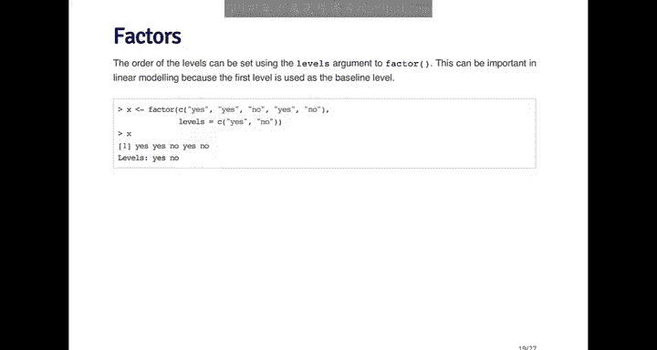

# 课程 12：R语言中的因子数据类型 📊


在本节课中，我们将要学习R语言中一种特殊的数据类型——**因子**。因子是用于表示分类数据的向量，在统计分析中扮演着至关重要的角色。

## 什么是因子？🤔

上一节我们介绍了向量的基本概念，本节中我们来看看因子。因子是一种特殊的向量，专门用于表示**分类数据**。它主要分为两种类型：**无序因子**和**有序因子**。

*   **无序因子**：用于表示没有内在顺序的分类标签。例如，性别（男/女）。
*   **有序因子**：用于表示有顺序或等级的分类，但这些分类本身不是数值。例如，大学职称（助理教授、副教授、正教授）。

你可以将因子理解为一个带有标签的整数向量。例如，一个表示“高”、“中”、“低”的因子，在R内部可能用数字1、2、3来存储，但每个数字都对应一个易于理解的标签。

## 为什么因子很重要？💡

因子之所以重要，主要有以下两个原因：

1.  **建模函数识别**：像 `lm()` 和 `glm()` 这样的建模函数（我们将在后续课程中讨论）会特殊处理因子变量。
2.  **数据自描述性**：使用带有标签的因子比使用简单的整数向量更好，因为因子是“自描述”的。一个值为“男”、“女”的变量，远比一个值为1、2的变量更易于理解。在许多数据集中，你可能会发现用1和2编码的变量，但很难判断它究竟是只取1和2的数值变量，还是一个分类变量。使用因子变量，标签的编码就内置于变量本身，理解起来容易得多。

## 如何创建因子？🔨

因子可以通过 `factor()` 函数创建，该函数的输入通常是一个字符向量。

以下是创建因子的示例代码：

```r
# 创建一个字符向量
x <- c("yes", "yes", "no", "yes", "no")
# 使用factor()函数将其转换为因子
x <- factor(x)
print(x)
```

运行上述代码，输出结果会与普通字符向量略有不同。它不仅会显示值（“yes”, “yes”, “no”, “yes”, “no”），还会单独显示一个名为 **`levels`** 的属性，列出该因子所有可能的类别（“no”和“yes”）。

你可以使用 `table()` 函数来获取每个水平的频数统计：

```r
table(x)
```

`unclass()` 函数可以剥离向量的类别属性，让我们看到因子在R内部的真实表示：

```r
unclass(x)
```

你会看到，因子在底层实际上是一个整数向量（例如 2, 2, 1, 2, 1），并附带一个 `levels` 属性（“no”, “yes”）。了解这一点有助于理解R如何处理因子。

## 如何设置因子的水平顺序？🔄

因子中水平的顺序可以通过 `factor()` 函数中的 `levels` 参数来设置。这一点有时非常重要，因为在建模函数中引入因子变量时，了解哪个是**基线水平**（即第一个水平）很关键。

默认情况下，R会按照**字母顺序**来确定水平的顺序。例如，一个包含“yes”和“no”的因子，“no”会排在“yes”前面，因此“no”是基线水平。

如果你希望改变基线水平，例如让“yes”作为第一个水平，就需要显式地指定 `levels` 参数：

```r
# 创建因子，并指定水平的顺序为“yes”在前，“no”在后
x <- factor(c("yes", "yes", "no", "yes", "no"), levels = c("yes", "no"))
print(x)
```

现在，虽然元素值相同，但 `levels` 属性的顺序变成了“yes”、“no”，这意味着“yes”现在是基线水平。

## 总结 📝



本节课中我们一起学习了R语言中的因子数据类型。我们了解到因子是用于表示分类数据的特殊向量，分为无序和有序两种。因子因其自描述性和被建模函数特殊对待而非常重要。我们学会了如何使用 `factor()` 函数创建因子，以及如何通过 `levels` 参数来控制因子水平的顺序，这对于后续的统计分析至关重要。