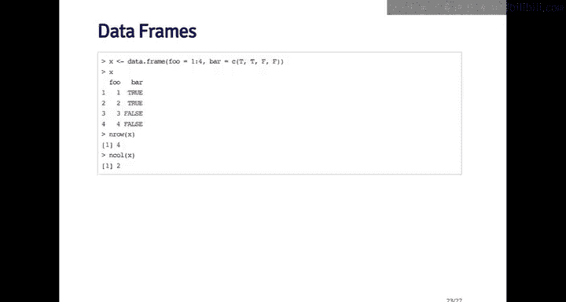

# 课程名称：R语言基础 - 第14课：数据类型：数据框 📊


## 概述

在本节课中，我们将要学习R语言中一个至关重要的数据类型——数据框。数据框是存储表格数据的主要形式，在统计学和数据科学中应用极为广泛。我们将了解数据框的基本概念、特性、创建方法及其与矩阵的区别。

---

## 数据框：存储表格数据的关键结构

上一节我们介绍了列表等数据结构，本节中我们来看看专门用于处理表格数据的数据框。

数据框是R中一个关键的数据类型，它用于存储表格数据。当然，并非所有类型的数据都是表格形式的，但由于大量数据都以表格形式存在，因此数据框在R中非常重要。

数据框本质上是一种特殊类型的列表，其中该列表的**每个元素都具有相同的长度**。你可以将数据框的每一列视为列表的一个元素。为了构成一个表格，每一列自然需要有相同的长度。

然而，**每一列不必是相同的数据类型**。第一列可以是数值型，第二列可以是因子型，第三列可以是整型，第四列可以是逻辑型。各列的类型可以不同。

因此，与矩阵必须在每个元素中存储相同类型的对象不同，数据框可以存储不同类别的对象。

---

## 数据框的特殊属性

数据框还拥有一些特殊的属性。第一个特殊属性称为**行名**。数据框的每一行都有一个名称，这有助于为数据添加注释。例如，每一行可能代表一项研究中招募的一名受试者，那么行名就可以是受试者ID。不过，有时行名并不重要，通常你只会使用1、2、3等作为行名。

---

## 创建与转换数据框

数据框最常通过调用`read.table()`或`read.csv()`函数来创建。我们将在讲解如何将数据读入R时深入探讨这一点。

你也可以通过调用`data.matrix()`函数，将数据框转换为矩阵。但需要注意的是，如果一个数据框包含多种不同类型的对象，当你将其强制转换为矩阵时，每个对象都会被强制转换，以使它们类型一致，因此最终结果可能并非完全如你所愿。

除了使用`read.table()`或`read.csv()`，你还可以使用`data.frame()`函数创建数据框。

以下是一个使用`data.frame()`创建简单数据框的示例：

```r
# 创建一个数据框
x <- data.frame(foo = 1:4, bar = c(T, T, F, F))
```

在这个例子中，第一列名为`foo`，是一个从1到4的整数序列；第二列名为`bar`，是一个包含两个`TRUE`和两个`FALSE`的逻辑向量。

当我们自动打印这个数据框`x`时，它会显示出这两列。由于我没有指定特殊的行名，行名默认显示为1、2、3、4（因为有四行）。

调用`nrow(x)`函数可以显示这个数据框有4行。
调用`ncol(x)`函数可以显示这个数据框有2列。

---

## 总结



本节课中，我们一起学习了R语言中的**数据框**类型。我们了解到数据框是一种用于存储**表格数据**的特殊列表，其每列长度相同但类型可以不同。我们探讨了它的**行名**属性，并学习了如何使用`data.frame()`函数创建数据框，以及如何通过`nrow()`和`ncol()`函数查看其维度。理解数据框是掌握R语言数据处理的基础。