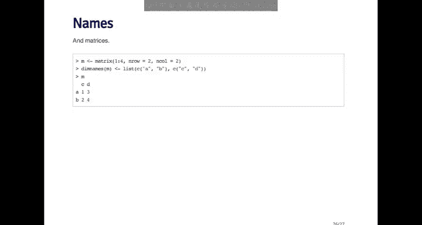

# 课程15：数据类型与名称属性 📝


在本节课中，我们将要学习R语言中一个非常实用的特性：为数据对象添加名称属性。我们将看到如何为向量、列表和矩阵等对象添加名称，这有助于编写更清晰、更易读的代码。

## 概述

在R语言中，许多对象都可以拥有名称属性。这不仅仅是数据框的特性，而是适用于我们创建的各种对象。为对象元素命名可以使代码更具可读性，并创建自描述性的数据结构。

## 为向量添加名称

首先，我们来看如何为向量添加名称。以下是一个创建整数序列向量的例子：

```r
x <- 1:3
```

默认情况下，这个向量没有名称。当我们调用 `names` 函数时，会得到 `NULL` 值：

```r
names(x)
# 输出: NULL
```

然而，我们可以为向量 `x` 的每个元素指定一个名称。例如：

```r
names(x) <- c("food", "bar", "north")
```

现在，当我们打印向量 `x` 时，不仅会看到数值 `1, 2, 3`，还会看到每个数值上方显示我们刚刚指定的名称。再次调用 `names` 函数，会返回与向量每个元素相关联的名称：

```r
names(x)
# 输出: "food" "bar" "north"
```

## 为列表添加名称

上一节我们介绍了如何为向量命名，本节中我们来看看列表的命名方法。列表同样可以拥有名称属性。

以下是创建一个列表并为其元素命名的例子：

```r
my_list <- list(A = 1, B = 2, C = 3)
```

在这个例子中，我们使用 `list` 函数创建列表，并直接在参数中为每个元素命名（第一个元素名为“A”，第二个为“B”，第三个为“C”）。当我们打印这个列表时，它会显示每个元素的名称及其对应的值。

## 为矩阵添加名称

最后，我们来学习如何为矩阵添加名称。矩阵的名称属性被称为维度名称。

以下是创建一个2x2矩阵的例子：

```r
m <- matrix(1:4, nrow=2, ncol=2)
```

要为矩阵设置行名和列名，我们使用 `dimnames` 函数。我们需要向其传递一个列表，该列表的第一个元素是行名向量，第二个元素是列名向量：

```r
dimnames(m) <- list(c("A", "B"), c("C", "D"))
```

在这个例子中，我们将行命名为“A”和“B”，将列命名为“C”和“D”。现在，当我们打印矩阵 `m` 时，可以看到行和列都按照我们的意愿被标记了。

## 总结

本节课中我们一起学习了R语言中为数据对象添加名称属性的方法。我们掌握了：

*   如何使用 `names()` 函数为向量元素命名。
*   如何在创建列表时直接为其元素命名。
*   如何使用 `dimnames()` 函数为矩阵设置行名和列名。



为对象添加名称是一个简单的操作，却能极大地提升代码的可读性和自解释性，是编写高质量R语言代码的重要技巧。