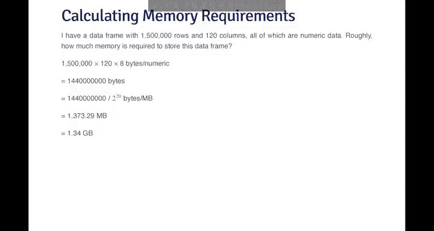

# 课程 18：读取大型数据表 📊


在本节课中，我们将学习如何高效地将大型数据集读取到 R 语言中。我们将探讨一些关键策略，以优化读取过程、预估内存需求，并避免程序因内存不足而崩溃。

上一节我们介绍了处理中小型数据集的基本方法，本节中我们来看看当面对大型数据集时，有哪些技巧可以提升读取效率。

## 优化读取策略

面对超出中小型规模的大型数据集，在读取表格数据时，你可以采取一些措施，这会让你的工作轻松很多，更重要的是，能防止 R 语言完全卡死。

首先，你应该阅读 `read.table` 函数的帮助页面。事实上，你或许应该把它背下来。这个帮助页面包含了许多关键提示和有用的信息。在我看来，没有足够的人仔细阅读这个帮助页面，以至于无法在睡梦中复述它。一旦你阅读了它，你就会发现其中有很多关于如何针对大型数据集优化 `read.table` 的重要信息。

以下是几个关键的优化步骤：

*   **预估内存需求**：你需要对存储即将读取的数据所需的内存进行一个粗略的计算。这样你就能大致判断你的计算机是否有足够的内存来存储这些数据。因为请记住，除非你采取其他措施，否则 R 语言会将你的整个数据集存储在内存中。当你调用 `read.table` 或 `read.csv` 时，它会把整个数据集读入计算机的 RAM 中。因此，你需要大致了解这个数据集将需要多少 RAM，我们稍后会讨论如何计算。

*   **设置注释字符**：另一个简单的优化是，如果你的文件中没有注释行，只需将 `comment.char` 参数设置为空，即一对空引号 `""`。

*   **指定列数据类型**：`colClasses` 参数实际上非常重要。因为如果你不指定它，R 默认会遍历数据的每一列，并尝试推断其数据类型。对于中小型数据来说，这没问题。但读取每一列并尝试推断数据类型需要时间、占用内存，并且通常会减慢速度。如果你能告诉 R 每列数据的类型，那么 R 就不必花时间去自行推断，这通常会使 `read.table` 运行得更快。

## 确定列数据类型的方法

你可以通过以下方法确定并指定 `colClasses`，从而节省大量时间：

*   **手动指定**：如果你的数据只有几列，通常可以直接说明它们的类型。
*   **统一类型**：例如，如果所有列都是数值型，你可以直接将 `colClasses` 设置为 `"numeric"`。如果你只提供一个值，R 会假定每一列都具有相同的类型。
*   **采样推断**：如果你有一个巨大的数据集，你可以通过指定 `nrows` 参数，先读取前一百行或一千行。然后，使用 `sapply` 函数遍历每一列并调用 `class` 函数。`class` 函数会告诉你每列数据的类型。你可以存储这些信息，然后通过指定 `colClasses` 参数来读取整个数据集。

## 其他有用参数

`nrows` 参数实际上也非常有用。它不一定能让 R 运行得更快，但确实有助于内存管理。如果你能告诉 R 将要读取多少行数据，它就可以计算出所需的内存，而不必在读取过程中动态计算。即使你稍微高估了数据中的行数也没关系，因为它仍然会读取正确的行数。

## 系统环境考量

通常，当你使用 R 处理大型数据集时（如今有很多大型数据集），手头掌握一些信息是很有用的。以下是需要考虑的几个方面：

*   **计算机内存**：你的计算机有多少内存？如今大多数计算机的物理 RAM 从几 GB 到许多 GB 不等。
*   **其他应用程序**：你的计算机上是否运行着其他可能占用处理器时间或内存的应用程序？
*   **多用户系统**：如果你在多用户系统上，是否有其他用户登录到系统？他们是否在使用计算机的一些资源？
*   **操作系统**：你的计算机是什么操作系统？是 Mac、Windows、Unix、Linux 还是其他？
*   **系统位数**：了解你运行的操作系统是 32 位还是 64 位也很有用。在 64 位系统上，如果计算机有更多内存，你通常能够访问更多内存。

## 内存需求估算

在使用 `read.table` 或 `read.csv` 函数将表格读入 R 之前，你可以做一个快速的计算来估算内存需求。

假设我有一个数据框，有 150 万行和 120 列。这个数据集不算特别大，但规模可观。假设所有列都是数值型，因此我不必担心不同的数据类型。

问题是：在内存中存储这个数据框需要多少内存？我可以做一个简单的计算。

*   数据框中的元素数量是 **150 万 × 120**，因为它是一个矩形对象。
*   如果所有数据都是数值型，那么每个数字需要 **8 字节** 的内存来存储，因为数字是以 64 位（8 字节）存储的。
*   因此，总字节数 = 元素数量 × 8 字节。
*   然后，我们可以将总字节数除以 **2^20**（即 1,048,576）得到兆字节数。
*   接着，再除以 **2^10**（即 1024）得到千兆字节数。

**公式**：
`所需内存 (GB) ≈ (行数 × 列数 × 8) / (2^30)`

对于我们的例子：
`(1,500,000 × 120 × 8) / (1,073,741,824) ≈ 1.34 GB`

这个数据框的原始存储空间大约需要 **1.34 GB**。

实际上，读取数据时你需要比这稍多一点的内存，因为读取数据本身需要一些开销。经验法则是：使用 `read.table` 读取这个数据集所需的内存，大约是对象本身所需内存的 **两倍**。

因此，如果你的计算机只有 2 GB 的 RAM，而你试图读取这个 1.34 GB 的表格，你可能需要三思，因为你将接近读取数据所需内存的边界。当然，如果你的计算机有 4、8 或 16 GB 的 RAM，那么在内存需求方面应该没有问题。读取它仍然需要一些时间，但这只是因为读取所有数据需要时间，而你不会耗尽内存。

在进行这种计算时，使用 R 代码辅助非常方便：

```r
# 估算内存需求的示例代码
rows <- 1500000
cols <- 120
bytes_per_numeric <- 8

total_bytes <- rows * cols * bytes_per_numeric
total_mb <- total_bytes / (1024^2)
total_gb <- total_mb / 1024

cat("预计需要内存：", round(total_gb, 2), "GB\n")
cat("建议可用内存至少为：", round(total_gb * 2, 2), "GB\n")
```

当你读取大型数据集时，进行这种计算非常有用，它能让你心里有数：我是否有足够的内存？如果你遇到任何错误，你会知道错误是否是由于内存耗尽引起的。因此，我鼓励你在读取大型数据集并且事先知道它大概有多大时，进行这种计算。

---



本节课中我们一起学习了高效读取大型数据表到 R 语言中的关键策略。我们重点探讨了通过预估内存需求、指定列数据类型、利用 `nrows` 参数以及考量系统环境来优化读取过程。掌握这些方法，尤其是进行简单的内存计算，能帮助你在处理大规模数据时更加得心应手，避免因内存不足而导致程序崩溃。