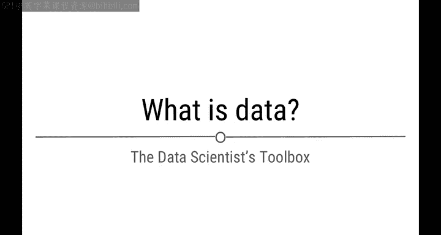
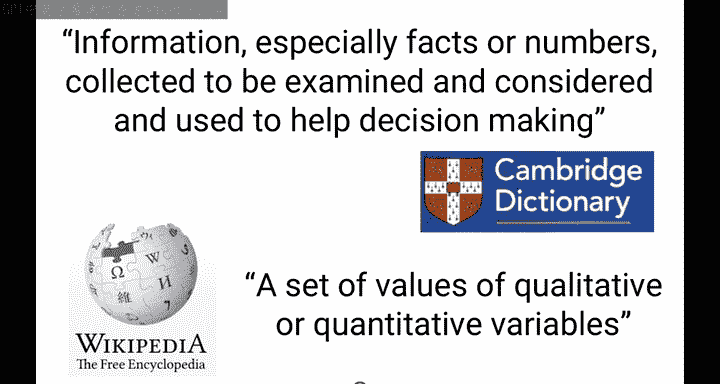
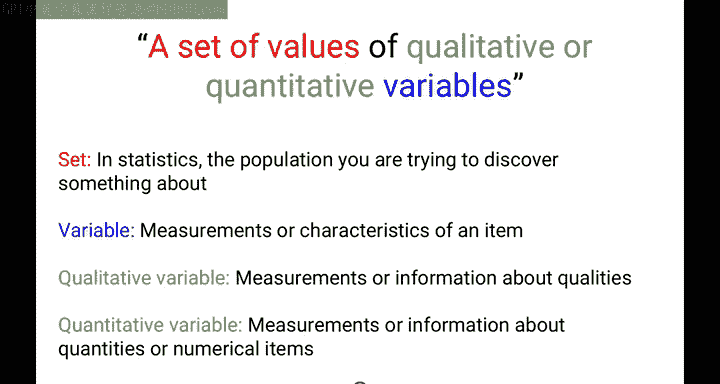
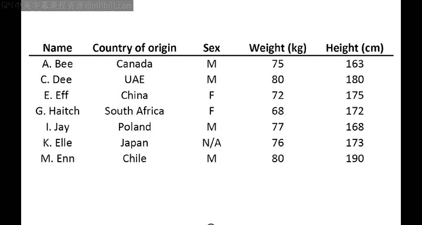
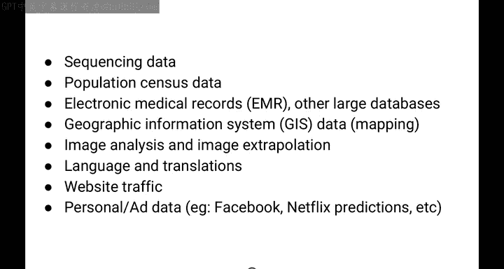
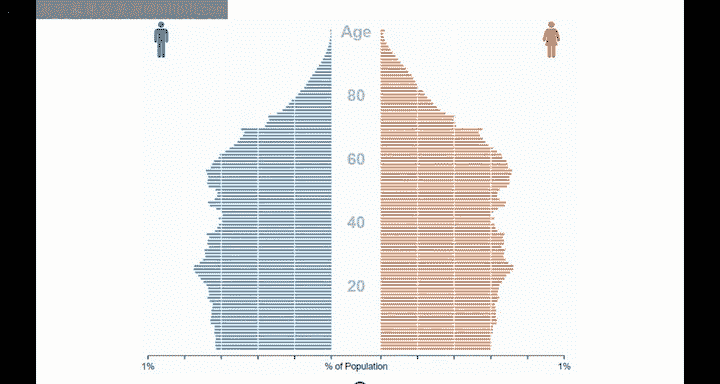
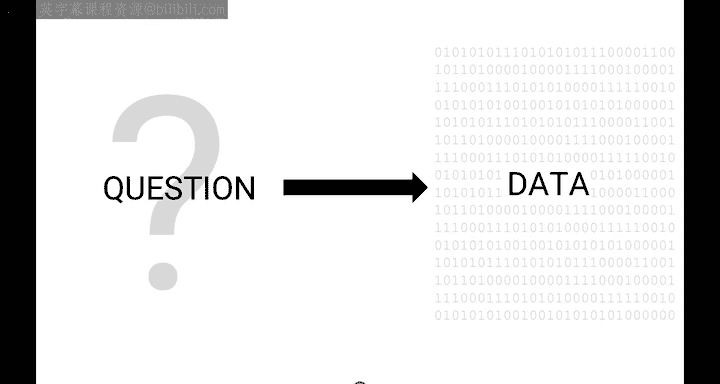
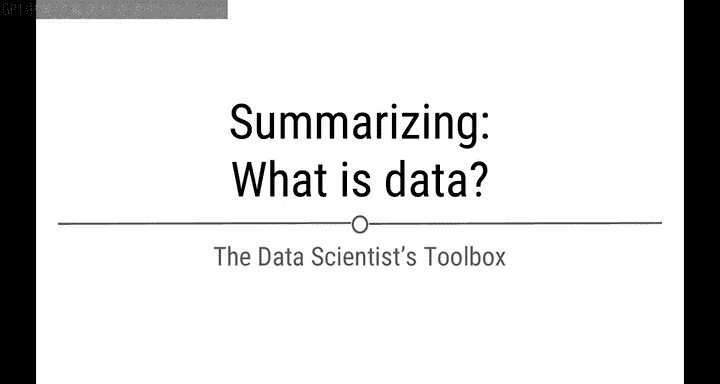

# 课程 2：什么是数据？📊

在本节课中，我们将深入探讨“数据”这一核心概念。我们将了解数据的定义、构成要素，并观察数据在现实世界中的多种表现形式。理解数据的本质是学习数据科学的第一步。

---

## 数据定义：两种视角

上一节我们讨论了数据科学是什么，本节中我们来看看数据本身的确切含义。以下是两个权威来源对数据的定义。

**剑桥英语词典**的定义：
> 数据是信息，特别是为被检查、考虑并用于辅助决策而收集的事实或数字。

**维基百科**的定义：
> 数据是一组定性或定量变量的值。

这两个定义略有不同，但都抓住了数据的关键部分。剑桥定义侧重于围绕数据的**行动**：数据被收集、检查，并最终用于决策。这与我们之前强调的“问题驱动”理念一致。维基百科定义则更侧重于数据的**构成**，它虽然简短，但内涵丰富。

---

## 解析数据的构成要素

根据维基百科的定义，我们可以将数据拆解为三个核心部分。

**1. 一组值**
要拥有数据，你需要一组被测量的项目。在统计学中，这组项目通常被称为 **总体**。你试图从这整个集合中发现某些信息。

**2. 变量**
变量是对项目中某个特征的**测量**。例如，对于“人”这个项目，变量可以是身高、国籍或性别。

**3. 变量的类型**
变量主要分为两类：
*   **定性变量**：描述“品质”的信息。通常用文字描述，不一定有顺序。
    *   示例：`country_of_origin = “中国”`， `sex = “女”`， `treatment_group = “对照组”`
*   **定量变量**：描述“数量”的信息。通常用数字描述，并在连续有序的尺度上测量。
    *   示例：`height = 175.5`， `weight = 65.2`， `blood_pressure = 120`

综合来看，数据就是**对一组项目进行的定性或定量测量**。这是一个相当不错的定义。

---

## 现实世界中的数据：混乱是常态

在我们讨论定义时，使用的例子（如国籍、身高）都非常基础，很容易想象它们被整齐地排列在一个表格中，个体在行，变量在列。

然而，这很少是数据呈现给你的方式。我们通常遇到的数据集要混乱得多。数据科学家的任务就是从这些混乱的数据源中提取所需信息，将其整理成类似上文的整洁表格，进行恰当分析并可视化结果。

以下是几种常见的数据源及其形态：

**1. 测序数据**
我经常处理的一类数据是基因测序数据。这种数据最初以`FASTQ`格式出现，这是测序机器产生的原始文件格式。这些文件通常长达数亿行，我们的任务是将其解析成可理解、可解释的格式，并推断个体基因组的某些信息。

**2. 人口普查数据**
全国人口普查是一个丰富的信息源。几乎所有国民都会回答一组标准化问题并将答案提交给政府。当受访者如此之多时，数据量巨大且混乱。但一旦这个大型数据库可供查询，其中蕴含的答案就非常重要。

**3. 电子病历**
这是一个电子病历的模拟示例。这是存储健康信息的流行方式，越来越多的基于人群的研究使用这些数据来回答问题、对广大群体做出推断，或作为改进医疗保健方法的手段。

**4. 图像/视频数据**
图像或视频中编码着大量信息，正等待被提取。一个熟悉的图像分析例子是，当你将照片上传到Facebook时，它不仅自动识别图片中的人脸，还会建议他们可能是谁。

---

## 重申核心：问题先行

认识到我们已经花了大量时间讨论数据是什么，我们需要重申：数据很重要，但它**次于你的问题**。

一个好的数据科学家**先提出问题，再寻找相关数据**。诚然，可用的数据常常会限制甚至决定你能提出哪些问题。在这些情况下，你可能需要重新构建问题或回答一个相关问题。但**数据本身不应驱动提问**。

---

## 课程总结

本节课中，我们一起学习了数据的核心概念。

首先，我们看了两个数据定义：一个侧重于围绕数据的行动，另一个侧重于数据的构成。第二个定义包含了总体、变量的概念，并区分了定量和定性数据。

其次，我们考察了可能遇到的不同数据源，并强调了整洁数据集的缺乏。需要被“驯服”成可解释形式的混乱数据集示例包括测序数据、人口普查数据、电子病历等。

最后，我们回到了关于数据与问题之间关系的信念，并强调了“问题先行”策略的重要性。你可以拥有梦寐以求的所有数据，但如果你没有一个问题作为起点，这些数据就毫无用处。