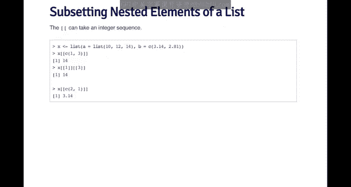
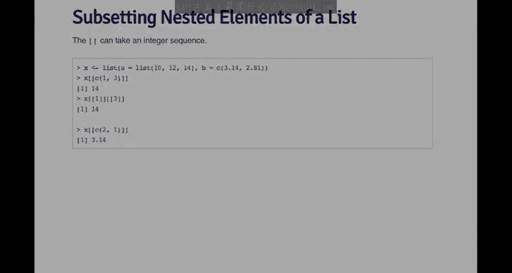

# 课程名称：R语言基础 - 第22课：列表子集操作 🧩

## 概述

在本节课中，我们将要学习如何在R语言中对列表进行子集操作。列表是一种可以包含多种数据类型元素的复杂数据结构，因此其子集操作方式与向量或矩阵有所不同。我们将详细介绍单括号、双括号和美元符号这三种操作符的使用方法、区别以及适用场景。

---

## 列表子集操作的基本方法

列表的子集操作有些不同，因为你可以使用双括号或美元符号操作符，也可以使用单括号操作符。

这里我有一个列表。第一个元素是一个名为`foo`的命名元素，它是一个从1到4的序列。第二个元素名为`bar`，它是一个数值0.6。这是一个包含两个元素的列表。

我可以使用单方括号提取第一个元素。请记住，单方括号总是返回一个与原始对象类别相同的元素。因此，如果`x`是一个列表，那么`x[1]`也将是一个列表。

所以我得到的是一个包含名为`foo`的元素的列表，该元素是一个从1到4的序列。

现在，如果我使用双括号，即输入`x[[1]]`，那么我得到的就仅仅是一个从1到4的序列。这里的区别在于，在第一个例子中，我得到了一个包含序列的列表；而在第二个例子中，我直接得到了序列本身。这就是单括号和双括号操作符之间的区别。

---

## 使用名称提取元素

在下一个例子中，我使用了美元符号。我输入`x$bar`，这意味着它返回与名称`bar`相关联的元素。在这个例子中，它是一个单独的数字0.6。

我也可以使用双括号操作符并传递一个字符串给它。`x[["bar"]]`与执行`x$bar`效果相同，都返回0.6。

如果我使用带有名称的单括号，例如`x["bar"]`，那么我会得到一个包含`bar`元素的列表。请记住，因为在对列表进行子集操作时，单括号总是返回一个列表。

能够使用名称对元素进行子集操作的好处是，你不需要记住它在列表中的位置。例如，如果我不记得`bar`是第一个元素还是第二个元素，我不需要为了使用数字索引而去记住它的位置。我只需使用它的名称，它就会自动从列表中提取出该元素。

---

## 提取列表的多个元素

如果你想提取列表的多个元素，那么你需要使用单括号操作符。

例如，如果我想提取这里的第一个和第三个元素（即`foo`和`baz`元素），我可以将一个数值向量`c(1, 3)`通过单括号操作符传递给`x`。这将返回一个包含`foo`和`baz`元素的列表。

这就是我提取列表多个元素的方法。当你想要提取列表的多个元素时，不能使用双括号或美元符号操作符。

---

## 双括号操作符与计算索引

双括号操作符与美元符号的一个不同之处在于，你可以使用双括号操作符来索引一个列表，而索引本身可以是计算得出的。

请注意，之前我使用美元符号时，我实际上键入了单词`bar`。我必须键入对象的名称（或者更准确地说，是元素的名称）。但有时，元素的名称实际上是某些计算的结果。

例如，这里我有一个包含三个元素`foo`、`bar`和`baz`的列表。然后我创建了一个名为`name`的变量，它的值实际上是字符串`"foo"`。

如果我对这个变量使用双括号操作符，请注意列表中并没有名为`name`的元素，但列表中有一个名为`foo`的元素。

现在，当我将这个名为`name`的变量传递给双括号操作符时，它返回与`foo`相关联的元素，因为这就是`name`变量的值。

因此，如果我想要使用计算得出的索引，那么我必须使用双括号操作符。如果我使用美元符号，它将按字面意思查找列表中与单词`name`相关联的元素，而这个元素当然不存在于这个列表中。所以，要使用美元符号，我需要使用一个字面符号。

---

## 双括号操作符与整数序列

双括号操作符可以接受一个整数序列，而不仅仅是单个数字。你可以这样理解：它有点像是递归地进入列表。

看看我这里的当前列表。第一个元素`a`是另一个列表，它包含元素10、12和14。假设我想提取数字14，它实际上是第一个元素的第三个元素，对吧？也就是说，它是列表的第三个元素，而这个列表恰好是另一个列表的第一个元素。

因此，我可以通过将向量`c(1, 3)`传递给列表`x`，使用双括号操作符来提取它。这相当于执行`x[[1]][[3]]`这样的双重子集操作。

我也可以通过传递整数向量`c(2, 1)`来提取第二个元素的第一个元素，从而得到3.14。

---

## 总结

本节课中我们一起学习了R语言中列表子集操作的三种主要方法：单括号`[]`、双括号`[[]]`和美元符号`$`。

*   **单括号 `[]`**：总是返回一个列表，可用于提取单个或多个元素。
*   **双括号 `[[]]`**：提取列表中的单个元素，返回该元素本身（可能是向量、列表或其他类型）。它支持使用计算得出的索引或名称，并且可以传递整数序列进行递归提取。
*   **美元符号 `$`**：通过元素的字面名称提取单个元素，语法简洁，但不能用于计算索引或提取多个元素。

理解这些操作符之间的区别对于有效地处理和操作R中的列表数据结构至关重要。