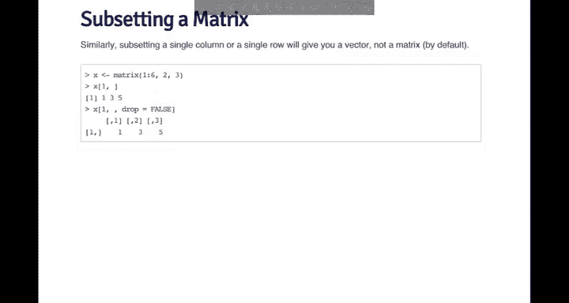
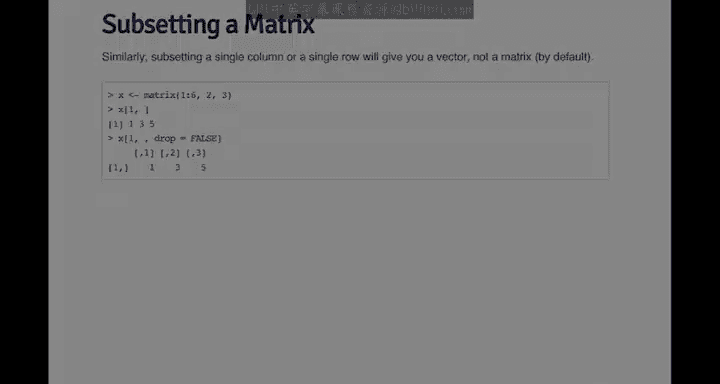

# 课程名称：R语言基础 - 第23课：矩阵子集操作 🧮


## 概述

在本节课中，我们将学习如何在R语言中对矩阵进行子集操作。我们将了解如何通过行索引和列索引提取矩阵中的特定元素、行或列，并讨论默认行为以及如何控制输出结果的维度。

---

## 矩阵子集的基本语法

矩阵的子集操作遵循直观的规则。第一个索引代表行，第二个索引代表列。我们可以使用数字来指定这些索引。

例如，假设我们有一个矩阵 `x`，它是一个2行3列的矩阵，包含数字1到6。

```r
x <- matrix(1:6, nrow=2, ncol=3)
```

如果我们使用 `x[1, 2]`，这将提取第一行第二列的元素，结果是数字3。

```r
x[1, 2] # 输出: 3
```

类似地，`x[2, 1]` 将提取第二行第一列的元素，结果是数字2。

```r
x[2, 1] # 输出: 2
```

---

## 提取整行或整列

在子集操作中，不一定总要同时指定两个索引。

例如，如果我们想提取矩阵的第一行，可以使用 `x[1, ]` 的语法。逗号后的空白表示我们想要所有列。

```r
x[1, ] # 输出: 1 3 5
```

同样，如果我们想提取矩阵的第二列，可以使用 `x[, 2]` 的语法。逗号前的空白表示我们想要所有行。

```r
x[, 2] # 输出: 3 4
```

---

## 默认行为：维度降低

默认情况下，当从矩阵中提取单个元素时，R会返回一个长度为1的向量，而不是一个1x1的矩阵。

之前我们提到，单方括号 `[ ]` 操作符通常返回与原始对象相同类的对象。但这里有一个有时会出乎意料的情况：提取矩阵的单个元素时，返回的不是矩阵，而是一个包含该数字的向量。

例如，`x[1, 2]` 返回的是数字3，而不是一个包含3的1x1矩阵。这通常是期望的行为，但有时也可能导致问题。

---

## 控制维度：`drop` 参数

你可以通过为子集操作添加一个名为 `drop` 的额外参数来关闭上述默认行为。默认情况下，`drop = TRUE`，它会“丢弃”维度，因此返回的通常是一维对象，而不是二维对象。

然而，如果你想保留对象的维度，可以设置 `drop = FALSE`。

```r
x[1, 2, drop = FALSE]
# 输出:
#      [,1]
# [1,]    3
# 这是一个1x1的矩阵
```

现在，当你提取单列或单行时，默认也不会返回矩阵。

例如，提取第一行 `x[1, ]`，你可能会认为应该返回一个1行3列的矩阵，元素是1, 3, 5。但实际上，你得到的是一个包含元素1, 3, 5的向量。

这通常是可以接受的。但如果你不希望这样，可以在子集矩阵时始终设置 `drop = FALSE` 参数。

```r
x[1, , drop = FALSE]
# 输出:
#      [,1] [,2] [,3]
# [1,]    1    3    5
# 这是一个1x3的矩阵
```

---

## 总结



本节课我们一起学习了R语言中矩阵的子集操作。我们掌握了使用行索引和列索引提取特定元素、行或列的基本方法。我们了解了默认情况下R会降低输出结果的维度（返回向量），并学习了如何使用 `drop = FALSE` 参数来保留原始矩阵的维度结构。理解这些概念对于有效地处理和操作R中的矩阵数据至关重要。



---