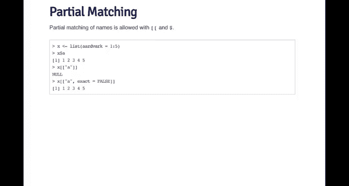

# 课程名称：数据科学R语言基础｜Data Science： Foundations using R
## 课程编号：P43 - 24_子集部分匹配 🎯


在本节课中，我们将要学习R语言中一个名为“部分匹配”的便捷功能。这个功能可以帮助你在命令行操作时节省大量输入时间。

部分匹配是一个方便的工具，它通常可以节省你在命令行的大量输入。当你编写程序和函数时，它并不是特别有用。但当你需要在命令行快速输入内容时，它非常有用。

上一节我们介绍了子集提取的基本概念，本节中我们来看看部分匹配的具体工作机制。

部分匹配的理念是，它适用于双括号操作符和美元符号操作符。假设我有一个列表`x`，其中包含一个名为`abcdef`的元素，它是一个从1到5的序列。假设每次都要完整输入`abcdef`有点麻烦。

### 美元符号操作符的部分匹配

以下是美元符号操作符的默认工作方式：

*   它会在列表中查找名称与所提供字符串匹配的元素。
*   在本例中，我只输入字母`a`。
*   列表中只有一个元素的名称以`a`开头。
*   因此，它返回了名称`abcdef`，并给出了与之关联的对象，即序列1到5。

```r
x <- list(abcdef = 1:5)
x$a
```

### 双括号操作符的部分匹配

接下来，我们看看双括号操作符的情况，它有些不同。

双括号操作符期望你传递给它的名称与列表中的某个名称**完全匹配**。默认情况下，双括号操作符**不会**像美元符号那样进行部分匹配。

所以，当我输入`x[["a"]]`时，返回的是`NULL`，因为列表中没有名为`"a"`的元素。

但是，你可以向双括号操作符传递第二个参数，即`exact`参数。如果你指定`exact = FALSE`，那么当我再次输入`x[["a"]]`时，它就会返回序列1到5，因为这是与字母`"a"`最匹配的元素。

```r
x[["a"]] # 返回 NULL
x[["a", exact = FALSE]] # 返回 1:5
```



本节课中我们一起学习了R语言中的部分匹配功能。我们了解到，美元符号操作符默认支持部分匹配，可以快速提取列表元素。而双括号操作符默认要求精确匹配，但可以通过设置`exact = FALSE`参数来启用部分匹配。这个技巧在命令行交互式操作时能有效提升效率。