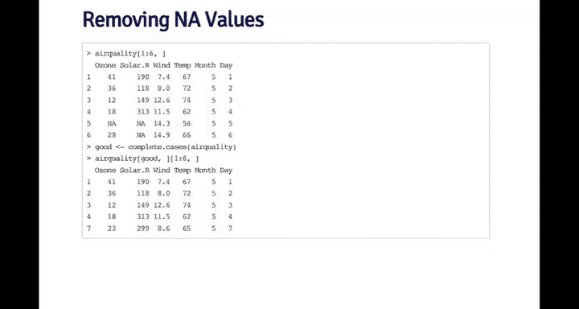

# 课程 25：R语言中如何移除缺失值 🧹


在本节课中，我们将学习如何在R语言中识别并移除向量、矩阵和数据框中的缺失值（NA）。这是数据分析中一项非常常见的操作，因为现实数据通常包含大量缺失值。

## 识别缺失值

上一节我们介绍了子集选取的基本概念，本节中我们来看看如何专门处理缺失值。首先，我们需要识别数据中的缺失值。

我们可以使用 `is.na()` 函数来创建一个逻辑向量，该向量会指出原始向量中哪些元素是缺失值。

```r
# 创建一个包含缺失值的向量
x <- c(1, 2, NA, 4, NA, 5)

# 使用 is.na() 识别缺失值
bad <- is.na(x)
```
执行上述代码后，`bad` 将是一个逻辑向量，其值为 `FALSE, FALSE, TRUE, FALSE, TRUE, FALSE`，对应 `x` 中每个元素是否为 `NA`。

## 移除缺失值

识别出缺失值的位置后，我们通常希望获取所有非缺失值。这可以通过对逻辑向量取反，然后进行子集选取来实现。

```r
# 获取所有非缺失值
good_elements <- x[!bad]
```
这里，`!` 是逻辑“非”运算符。`!bad` 会得到一个与 `bad` 相反的逻辑向量（`TRUE` 变为 `FALSE`，`FALSE` 变为 `TRUE`）。然后，`x[!bad]` 会选取 `x` 中所有对应位置为 `TRUE` 的元素，即所有非缺失值，结果为 `1, 2, 4, 5`。

## 处理多个向量的情况

在实际分析中，我们经常需要同时处理多个变量。如果每个变量的缺失值出现在不同位置，我们需要找到所有变量都非缺失的观测。

假设我们有两个向量 `x` 和 `y`：
```r
x <- c(1, 2, NA, 4, NA, 5)
y <- c(“A”, “B”, NA, “D”, NA, “F”)
```
我们希望得到一个子集，其中只包含 `x` 和 `y` 在相同位置上都非缺失的观测。这时可以使用 `complete.cases()` 函数。

以下是 `complete.cases()` 函数的使用步骤：
1.  `complete.cases()` 函数接受一个或多个向量（或数据框）作为输入。
2.  它返回一个逻辑向量，指明每个位置（或每行）在所有输入中是否都是完整的（即没有缺失值）。
3.  对于上面的 `x` 和 `y`，`complete.cases(x, y)` 将返回 `TRUE, TRUE, FALSE, TRUE, FALSE, TRUE`。
4.  然后我们可以用这个结果来同时子集选取 `x` 和 `y`。

```r
# 找出两个向量都完整的观测
good_positions <- complete.cases(x, y)

# 子集选取
x[good_positions] # 结果为 1, 2, 4, 5
y[good_positions] # 结果为 “A”, “B”, “D”, “F”
```

## 从数据框中移除缺失值

`complete.cases()` 函数在处理数据框时尤其有用。数据框的每一行可能在不同列中存在缺失值，我们常常需要找出所有列都完整的行。

以R内置的 `airquality` 数据集为例，它包含臭氧、太阳辐射等变量，其中有些行存在缺失值。

```r
# 查看数据框的前几行，其中包含NA
head(airquality)

# 使用 complete.cases 找出所有列都完整的行
good_rows <- complete.cases(airquality)

# 子集选取，创建一个没有缺失值的新数据框
airquality_complete <- airquality[good_rows, ]
head(airquality_complete)
```
执行上述代码后，`airquality_complete` 数据框将只包含原始数据中所有变量都没有缺失值的行。

## 总结



本节课中我们一起学习了在R语言中处理缺失值的关键技巧。我们首先使用 `is.na()` 函数来识别缺失值，然后通过逻辑取反和子集选取来移除它们。接着，我们探讨了如何使用 `complete.cases()` 函数高效地处理多个向量或整个数据框，确保只保留所有变量都完整的观测。`complete.cases()` 是一个非常有用的函数，特别适用于需要在大型数据集中清理缺失值的情况。