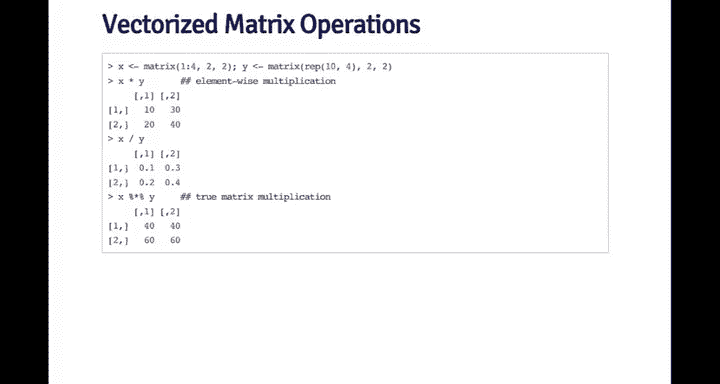

# 课程 26：向量化操作 🧮


在本节课中，我们将要学习 R 语言中一个非常强大且方便的特性：向量化操作。理解这个概念能帮助你编写更简洁、更高效的代码，而无需依赖复杂的循环结构。

## 概述

向量化操作是 R 语言的核心特性之一。它允许我们对整个向量或矩阵执行运算，而无需显式地编写循环。这使得代码更易读、更易写，并且在处理数据时非常高效。许多其他计算语言，如 MATLAB，也具备类似的功能。

## 什么是向量化操作？

上一节我们介绍了向量化操作的基本概念。本节中，我们来看看它的具体含义。

向量化操作的核心思想是并行计算。例如，当你想要对两个向量进行加法运算时，R 会自动将第一个向量的每个元素与第二个向量的对应元素相加，而不是要求你手动遍历每个元素。

假设我们有两个向量 `x` 和 `y`：
```r
x <- 1:4  # 序列 1 到 4
y <- 6:9  # 序列 6 到 9
```
如果我们想将这两个向量相加，我们的本意是将 `x` 的第一个元素与 `y` 的第一个元素相加，第二个元素与第二个元素相加，依此类推。

在其他语言中，你可能需要写一个循环来完成这个任务。但在 R 中，你可以直接使用加号运算符：
```r
x + y
```
这个操作会返回一个新的向量 `c(7, 9, 11, 13)`，它对应着 `1+6`, `2+7`, `3+8`, `4+9` 的结果。

## 逻辑比较与算术运算

理解了基本的向量加法后，我们来看看其他类型的向量化操作。

同样地，你可以使用大于或小于等符号来得到逻辑向量。例如：
```r
x > 2
```
由于 `x` 是一个包含四个数字的向量，这个向量化操作会将所有数字与 2 进行比较，并返回一个由 `TRUE` 和 `FALSE` 组成的向量，指示哪些数字大于 2。

以下是其他常见的向量化逻辑与算术运算示例：
*   `x >= 2`：判断哪些数字大于或等于 2。
*   `y == 8`：使用双等号测试相等性，判断 `y` 的每个元素是否等于 8。
*   `x * y`：向量元素对应相乘。
*   `x / y`：向量元素对应相除。

当你想要对向量进行乘、除、加、减运算时，可以直接使用相应的运算符，操作会自动并行执行。

## 矩阵的向量化操作

向量化操作不仅限于向量，也适用于矩阵。了解这一点很重要，因为矩阵乘法有不同的类型。

假设我们创建两个矩阵 `x` 和 `y`：
```r
x <- matrix(1:4, nrow=2, ncol=2) # 一个 2x2 矩阵，元素为 1 到 4
y <- matrix(1, nrow=2, ncol=2)   # 一个 2x2 矩阵，所有元素都是 1
```

如果你直接使用 `x * y`，这**不是**矩阵乘法，而是**逐元素**乘法。第一个矩阵的 (1,1) 元素与第二个矩阵的 (1,1) 元素相乘，以此类推。除法操作 `x / y` 同理，它只是将一个矩阵的每个元素除以另一个矩阵的对应元素，而不是求矩阵的逆。

如果你想进行真正的矩阵乘法，必须使用特定的运算符 `%*%`：
```r
x %*% y # 真正的矩阵乘法
```

## 总结



本节课中，我们一起学习了 R 语言的向量化操作。我们了解到，向量化操作允许我们直接对整个数据结构（向量或矩阵）应用算术和逻辑运算，从而实现隐式的并行计算，而无需编写循环。这极大地简化了代码，使其更清晰、更高效。对于习惯其他编程语言、可能会下意识使用循环结构的同学来说，掌握向量化操作是编写地道 R 代码的关键一步。在后续课程中，你会更频繁地见到并运用这个强大的特性。