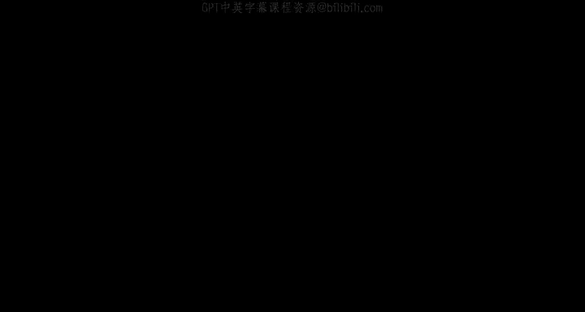
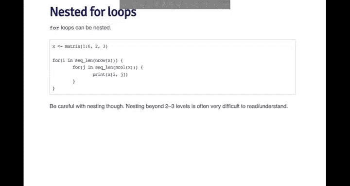

# 课程 30：控制结构 - for 循环 🔄

在本节课中，我们将要学习 R 语言中最常见的循环操作符——`for` 循环。我们将了解其基本语法、不同的使用方式以及如何嵌套循环。

---

## 概述

`for` 循环的核心思想是使用一个**循环索引**（通常称为 `i`），该索引会遍历一个序列（通常是整数序列）。在每次迭代中，循环体中的代码都会执行一次。

## 基本 `for` 循环



以下是一个基本的 `for` 循环示例，它遍历数字 1 到 10 并打印每个数字。

```r
for(i in 1:10) {
  print(i)
}
```

在这个例子中，`i` 是循环索引，`1:10` 创建了一个从 1 到 10 的整数序列。循环体 `{ print(i) }` 在每次迭代中执行，打印出当前的 `i` 值。

循环结束后，程序会继续执行后续的代码块。


## `for` 循环的多种索引方式

R 语言在如何索引不同类型的对象方面非常灵活。以下三种 `for` 循环是等价的，它们都打印出向量 `x` 中的元素 "A", "B", "C", "D"。

首先，我们创建一个字符向量：
```r
x <- c("A", "B", "C", "D")
```

### 方式一：使用整数序列索引

这是类似 C 语言等编程语言的常见做法。我们创建一个整数序列 `1:4` 作为索引。

```r
for(i in 1:4) {
  print(x[i])
}
```

### 方式二：使用 `seq_along` 函数生成索引

`seq_along()` 函数接受一个向量作为输入，并生成一个等于该向量长度的整数序列。这使得循环的编写不依赖于硬编码的数字。

```r
for(i in seq_along(x)) {
  print(x[i])
}
```
`seq_along(x)` 会生成序列 `1:4`，效果与方式一相同，但代码更具通用性。

### 方式三：直接遍历向量元素

循环索引变量不一定必须是整数，它可以直接取自向量本身的元素。

```r
for(letter in x) {
  print(letter)
}
```
在这个循环中，索引变量 `letter` 在每次迭代中直接取值为向量 `x` 中的一个元素（"A", "B", "C", "D"），并直接打印出来。

以上三种循环最终都打印出 "A", "B", "C", "D"。

## 单行循环体语法

如果 `for` 循环体只包含一个表达式，可以省略花括号 `{}`，将所有内容写在一行。这可以使代码更紧凑，但并非所有人都喜欢这种风格。

```r
for(i in 1:4) print(x[i])
```

## 嵌套 `for` 循环

`for` 循环可以嵌套，即一个循环 inside 另一个循环。这在处理二维数据结构（如矩阵）时很常见，例如需要遍历所有行和列。

假设我们有一个 2 行 3 列的矩阵：
```r
x <- matrix(1:6, nrow=2, ncol=3)
```

以下嵌套循环会打印出矩阵中的所有元素：

```r
for(i in seq_len(nrow(x))) {
  for(j in seq_len(ncol(x))) {
    print(x[i, j])
  }
}
```

*   **外层循环**：索引 `i` 使用 `seq_len(nrow(x))` 遍历行。`seq_len(n)` 函数生成一个从 1 到 `n` 的整数序列。这里 `nrow(x)` 为 2，所以生成序列 `1:2`。
*   **内层循环**：索引 `j` 使用 `seq_len(ncol(x))` 遍历列。`ncol(x)` 为 3，生成序列 `1:3`。

在每次外层和内层循环的组合中，代码 `print(x[i, j])` 会打印出矩阵在 `i` 行 `j` 列的元素。



## 关于嵌套循环的注意事项

虽然 R 语言理论上支持两层、三层甚至更多层的嵌套循环，但当嵌套超过两到三层时，代码会变得难以阅读和理解。有时嵌套循环是逻辑上必需的做法，但很多时候，可以通过使用**函数**（例如 `apply` 函数族）或向量化操作来避免深层嵌套，从而使代码更清晰、更高效。

---

## 总结


本节课中我们一起学习了 R 语言中的 `for` 循环。我们掌握了其基本语法，了解了使用整数序列、`seq_along` 函数以及直接遍历向量元素等多种索引方式。我们还学习了如何编写嵌套的 `for` 循环来遍历多维数据结构，并认识到应谨慎使用深层嵌套以保持代码的可读性。`for` 循环是进行重复性操作和控制程序流程的强大工具。