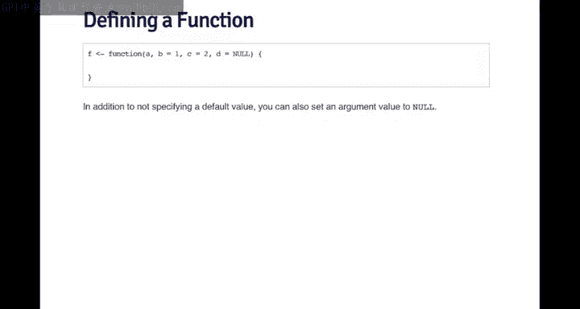
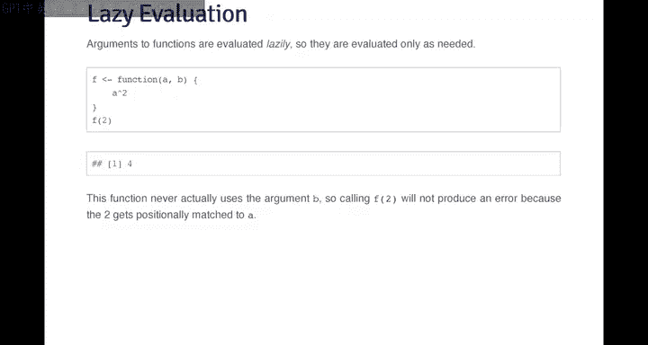
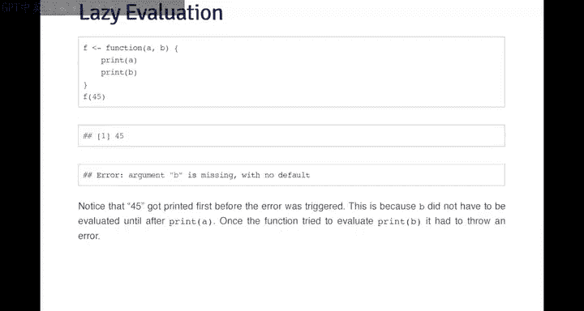
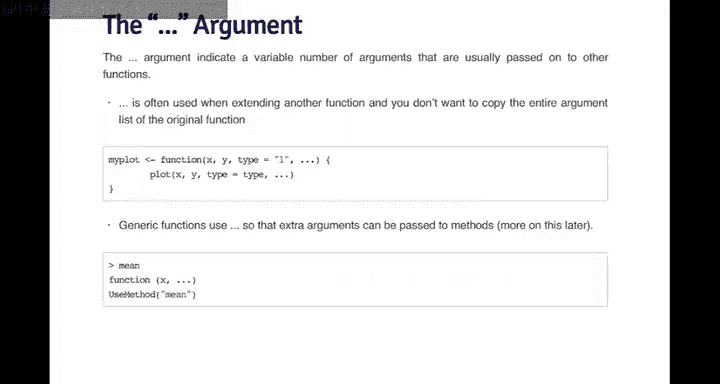
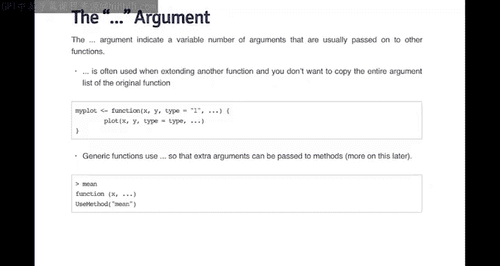
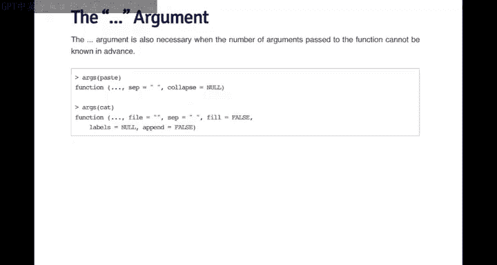
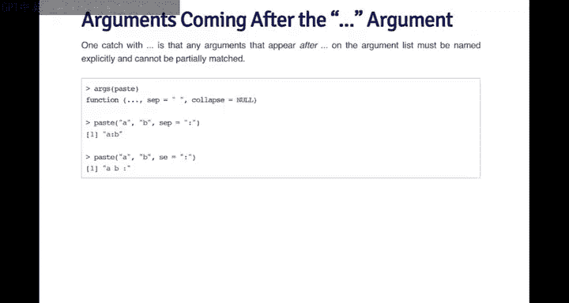

# 课程 35：函数（第二部分）📘

在本节课中，我们将继续学习 R 语言中函数的相关概念。我们将重点探讨函数的默认参数、惰性求值机制以及特殊的 `...` 参数。理解这些特性将帮助你编写更灵活、更健壮的函数。



---

## 默认参数与 `NULL` 值

上一节我们介绍了函数的基本结构，本节中我们来看看如何为函数参数设置默认值。

一个函数可以包含多个参数，其中一些可以预先设定默认值。`NULL` 是一个常用的默认值，它通常表示“空”或“无内容”。

以下是一个包含四个参数的函数示例：
```r
function_name <- function(a, b = 1, c = 2, d = NULL) {
  # 函数体
}
```
在这个例子中，参数 `a` 没有默认值，而参数 `b`、`c` 和 `d` 都有默认值。`d` 的默认值被设置为 `NULL`。

---



## 惰性求值



R 语言的一个关键特性是**惰性求值**。这意味着函数的参数只有在函数体内真正被用到时，才会被计算。

请看以下函数：
```r
f <- function(a, b) {
  a^2
}
```
这个函数接受两个参数 `a` 和 `b`，但函数体只使用了 `a`（计算其平方）。当我们调用 `f(2)` 时，会发生以下情况：
*   值 `2` 被位置匹配到参数 `a`。
*   函数计算 `2^2` 并返回结果 `4`。
*   参数 `b` 从未在函数体中被使用，因此 R 永远不会去计算或检查它是否存在，也不会因此报错。

---


## 惰性求值引发的错误

惰性求值意味着错误只会在参数被实际求值时触发。

请看另一个函数：
```r
f <- function(a, b) {
  print(a)
  print(b)
}
```
以下是调用该函数时可能发生的情况：
*   调用 `f(45)`：值 `45` 被匹配给 `a`。函数首先执行 `print(45)`，成功输出 `45`。接着，当执行到 `print(b)` 时，R 需要计算参数 `b` 的值。由于 `b` 既未在调用时提供，也没有默认值，此时会抛出错误：“argument ‘b’ is missing”。
*   关键点在于，错误是在成功执行了第一行代码 `print(a)` 之后才发生的。

---



## 特殊参数：`...`

`...` 参数（通常读作“dot-dot-dot”）用于处理可变数量的参数。这在两种主要场景下非常有用。

**场景一：扩展其他函数**
当你想要创建一个新函数来扩展或修改现有函数（如 `plot`）的行为，但又不想手动复制原函数的所有参数列表时，可以使用 `...`。



例如，创建一个自定义绘图函数：
```r
myplot <- function(x, y, type = "l", ...) {
  plot(x, y, type = type, ...)
}
```
在这个函数中：
*   `x` 和 `y` 是显式定义的参数。
*   `type` 被设置了新的默认值 `"l"`（代表线条图）。
*   `...` 会“吸收”调用 `myplot` 时传入的任何其他参数（如 `main`, `xlab`, `col` 等），并将它们原封不动地传递给内部的 `plot` 函数。

**场景二：参数数量未知的函数**
有些函数在设计时，就无法预知会接收多少个参数。`...` 为此提供了支持。

以下是两个典型例子：
1.  **`paste` 函数**：用于连接多个字符串。
    ```r
    # 将多个字符串用空格连接
    paste("Hello", "World", "from", "R")
    ```
    它的第一个参数就是 `...`，因为要连接的字符串数量是可变的。
2.  **`cat` 函数**：用于连接并输出内容。
    ```r
    # 连接并输出到控制台
    cat("Value:", some_value, "\n")
    ```
    同样，其第一个参数也是 `...`，用于接收所有要输出的对象。

---

## 使用 `...` 的注意事项



当函数参数列表中包含 `...` 时，出现在 `...` **之后**的所有参数都必须通过**完整名称**来指定，不能使用位置匹配或部分匹配。

以下是一个错误示例：
```r
# 意图：用冒号连接 “A” 和 “B”
paste("A", "B", sep = ":")  # 正确，输出 “A:B”
paste("A", "B", se = ":")   # 错误！`se` 是 `sep` 的部分匹配，但被忽略
```
在第二个调用中，`se` 本意是参数 `sep` 的部分匹配。但由于 `sep` 位于 `...` 之后，R 无法进行部分匹配。因此，`se = “:”` 会被 `...` 吸收，当作一个普通的字符串参数处理，最终输出意料之外的结果 `“A B :”`。

---

## 总结

本节课中我们一起学习了 R 函数的三个高级特性：
1.  **默认参数**：可以为函数参数预设值，使函数调用更灵活，`NULL` 是表示“空”的常用默认值。
2.  **惰性求值**：函数参数只在被需要时才计算，这影响了错误的触发时机。
3.  **`...` 参数**：用于处理可变数量参数，常见于扩展函数或参数数量未知的函数。使用时需注意，`...` 之后的参数必须显式且完整地命名。



掌握这些概念，将有助于你更好地理解和构建复杂的 R 函数。