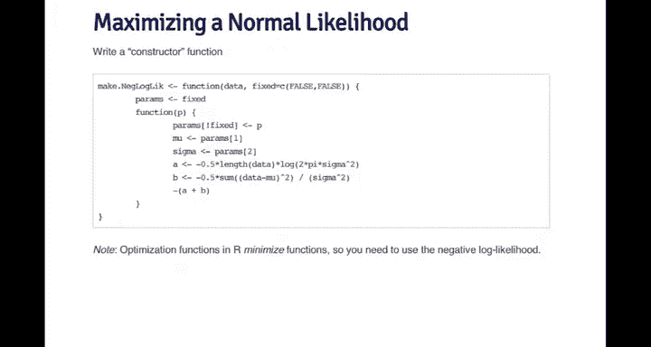
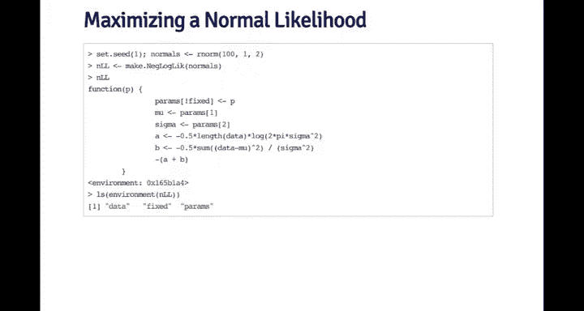
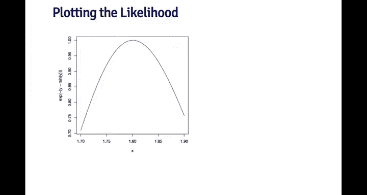
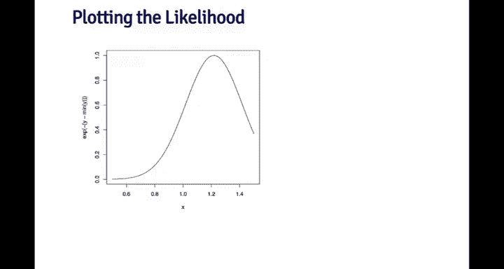

# 课程 P57：R语言作用域规则在优化中的应用示例（可选）🔧


在本节课中，我们将学习如何利用R语言的作用域规则来构建更灵活、更简洁的优化函数。我们将通过一个具体的统计示例——拟合正态分布的最大似然估计——来演示这一概念。

---

## 概述

之前我们已经讨论了R语言中的函数和作用域规则。你可能会好奇这些知识在实际中有什么用。除了编写常规的数据处理或计算函数外，作用域规则与函数的结合在统计学中非常有用，尤其是在**优化**问题中。

R语言中有几个优化例程，如 `optim`、`nlm` 和 `optimize`。它们都要求你传入一个函数，该函数的参数是一个参数向量。例如，你可能有一个函数需要在某个参数范围内最小化或最大化，而 `optim`、`nlm` 和 `optimize` 这类函数会接收这个目标函数并尝试寻找其最小值或最大值。

在统计学中，我们试图最小化或最大化的目标函数（例如对数似然函数）除了依赖于待优化的参数外，通常还依赖于其他因素，特别是**数据**。那么，如何以一种清晰、可读的编程风格来编写一个依赖于参数、数据以及其他许多因素的函数，并让用户更容易使用呢？此外，在进行此类优化时，通常需要固定某些参数，例如将一个参数设为特定值，然后优化其他参数。

---

## 核心概念：构造函数与词法作用域


R语言中解决任何优化问题的基本思路是：你可以创建一个**构造函数**来构建目标函数。这个目标函数会将其所依赖的所有数据和其他因素“打包”到其**定义环境**中。这样，每次调用该函数时，你就不需要重复指定这些数据，只需指定参数值即可。函数会自动从其封闭环境中查找这些“自由变量”。

以下是构建一个负对数似然函数构造函数的示例代码。请注意，R中的 `optim`、`nlm` 和 `optimize` 等函数默认都是**最小化**函数。因此，如果你的目标函数原本需要最大化（如似然函数），你需要取其负值，以便通过最小化来达到目的。

```r
make.NegLogLik <- function(data, fixed = c(FALSE, FALSE)) {
  params <- fixed
  function(p) {
    params[!fixed] <- p
    mu <- params[1]
    sigma <- params[2]
    # 计算正态分布的对数似然并取负值
    a <- -0.5 * length(data) * log(2 * pi * sigma^2)
    b <- -0.5 * sum((data - mu)^2) / (sigma^2)
    -(a + b)
  }
}
```

这个 `make.NegLogLik` 函数是一个构造函数。它的第一个参数是 `data`（数据）。第二个参数 `fixed` 是一个逻辑向量，用于指示哪些参数需要被固定。

在构造函数内部，我们定义了另一个函数。这个内部函数以参数向量 `p` 为输入，并返回基于正态分布假设的负对数似然值。正态分布有两个参数：均值 `mu` 和标准差 `sigma`，这就是我们要优化的两个参数。

构造函数最终返回这个内部函数作为其输出。

---

## 应用示例：拟合正态分布

现在，让我们应用这个构造函数。首先，我们模拟一些来自正态分布（均值为1，标准差为2）的随机数据。

```r
set.seed(1)
normals <- rnorm(100, 1, 2)
```

接着，我们调用构造函数，传入模拟的数据，生成我们的负对数似然函数 `nLL`。

```r
nLL <- make.NegLogLik(normals)
nLL
```

当你打印 `nLL` 函数时，会发现函数体与我们构造函数中定义的代码一致。但请注意函数底部有一个**环境标签**。这指向该函数的定义环境。当你在另一个函数内部定义一个函数时，R必须保留一个指向该定义环境的指针，以便记住所有自由变量的值。



在 `nLL` 的函数体中，变量 `data` 既不是参数，也不是局部变量，它是一个**自由变量**。它的值来源于构造函数 `make.NegLogLik`，并被存储在该函数的定义环境中。

你可以使用 `ls` 函数查看 `nLL` 函数环境中的内容：

```r
ls(environment(nLL))
```

你会看到环境中包含了 `data`、`fixed` 和 `params` 变量。这些都是在负对数似然函数内部使用的自由变量，但它们已在定义环境中被定义和固定。

---

## 进行优化

现在我们可以使用 `optim` 函数来优化我们的 `nLL` 函数。我们需要为参数 `mu` 和 `sigma` 提供初始值。

```r
optim(c(mu = 0, sigma = 1), nLL)$par
```

优化结果给出的估计值 `mu` 约为1.2，`sigma` 约为1.78，非常接近我们模拟时使用的真实值（1和2）。

---

## 固定参数进行优化

构造函数的一个强大之处在于可以轻松地固定某些参数。例如，我们可以将 `sigma` 固定为其真实值2，然后仅优化 `mu`。



首先，我们需要重新构造目标函数，这次在调用构造函数时指定 `fixed` 参数。

```r
nLL_fixed_sigma <- make.NegLogLik(normals, fixed = c(FALSE, 2))
```

现在，`nLL_fixed_sigma` 是一个只关于 `mu` 的单变量函数。我们可以使用 `optimize` 函数（专用于单变量优化）来寻找最小值。

```r
optimize(nLL_fixed_sigma, c(-1, 3))$minimum
```

优化得到的 `mu` 估计值约为1.21。

同样，我们也可以固定 `mu` 为1，然后优化 `sigma`。

```r
nLL_fixed_mu <- make.NegLogLik(normals, fixed = c(1, FALSE))
optimize(nLL_fixed_mu, c(1e-6, 10))$minimum
```


优化得到的 `sigma` 估计值约为1.8。

---

## 可视化似然函数

由于我们的目标函数已经“打包”了所有数据，并且参数设置灵活，因此绘制似然函数曲线变得非常简单。


例如，要绘制固定 `mu=1` 时，负对数似然函数随 `sigma` 变化的曲线：

```r
# 构造固定mu的函数
nLL_plot_sigma <- make.NegLogLik(normals, fixed = c(1, FALSE))
# 创建sigma的网格值
x <- seq(1, 3, len = 100)
# 计算每个sigma对应的负对数似然值
y <- sapply(x, nLL_plot_sigma)
# 绘图
plot(x, y, type = "l", xlab = expression(sigma), ylab = "Negative Log Likelihood")
```





同样，我们可以绘制固定 `sigma=2` 时，负对数似然函数随 `mu` 变化的曲线：

```r
# 构造固定sigma的函数
nLL_plot_mu <- make.NegLogLik(normals, fixed = c(FALSE, 2))
# 创建mu的网格值
x <- seq(0.5, 1.5, len = 100)
# 计算每个mu对应的负对数似然值
y <- sapply(x, nLL_plot_mu)
# 绘图
plot(x, y, type = "l", xlab = expression(mu), ylab = "Negative Log Likelihood")
```

---

## 总结

本节课中，我们一起学习了如何利用R语言的词法作用域规则来构建用于优化的目标函数。

*   **核心机制**：通过**构造函数**创建一个内部函数，该内部函数将其依赖的数据和固定参数存储在其**定义环境**中。
*   **主要优点**：
    1.  **代码简洁**：调用优化函数时，无需冗长的参数列表，只需传递待优化的参数。
    2.  **灵活性强**：可以轻松固定部分参数，仅优化其余参数，便于进行条件优化和模型比较。
    3.  **便于探索**：简化了交互式工作和探索性分析，例如绘制似然函数曲线。

这种方法使得统计建模和优化的代码更加清晰、模块化且易于维护。关于R语言词法作用域在统计计算中应用的更深入讨论，可以参考Robert Gentleman和Ross Ihaka的论文《Lexical Scope and Statistical Computing》。


通过本示例，你应该对如何将R的作用域规则应用于实际统计问题有了更具体的理解。