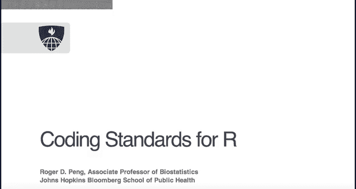
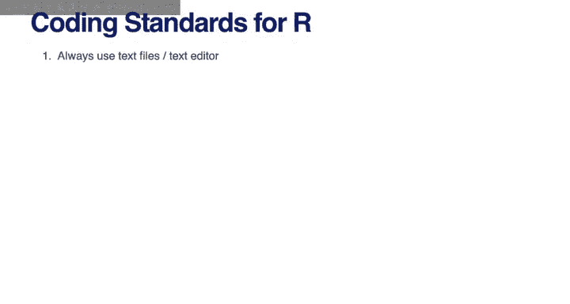
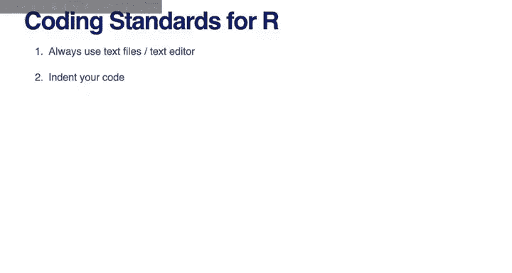
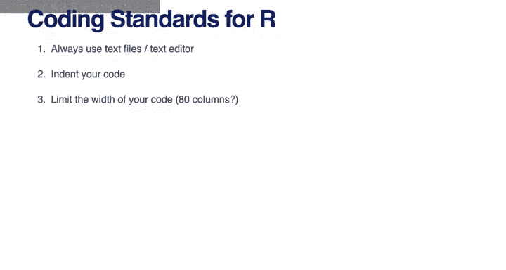
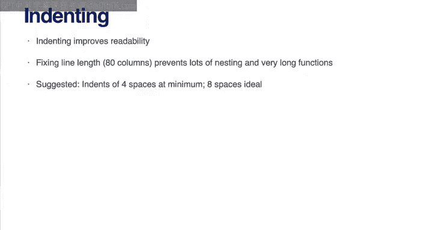
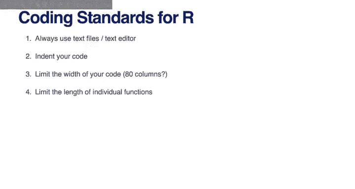

# 课程 39：R 语言编码标准 📝

在本节课中，我们将学习 R 语言编程中的编码标准。这些标准对于编写清晰、可读且易于维护的代码至关重要。我们将探讨几个核心原则，帮助你养成良好的编程习惯。

---

## 概述

编码标准在 R 语言中非常重要，因为它们能帮助你使代码更具可读性，让你和其他人能理解代码的逻辑。虽然像任何风格问题一样，很难让所有人都同意一套标准，但有几个非常基本且最低限度的标准，在 R 编程中至关重要。本节将讨论一些我认为在编写 R 代码时重要的编码标准，这些标准将使你的代码更易读、对他人更有用。

---

## 核心原则

以下是编写高质量 R 代码的几个核心原则。

### 1. 使用文本编辑器 📄

在任何编程语言中，不仅仅是 R，一个非常重要的原则是：**始终使用文本编辑器编写代码，并保存为文本文件**。

文本文件是一种基本标准。它通常没有任何格式或特殊外观，就是纯文本。通常，它是 ASCII 文本。如果你在非英语国家使用其他语言，可能会有其他标准文本格式。但基本思想是，如今任何基本的编辑程序都能读取文本格式。

当你编写代码时，应该始终尝试使用文本编辑器，因为这是最低的共同标准，能确保每个人都能访问并改进你的代码。

---

### 2. 缩进你的代码

上一节我们介绍了使用文本编辑器的重要性，本节中我们来看看如何通过缩进来提升代码的可读性。**缩进**对于代码可读性至关重要。

缩进是指不同的代码块应该比其他代码块向右多空出一些空间。仅通过缩进，你就能看出程序的控制流和流程走向。关于缩进多少合适，经常有激烈的讨论。虽然我也有一些建议，但最重要的是理解缩进为何重要。

以下是关于缩进的一些要点：
*   缩进使代码结构一目了然。
*   它有助于区分函数、循环和条件语句的起始与结束。
*   建议至少使用 **4 个空格**进行缩进。

---

### 3. 限制代码宽度

与缩进紧密相关的是第三个原则：**限制代码的宽度**。

如果你进行缩进，代码可能会无限向右延伸。因此，你需要限制代码右侧的宽度。这通常通过文本列数来控制。一种常见的做法是将文本限制在大约 **80 列**，确保你的代码宽度永远不会超过这个限制。

---

### 4. 限制函数长度

最后，我们来谈谈如何组织代码逻辑。**限制函数的长度**非常重要。

R 中的函数理论上可以写得很长。但一个逻辑的做法是，让每个函数只负责一项基本活动。例如，如果你的函数名为 `read_data`，那么它就应该只负责读取数据，而不应该同时处理数据、拟合模型和打印输出。这些逻辑步骤应该被拆分到不同的函数中。

将代码拆分成逻辑函数有几个优点：
*   将整个函数放在编辑器的一屏内，可以一目了然地看到它的全部功能。
*   当你使用 `traceback`、性能分析器或调试器时，它们会告诉你问题发生在函数调用栈的哪个位置。如果函数被逻辑清晰地分开，你就能知道去哪里修复问题。
*   如果只有一个冗长的函数，调试工具只能告诉你这个函数有问题，但很难精确定位问题所在。

当然，过度拆分，比如拥有 10 个只有三行的函数，也不是我们想要的。目标是让不同函数的分离是合乎逻辑的，并且每个函数专门做一件事。

---

## 总结

本节课中我们一起学习了 R 语言编码的四个基本准则：
1.  **始终使用文本编辑器**编写和保存代码。
2.  **始终缩进你的代码**，建议至少使用 **4 个空格**。
3.  **限制代码右侧的宽度**，例如不超过 **80 列**。
4.  **限制函数的大小**，使其按程序的逻辑部分分组。

遵循这四个原则，你的代码将更具可读性，无论是对你自己还是对他人，都将使编写 R 代码对每个人都更有用。