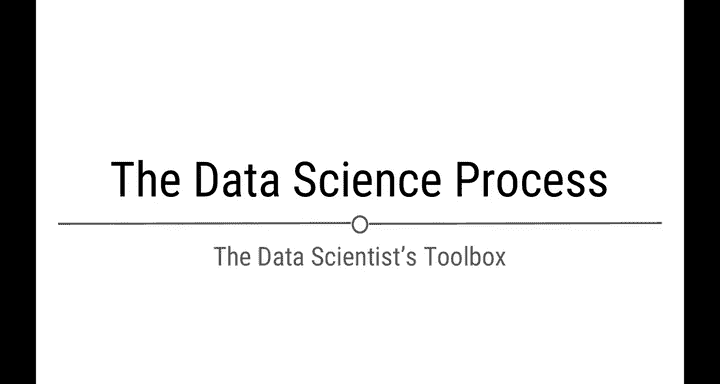
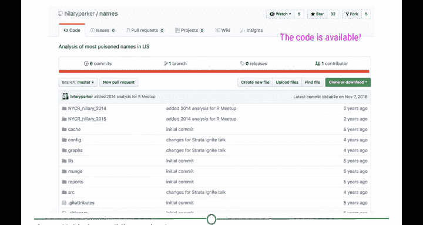
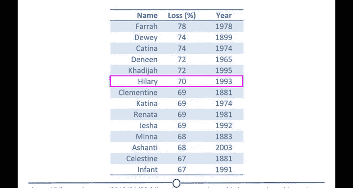
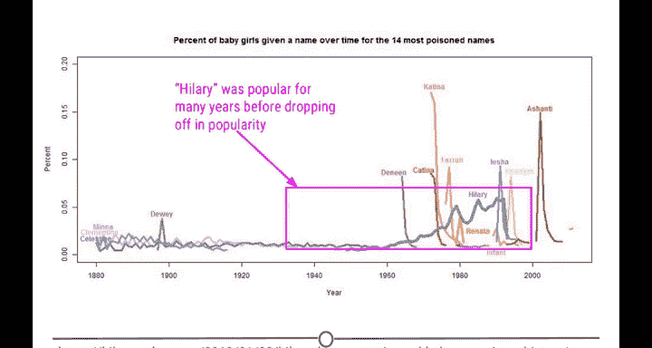
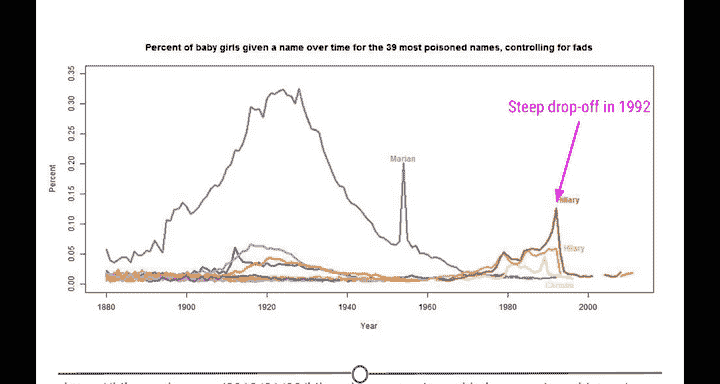
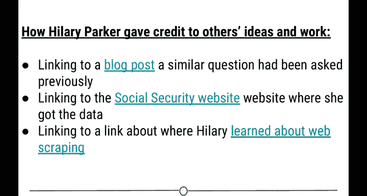
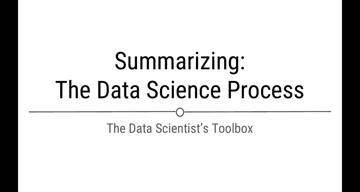

# 课程4：数据科学过程 🧭

在本节课中，我们将学习一个完整的数据科学项目包含哪些步骤。我们将通过一个实际案例，分解典型项目的各个组成部分，并了解数据科学家如何从提出问题到最终分享成果。

---

在前几节课中，我们讨论了数据和数据科学的定义以及寻求帮助的方法。我们尚未涉及的是一个实际的数据科学项目具体是怎样的。

为此，我们将首先剖析一个真实的数据科学项目，分解典型项目的各个部分，然后提供一些其他有趣数据科学项目的链接。本节课的目标是让大家了解执行数据科学项目时所经历的过程。

## 数据科学项目的核心步骤

每个数据科学项目都始于一个需要用数据来回答的问题。这意味着，明确问题是过程中的重要第一步。

第二步是寻找或生成你将用来回答该问题的数据。

在问题明确且数据在手之后，就可以开始分析数据了。首先是对数据进行探索，然后通常会对数据进行建模，这意味着使用一些统计或机器学习技术来分析数据并回答你的问题。

从分析中得出结论后，必须将项目成果传达给他人。有时这是你发送给老板或工作团队的报告，有时是一篇博客文章，通常也可能是向同事小组进行的演示。无论如何，数据科学项目几乎总是涉及以某种形式传达项目发现。

下面我们将通过一个数据科学项目示例来逐步讲解这些步骤。

## 案例研究：希拉里是最“毒”的婴儿名吗？

在这个示例中，我们将使用一位名叫希拉里·帕克的数据科学家的分析案例。她的工作可以在她的博客上找到。

我们将要研究的这个具体项目来自2013年，标题为“希拉里：美国历史上最‘毒’的婴儿名”。为了从本节课中获得最大收益，请点击该链接并阅读希拉里的博文。完成后，请返回本节课并阅读对该博文的分解分析。

### 第一步：明确问题

开始一个数据科学项目时，最好能清晰地定义你的问题。在分析过程中可能会冒出其他问题，但明确你想通过分析回答什么是非常重要的第一步。

希拉里·帕克的问题在她的博文中以粗体标出，这清楚地表明她有兴趣回答以下问题：**希拉里（Hillary/Hilary）真的是美国有记录以来流行度下降最快的名字吗？**

### 第二步：获取数据

为了回答这个问题，希拉里从社会保障局网站收集了数据。该数据集包含了从1880年到2011年每年最流行的1000个婴儿名字。

### 第三步：分析与计算

正如博客文章中所解释的，希拉里感兴趣的是计算她数据中4110个不同名字从1880年到2011年每年到下一年之间的相对风险。手动计算这将是一场噩梦。幸运的是，通过在R中编写代码（所有代码都在GitHub上可用），希拉里能够为所有这些名字在所有这些年里生成这些数值。

目前并不需要完全理解相对风险计算是什么（尽管希拉里在她的帖子中做了很好的分解），但重要的是要知道，在整理好数据之后，下一步就是弄清楚你需要对这些数据做什么才能回答你的问题。

对于希拉里的问题，计算每个名字从1880年到2011年每年到下一年之间的相对风险，并查看每个名字在特定年份的婴儿占比，就是她为回答问题需要做的事情。

你在博客文章中看不到的是希拉里编写的所有代码：从社会保障局网站获取数据、将其转换为分析所需的格式以及生成图表。如上所述，她将所有代码都放在了GitHub上，以便其他人可以看到她的工作并在需要时重复她的步骤。

除了这些代码，数据科学项目通常还涉及编写大量代码和生成许多最终结果中未包含的图表。这也是数据科学过程的一部分：弄清楚如何做你想做的事情来回答你感兴趣的问题是过程的一部分，它并不总是出现在你的最终项目中，并且可能非常耗时。

### 第四步：探索与验证

鉴于希拉里现在已经计算出了必要的数值，她开始分析数据。她做的第一件事是查看从一年到下一年百分比下降幅度最大的名字。

通过这个初步分析，希拉里排名第六，这意味着有五个其他名字的受欢迎程度单年下降幅度超过了希拉里这个名字在1992年到1993年间的下降幅度。

在查看分析结果时，前五个名字对希拉里·帕克来说显得很奇特。在任何分析中，考虑结果是否符合你的预期总是好的。它们似乎都不是长期流行的名字。为了验证这个直觉是否正确，希拉里绘制了每年出生的婴儿中拥有这些名字的百分比图表。

她发现，在这些“有毒”的名字（即受欢迎程度从一年到下一年大幅下降的名字）中：

除了希拉里之外的名字都是突然流行起来，然后受欢迎程度就下降了。希拉里·帕克能够找出为什么大多数其他名字会流行起来（所以一定要阅读她帖子中的那个部分）。

然而，希拉里这个名字则不同。它流行了一段时间，然后完全失去了受欢迎程度。为了弄清楚希拉里这个名字具体发生了什么，她剔除了那些在下降前只流行了很短时间的名字，只关注那些在1000名内停留超过20年的名字。

这项分析的结果明确显示，在1880年至2011年间，希拉里是1992年所有女性婴儿名中受欢迎程度下降最快的。玛丽昂的下降则是多年逐渐发生的。

### 第五步：沟通与分享

在这个数据分析过程的最后一步，一旦希拉里·帕克回答了问题，就是时候与世界分享了。任何数据科学项目的一个重要部分是有效地传达项目结果。

希拉里通过撰写一篇精彩的博客文章来做到这一点，传达了分析结果，回答了她最初提出的问题，并且以一种有趣的方式完成。

此外，重要的是要注意，大多数项目都是建立在他人工作的基础上的。给予这些人信任非常重要。希拉里通过链接到之前有人提出类似问题的博客文章、她获取数据的社会保障局网站以及她学习网络爬虫的地方来做到这一点。

## 用R构建的数据科学项目示例

希拉里的工作是使用R编程语言完成的。在本系列课程中，你将学习R编程的基础知识、探索和分析数据，以及如何构建报告和网络应用程序，以便有效地传达你的结果。

为了给你一个使用R编程和一系列可用工具可以构建的东西的例子，以下是使用数据科学过程和R编程语言构建的一些示例，也是你在本系列课程结束时能够生成的东西的类型。

宾夕法尼亚大学的研究生着手预测罗德岛普罗维登斯阿片类药物过量的风险。他们详细介绍了他们使用的数据、清理数据的步骤、可视化过程以及最终结果。虽然细节现在不重要，但了解过程和可以生成的报告类型很重要。

此外，他们创建了一个Shiny应用程序，这是一个交互式网络应用程序。这意味着你可以选择要关注的普罗维登斯社区。所有这些都是使用R编程构建的。

以下是比上述示例规模更小的项目，但同样是数据科学项目。在每个项目中，作者都有一个他们想回答的问题，并使用数据来回答。他们探索、可视化并分析了数据，然后撰写博客文章来传达他们的发现。请查看以了解更多关于所列主题的信息，并了解其他人如何完成数据科学项目过程并传达他们的结果。

*   **天气偏好分析**：My Al Salmon试图使用数据来查看，根据天气偏好，一个人应该住在美国哪里。
*   **特朗普推文分析**：David Robinson对特朗普的推文进行了分析，以表明特朗普只亲自撰写那些更愤怒的推文。
*   **多伦多性健康诊所地图**：Charlotte Geellfin使用多伦多市提供的开放数据构建了一个包含性健康诊所信息的地图。

## 总结 📝

在本节课中，我们希望我们已经传达出，有时数据科学项目处理的是困难的问题（例如“我们能预测阿片类药物过量的风险吗？”），而其他时候，项目的目标则是回答你个人感兴趣的问题（例如“希拉里是美国有记录以来最‘毒’的婴儿名吗？”）。

无论哪种情况，过程都是相似的：你必须形成你的问题、获取数据、探索和分析你的数据，并传达你的结果。通过本系列课程中学到的工具，你将能够着手并执行自己的数据科学项目，就像本节课中包含的示例一样。

