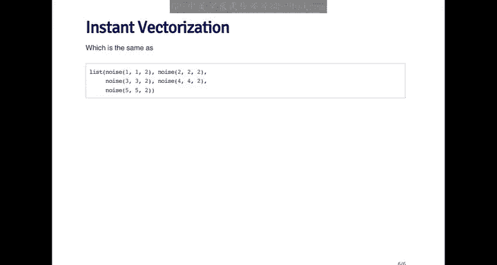

# 课程 43：循环函数 mapply 🌀


在本节课中，我们将学习 R 语言中的 `mapply` 函数。`mapply` 是 `lapply` 和 `sapply` 函数的多变量版本，它能够并行地对多组参数应用一个函数。我们将通过简单的例子来理解它的工作原理和用途。

---

## 概述：什么是 mapply？

`mapply` 是一个循环函数，它是之前学过的 `lapply` 和 `sapply` 函数的多变量版本。其核心思想是**并行地对多组不同的参数应用一个函数**。

我们注意到，之前的函数如 `lapply`、`sapply`、`tapply` 都只能对**单个对象**的元素应用函数。例如，`lapply` 的输入是一个列表，函数会应用于该列表的每个元素。

那么，如果你有两个列表，并且第一个列表的元素需要作为函数的第一个参数，第二个列表的元素需要作为函数的第二个参数，该怎么办呢？`lapply` 和 `sapply` 无法直接处理这种情况。一种方法是编写一个 `for` 循环来索引每个列表的元素，然后将函数应用于这些元素。

然而，另一种更简洁的方法是使用 `mapply`。`mapply` 可以接受多个列表作为参数，并**并行地**将函数应用于这些列表的对应元素上。

---

## mapply 的函数参数

`mapply` 的函数参数略有不同，因为它需要允许可变数量的参数。

以下是 `mapply` 的主要参数：
*   **第一个参数**：要应用的函数。这个函数必须至少接受与传递给 `mapply` 的列表数量一样多的参数。
*   **`...` 参数**：将要被强制转换为列表的对象（即你的多个列表参数）通过 `...` 传递。
*   **`MoreArgs` 参数**：如果你的函数还需要其他固定的参数，可以在这里传递。
*   **`simplify` 参数**：与 `sapply` 和 `tapply` 中的 `simplify` 参数类似，用于控制结果的简化。

---

## 示例 1：使用 mapply 简化列表创建

假设我们需要创建一个列表，其内容为：数字 `1` 重复4次，数字 `2` 重复3次，数字 `3` 重复2次，数字 `4` 重复1次。

手动创建这个列表比较繁琐：
```r
list(rep(1, 4), rep(2, 3), rep(3, 2), rep(4, 1))
```

使用 `mapply` 可以非常简洁地完成：
```r
mapply(rep, 1:4, 4:1)
```
在这个例子中：
*   函数 `rep` 有两个参数：要重复的对象 `x` 和重复次数 `times`。
*   我们传递了两组参数：第一组是 `1:4`，第二组是 `4:1`。
*   `mapply` 会并行地应用 `rep` 函数：`rep(1, 4)`、`rep(2, 3)`、`rep(3, 2)`、`rep(4, 1)`，最终生成我们想要的列表。

---

## 示例 2：向量化非向量化函数

让我们看一个更实际的例子。假设我们有一个自定义函数 `noise`，用于生成指定数量、均值和标准差的正态分布随机数。

函数定义如下：
```r
noise <- function(n, mean, sd) {
  rnorm(n, mean, sd)
}
```
如果使用一组参数调用，它能正常工作：
```r
noise(5, 1, 2) # 生成5个均值为1、标准差为2的随机数
```

但是，如果我们尝试传递向量参数，它不会按预期工作：
```r
noise(1:5, 1:5, 2)
```
我们期望的结果是：生成1个均值为1的随机数，2个均值为2的随机数，3个均值为3的随机数，以此类推。但直接传递向量无法实现这个效果。

这时，`mapply` 就派上用场了。我们可以用 `mapply` 来“即时向量化”这个函数：
```r
mapply(noise, 1:5, 1:5, 2)
```
现在，`mapply` 并行地应用 `noise` 函数：
1.  `noise(1, 1, 2)` -> 1个随机数，均值1
2.  `noise(2, 2, 2)` -> 2个随机数，均值2
3.  `noise(3, 3, 2)` -> 3个随机数，均值3
4.  `noise(4, 4, 2)` -> 4个随机数，均值4
5.  `noise(5, 5, 2)` -> 5个随机数，均值5

这样就得到了我们期望的结果。这等同于手动写出包含这五个函数调用的列表，但使用 `mapply` 更加高效和简洁。

---

## 总结

本节课我们一起学习了 `mapply` 函数。

*   `mapply` 是 `lapply` 系列函数中的多变量版本，用于**并行地对多组参数应用一个函数**。
*   它特别适用于需要将函数应用于多个列表或向量对应元素的情况。
*   通过 `mapply`，我们可以轻松地将一个原本不支持向量化输入的函数进行“即时向量化”，从而避免编写复杂的循环代码。



掌握 `mapply` 能让你在处理需要多参数并行计算的任务时，写出更简洁、更高效的 R 代码。