# 课程 45：split 函数详解 🧩

在本节课中，我们将学习 `split` 函数。`split` 函数本身并非循环函数，但它是一个非常有用的工具，常与 `lapply` 或 `sapply` 等函数结合使用。它的核心功能是将一个向量或对象按照因子变量的不同水平拆分成多个部分。

## split 函数的基本原理

`split` 函数类似于 `tapply`，但它不直接应用汇总统计。它的作用是接收一个对象 `X` 和一个因子变量 `F`，然后根据 `F` 中定义的组别将 `X` 拆分开来。


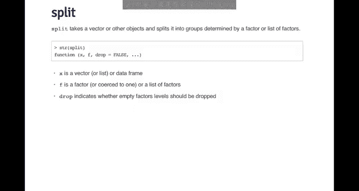


例如，如果因子 `F` 有三个水平，代表三个组，那么 `split` 函数就会将 `X` 拆分成三个组。


```r
split(x, f)
```

一旦数据被拆分成组，你就可以使用 `lapply` 或 `sapply` 对每个组应用特定的函数。

## 一个简单的示例

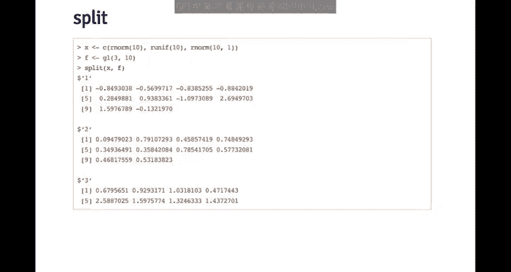

以下是一个简单的示例。我们模拟生成了三组数据：10个均值为0的正态分布随机数、10个均匀分布随机数，以及10个均值为1的正态分布随机数。我们创建一个因子变量来标识这三组数据，然后使用 `split` 函数拆分向量。

```r
x <- c(rnorm(10), runif(10), rnorm(10, 1))
f <- gl(3, 10)
split(x, f)
```

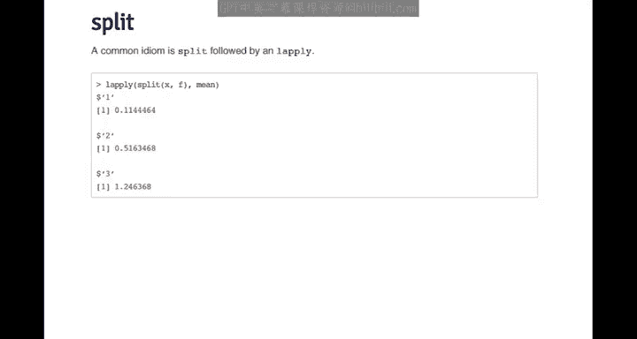

运行后，`split` 会返回一个列表。列表的第一个元素包含10个正态随机数，第二个元素包含10个均匀随机数，第三个元素包含另外10个正态随机数。

`split` 函数总是返回一个列表。如果你想对这个列表进行操作，可以使用 `lapply` 或 `sapply`。

## 结合 lapply 使用 split

将 `lapply` 与 `split` 结合使用是一种常见做法。其思路是先拆分数据，然后对拆分后的列表应用 `lapply` 函数。

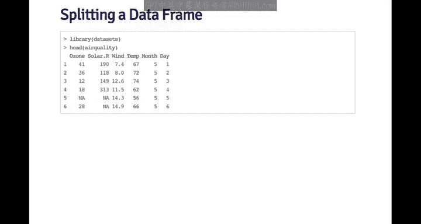

虽然在这个例子中，使用 `tapply` 函数可以达到同样的效果，并且代码更简洁，但 `split` 函数的优势在于它可以拆分更复杂的对象类型。

## 拆分数据框的示例

上一节我们介绍了如何拆分向量，本节中我们来看看如何拆分更复杂的对象，比如数据框。

我们以 `datasets` 包中的 `airquality` 数据框为例。这个数据框包含臭氧、太阳辐射、风速和温度等变量的测量值，以及月份和日期信息。

假设我们想计算每个月内臭氧、太阳辐射和风速的平均值。我们可以先将数据框按月份拆分，然后对每个拆分后的月度数据框计算列均值。

以下是具体步骤：

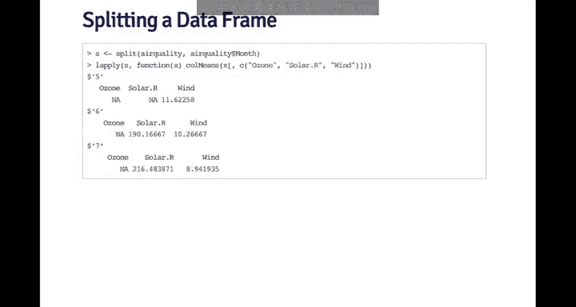

1.  使用 `split` 函数，根据 `Month` 变量拆分 `airquality` 数据框。
2.  对拆分后的列表应用一个匿名函数，该函数计算指定列（臭氧、太阳辐射、风速）的均值。

```r
s <- split(airquality, airquality$Month)
lapply(s, function(x) colMeans(x[, c("Ozone", "Solar.R", "Wind")]))
```

运行后，`lapply` 会返回一个列表，其中每个元素都是一个长度为3的向量，分别代表该月内臭氧、太阳辐射和风速的平均值。注意，由于原始数据中存在缺失值（`NA`），直接计算均值会得到 `NA`。

我们可以使用 `sapply` 来简化输出结果，它会将列表转换为一个更紧凑的矩阵格式。

```r
sapply(s, function(x) colMeans(x[, c("Ozone", "Solar.R", "Wind")]))
```

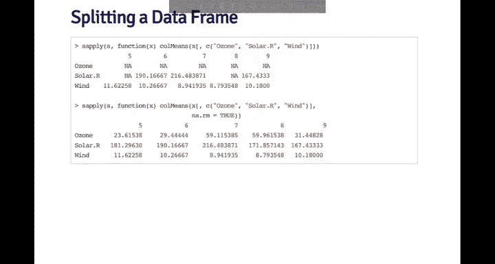

为了处理缺失值，我们可以在计算列均值时传入 `na.rm = TRUE` 参数。

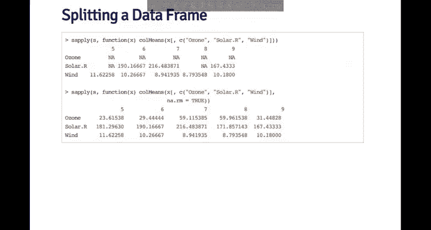

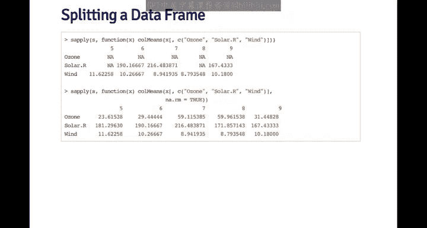

```r
sapply(s, function(x) colMeans(x[, c("Ozone", "Solar.R", "Wind")], na.rm = TRUE))
```

现在，我们得到了五个月份中三个变量观测值的均值矩阵。

`split` 函数非常方便，它可以根据因子的水平拆分任意对象，然后对拆分后的列表元素应用任何函数。

## 基于多个因子进行拆分


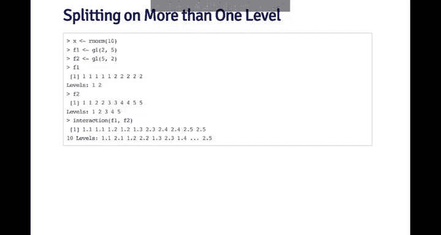

之前我们只使用了单个因子进行拆分，但有时你可能需要基于多个因子进行拆分。例如，你可能有一个性别因子（男/女）和一个种族因子，你想查看这两个因子所有水平组合下的数据。

以下是如何操作：


1.  创建两个因子变量 `f1` 和 `f2`。
2.  使用 `interaction` 函数将两个因子的所有水平组合起来，生成一个新的交互因子。
3.  使用 `split` 函数，根据这个交互因子拆分数据向量。

实际上，在使用 `split` 函数时，你可以直接传入一个包含多个因子的列表，它会自动调用 `interaction` 函数。

```r
x <- rnorm(10)
f1 <- gl(2, 5)
f2 <- gl(5, 2)
split(x, list(f1, f2))
```

拆分后，返回的列表会包含所有因子水平组合（即使某些组合没有观测值）。这些空的组合级别有时并不需要。

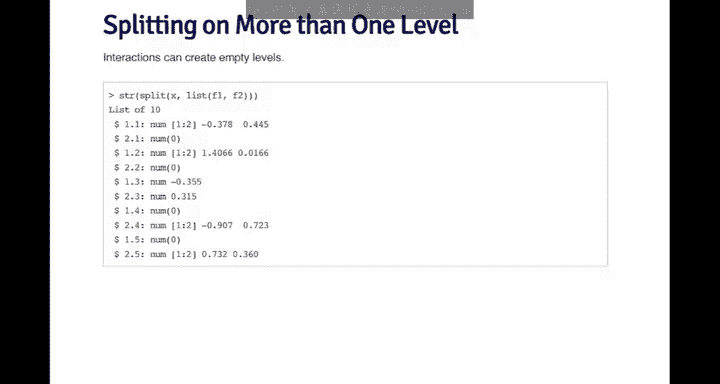


`split` 函数有一个 `drop` 参数。设置 `drop = TRUE` 可以删除拆分过程中产生的空级别。这在组合多个因子时非常有用，因为你通常不会观测到所有可能的组合。

```r
split(x, list(f1, f2), drop = TRUE)
```

这样，返回的列表将只包含有观测值的组合级别。

## 总结


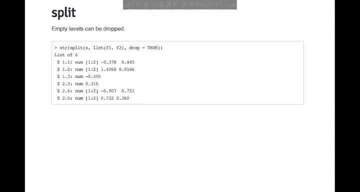


本节课中我们一起学习了 `split` 函数。我们了解到 `split` 函数可以根据一个或多个因子变量的水平，将向量或数据框等对象拆分成多个部分，并返回一个列表。这个列表可以方便地与 `lapply`、`sapply` 等函数结合，对每个分组进行计算或分析。我们还学习了如何处理基于多个因子的拆分，以及如何使用 `drop` 参数来简化输出结果。`split` 是数据分组处理中一个非常实用的工具。