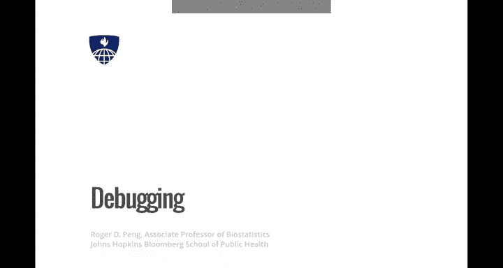
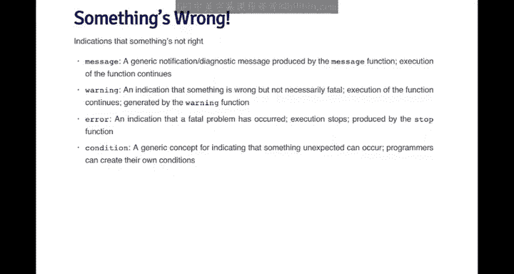
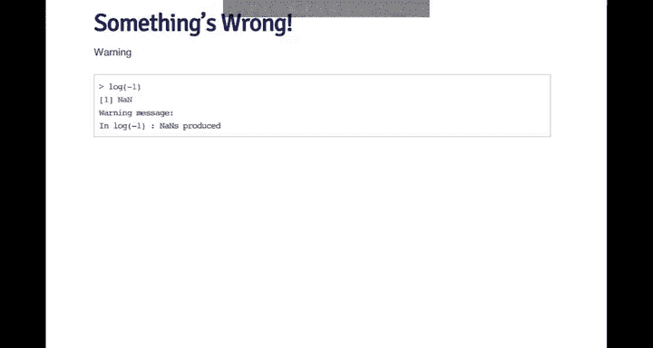
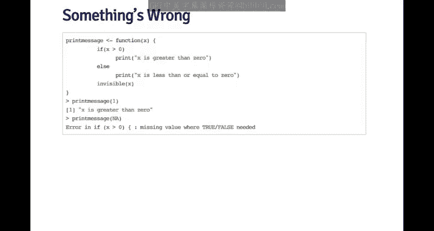
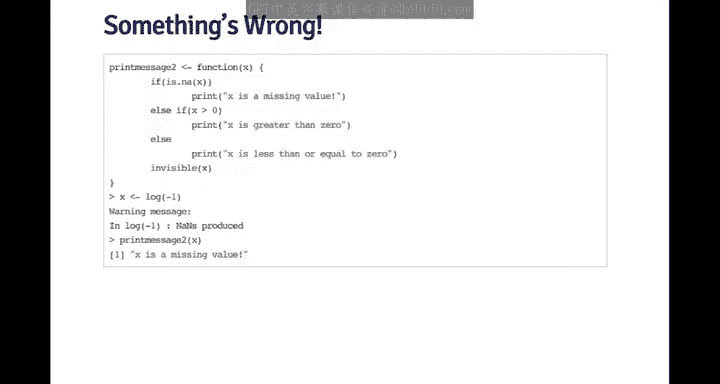
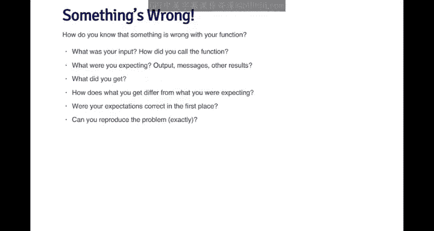

# 课程46：R语言调试工具 🐛



在本节课中，我们将学习R语言内置的调试工具。这些工具无需安装任何包，可以帮助我们在发现问题后，找出代码中的错误所在。

## 如何发现问题

在开始调试之前，我们首先需要知道问题已经发生。R语言会通过几种不同的指示来告知我们，这些指示大致可以分为三个等级。

以下是R语言中三种主要的指示类型：

*   **消息**：这是一种非常温和的通知。它可能只是一个诊断信息，表明发生了某些事情，但通常不会影响程序运行。消息不会停止函数的执行，它只会被打印到屏幕上，然后函数会继续运行。
*   **警告**：警告表明发生了预期之外的事情，但这不一定是致命问题。很多时候，我们甚至会选择忽略警告。当函数期望得到一种结果，却得到了略有不同的东西时，就可能触发警告。警告会在函数执行**结束后**出现，不会中断函数的执行过程。
*   **错误**：错误是致命问题。它会立即停止函数的执行。错误信息由 `stop()` 函数产生。



此外，还有一个更高级的概念叫做“条件”。消息、警告和错误都属于“条件”。理论上，你甚至可以创建自定义的条件类型，但这超出了本课程的范围。

## 指示类型示例



上一节我们介绍了三种指示类型，本节我们通过具体例子来看看它们在实际中是什么样子。

### 警告示例

一个典型的警告例子是计算负数的对数。在R中执行 `log(-1)` 会返回 `NaN`（非数字），同时产生一条警告信息：“NaNs produced”。这种警告通常可以接受，例如当你对一组数字取对数，其中包含一些负数，但你并不在意时。

### 消息示例

这里有一个我创建的小函数：

```r
printmessage <- function(x) {
    if(x > 0) {
        print(paste("x is greater than 0"))
    } else {
        print(paste("x is less than or equal to 0"))
    }
    invisible(x)
}
```

这个函数检查输入值 `x`。如果 `x` 大于0，则打印“x is greater than 0”；如果小于或等于0，则打印“x is less than or equal to 0”。函数最后使用 `invisible(x)` 返回输入值 `x`，但不会自动打印它。

`invisible()` 函数的作用是阻止自动打印。通常，在命令行执行一个函数时，R会自动打印函数返回的最后一个对象。使用 `invisible()` 后，对象仍会被返回，但不会自动显示在控制台上。`load()` 函数就是一个例子，它加载保存的工作空间对象，并返回加载的对象名称，但这个返回值是隐式的，不会打印出来。



现在，调用 `printmessage(1)`，我们会看到消息“x is greater than 0”，并且数字1不会被打印出来。

### 错误示例

如果我们向 `printmessage` 函数传入 `NA`，会发生什么呢？执行 `printmessage(NA)` 会导致错误。因为表达式 `if(x > 0)` 无法处理 `NA` 值（`NA` 既不是 `TRUE` 也不是 `FALSE`），所以R会报错并停止执行。



## 调试的核心：对比预期与实际

很多时候，问题并不像错误那样明显。代码可能没有报错，但结果却不符合我们的预期。这正是调试的关键所在。

为了修复上面的错误，我创建了一个新函数 `printmessage2`，它首先检查输入是否为 `NA`：

```r
printmessage2 <- function(x) {
    if(is.na(x)) {
        print("x is a missing value!")
    } else if(x > 0) {
        print("x is greater than 0")
    } else {
        print("x is less than or equal to 0")
    }
    invisible(x)
}
```

现在，假设我计算 `log(-1)` 并将结果赋值给 `x`。虽然会得到一个警告，但程序会继续执行。然后我调用 `printmessage2(x)`。我原本期望看到“x is greater than 0”，但实际上却看到了“x is a missing value!”。这里没有错误，但结果与我的预期不符。这就是一个需要调试的典型场景。

## 调试时需回答的关键问题

当你怀疑函数有问题时，需要系统地回答以下几个问题，这能帮助你定位问题根源：

*   **你实际输入了什么？** 仔细检查你传递给函数的实际输入值，而不是你以为的输入值。在上例中，我以为输入了一个正数，但实际上输入的是 `NaN`。
*   **你是如何调用函数的？** 回想调用函数时使用的具体参数。
*   **你期望得到什么输出？** 清晰地表达你期望的结果至关重要，无论是向自己还是向他人求助时。你期望看到特定的消息，还是特定的数值结果？
*   **你实际得到了什么输出？** 实际结果是什么？
*   **实际结果与期望结果有何不同？** 对比两者之间的差异。
*   **你的期望本身是否正确？** 有时，问题可能出在我们的预期上。我们可能错误地理解了函数的功能。
*   **你能重现这个问题吗？** 这是调试中最关键的一点。你必须能够稳定地重现导致问题的步骤，否则将很难定位和修复它。对于涉及随机数的问题，使用 `set.seed()` 固定随机种子至关重要。虽然网络编程或并行计算中的问题可能难以重现，但对于大多数本地运行的问题，重现通常是可行的。

## 总结



本节课中，我们一起学习了R语言内置的调试工具。我们首先了解了R发出问题信号的三种方式：消息、警告和错误。然后，我们通过实例观察了它们的不同表现。更重要的是，我们探讨了调试的核心思路：当实际结果与预期不符时，如何通过一系列关键问题（如“输入是什么？”、“期望是什么？”、“能否重现？”）来系统地定位和解决问题。掌握这些基础概念，是成为高效调试者的第一步。