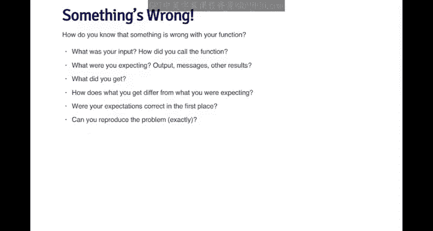
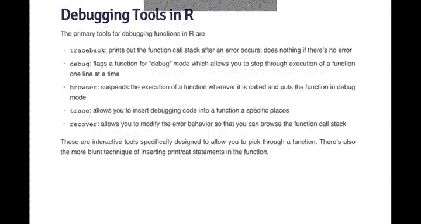
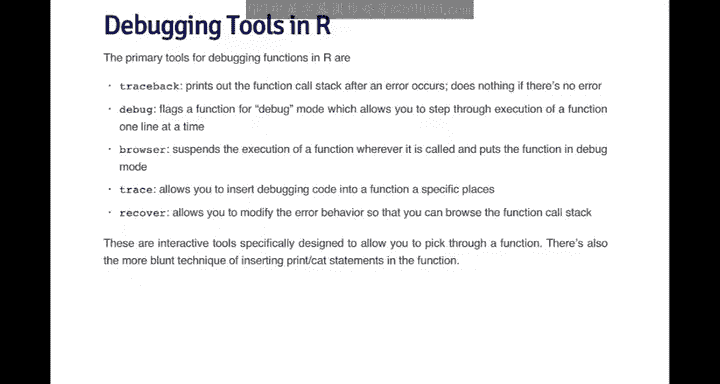
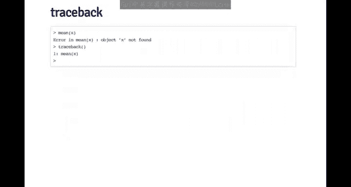

# 课程 47：R语言调试基础工具 🐛

在本节课中，我们将学习R语言内置的五个核心调试函数。这些工具能帮助你定位和修复代码中的错误。

R语言提供了一系列内置函数来辅助程序调试。虽然许多R用户可以在很长一段时间内不使用这些工具，但在某些复杂情况下，它们会非常有用。

## 1. `traceback` 函数：追踪调用栈

上一节我们介绍了调试工具的存在，本节中我们来看看第一个基础工具。

`traceback` 函数用于打印出所谓的“函数调用栈”。通常，当你调用一个函数时，该函数可能调用另一个函数，如此层层深入。错误可能发生在调用链的深处。`traceback` 会告诉你当前处于第几层函数调用，以及错误发生在哪里，帮助你定位错误在哪个调用环节出现。

## 2. `debug` 函数：进入调试模式

接下来，我们看看最实用的工具之一。

`debug` 函数接受一个函数作为参数，并将该函数标记为调试模式。这意味着，无论何时何地执行该函数（即使是被其他函数调用），执行都会在函数的第一行暂停，进入“浏览器”模式。在此模式下，你可以逐行执行函数内的代码，一次执行一个表达式，从而精确定位发生错误的代码行。

## 3. `browser` 函数：在任意点暂停

`browser` 函数与 `debug` 相关，但提供了更灵活的控制。

你可以在代码中的任意位置插入 `browser()` 函数调用。当执行到该行时，函数会暂停，然后你可以从此处开始逐行执行。这在你不想从函数开头开始调试，而是希望运行到某个中间点再暂停检查时非常有用。

## 4. `trace` 函数：非侵入式调试

有时你需要调试他人编写的代码，例如R包或基础R中的函数，直接编辑源代码可能不方便。`trace` 函数就是为了解决这个问题。

`trace` 函数允许你在不实际编辑函数源代码的情况下，向函数中插入调试代码（通常就是插入一个 `browser()` 调用）。调试完成后，你可以关闭追踪，函数将恢复正常。

## 5. `recover` 函数：错误处理与检查

最后一个工具是 `recover` 函数，它与 `traceback` 相关，但功能更强大。

默认情况下，R遇到错误时会显示错误信息并停止执行，将控制权交还给控制台。`recover` 是一个错误处理函数，它可以改变这一行为。当设置 `recover` 后，一旦在函数执行中遇到错误，R解释器会在错误发生处暂停执行，并打印出函数调用栈。然后，你可以在浏览器模式下“跳转”到调用栈的不同层级进行检查，查看各层函数的环境和数据状态。

## 调试策略与思考

除了使用上述函数，一个简单直接的调试方法是在代码中插入 `print` 或 `cat` 语句来输出变量的值。这种方法简单有效，很多问题仅靠它就能解决。

但其缺点是，在长代码中可能需要插入大量打印语句，调试完成后又需逐一删除，略显繁琐。此外，有观点认为过度依赖调试器（如逐行跟踪）可能会助长草率的编码习惯，因为开发者可能会倾向于先写代码，出了问题再依赖调试器去查找，而不是在编写时就仔细思考逻辑。

尽管如此，合理使用调试工具是高效编程的重要组成部分。作者本人就经常使用这些函数。

---

本节课中我们一起学习了R语言的五个核心调试工具：`traceback`、`debug`、`browser`、`trace` 和 `recover`。它们分别用于追踪错误位置、逐行调试、在指定点暂停、非侵入式调试以及交互式错误检查。理解并适时运用这些工具，将极大提升你诊断和修复R代码问题的能力。