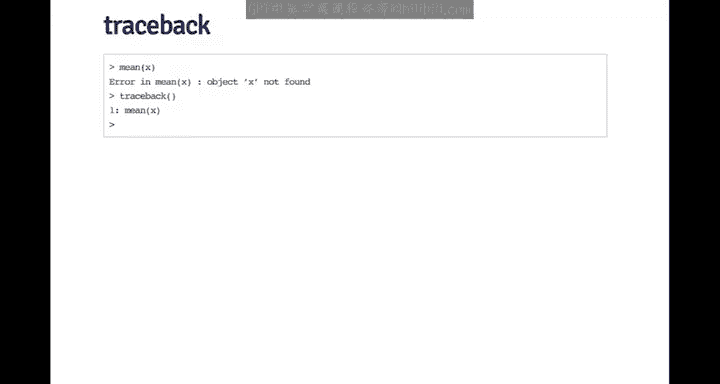
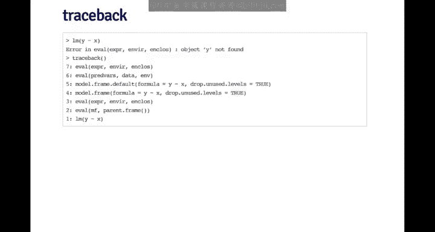
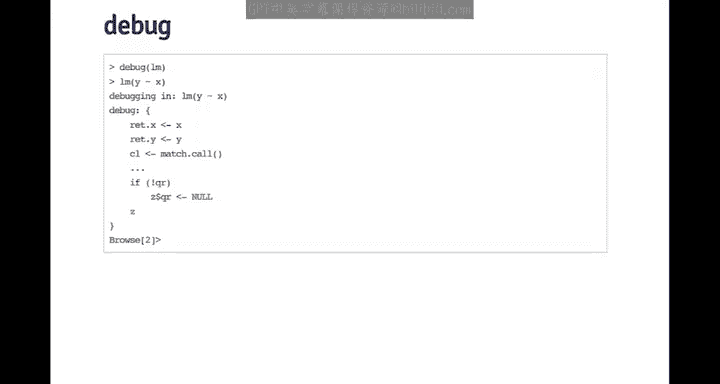
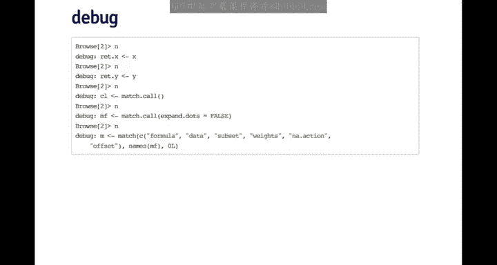
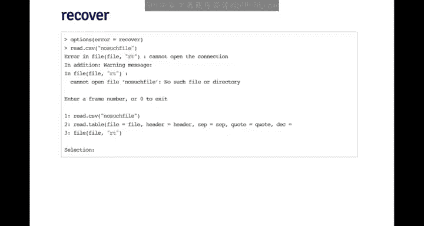
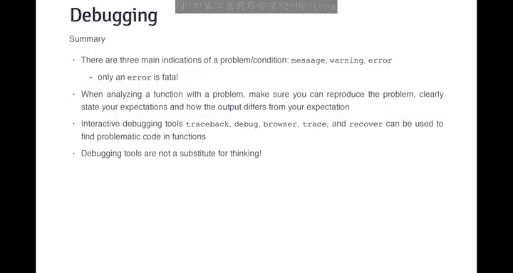
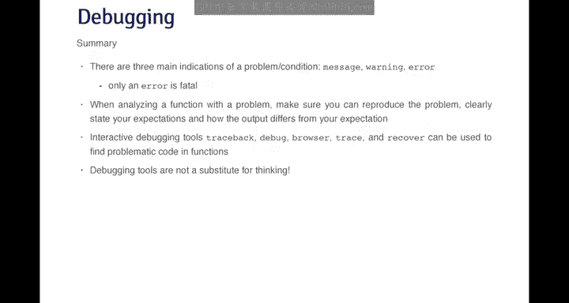
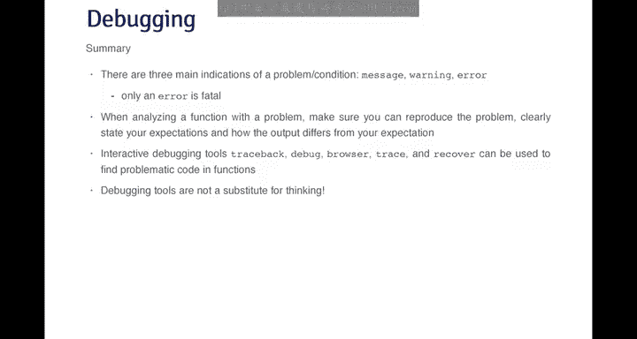

# 课程 48：R语言调试工具使用指南 🔧

在本节课中，我们将学习R语言中几种关键的交互式调试工具，包括 `traceback`、`debug` 和 `recover`。这些工具能帮助你在代码出错时，快速定位问题所在，理解错误发生的上下文。

---

## 概述：理解错误与调试

在编写R代码时，你可能会遇到三种指示问题的信号：**消息（message）**、**警告（warning）** 和 **错误（error）**。其中，只有错误会立即停止函数的执行。调试的核心在于能够复现问题，并清晰地描述你的预期结果与实际输出之间的差异。

上一节我们介绍了错误的基本概念，本节中我们来看看如何利用R内置的工具来追踪和诊断这些错误。

---

## 使用 `traceback` 追踪错误调用栈 🧵

`traceback` 函数用于显示导致错误的函数调用序列（即调用栈）。这对于理解错误在复杂的嵌套函数调用中发生在哪一层非常有用。



**关键点**：你必须在错误发生后**立即**调用 `traceback()`。如果之后执行了其他代码，`traceback` 将只显示最近一次的错误信息。

### 简单示例

以下是一个简单的错误示例。我们尝试计算一个不存在的对象 `X` 的均值。

```r
mean(X)  # 错误：对象 'X' 未找到
```

调用 `traceback()` 后，输出可能非常简单，因为错误就发生在 `mean` 函数的最顶层，它没有调用其他函数。在这种情况下，`traceback` 的作用有限。

### 复杂示例



一个更有趣的例子是使用 `lm`（线性模型）函数。

```r
lm(y ~ x)  # 错误：对象 'y' 未找到
```

调用 `traceback()` 可能会显示一个长达七层的调用栈。它揭示了 `lm` 函数内部如何通过一系列 `eval` 和 `model.frame` 调用来尝试评估公式 `y ~ x`，最终在第七层因为找不到 `y` 和 `x` 而失败。

**何时有用**：当你通过邮件等方式向他人求助时，提供 `traceback()` 的输出非常有用，因为它能清晰地展示错误发生的函数调用层次。

---

## 使用 `debug` 和 `browser` 进行逐步调试 🔍

`debug` 函数允许你以“浏览器（browser）”模式逐步执行任何函数（无论是否由你编写）。这是一种强大的交互式调试方式。

### 启动调试



你可以使用 `debug(lm)` 命令来调试 `lm` 函数。之后，当你再次调用 `lm(y ~ x)` 时，R会立即进入调试模式。

进入调试模式后：
1.  R会首先打印出 `lm` 函数的完整代码体。
2.  你会看到一个 `Browse>` 提示符，表示你已进入浏览器环境。

### 浏览器环境

在浏览器环境中：
*   你的工作空间（环境）是该函数内部的局部环境。
*   最初，环境中只包含函数的参数（例如，公式 `y ~ x`）和具有默认值的其他参数。

### 逐步执行

在 `Browse>` 提示符下，你可以：
*   按 `n` 然后回车，来**逐行执行**函数代码。
*   一直按 `n`，直到执行到引发错误的那一行。此时，你会看到与之前相同的错误信息，但你现在确切知道错误发生在哪一行代码。
*   你甚至可以在调试器中嵌套调试。例如，在执行到某个内部函数（如 `model.frame`）时，你可以调用 `debug(model.frame)`，然后进入该函数的调试环境。这就像浏览器帧的堆栈，你可以深入多层进行探查。



---

## 使用 `recover` 作为错误处理程序 🛠️

`recover` 函数可以设置为全局的错误处理程序。当错误发生时，它不会直接停止并返回控制台，而是提供一个交互式菜单，让你选择进入调用栈中任意一层的环境进行查看。

### 设置 `recover`

使用 `options` 函数进行设置：
```r
options(error = recover)
```
此设置对当前R会话有效，退出后失效。

### 使用示例

设置后，执行一个会出错的命令，例如读取一个不存在的文件：
```r
read.csv("不存在的文件.csv")
```

错误发生后，你会看到一个菜单，列出了函数调用栈（类似于 `traceback` 的输出）。例如：
1.  `read.csv`
2.  `read.table`
3.  `file` （错误发生在此处，因为无法创建文件连接）

### 交互式探查



此时，你可以输入对应的数字（如 `3`），然后按回车，R会带你进入 `file` 函数调用时的环境。你可以查看当时各变量的状态，帮助你理解为何出错。之后，你可以退出当前层，选择进入其他层（如 `2` 进入 `read.table` 的环境）继续探查。

这对于在冗长的调用栈中精确定位问题非常有效。

---




## 总结与核心要点 📝



本节课中我们一起学习了R语言中三种主要的交互式调试工具：

1.  **`traceback()`**：**立即**在错误后调用，用于查看导致错误的函数调用序列，便于理解和沟通问题上下文。
2.  **`debug()`** 与 **`browser`**：允许你逐步执行函数代码，深入函数内部环境，精确找到错误发生的行，并支持嵌套调试。
3.  **`recover()`**：通过 `options(error = recover)` 设置为全局错误处理程序。错误发生时提供一个调用栈菜单，允许你交互式地跳转到任意调用层检查环境状态。





**核心概念**：这些工具的关键在于其**交互性（interactive）**。它们能让你在控制台动态地探查代码状态。然而，必须记住，调试工具**不能替代思考**。在编写代码之前进行周密设计，始终比写完代码后完全依赖调试器来捕捉问题更为重要。