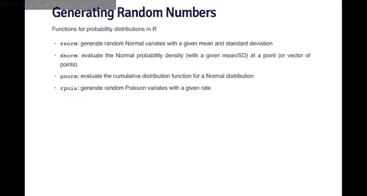
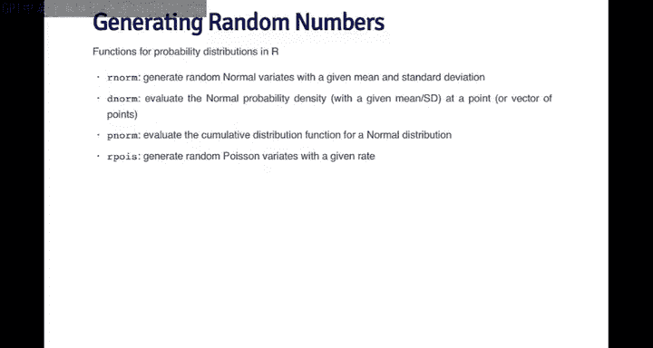
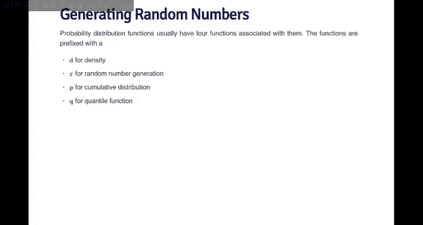
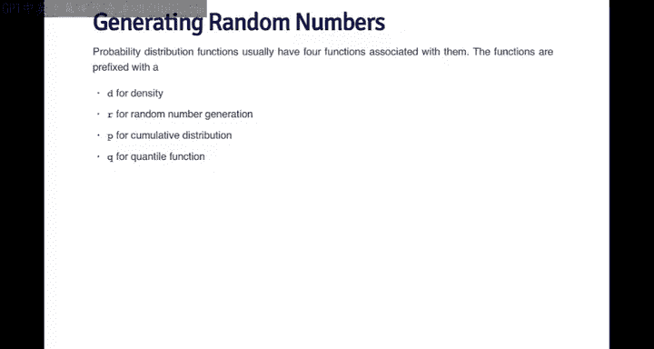
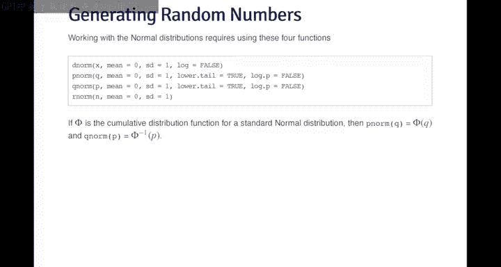
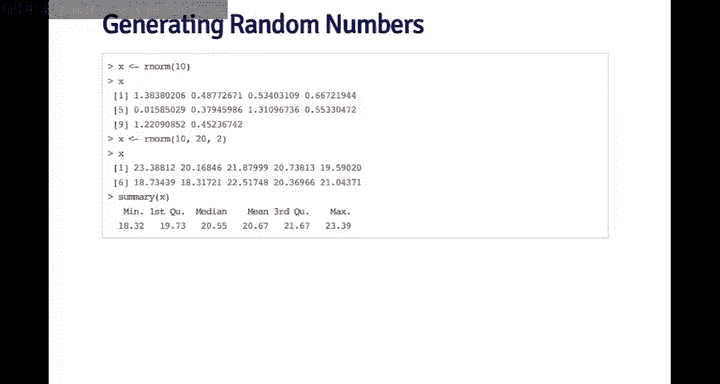
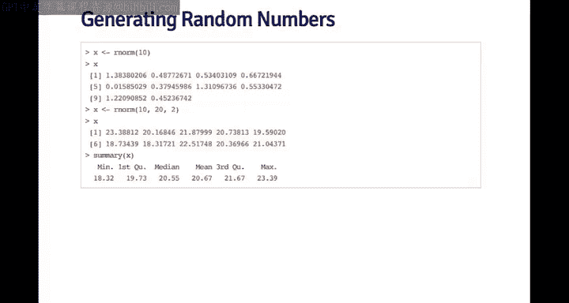
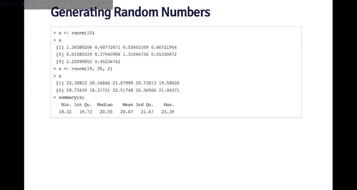
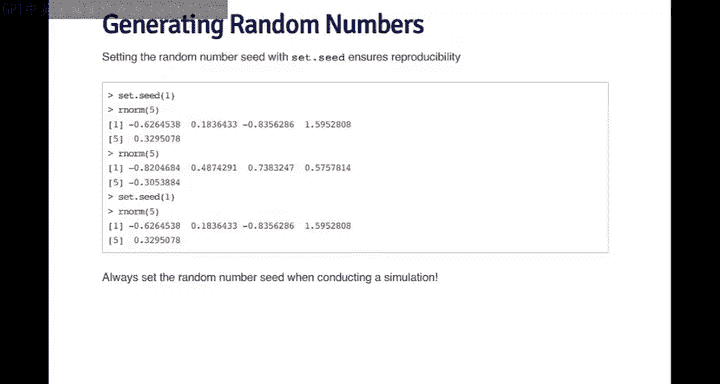
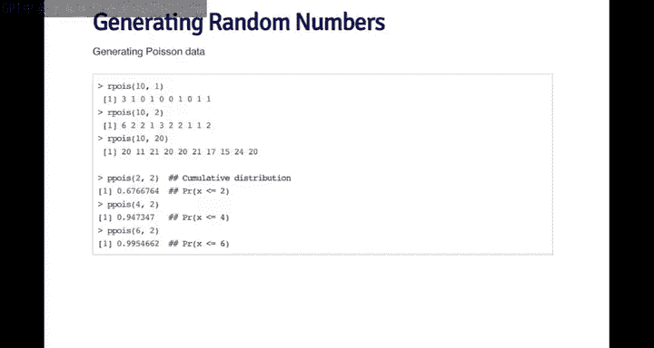

# 课程 50：模拟生成随机数 🎲

在本节课中，我们将学习如何在 R 语言中进行模拟，特别是如何从各种概率分布中生成随机数。模拟是统计学及其他许多应用领域中非常重要的技术。我们将介绍 R 中用于模拟的核心函数，并解释如何控制随机数生成以确保结果的可重复性。


## 模拟与概率分布函数



上一节我们介绍了模拟的重要性。本节中我们来看看 R 语言中用于从给定概率分布生成随机数或变量的几个函数。其中最重要的分布之一是正态分布。

我们可以通过指定分布的均值和标准差，然后调用 `rnorm` 函数来生成正态分布的随机变量。

```r
# 生成10个标准正态分布随机数
rnorm(10)
# 生成10个均值为20，标准差为2的正态分布随机数
rnorm(10, mean = 20, sd = 2)
```



对于正态分布，还有对应的函数用于评估概率密度、累积分布函数和分位数函数。

另一个用于生成随机变量的函数是 `rpois` 函数，它可以从具有给定速率的泊松分布中生成泊松随机变量。

R 中有许多函数可以从标准概率分布中生成随机变量，你可以使用它们来运行模拟。

## 概率分布函数的四种类型

每个概率分布函数基本上都关联着四种类型的函数。对于任何给定的分布，例如正态分布，都会有一个以 `d` 开头的函数、一个以 `r` 开头的函数、一个以 `p` 开头的函数和一个以 `q` 开头的函数。





以下是每个分布对应的四种不同函数：

*   `rnorm` 函数用于随机数生成。
*   `dnorm` 函数用于评估给定均值和标准差下的概率分布密度。
*   `pnorm` 函数用于评估累积分布。
*   `qnorm` 函数用于评估分位数函数。

每个分布都有这四种类型的函数。例如，对于 Gamma 分布，会有 `dgamma`、`rgamma`、`pgamma` 和 `qgamma` 函数。对于泊松分布，则有 `rpois`、`dpois`、`ppois` 和 `qpois` 函数。

## 正态分布函数详解

处理正态分布需要用到这四种函数：`dnorm`、`pnorm`、`qnorm` 和 `rnorm`。每个函数都接受多个参数。

所有函数都要求你指定均值和标准差，因为这是定义实际概率分布所必需的。如果不指定，默认值是标准正态分布，其均值为 0，标准差为 1。

对于 `dnorm` 函数，你可以评估密度，并且有一个选项允许你评估密度的对数值。大多数时候，当你评估正态分布的密度函数时，你会希望使用该值的对数，但默认值是 `FALSE`。

对于 `pnorm` 和 `qnorm` 函数，也有一个选项可以在对数尺度上进行评估。另一个选项是评估分布的下尾还是上尾。下尾是默认值，可以理解为概率分布向左的部分。如果你想评估上尾，有时需要这样做，那么你应该设置 `lower.tail = FALSE`，这将评估分布的上尾。



最后，对于 `rnorm`，只有两个参数 `mean` 和 `sd`，以及 `n`，即你想要生成的随机变量的数量。如果 `n` 是 100，你将得到一个包含 100 个从正态分布中抽取的数字的向量。

更明确地说，如果 Φ 是标准正态分布的累积分布函数，那么 `pnorm` 等价于 Φ，而 `qnorm` 等价于 Φ 的逆函数。

## 设置随机数种子







无论出于何种目的从任何分布模拟随机数时，设置随机数生成器种子都非常重要，这可以通过 `set.seed` 函数完成。

重要的是要了解，在计算机上生成随机数时，这些数字实际上并不是随机的，但它们看起来是随机的，这一点很重要。其思想是，如果你想再次生成同一组随机数，你可以做到，因为这些数字实际上并不是随机的，它们被称为伪随机数。

以下是设置种子的方法：

```r
# 设置随机种子为1
set.seed(1)
# 生成5个随机数
rnorm(5)
# 再次设置种子为1，会得到完全相同的5个随机数
set.seed(1)
rnorm(5)
```

种子可以是任何你想要的整数，你只需传递一个整数作为种子。设置种子后，它会设定将要发生的随机变量序列。如果你重置种子，你会将序列设置回开始的地方，然后它将从那里继续生成随机变量。

这很重要，因为它允许你重现现在生成的随机数。这听起来可能很奇怪，因为你为什么想要两次生成相同的随机数？但在许多应用中，你确实希望两次生成相同的随机数，以便其他人可以重现你所做的事情，特别是在你所做的事情存在一些错误或问题时，你希望能够回到产生这些问题的确切情况。

因此，每当你进行模拟时，你都应该设置随机数种子，以便你可以返回并获得相同的结果。

## 其他分布的模拟示例

我已经演示了如何生成正态随机变量，当然你也可以从其他概率分布生成随机变量。


泊松分布当然非常流行。以下是从不同速率的泊松分布生成随机变量的例子：



```r
# 生成10个速率为1的泊松随机变量
rpois(10, lambda = 1)
# 生成10个速率为2的泊松随机变量
rpois(10, lambda = 2)
# 生成10个速率为20的泊松随机变量
rpois(10, lambda = 20)
```

对于泊松分布，均值将等于速率，你可以大致在这三种情况中看到，均值大致等于我指定的速率。

我也可以评估泊松分布的累积分布函数。例如，在第一个例子中，我想知道如果速率为 2，泊松随机变量小于或等于 2 的概率是多少，这个概率大约是 0.67。

```r
# 评估累积分布概率
ppois(2, lambda = 2) # P(X <= 2)
ppois(4, lambda = 2) # P(X <= 4)
ppois(6, lambda = 2) # P(X <= 6)
```

累积分布函数允许你评估这些概率。

## 总结



本节课中我们一起学习了在 R 语言中进行模拟的基础知识。我们介绍了如何从正态分布和泊松分布等常见概率分布中生成随机数，并详细解释了与每个分布关联的四种核心函数：`r`（生成）、`d`（密度）、`p`（累积分布）和 `q`（分位数）。最重要的是，我们强调了使用 `set.seed` 函数设置随机数种子的必要性，以确保模拟结果的可重复性，这是进行可靠数据分析的关键步骤。