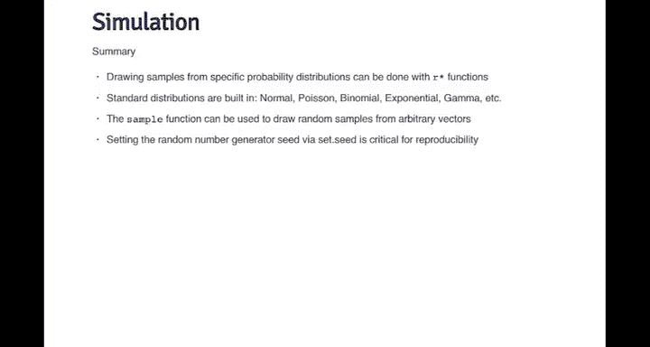

# 课程名称：R语言模拟与随机抽样基础 🎲


## 概述

在本节课中，我们将学习R语言中用于模拟随机数据和抽样的核心函数。我们将重点介绍`sample()`函数，它允许你从指定的对象集合中随机抽取样本，并回顾其他用于从特定概率分布生成随机数的函数。

---

## `sample()`函数：从指定集合中随机抽样

上一节我们介绍了R语言中用于生成特定分布随机数的函数。本节中，我们来看看`sample()`函数，它允许你从一组你指定的特定对象中随机抽取样本。

如果你提供一个数字向量，`sample()`函数允许你从该向量中抽取随机样本。通过指定一个对象向量并从中抽样，你可以创建任意自定义的分布。

以下是`sample()`函数的基本用法示例：

*   **示例1：从数字中抽样（无放回）**
    ```r
    # 从整数1到10中随机抽取4个，不重复（无放回）
    sample(1:10, 4)
    # 输出可能是：3, 4, 5, 7
    ```
    再次运行会得到不同的结果，例如`3, 9, 8, 5`。在这个例子中，由于是无放回抽样，不会得到重复的数字。

*   **示例2：从字母中抽样**
    ```r
    # 从字母A到Z中随机抽取5个
    sample(letters, 5)
    # 输出可能是：Q, B, E, X, P
    ```
    你不必只抽样数字，也可以抽样字母等其他对象。

*   **示例3：生成随机排列**
    ```r
    # 如果不指定抽样数量，`sample()`会返回整个向量的一个随机排列（洗牌）
    sample(1:10)
    # 输出是1到10的一个随机顺序排列
    ```
    再次调用会得到另一个不同的排列。

*   **示例4：有放回抽样**
    ```r
    # 从1到10中抽取10个数，允许重复（有放回）
    sample(1:10, replace = TRUE)
    # 输出可能包含重复值，例如某个数字出现多次
    ```
    通过设置`replace = TRUE`参数，可以进行有放回抽样，此时样本中可能出现重复元素。

---

## R语言中的其他模拟函数

除了`sample()`函数，R语言还内置了从各种标准概率分布生成随机数的函数。

以下是常用的随机数生成函数：

*   `rnorm()`: 从正态分布生成随机数。
*   `rpois()`: 从泊松分布生成随机数。
*   `rbinom()`: 从二项分布生成随机数。
*   其他如指数分布、伽马分布等也都有对应的函数（如`rexp()`, `rgamma()`）。

这些函数对于模拟符合特定统计模型的数据非常有用。

---

## 重要实践：设置随机种子

在R中进行任何数据模拟时，非常重要的一点是使用`set.seed()`函数设置随机数生成器的种子。

这样做的目的是确保你的模拟结果可以重现。在以后的日子里，你可以通过使用相同的种子值，得到完全相同的随机序列。

```r
# 设置随机种子，例如设为123
set.seed(123)
# 然后运行你的抽样或模拟代码
sample(1:10, 3)
# 无论何时运行，只要种子相同，输出就固定不变
```

---

## 总结

本节课中我们一起学习了R语言中用于模拟和抽样的关键工具。

我们详细探讨了`sample()`函数，它能够从任意指定的向量中进行随机抽样，支持无放回和有放回两种模式。我们还回顾了其他用于从标准概率分布（如正态分布、二项分布）生成随机数的R函数。



最后，我们强调了使用`set.seed()`函数来确保模拟结果可重现的重要性，这是进行可靠数据分析的基础步骤。