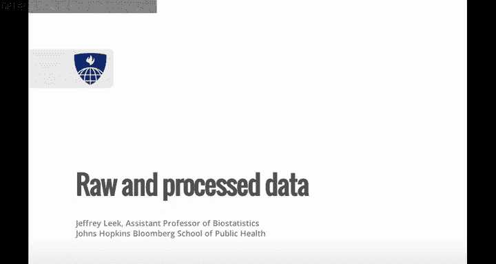
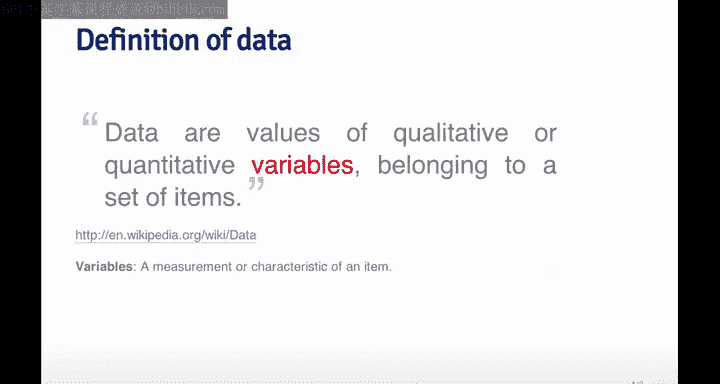
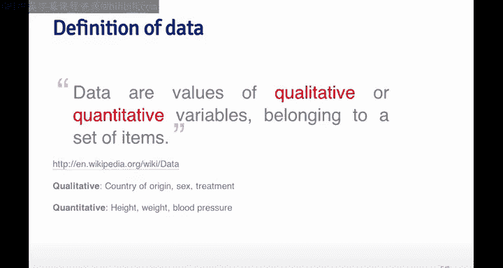
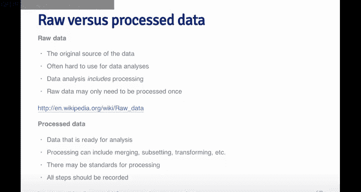
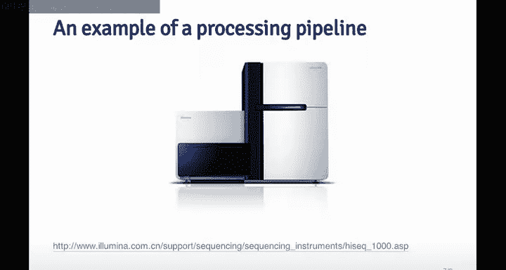
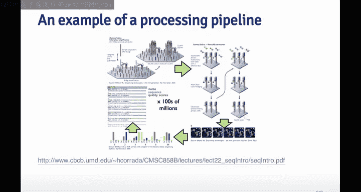

# 课程 1：原始数据与处理过的数据 📊

在本节课中，我们将学习数据科学中两个核心概念：原始数据和处理过的数据。我们将探讨它们的定义、区别，以及从原始数据到可分析数据的处理流程。理解这些概念对于进行严谨的数据分析至关重要。

---

## 数据的定义

上一节我们介绍了课程主题，本节中我们来看看数据的定义。

数据是归属于一组项目的定性或定量变量的值。这组项目可能是你感兴趣的人群或对象集合。这些值对应着变量，而变量就是你测量的东西。

变量可以用定性或定量的方式来测量。通常，我们考虑的变量包括：
*   **定性变量**：如国家、性别、治疗方案。
*   **定量变量**：如身高、体重、血压。

许多测量值实际上源自更底层的测量。例如，血压是通过计算压力测量值得出的。这些底层的测量正是我们讨论原始数据与处理过的数据时会涉及的内容。

---

## 原始数据

上一节我们了解了数据的基本构成，本节中我们来深入探讨原始数据。

原始数据是数据的原始来源。它们通常很难直接用于数据分析，因为其结构复杂、难以解析或直接分析。

实际上，数据分析本身就包含了数据处理或清洗的步骤。如果你获得一个原始图像文件，将其处理并转换成一个规整的数据框，然后在R中进行分析，那么这个数据处理过程就是数据分析或数据科学流程的一部分。事实上，数据科学家工作的很大一部分就是执行这类处理操作。

原始数据可能只需要处理一次，但无论处理频率如何，你都需要记录所有处理步骤，因为这些步骤会对后续分析产生重大影响。

以下是原始数据的一些关键特征：
*   是数据的原始来源。
*   通常结构复杂，难以直接分析。
*   处理过程是数据分析的关键组成部分。
*   处理步骤必须被完整记录。

---

## 处理过的数据

理解了原始数据的特性后，我们来看看它的产物——处理过的数据。

处理过的数据是已准备好进行分析的数据。对数据的处理可能包括合并、子集化、转换等操作。例如，你可能从一个文件中提取图像的一部分，或从一个自由文本字段中提取特定文本。

根据你所处的领域，可能存在标准的处理流程。例如，在我工作的基因组学领域，在分析数据之前需要应用许多非常标准的预处理技术。

一个极其关键的组成部分是：**所有步骤都应被记录**。这一点再怎么强调都不为过。预处理通常是对下游数据影响最大的数据分析环节。因此，仔细关注你所做的每一步，对于成为一名严谨的、理解整个数据处理流程的数据科学家至关重要。

以下是处理过的数据的一些关键特征：
*   已准备好用于分析。
*   可能经过合并、子集化、转换等操作。
*   不同领域可能有标准的预处理方法。
*   记录所有处理步骤是至关重要的。

---

## 示例：基因组数据处理流程

为了更具体地说明“原始数据”在不同层级上的含义，我将用一个快速的示例来展示一个处理流程。

这是一台Illumina高通量测序仪。这台机器可用于对DNA进行测序，现在的测序速度比过去快得多。最初的人类基因组计划启动时，测序一个人类基因组花费了近十年时间和可能超过十亿美元。而现在，使用这样的机器，大约一周时间、一万美元左右就能完成同样的过程。这个例子说明了数据正变得越来越廉价且易于收集。

其工作原理（非常粗略的概述）如下：你可以想象从DNA片段开始。这些小的DNA片段被绑定到一个载玻片上，每个片段可能由500个字母（碱基）组成。你可以将DNA想象成一条由30亿个字母组成的字符串，然后取其中一小段（500个字母）绑定到载玻片上。

通过一个化学过程，会制造出相同序列的多个副本。这个过程通过“合成测序”进行：与载玻片上序列每个字母互补的碱基（字母）被逐个添加，而每个不同的字母（A、C、T、G）会被标记上不同的颜色。

因此，对于每个小簇，在每个新合成的核苷酸处，你都会得到一个颜色。这些颜色创建了一系列图像。例如，在合成第一个核苷酸时，你可能会得到这张图像，然后是第二个核苷酸的图像，第三个，依此类推。

如果你放大一个特定的小点，它对应着其中一个完全相同的序列簇。你可以沿着图像序列追踪，查看每个图像中该点的颜色。最终，对于每个图像，颜色对应着每个字母，其中最亮的那个颜色就被指定为该位置的碱基。

例如，对于这个特定片段，第一个字母将是C，因为在这四个字母中，C是最亮的。在第二个核苷酸处，你可以看到这四个字母中最亮的是G，因此我们指定的下一个字母就是G，以此类推。

最终你得到的是类似这样的一个FastQ文件（我在课堂上展示过几次）。FastQ文件是一个文本文件，其中包含了从平板上每个小片段中读取到的一系列特定字母（A、C、T、G）。

你可以从几个不同的步骤来思考原始数据：
1.  原始数据可能是这些图像文件。你必须处理这些图像文件才能得到每个不同片段的这些图谱。
2.  在获得图谱之后，你必须处理这些图谱，以预测哪些字母应该进入最终出现在这里的序列中。

这些阶段中的任何一个都可以被认为是“原始”的。在每个阶段，都有许多必须应用的计算步骤，这些步骤可能产生重大影响。

在进行数据分析时，需要记住的一点是：你经常可能分析从这台机器出来的所谓“读数”，甚至可能分析更下游的东西，比如基于汇总某些读数得到的计数。当你这样做时，你忽略了一个事实，即所有这些处理步骤都发生在之前。这些处理步骤可能产生重大影响。本课程的部分目的就是理解这些处理步骤是什么，以确保你的分析不会受到从原始数据到可分析数据的转换方式所引入的人为假象的驱动。

**这就是获取数据的全部意义：将原始数据转化为处理过的数据。**

---

## 总结

本节课中，我们一起学习了数据科学中的两个基础概念。我们明确了**原始数据**是复杂、未加工的原始来源，而**处理过的数据**是经过清洗、转换后可用于分析的形式。我们通过基因组测序的例子，看到了数据从图像文件到文本序列的多层处理流程，并强调了**完整记录每一步处理步骤**的极端重要性。理解从原始数据到处理过的数据的旅程，是确保数据分析结果可靠、可复现的关键。