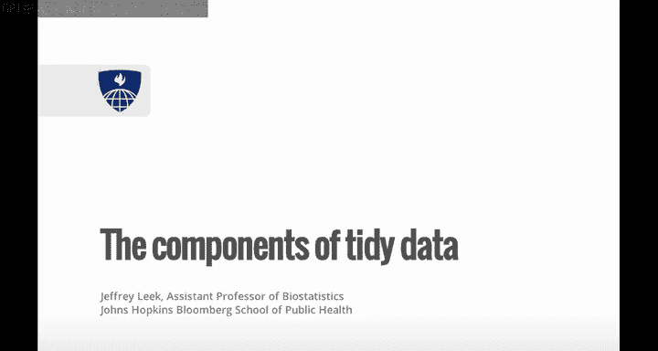
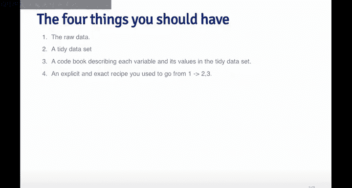
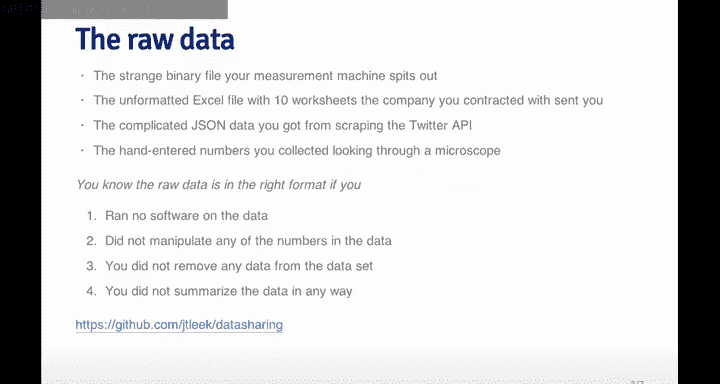
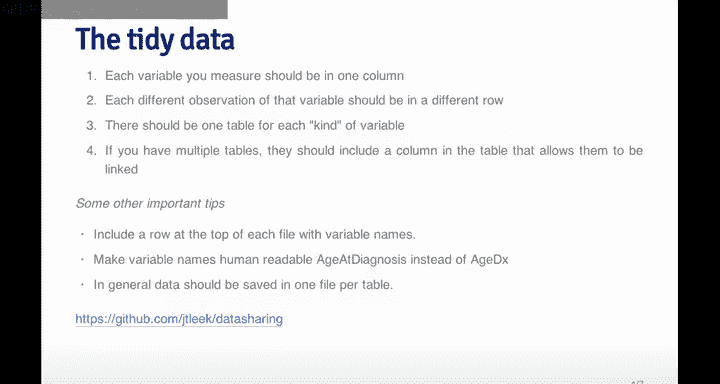
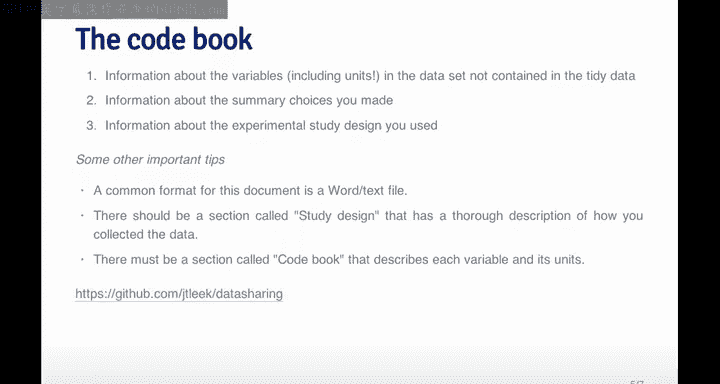
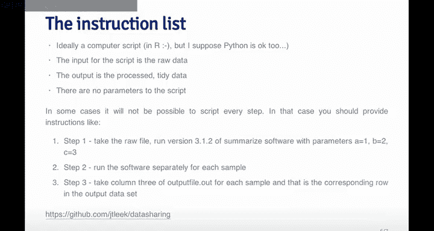
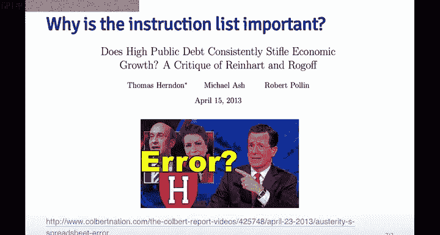

# 课程 2：整洁数据的组成部分 📊



在本节课中，我们将要学习如何将原始数据转化为整洁数据，并了解构成一个完整、可重现数据分析流程的关键组成部分。

上一节我们介绍了原始数据的概念，即分析流程的起点。本节中我们来看看整个数据处理流程的目标——整洁数据，以及为了确保分析的可信与可重现，我们需要准备哪些关键文件。

---

## 原始数据 📁



原始数据是你获取到的、未经任何处理的初始数据。它可能以多种形式存在。

以下是原始数据的一些常见例子：
*   一个由测量仪器输出的奇怪二进制文件。
*   一个包含10个工作表的、格式混乱的Excel文件。
*   从API抓取得到的复杂JSON数据。
*   甚至可能是你通过显微镜观察并手动计数的细胞数量。

判断数据是否为原始形式的一个关键标准是：**你未对数据运行任何软件**。这意味着，数据交到你手上时，你尚未对其进行任何计算、修改、删除或汇总操作。保持原始数据的纯净是向合作者交付可靠分析结果的基础。

---



## 整洁数据 🧹

整洁数据是整个数据处理流程的目标或最终成果。它遵循一套清晰的组织原则，便于后续的分析与建模。

整洁数据的核心规则可以概括为以下三点：
1.  **每个变量一列**：你测量的每个变量都应恰好对应数据表中的一列。
2.  **每次观测一行**：每一次独立的观测记录都应位于不同的行中。
3.  **每种观测类型一张表**：不同类型的观测数据应存放在不同的表格中。如果存在多张需要关联的表，每张表必须包含一个可以链接它们的列（例如ID）。

以下是整理数据时的一些实用建议：
*   在文件顶部包含变量名行。
*   使用**人类可读的变量名**（例如 `AgeAtDiagnosis` 优于 `AgeDX`）。
*   通常，**每个表格应保存为一个独立的文件**，而不是将多个工作表塞进一个Excel文件。

---



## 数据字典 📖

数据字典（或称元数据）是描述整洁数据集中每个变量及其取值的文档。它解释了数据背后的含义，是经常被忽略但至关重要的部分。

数据字典通常需要包含以下信息：
*   **变量的单位**：例如，收入数据是以“千元”还是“百万元”为单位。
*   **汇总方式**：例如，月收入数据是取的中位数还是平均值。
*   **实验研究设计**：描述数据是如何收集的（例如，是从数据库提取，还是进行了随机对照试验）。

一份标准的数据字典文档（如Word、文本或Markdown文件）应包含两个主要部分：
*   **研究设计**：详细描述数据收集的过程、样本选择方法、排除标准等。
*   **代码簿**：列出所有变量，并详细说明每个变量的定义和单位。

---



## 处理指令清单 🧾

处理指令清单是一份明确的“食谱”，记录了从原始数据到整洁数据（及数据字典）的每一个处理步骤。它是确保分析可重现的核心。

理想情况下，这份“食谱”应该是一个**计算机脚本**（例如R或Python脚本）。该脚本的输入是原始数据，输出是处理好的整洁数据。关键在于，这个脚本**不应包含需要手动调整的参数**，任何人使用相同的原始数据运行该脚本，都应得到完全一致的整洁数据集。

有时，并非所有步骤都能用脚本自动化（例如，某些处理可能依赖特定版本的第三方软件）。此时，你需要提供一个极其详尽的文本说明。

以下是文本指令清单应包含的内容示例：
```
对原始文件运行[软件名称]版本3.1.2，使用参数‘-a -b 10’。
对每个样本单独运行上述软件。
```

---



## 重要性总结与案例 🚨

本节课我们一起学习了构成可重现数据分析的四个核心部分：**原始数据**、**整洁数据**、**数据字典**和**处理指令清单**。

坚持这一流程至关重要。一个著名的反面案例是Reinhart和Rogoff关于债务与经济增长的论文，该研究曾被用来为多国的财政紧缩政策提供依据。后来，一位研究生检查了他们使用的Excel文件和处理步骤，发现了大量错误。这些数据处理上的问题导致论文结论受到严重质疑，进而影响了相关的政治决策。这个案例深刻地提醒我们，仔细记录并保存从原始数据到分析数据的完整处理流程，是保证研究质量和可信度的安全底线。



---