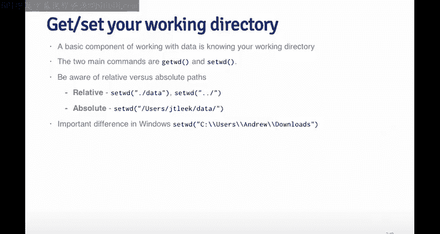
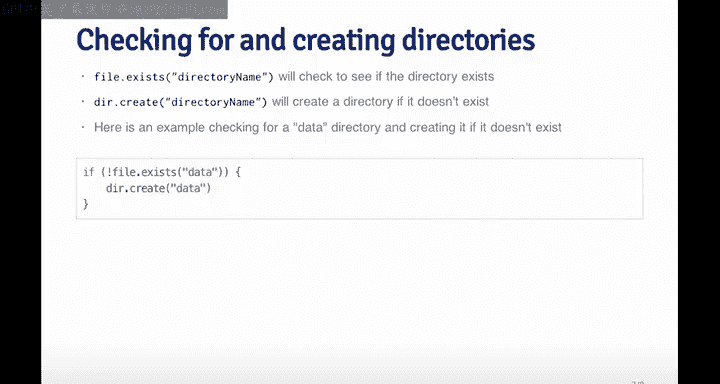
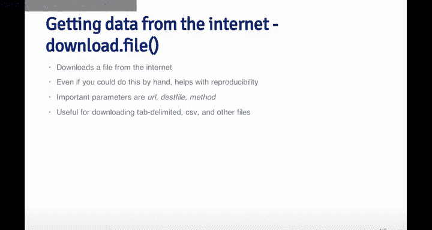
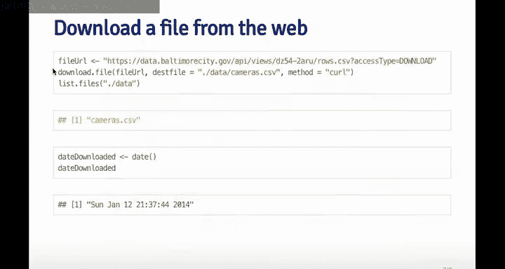
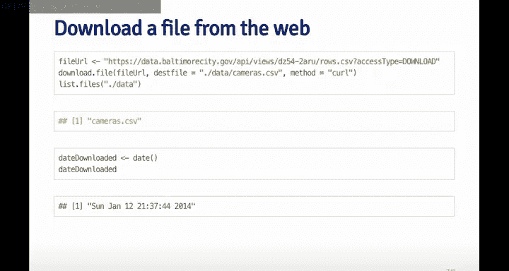
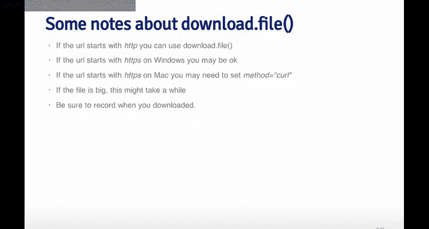

# 课程3：使用R下载文件 📥


在本节课中，我们将学习如何使用R编程语言从互联网下载文件。我们将了解为何通过R脚本下载文件比手动点击下载更具优势，并掌握相关的核心函数和操作步骤。

---


## 工作目录管理 🗂️

上一节我们介绍了数据获取的多种方式，本节中我们来看看如何在R中管理文件的工作目录。了解当前的工作目录是进行文件操作的第一步。

在R中，有两个主要的命令用于处理目录：`getwd()` 和 `setwd()`。

*   `getwd()` 函数用于获取当前的工作目录路径。
*   `setwd()` 函数用于设置新的工作目录。

以下是设置工作目录的两种方法：

1.  **使用相对路径**：例如，`setwd("../")` 会将目录向上移动一级。
2.  **使用绝对路径**：例如，`setwd("/Users/JTleek/data")` 会直接切换到指定的完整路径。

**注意**：在Windows系统中，路径需要使用反斜杠 `\` 而不是正斜杠 `/`。例如：`setwd("C:\\Users\\JTleek\\data")`。



---

## 创建数据目录 📁

在开始下载数据之前，通常需要创建一个专门的目录来存放数据。这有助于保持项目结构清晰。

R提供了检查目录是否存在和创建目录的函数。

*   `file.exists("目录名")`：检查当前目录下是否存在指定的子目录。存在则返回 `TRUE`，否则返回 `FALSE`。
*   `dir.create("目录名")`：创建一个新的目录。

以下是一段常用的代码逻辑，用于在数据目录不存在时自动创建它：



```r
if (!file.exists("data")) {
  dir.create("data")
}
```
这段代码的意思是：如果名为“data”的目录不存在，则创建它。

---

## 使用 `download.file` 函数下载 🌐

从互联网获取文件的主要方式是使用 `download.file()` 函数。虽然你可以手动访问网站并点击下载，但将下载步骤写入R脚本可以极大地提高分析过程的可重复性。

`download.file()` 函数的核心参数如下：



*   `url`：要下载的文件网络地址。
*   `destfile`：文件下载后保存在本地的路径和文件名。
*   `method`：下载方法，对于某些网站（特别是HTTPS链接）需要指定。

这个函数可以下载多种类型的文件，例如制表符分隔文件、CSV文件、Excel文件等。

---

## 实战示例：下载巴尔的摩摄像头数据 🚗

让我们通过一个实际例子来练习。我们将下载美国巴尔的摩市固定测速摄像头位置的数据集。



首先，从目标网站找到CSV文件的下载链接。然后，在R中执行以下步骤：

1.  **定义文件URL**：将复制的链接地址赋值给一个变量。
    ```r
    fileUrl <- "https://data.baltimorecity.gov/api/views/dz54-2aru/rows.csv?accessType=DOWNLOAD"
    ```

2.  **执行下载**：使用 `download.file()` 函数下载文件到之前创建的“data”目录中。
    ```r
    download.file(fileUrl, destfile = "./data/cameras.csv", method = "curl")
    ```
    **代码说明**：
    *   `destfile = "./data/cameras.csv"` 指定了保存路径和文件名。
    *   `method = "curl"` 是针对Mac系统下载HTTPS链接的常用设置。在Windows系统上，通常可以省略此参数或使用默认方法。

3.  **验证下载**：使用 `list.files()` 函数查看“data”目录中的文件，确认下载成功。
    ```r
    list.files("./data")
    ```

4.  **记录下载日期**：网络上的数据可能会更新。记录下载日期对于后续追溯数据版本非常重要。
    ```r
    dateDownloaded <- date()
    ```

---

## 重要注意事项 ⚠️



在使用 `download.file()` 时，有几个关键点需要牢记：

*   **链接类型**：如果URL以 `http://` 开头，通常没有问题。如果以 `https://` 开头，在Mac上需要设置 `method = "curl"`，在Windows上通常不需要。
*   **下载时间**：下载文件需要时间，取决于文件大小和网络速度。对于大型文件，在编写脚本时可以考虑将下载代码单独列出，避免在每次重新运行分析时都重复下载。
*   **版本控制**：务必使用 `date()` 函数记录下载时间，以便在未来需要时核对所使用的数据版本。

---

## 总结 📝



本节课中我们一起学习了如何使用R从互联网下载文件。我们掌握了管理工作目录的 `getwd()` 和 `setwd()` 函数，学习了如何用 `file.exists()` 和 `dir.create()` 创建数据目录，并深入了解了用于文件下载的核心函数 `download.file()` 及其关键参数。通过巴尔的摩摄像头数据的实战示例，我们演练了完整的下载流程，并强调了记录下载日期对于可重复研究的重要性。将这些步骤自动化到你的R脚本中，将使你的数据分析流程更加完整和可重现。