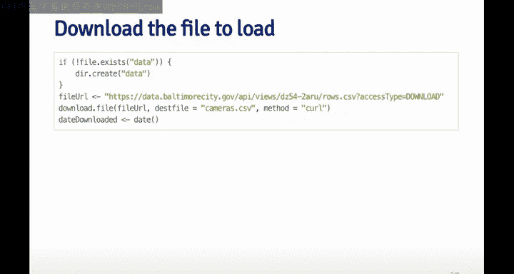
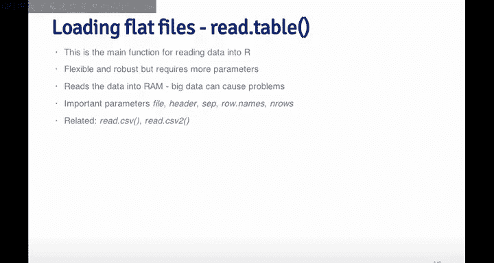
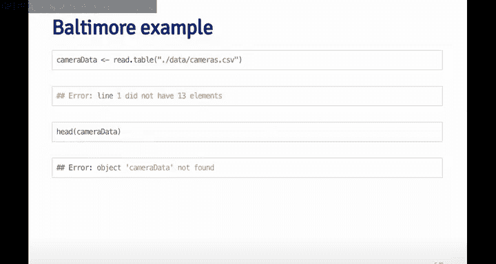
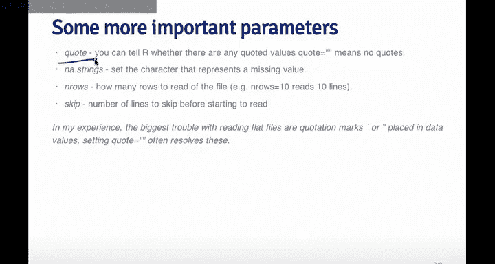
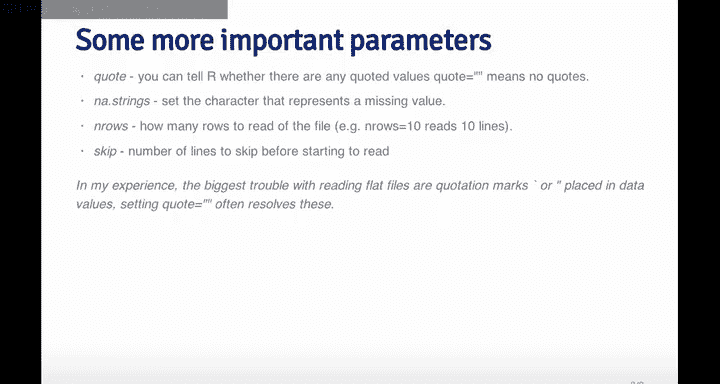
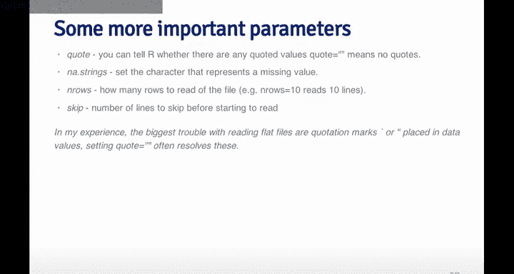

# 课程04：读取本地文件 📂

在本节课中，我们将学习如何在R语言中读取本地存储的“平面文件”。平面文件是常见的文本文件格式，例如制表符分隔文件、逗号分隔文件等。如果你已经学习过R编程课程，可能已经掌握了加载数据的方法，可以跳过本讲。


---

## 概述

本节课将介绍使用R读取本地数据文件的核心方法。我们将重点学习 `read.table()` 函数及其相关参数，并了解如何处理常见的文件读取问题。

---

## 读取数据的基本函数



上一节我们介绍了平面文件的概念，本节中我们来看看R中最常用的数据读取函数 `read.table()`。

`read.table()` 是R中最通用、最灵活的数据读取函数。它能够处理多种分隔符格式的文件，但相应地需要设置更多参数。对于非常大的数据集，`read.table()` 可能不是最高效的选择，因为它会将整个文件读入内存。此时可能需要考虑分块读取或其他方法。

以下是 `read.table()` 的一些重要参数：
*   `file`： 要读取的文件路径。
*   `header`： 文件第一行是否包含列名（变量名）。
*   `sep`： 文件中用于分隔不同数据值的字符。
*   `row.names`： 指定作为行名的列。
*   `nrows`： 指定要读取的行数。



此外，对于常见的逗号分隔值文件，R提供了便捷函数 `read.csv()` 和 `read.csv2()`。`read.csv()` 会自动将分隔符 `sep` 设置为逗号（`,`），并将 `header` 参数设为 `TRUE`。

---

## 实践：读取巴尔的摩摄像头数据



让我们通过一个实例来应用上述知识。我们将尝试读取一个名为 `cameras.csv` 的逗号分隔文件。

如果直接使用默认参数的 `read.table()` 读取CSV文件，会遇到错误。

```r
cameraData <- read.table("./data/cameras.csv")
```
**错误原因**：`read.table()` 的默认分隔符是制表符（`\t`），而我们的文件使用逗号分隔。因此，R无法正确解析第一行，导致变量 `cameraData` 并未被成功创建。

为了解决这个问题，我们需要在调用 `read.table()` 时明确指定分隔符，并告知文件包含表头。

```r
cameraData <- read.table("./data/cameras.csv", sep=",", header=TRUE)
head(cameraData)
```
通过设置 `sep=","` 和 `header=TRUE`，函数现在能正确识别文件结构。使用 `head()` 函数可以查看数据框的前几行，确认数据已被成功加载。

对于CSV文件，更简单的方法是直接使用 `read.csv()` 函数，它能自动处理上述参数。

```r
cameraData <- read.csv("./data/cameras.csv")
```

---

## 处理常见读取问题

在成功读取基础数据后，我们来看看如何通过调整参数来处理一些常见问题。以下是 `read.table()` 中其他一些有用的参数：





*   `quote`： 指定用于包围字符型数据的引号字符。例如，`quote=""` 表示文件中没有使用引号。
*   `na.strings`： 指定哪些字符串应被识别为缺失值（NA）。默认是 `"NA"`，但也可能是 `"-1"`、`"999.99"` 等。
*   `nrows`： 指定要读取的总行数。例如，`nrows=10` 只读取前10行。
*   `skip`： 指定在开始读取数据前要跳过的行数。例如，要读取第3到第13行，可以设置 `skip=2`（跳过前2行）和 `nrows=10`（读取10行）。


一个常见的棘手问题是数据值中意外包含了引号字符（如 `"`），这会导致R在解析行列时产生混乱。根据经验，将 `quote` 参数设置为空字符串（`quote=""`）通常是解决此类问题的有效方法，可以避免R将数据内的引号误认为是字段边界。

---

## 总结



本节课中我们一起学习了在R中读取本地平面文件的核心技能。我们重点掌握了 `read.table()` 函数及其关键参数（如 `sep`、`header`）的用法，并了解了其便捷版本 `read.csv()`。此外，我们还探讨了如何处理因错误引号或指定缺失值而导致的文件读取问题。正确地将外部数据加载到R中是进行后续所有数据分析的第一步。