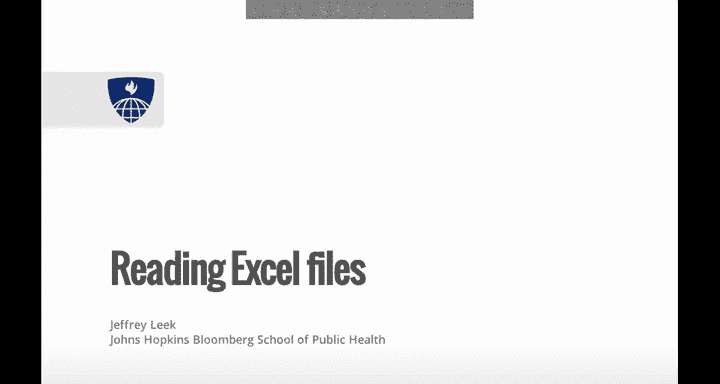
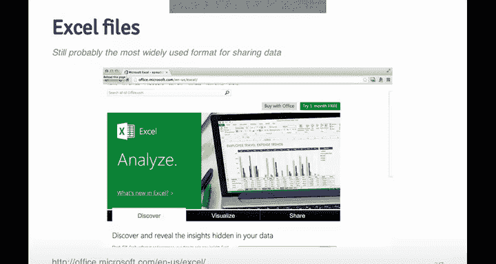
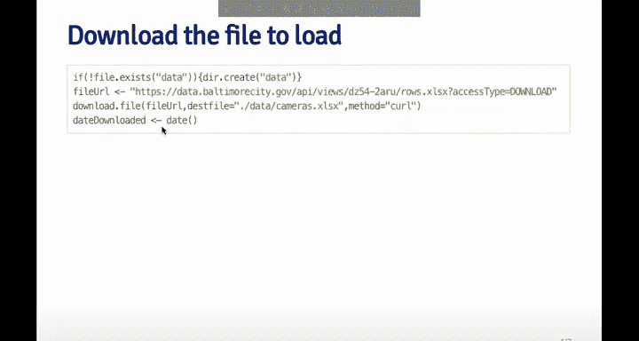
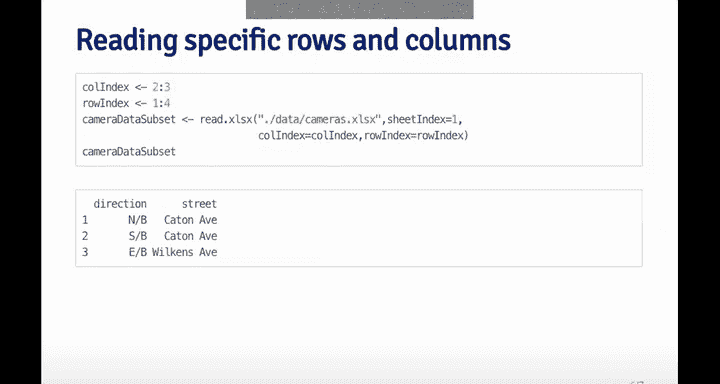
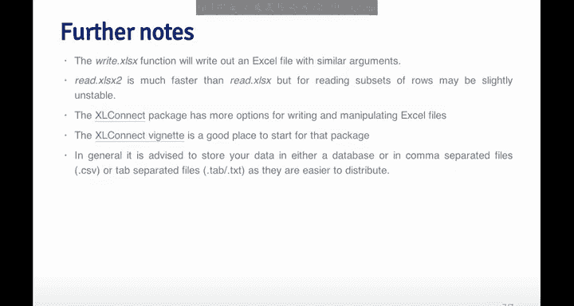

# 课程 P79：读取Excel文件 📊

在本节课中，我们将学习如何在R语言中读取和处理Excel文件。尽管一些数据科学家对Excel文件持有偏见，但Excel仍然是目前最广泛使用的数据共享格式之一。我们将了解其原因，并掌握使用R读取Excel数据的具体方法。

## Excel文件的普遍性

一些数据科学家对Excel文件表现出某种轻视态度。



但Excel文件可能仍然是共享数据时使用最广泛的格式。

我认为原因在于许多人习惯使用电子表格。



无论你是在商业应用还是科学领域工作，人们都知道如何使用电子表格来收集、输入数据并相互共享。

如今，随着像谷歌电子表格这类工具的出现，这一情况甚至比以往更加普遍，因为它们允许人们在互联网上协作共享数据。


## 在R中处理Excel数据的必要性

对你而言，问题在于当你使用像R这样的脚本语言分析数据时，你需要能够从这些文件中提取数据，以便进行后续的分析和处理。


## 下载Excel数据文件



我们将回到巴尔的摩摄像头数据。我想我最近一定收到了很多超速罚单，因为我一直在思考这个数据集。现在，我们将实际下载这个数据的Excel版本。在本例中，URL再次略有不同，你只需从网站上获取URL。

接下来我们要做的是将文件下载为 `.xlsx` 文件，因为这是Excel文件的扩展名。现在我们已经下载了这个文件。

我们开始使用 `download.file` 函数，请记住这个函数对文件类型是不可知的，它只是下载文件并将其放入你在此处指定的文件名中。我们再次收集文件下载时间的信息，以便了解分析是何时执行的。

以下是下载文件的R代码示例：
```r
fileUrl <- "http://example.com/data.xlsx"
download.file(fileUrl, destfile = "./data/cameras.xlsx", method = "curl")
dateDownloaded <- date()
```

## 使用`xlsx`包读取数据

用于此目的的R库是`xlsx`包。如果你愿意，也可以使用其他包如`XLConnect`，它们可能提供更灵活的接口，但我喜欢`xlsx`。

我们实际使用的命令是 `read.xlsx`，并再次将其赋值给`cameraData`变量。现在你需要传递几个参数：我们需要传递`sheetIndex`以指明数据存储在哪个工作表上，并且我们要告诉它存在标题行，这样列名就被标记了。

当我们将其加载到R中时，它看起来几乎与你读取CSV文件以及直接从Excel文件中读取时得到的数据完全一样。

以下是读取Excel文件的R代码示例：
```r
library(xlsx)
cameraData <- read.xlsx("./data/cameras.xlsx", sheetIndex=1, header=TRUE)
```



## 读取特定行与列

需要记住的一点是，你可以读取特定的行和列。例如，如果你只想读取第二列和第三列，并且只想读取第一到第四行，你可以实际将这些作为变量传递给`colIndex`和`rowIndex`参数给`read.xlsx`函数。这样你实际上只读取了Excel文件的一个子集，如果你只想提取文件中的一小部分，这可能很有用。

以下是读取特定行列的R代码示例：
```r
cameraDataSubset <- read.xlsx("./data/cameras.xlsx", sheetIndex=1,
                              colIndex=2:3, rowIndex=1:4)
```


## 其他注意事项与替代方案

以下是一些可能对你有用的进一步说明，或者你可以使用`write.xlsx`函数。如果你与喜欢Excel文件的人一起工作，你实际上可以在分析后将数据写回并与人共享。这非常相似，你传递想要写出的对象和文件名，它就会写出那个文件。

我发现`read.xlsx2`比`read.xlsx`快得多，但特别是在读取行的子集时，它可能有点不稳定，至少在我的经验中如此。

如前所述，`XLConnect`在读取、写入和操作Excel文件方面要灵活得多。因此，如果你真的需要对Excel文件进行大量严肃的处理，我发现如果你打算这样做，`XLConnect`可能会更好一些。`XLConnect`的说明文档实际上是一个很好的起点，它包含大量关于如何执行各种不同操作的信息，例如如何直接从R中操作和创建文件。

总的来说，就本课程的目的而言，也是就大多数分析的目的而言，如果你将文件存储为逗号分隔或制表符分隔的平面文件，读取文件会更快、更容易一些。它们也更容易分发，因为不是每个人都有Excel。它不一定像使用纯文本文件（仅包含逗号分隔或制表符分隔的值）那样具有跨平台性。



## 总结


本节课中，我们一起学习了在R中处理Excel文件的全过程。我们了解了Excel格式的普遍性，掌握了使用`download.file`函数获取网络Excel文件的方法，并重点学习了使用`xlsx`包的`read.xlsx`函数来读取数据。我们还探讨了如何读取特定的行和列以进行高效的数据提取，并简要介绍了`write.xlsx`、`read.xlsx2`以及更强大的`XLConnect`包作为备选方案。最后，我们认识到对于分析和共享，CSV等纯文本格式通常更具优势。