# 📘 课程 6：读取 XML 文件

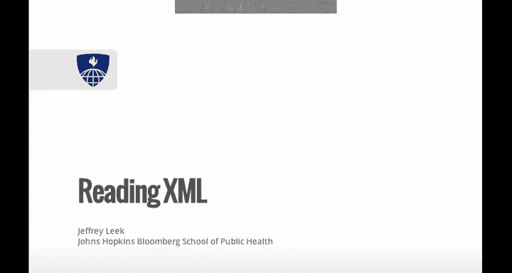

在本节课中，我们将学习如何读取和处理 XML 文件。XML 是一种广泛用于存储和传输结构化数据的标记语言，在网页抓取和网络 API 数据获取中尤为常见。

---

## 🏷️ 什么是 XML？

XML 代表可扩展标记语言。它常用于存储结构化数据，在互联网应用中非常普遍。例如，在进行网页抓取、从网络 API 获取数据或从开放数据网站下载数据时，经常会遇到 XML 格式。

提取 HTML 和 XML 是大多数网页抓取工作的基础。

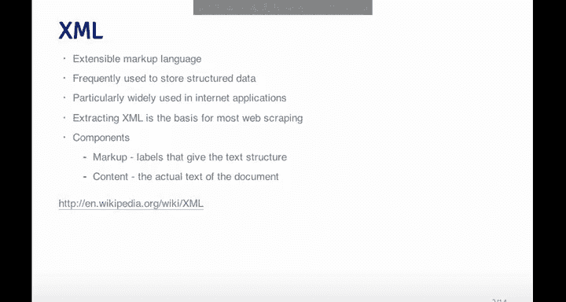

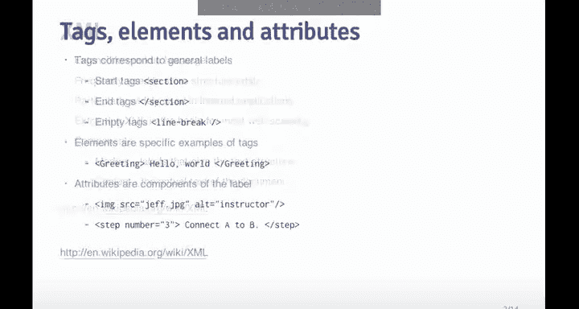

一个 XML 文件包含两个主要部分：**标记** 和 **内容**。标记是为文本提供结构的标签，而内容则是标签之间的实际文本。

为了更具体地理解，我们将介绍三个核心概念：**标签**、**元素** 和 **属性**。

---

## 🔖 标签、元素与属性

**标签** 是应用于文本特定部分的标签，用于赋予文本结构。标签分为开始标签和结束标签。

*   **开始标签** 的格式为 `<section>`。
*   **结束标签** 的格式为 `</section>`。
*   **空标签** 用于表示不需要成对出现的特定行，例如换行，格式为 `<br/>`。

**元素** 是标签的具体实例。例如，一个 XML 元素可以是由 `<greeting>` 开始标签和 `</greeting>` 结束标签包围的部分，中间的内容是 “Hello world”。

**属性** 是标签的组成部分，用于为标签添加额外信息。例如，一个图像标签 `` 可能包含 `src`（图片来源）和 `alt`（替代文本）属性。

另一个例子是步骤标签 `<step>`，可以包含 `number` 属性来标识步骤顺序，如 `<step number="1">`。

如果你想了解更多关于 XML 的知识，可以查阅维基百科上关于 XML 的条目，内容非常全面。

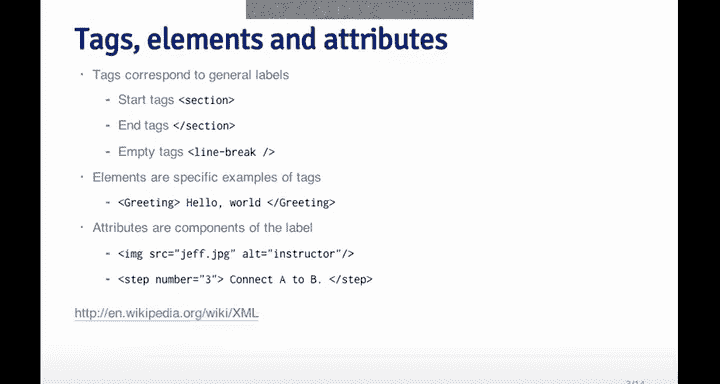

---

## 📄 XML 文件示例

以下是一个 XML 文件的示例。它本质上是一个包含许多标签和内容的文本文件。

例如，文件中有一个 `<food>` 开始标签和一个对应的 `</food>` 结束标签。在这个特定的食物元素内部，有一个 `<name>` 标签，其内容是 “Belgian Waffles”。此外，还有其他标签对应这个食物元素的其他组成部分。文件中还有更多这样的食物元素。

你可以通过课程中提供的网页链接查看这个文件的完整版本。

---

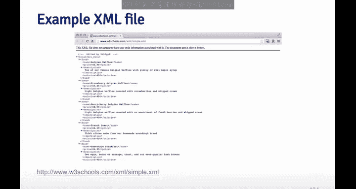

## 📥 在 R 中读取 XML 文件

你可以使用 `XML` 包将 XML 文件读入 R。

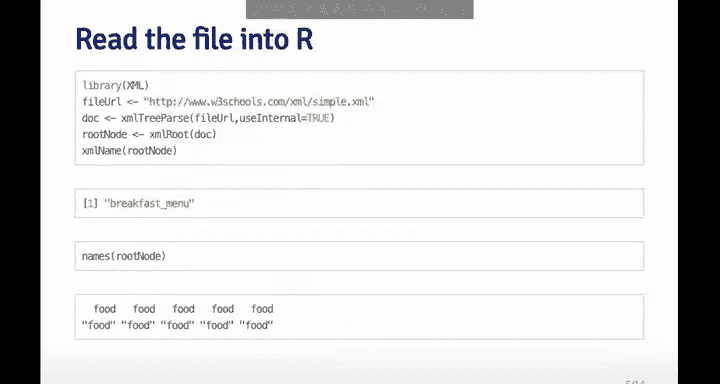

首先，加载 `XML` 包，然后使用 `xmlTreeParse` 函数来解析指定的 XML 文件。这个函数会将文档加载到 R 的内存中，以便后续解析和访问其不同部分。

```r
library(XML)
fileUrl <- "http://www.w3schools.com/xml/simple.xml"
doc <- xmlTreeParse(fileUrl, useInternalNodes = TRUE)
```

---

## 🧭 访问 XML 文档结构

在 R 中，解析后的 XML 是一个结构化对象，我们需要使用不同的函数来访问其各个部分。

首先，我们可以查看**根节点**，它是整个文档的包装元素。使用 `xmlRoot` 函数可以获取它。

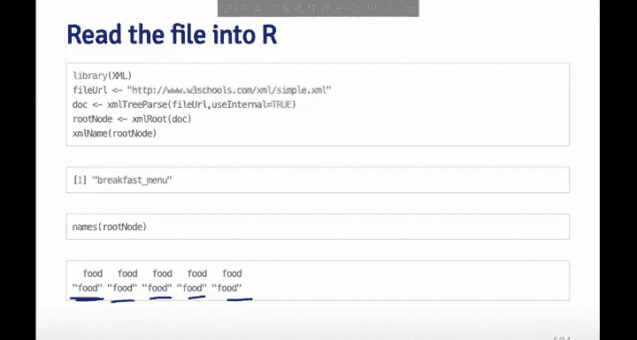

```r
rootNode <- xmlRoot(doc)
```

然后，使用 `xmlName` 函数可以获取根节点的名称。

```r
xmlName(rootNode)
```

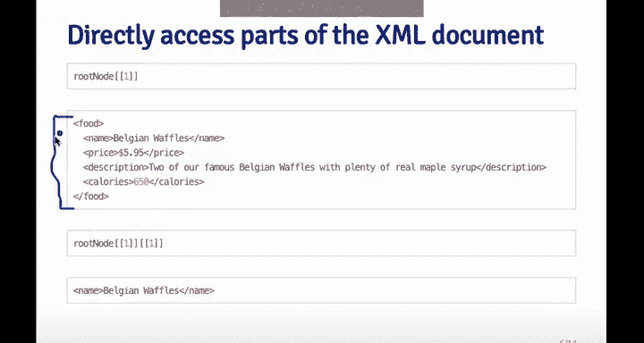

我们还可以查看根节点下所有嵌套元素的名称，这能告诉我们文档的整体结构。例如，根节点包装了整个“早餐菜单”，而菜单中包含五个用 `<food>` 元素包装的早餐项目。

```r
names(rootNode)
```

---

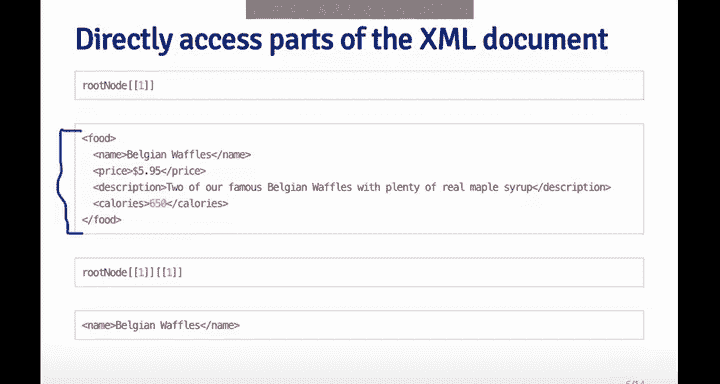

## 🔍 提取特定元素

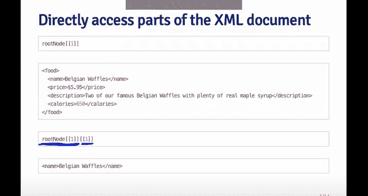

接下来，我们可以像访问 R 中的列表一样，直接访问 XML 文档的特定部分。

例如，要查看根节点的第一个元素（即第一个食物项），可以使用双括号索引。

```r
rootNode[[1]]
```

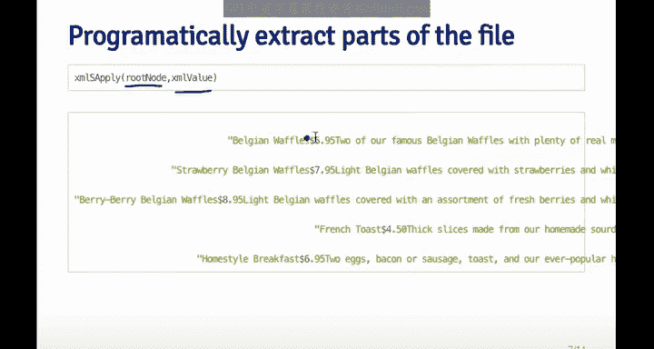

如果你想进一步深入，提取第一个食物项的第一个子元素（例如名称），可以继续使用子集索引。

```r
rootNode[[1]][[1]]
```

---

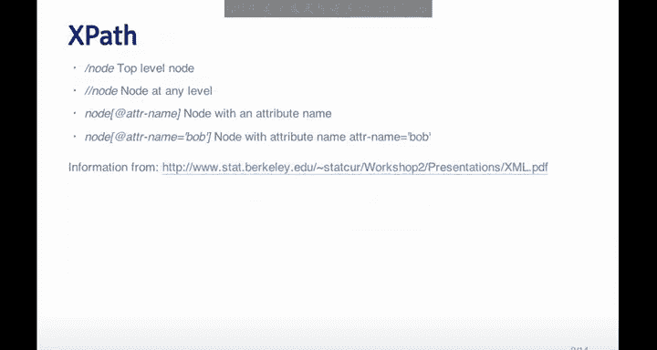

## 🔄 程序化提取内容

你可以使用 `xpathSApply` 函数程序化地提取文件的不同部分。

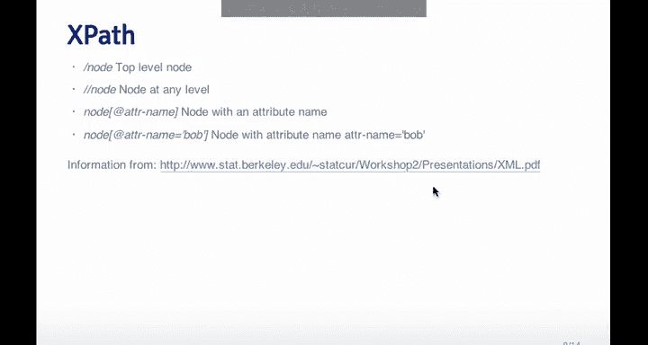

将解析后的 XML 对象传递给该函数，并指定要应用的函数（如 `xmlValue`）。默认情况下，它会递归地获取文档中每个被标记元素的值，最终将所有文本内容拼接在一起。

```r
xpathSApply(rootNode, "//name", xmlValue)
```

---

## 🎯 使用 XPath 进行精确提取

有时，你可能需要更精确地提取文档的特定部分，这时可以使用 **XPath** 语言。XPath 是另一种用于在 XML 文档中定位节点的语言。

虽然需要学习一些新语法，但掌握几个关键组件就能大有帮助。以下是一些基础概念：

*   `/node`：获取顶层节点。
*   `//node`：获取任何层级的节点。

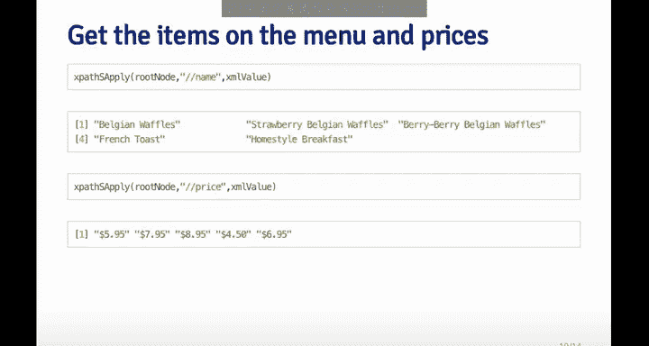


例如，要提取菜单上所有项目的名称和价格，可以这样做：

```r
# 提取所有名称
itemNames <- xpathSApply(rootNode, "//name", xmlValue)

# 提取所有价格
itemPrices <- xpathSApply(rootNode, "//price", xmlValue)
```

---

## 🌐 实战：从网页抓取数据

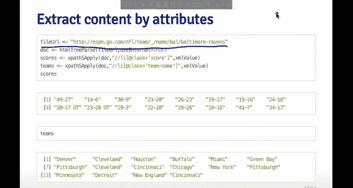

为了展示一个更复杂的例子，我们将从一个实际网页（巴尔的摩乌鸦队的主页）抓取数据。

首先，我们需要解析 HTML 文件（HTML 是 XML 的一种方言）。使用 `htmlTreeParse` 函数，并设置 `useInternal = TRUE` 以获取文件中的所有节点。

```r
fileUrl <- "http://espn.go.com/nfl/team/_/name/bal/baltimore-ravens"
doc <- htmlTreeParse(fileUrl, useInternal = TRUE)
```

假设我们想从页面中提取所有比赛得分。通过查看网页源代码，我们发现得分信息位于 `class` 属性为 “score” 的列表项 `<li>` 标签中。

我们可以使用 XPath 来精确提取这些元素的值：

```r
scores <- xpathSApply(doc, "//li[@class='score']", xmlValue)
```

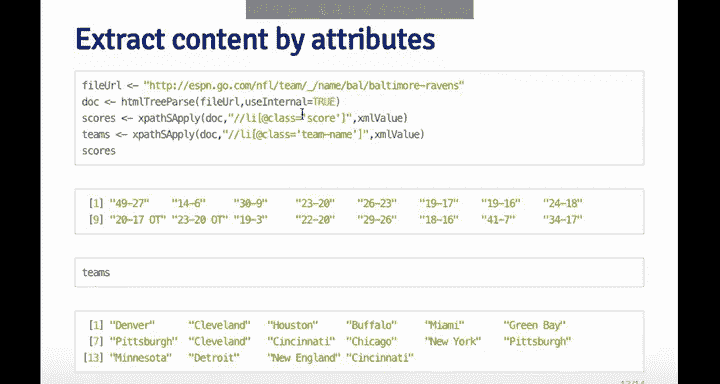

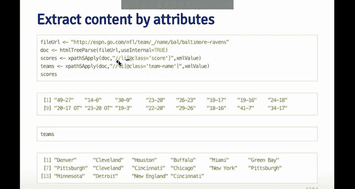

同样地，我们可以提取队伍名称，它们位于 `class` 属性为 “team-name” 的列表项中：

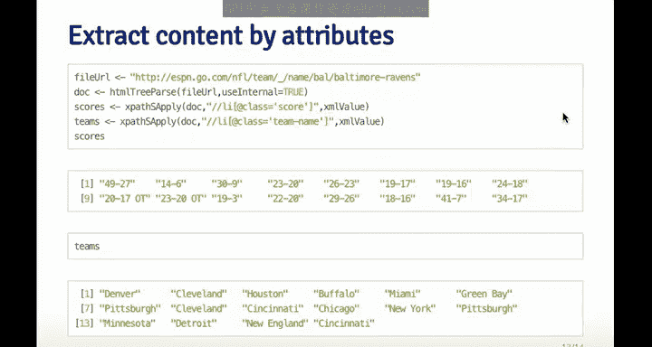

```r
teams <- xpathSApply(doc, "//li[@class='team-name']", xmlValue)
```

通过这种方式，我们成功地从网站上抓取到了比赛得分和队伍名称信息。

---

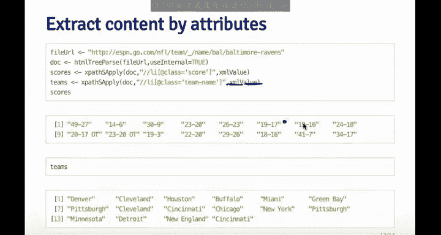

## 📚 总结与延伸阅读

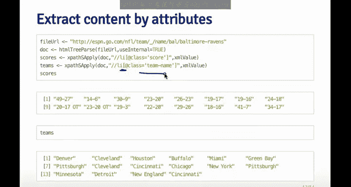


本节课简要介绍了 XML、R 中的 `XML` 包以及相关概念。

*   我们学习了 XML 的基本结构：标签、元素和属性。
*   我们掌握了如何在 R 中使用 `xmlTreeParse` 和 `htmlTreeParse` 读取和解析 XML/HTML 文件。
*   我们探索了使用 `xmlRoot`、`xmlName` 和列表式索引来浏览文档结构。
*   我们重点练习了使用 `xpathSApply` 函数结合 XPath 语言，程序化地精确提取所需数据。

如果你想深入学习，可以参考 `XML` 包的官方教程，其中包含简短入门和详细指南。网上也有大量关于如何使用 XML 从网站程序化提取信息的优秀资源。

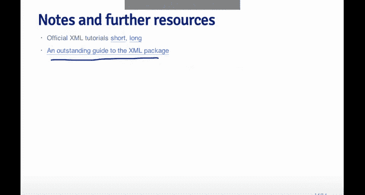

通过掌握这些技能，你将能够有效地处理网络上的结构化数据，为数据科学项目获取宝贵的信息源。