# 📘 课程 P81：读取 JSON 数据


在本节课中，我们将学习如何读取和处理 JSON 格式的数据。JSON 是一种轻量级的数据交换格式，广泛应用于网络数据传输和应用程序接口中。我们将了解其基本结构，并学习如何在 R 语言中使用 `jsonlite` 包来读取和转换 JSON 数据。

---

## 🏗️ JSON 简介

上一节我们介绍了课程概述，本节中我们来看看 JSON 的基本概念。

JSON 是 JavaScript 对象表示法的缩写。它是一种轻量级的数据存储和交换格式，与 XML 类似，具有结构化特点，但在语法和格式上有所不同。JSON 数据可以存储为数字、字符串、布尔值、数组或对象。

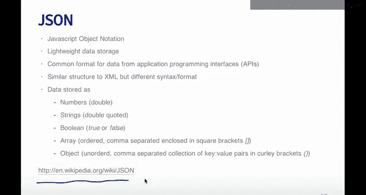

JSON 在应用程序编程接口中非常常见，例如，您可以通过 URL 以编程方式访问 Twitter 或 Facebook 等公司的数据。

如果您想了解更多关于 JSON 的信息，可以从维基百科的相关页面开始。

---

## 📄 JSON 文件结构示例

以下是一个 JSON 文件的示例，它来自 GitHub 的 API，展示了用户贡献的代码仓库信息。

整个 JSON 对象由一个外层花括号表示，每个独立的代码仓库信息则包含在各自的花括号内。每个仓库都有一系列与之关联的变量，例如 ID 或仓库的全名。

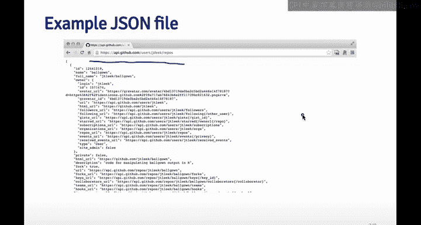

JSON 文件的结构通常是“键”后跟一个冒号，然后是“值”。您可以在其中嵌套结构，例如，一个数组可以作为 JSON 对象中某个变量的值。

在示例中，`owner` 变量的值就是一个数组，其中包含了登录名、头像 URL 等信息。

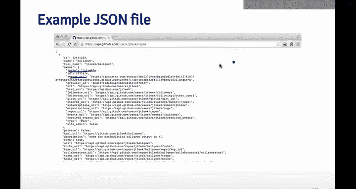

---

## 🔧 在 R 中读取 JSON 数据

在 R 语言中，有一个非常方便的包用于读取 JSON 数据，叫做 `jsonlite` 包。

以下是读取 JSON 数据的基本步骤：

1.  获取 JSON 数据所在的 URL。
2.  使用 `fromJSON()` 函数读取该 URL。
3.  函数将返回一个结构化的数据框。

读取后，数据框的列名对应 JSON 中的顶层变量，如 ID、名称、全名等。其中一些变量（如 `owner`）本身可能包含嵌套的数据结构，在 R 的数据框中可以表现为数据框中的列本身又是一个数据框。

例如，我们可以进一步查看 `owner` 列中的 `login` 信息。

---

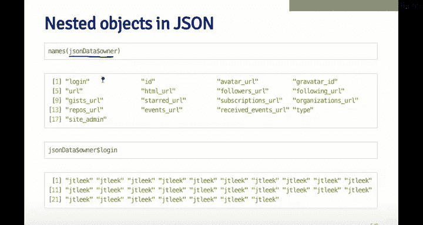

## 💻 代码操作演示

以下是具体的 R 代码操作示例。

首先，我们需要安装并加载 `jsonlite` 包。

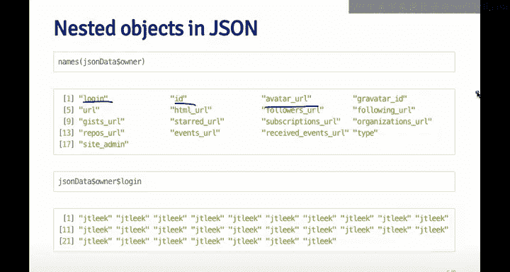

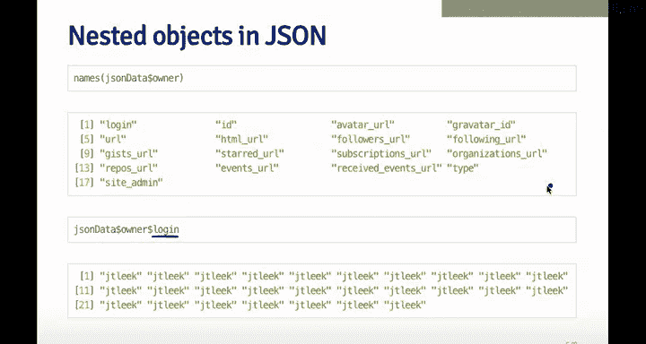

```r
# 安装并加载 jsonlite 包
install.packages("jsonlite")
library(jsonlite)
```


接着，我们可以从一个 URL 读取 JSON 数据。

```r
# 从 URL 读取 JSON 数据
myjson <- fromJSON("https://api.github.com/users/jtleek/repos")
# 查看数据框的列名
names(myjson)
# 查看 owner 列中的信息
names(myjson$owner)
# 查看所有仓库的登录名
myjson$owner$login
```

此外，您还可以将 R 中的数据框转换为 JSON 格式。例如，经典的 `iris` 数据集。

```r
# 将 iris 数据集转换为 JSON 格式的文本
myjson <- toJSON(iris, pretty=TRUE)
# 打印查看 JSON 文本
cat(myjson)
```

参数 `pretty=TRUE` 会使输出的 JSON 文本具有缩进，便于阅读。

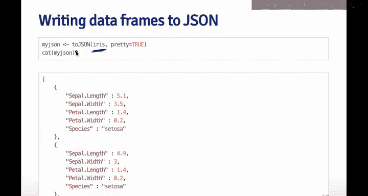

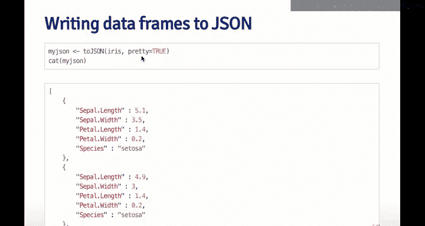

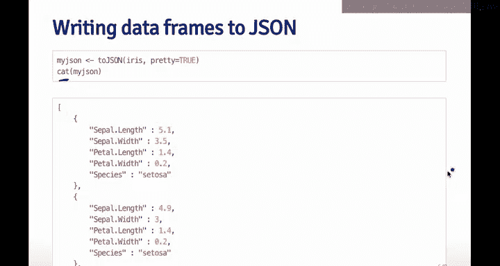

您还可以将这个新创建的 JSON 文本转换回数据框。

```r
# 将 JSON 文本转换回数据框
iris2 <- fromJSON(myjson)
# 查看数据框的前几行
head(iris2)
```

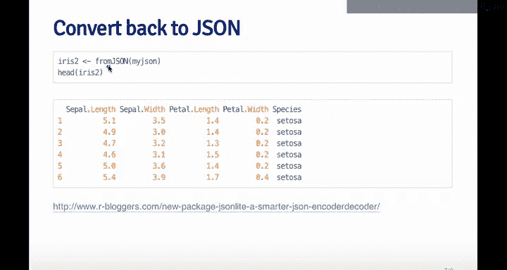

这样得到的数据框 `iris2` 将与原始的 `iris` 数据集完全相同。

---

## 📚 更多学习资源

如果您想获得更多信息，可以访问 JSON.org 以了解 JSON 的通用知识。

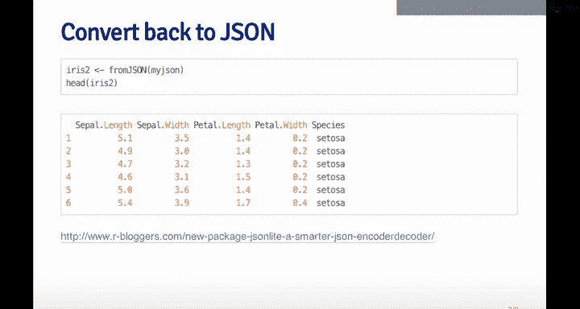

一个关于 `jsonlite` 包的优秀教程（也是本讲座的重要基础）可以在 R-bloggers 网站上找到。`jsonlite` 包的 vignette 文档也相当不错，能提供更多详细信息。

如果您需要处理更复杂的 JSON 结构，可以查阅这些资源以获取更多帮助。

---

## 🎯 课程总结

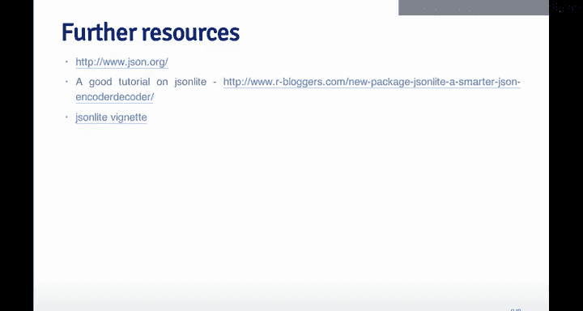

本节课中，我们一起学习了 JSON 数据格式的基础知识及其在 R 语言中的处理方法。我们了解了 JSON 的结构，掌握了使用 `jsonlite` 包中的 `fromJSON()` 和 `toJSON()` 函数进行数据读取与转换的技能。这些工具对于处理来自网络 API 的常见数据格式至关重要。