# 课程08：数据表包 📊


在本节课中，我们将要学习 `data.table` 包。这是一个在R语言中用于数据分析的工具，它通常是比标准数据框更快、更节省内存的版本。

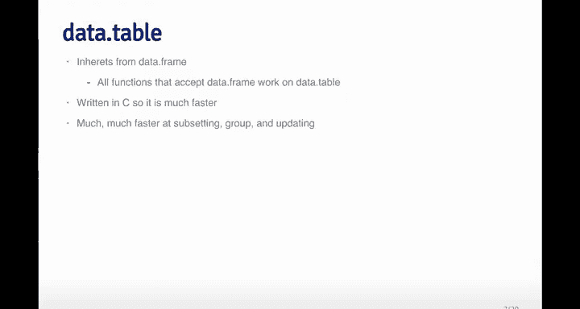

---

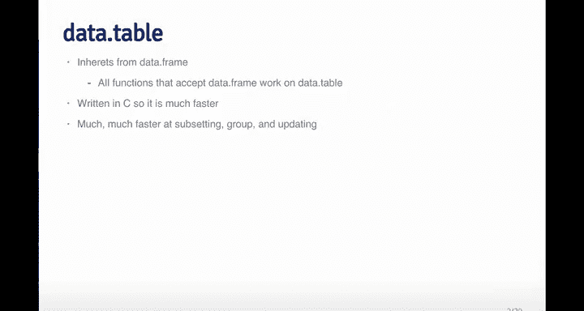

## 概述

`data.table` 包继承自数据框，因此所有接受数据框的函数也应该能在 `data.table` 上工作。它用C语言编写，在子集筛选、分组变量和更新变量方面比数据框快得多。不过，它需要学习一点新的语法。


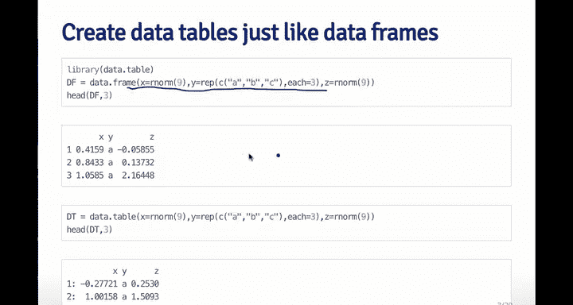

---

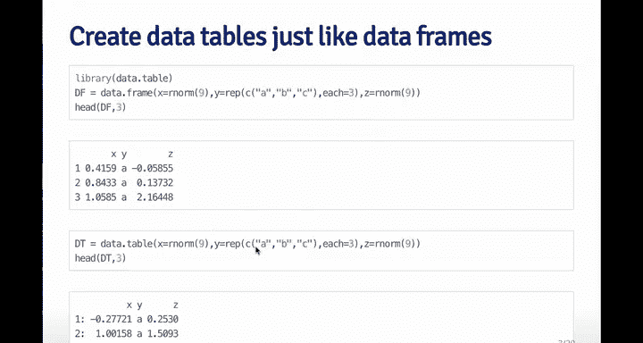

## 创建数据表

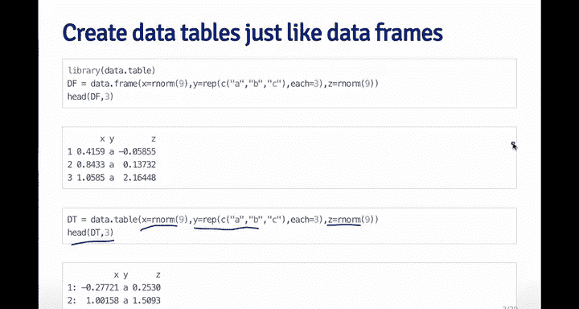

上一节我们介绍了 `data.table` 的基本概念，本节中我们来看看如何创建它。

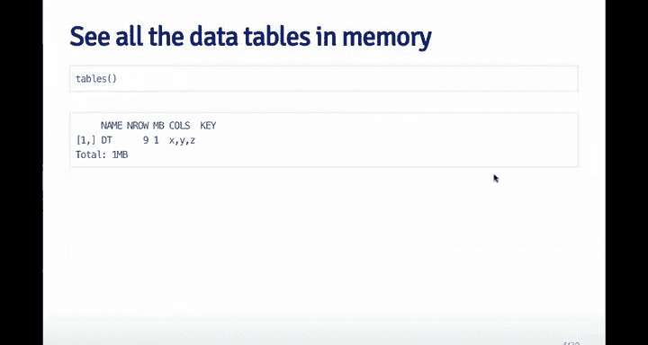

创建 `data.table` 的方式与创建数据框完全相同。

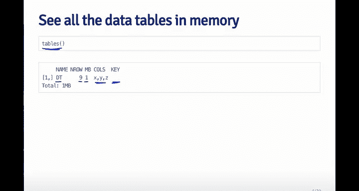

```r
# 创建一个数据框
df <- data.frame(x = rnorm(100), y = rep(c("a", "b", "c", "d"), 25), z = rnorm(100))

# 创建一个数据表
dt <- data.table(x = rnorm(100), y = rep(c("a", "b", "c", "d"), 25), z = rnorm(100))
```

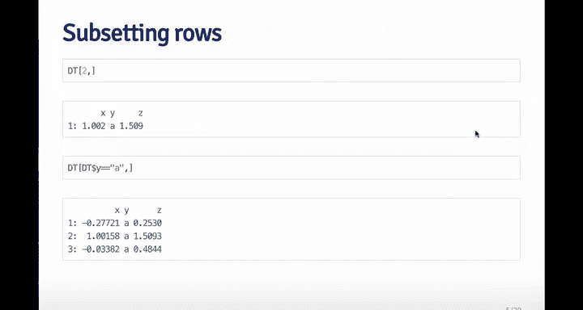

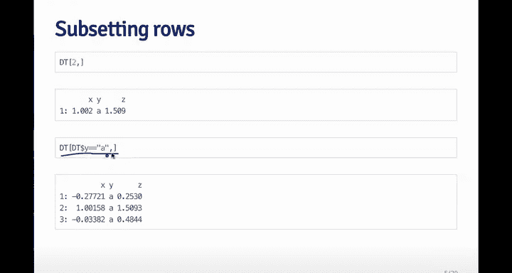

查看数据表顶部，其外观与数据框非常相似。

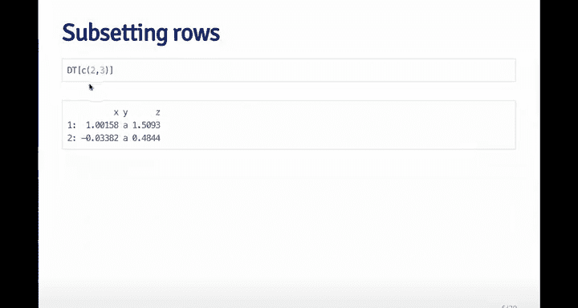

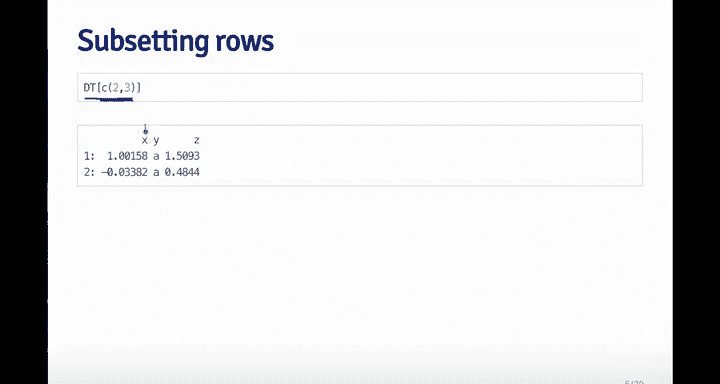

---

## 查看内存中的数据表

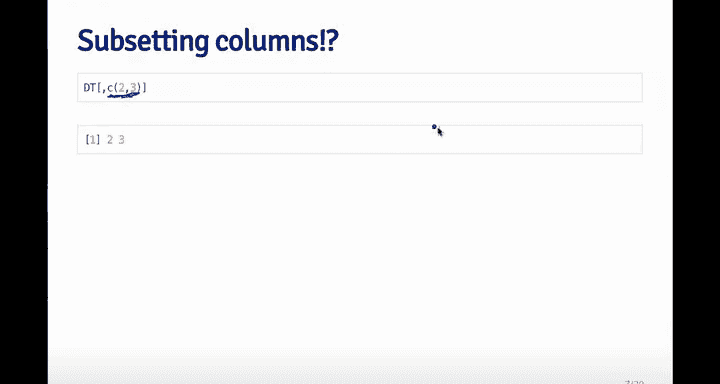

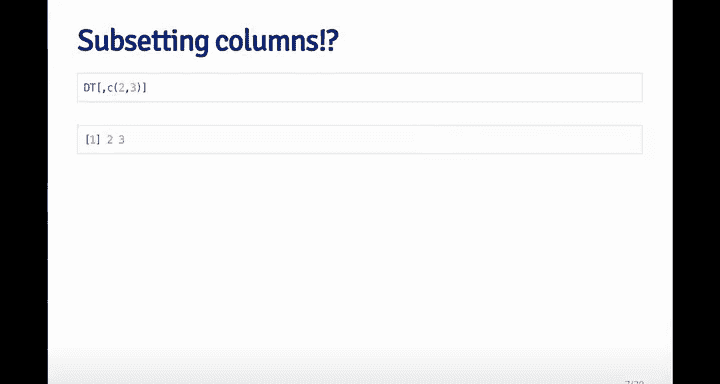

你可以使用 `tables()` 命令查看内存中的所有数据表。它会显示数据表的名称、行数、占用的内存大小、列数以及是否设置了键。

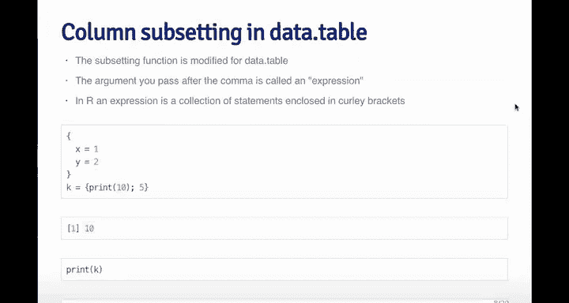

```r
tables()
```

---


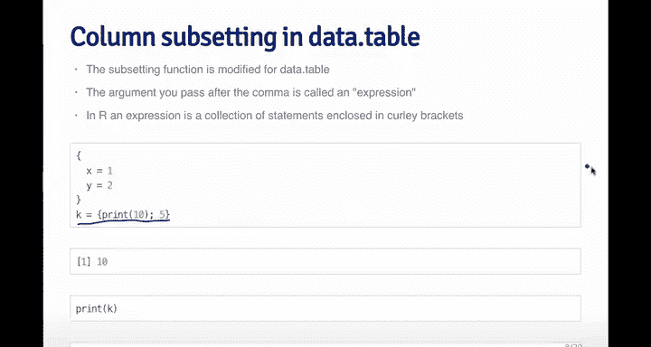

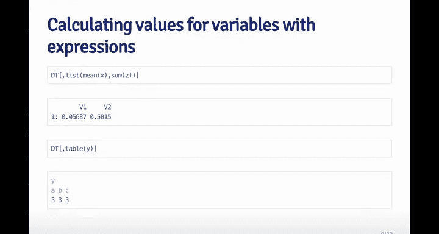

## 子集筛选行

与数据框类似，你可以在方括号的第一个位置（逗号前）对行进行子集筛选。

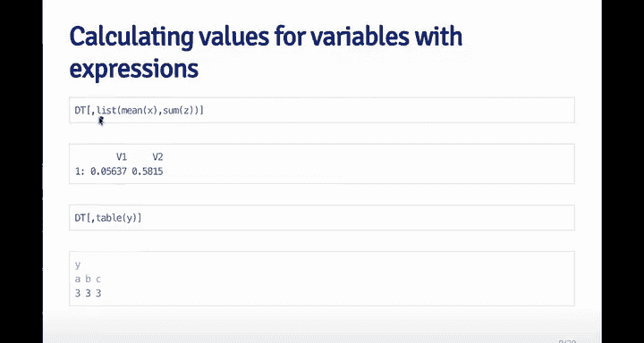

以下是筛选行的几种方法：

*   你可以像使用数据框一样，通过索引筛选行：`dt[2:3]` 会选取第二和第三行。
*   你也可以根据条件筛选行：`dt[y == "a"]` 会选取 `y` 列等于 “a” 的所有行。

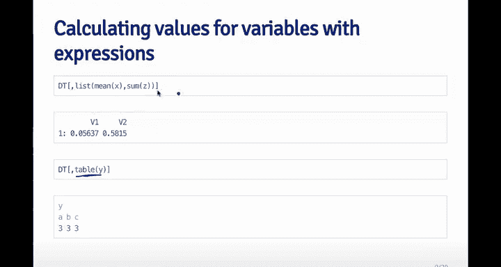

---

## 子集筛选列与表达式

如果你尝试用数据框常用的方式筛选列，`data.table` 的行为会有所不同。它使用**表达式**来以各种方式汇总数据。

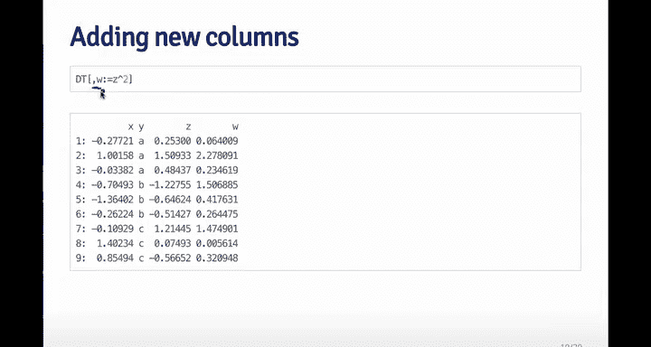

表达式是放在花括号 `{}` 内的一组语句。在 `data.table` 中，你可以在方括号的第二个参数位置传递一个函数列表，这些函数将应用于以列名命名的变量。

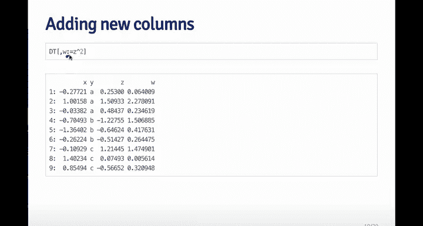

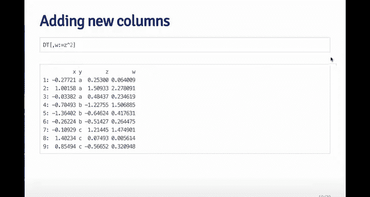

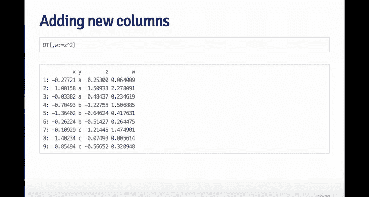

以下是使用表达式汇总数据的示例：

*   计算 `x` 列的均值和 `z` 列的总和：`dt[, list(mean(x), sum(z))]`
*   获取 `y` 列值的频数表：`dt[, table(y)]`

注意，你不需要为变量名加引号。

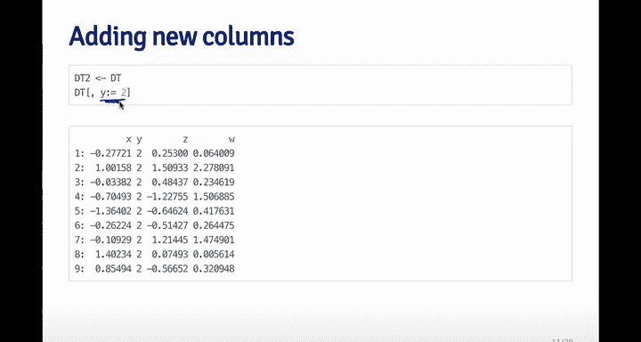

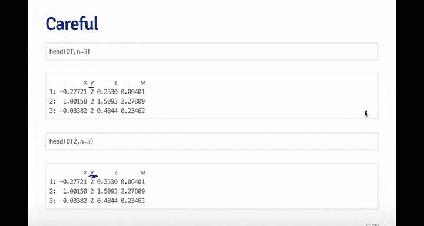

---

## 添加新列

`data.table` 可以非常快速且高效地添加新列。使用 `:=` 操作符可以直接在原有数据表上添加列，而无需创建整个数据表的新副本，这对于处理大型数据集非常有利。

例如，添加一个等于 `z` 列平方的新列 `w`：
```r
dt[, w := z^2]
```

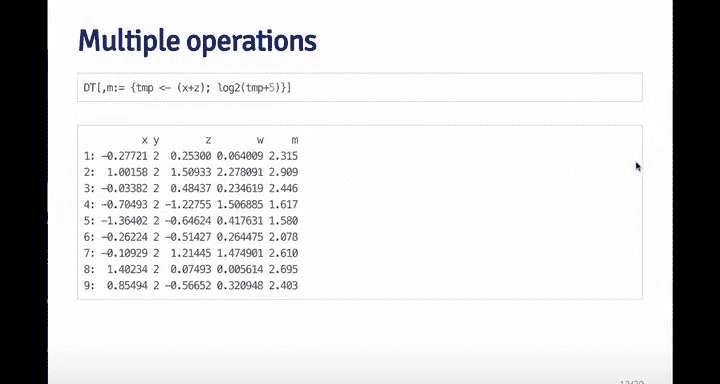

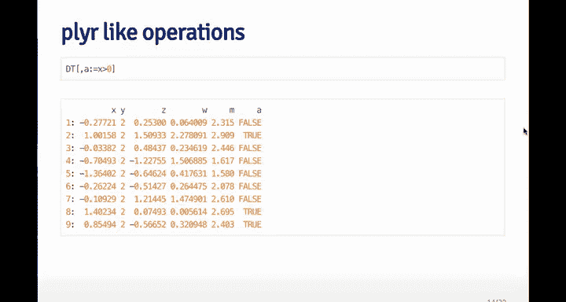

但是需要注意，由于默认不创建副本，直接赋值 (`dt2 <- dt1`) 后修改 `dt1` 也会影响 `dt2`。如果需要创建独立副本，必须显式使用 `copy()` 函数：
```r
dt2 <- copy(dt1)
```

---

## 多步操作与分组汇总

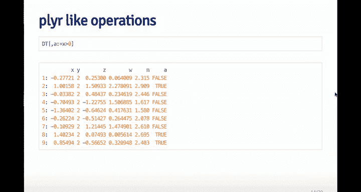

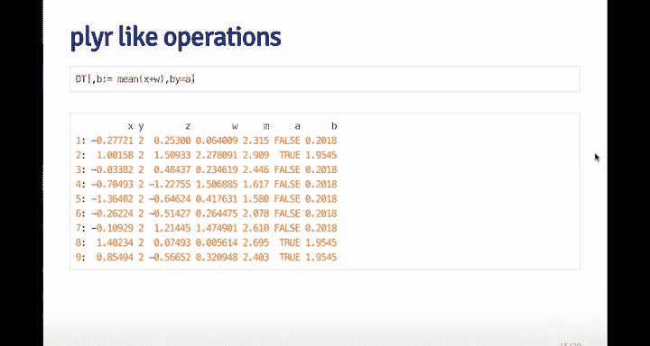

你可以在表达式中执行多步操作来创建新变量。每个语句用分号分隔，最后一个语句的结果会被返回。


例如，创建一个新变量 `m`，其值为 `log2(x + z + 5)`：
```r
dt[, m := {
  temp <- x + z
  log2(temp + 5)
}]
```

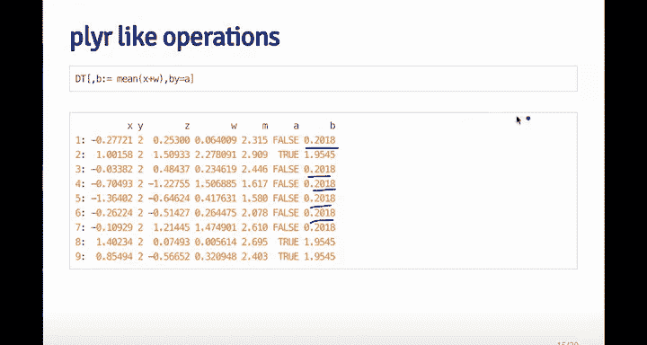


你还可以执行类似数据透视的操作。例如，先创建一个二进制变量 `a`，然后按 `a` 分组汇总：

1.  创建变量 `a`：`dt[, a := x > 0]`
2.  按 `a` 分组计算 `x + w` 的均值：`dt[, mean(x + w), by = a]`

---

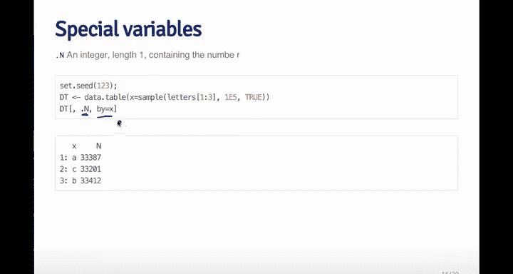

## 特殊变量与键

`data.table` 包含一些特殊变量以加速操作。例如，`.N` 是一个整数，包含每个分组出现的次数。使用 `.N` 可以快速计数：
```r
# 创建一个大数据表
big_dt <- data.table(x = sample(letters, 100000, replace = TRUE))
# 快速计算每个字母出现的次数
big_dt[, .N, by = x]
```

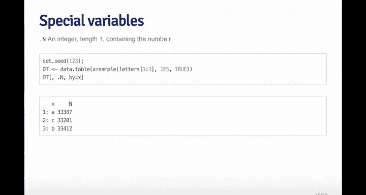

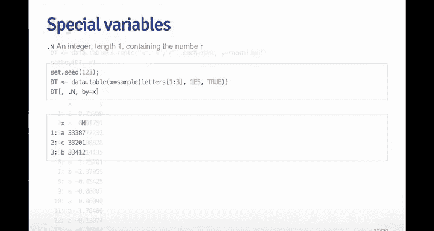

`data.table` 的一个独特功能是**键**。设置键后，可以更快地对数据表进行子集筛选和排序。

1.  设置键：`setkey(dt, x)`
2.  利用键快速筛选：`dt["a"]` 会快速筛选出 `x` 列等于 “a” 的所有行。

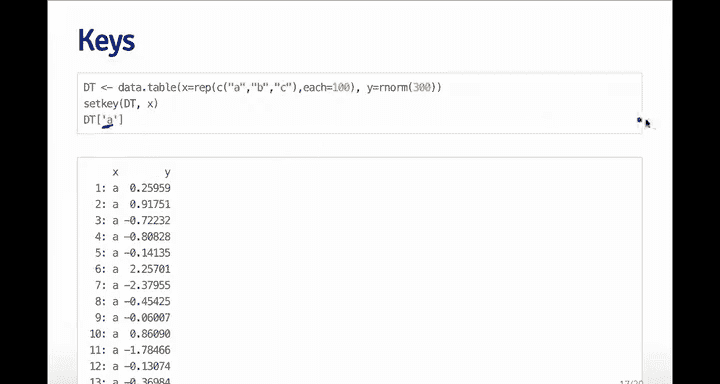

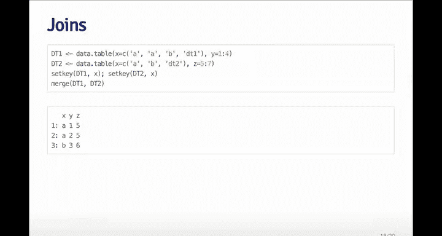

键还可以促进数据表之间的连接，只要两个数据表设置了相同的键，合并操作会比数据框快得多。

---

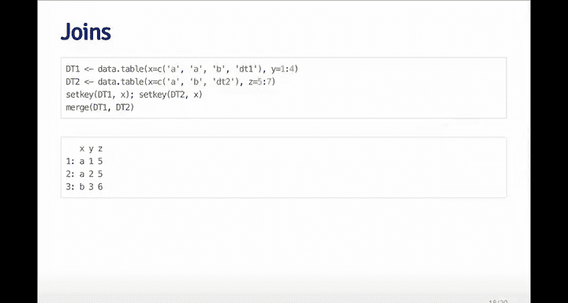

## 快速读取文件

`data.table` 的 `fread()` 函数可以非常快速地从磁盘读取文件，它是读取制表符分隔文件时 `read.table()` 的高效替代品。

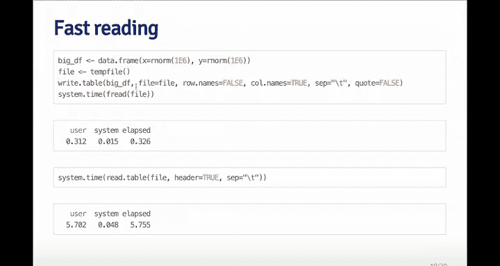

```r
# 创建一个临时文件并写入大数据框
temp_file <- tempfile()
write.table(big_df, file = temp_file, row.names = FALSE, col.names = TRUE, sep = "\t", quote = FALSE)


# 使用 fread 快速读入
system.time(dt <- fread(temp_file))
```

与 `read.table()` 相比，`fread()` 的速度通常快一个数量级以上。


---


## 总结与资源

本节课中我们一起学习了 `data.table` 包。总结来说，`data.table` 在速度和内存效率上通常优于数据框，但需要学习新语法，并且在复制数据表时需要小心。

*   **最新发展**：该包开发活跃，最新功能可在其开发版本中找到。它已经开始开发类似 `reshape2` 包中 `melt` 和 `dcast` 的操作。
*   **学习资源**：有一个网站详细列出了 `data.table` 与数据框之间的差异，对于从数据框过渡到 `data.table` 非常有用。
*   **致谢**：本讲义的笔记主要基于 Raphael Guardo 和 Kevin Uhi 在 GitHub 上分享的优秀资料。

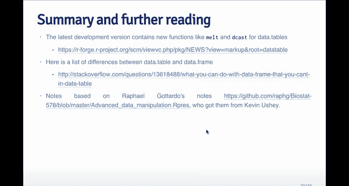

---

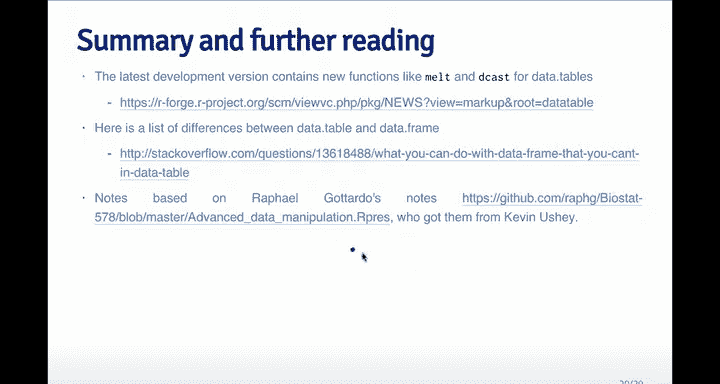

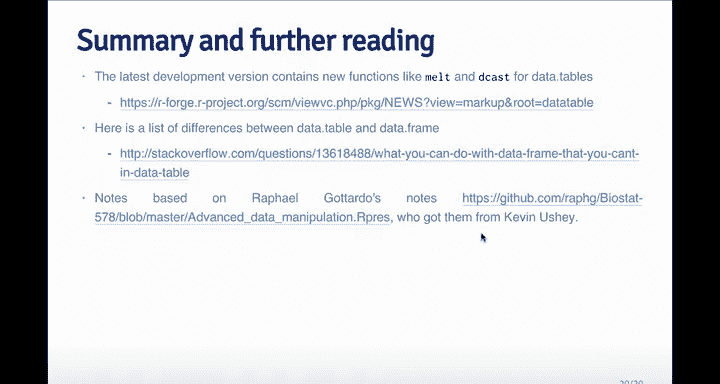

通过本教程，你应该对 `data.table` 包的核心功能、优势及基本用法有了初步了解。记住，虽然初期有学习成本，但其在处理大型数据时带来的性能提升是显著的。