# 课程12：从API读取数据 📡

在本节课中，我们将学习如何从API获取数据。API是应用程序编程接口，许多互联网公司（如Twitter或Facebook）都提供API，允许开发者下载特定数据。我们将重点介绍如何使用R语言的`httr`包，通过Twitter API获取数据。

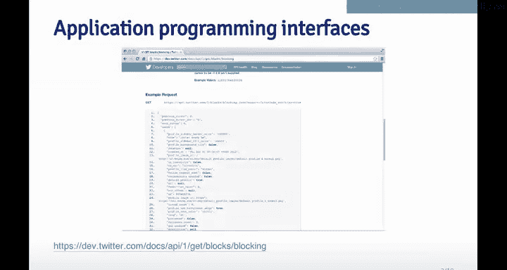

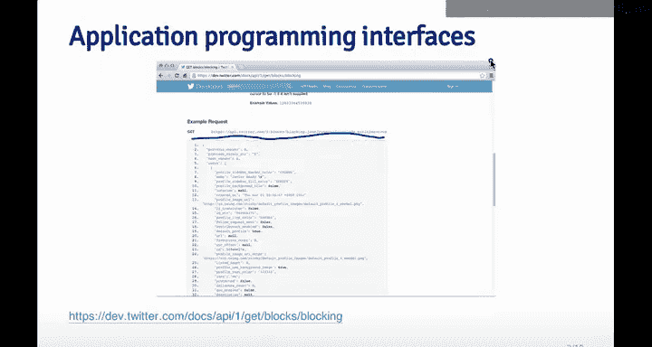

## 什么是API？

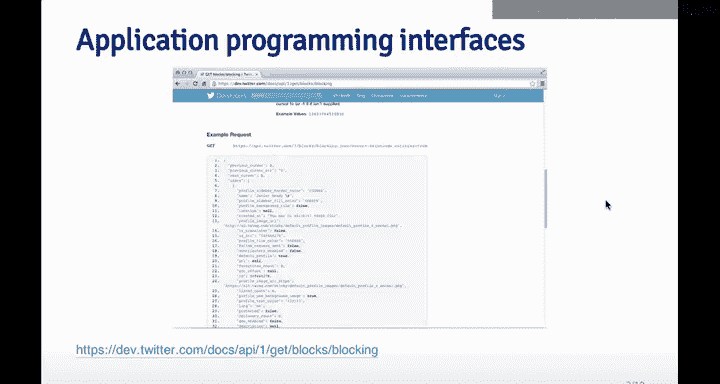

API是应用程序编程接口。例如，Twitter或Facebook等互联网公司会提供API，用户可以通过它下载数据。你可以获取关于哪些用户在发推文、推文内容，或者人们在Facebook上发布的信息。通常，你可以通过向特定URL发送GET请求来获取这些数据。

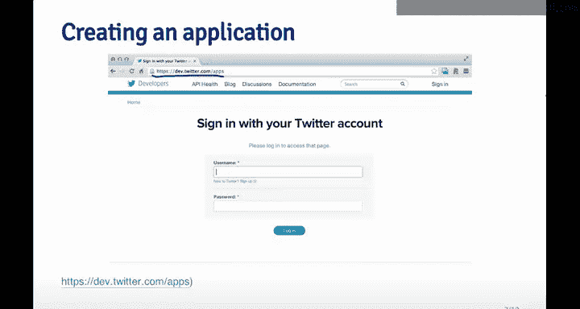

我们将能够使用`httr`包从这些网站获取数据。

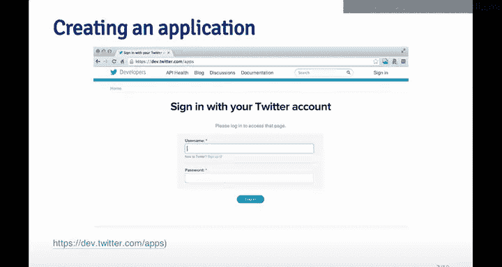

## 创建API应用账户

通常，你需要做的第一件事是创建一个账户。这里指的不是普通的用户账户，而是需要向特定组织（如Twitter）的开发团队或API注册一个应用账户。

例如，我们将访问 `dev.twitter.com/app`。

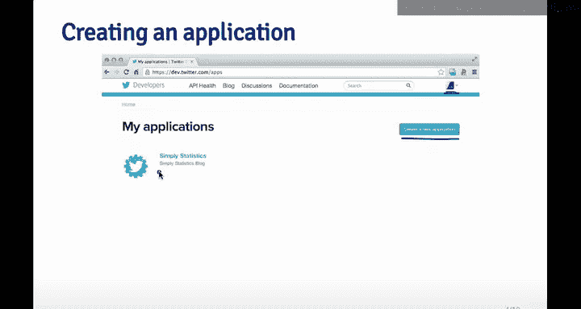

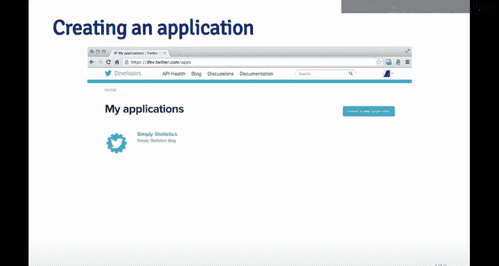

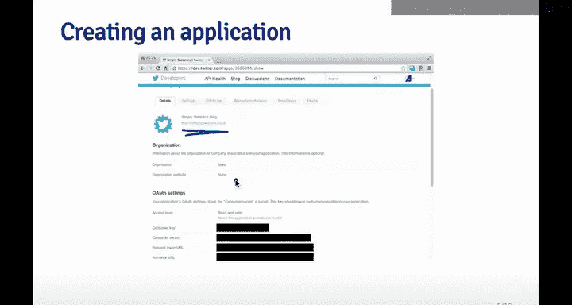

我们将创建一个应用。这里，我将使用我的博客Twitter账号“simplystats”来创建一个应用。

现在，我们已经使用Twitter详细信息登录。你可以看到我以“simplystats”登录。我可以点击按钮创建一个新应用。这将为我提供一些数字，稍后我将用这些数字在R中验证应用并访问数据。

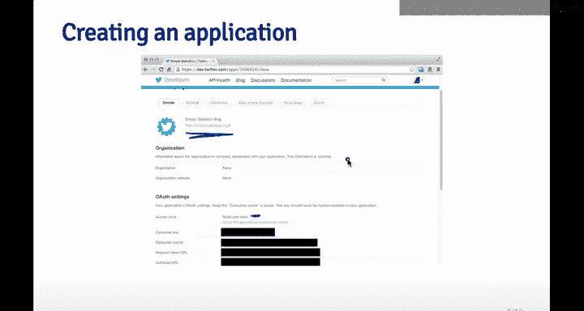

这里我已经创建了一个名为“simplystats blog”的应用。点击该应用，会进入一个类似这样的页面。这是应用页面，上面有应用的URL，还有一些关于我的组织和组织网站的信息我尚未填写。

在“OAuth设置”下方，我可以看到我对API拥有读写权限。这里有一系列数字，我已将它们涂黑，因为这些数字对你创建的应用是私密的。

但你会拥有自己的**消费者密钥**、**消费者密钥**、请求令牌URL和授权URL。创建应用后，你需要记下所有这些数字，因为我们稍后将在R代码中使用它们来访问API。

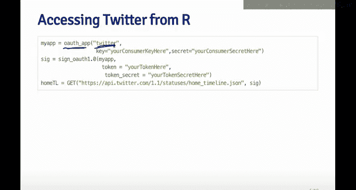

## 在R中设置认证

以下是我们要做的步骤：我们将使用`httr`包。加载该包后，我们将使用`oauth_app`命令。这将启动你应用的授权过程。

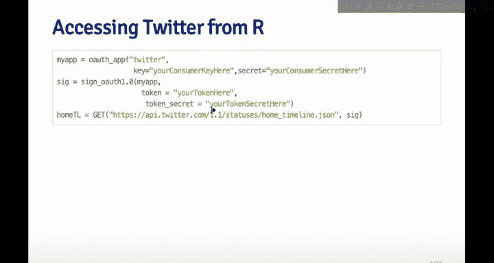

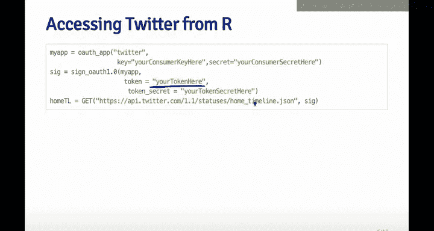

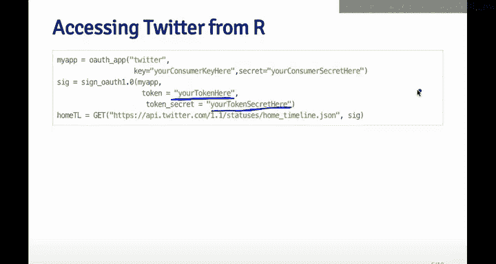

你需要为应用命名（这不会发送给API，只是为了方便），我将其命名为“twitter”，因为它是Twitter应用。

然后，我将在这里输入我从应用网站获得的**消费者密钥**和**消费者密钥**。

接下来，我将使用从网站获取的**令牌**和**令牌密钥**来签署并登录该应用。

完成这些步骤后，我就创建了能够访问Twitter私有数据的凭证，这些数据仅对拥有应用的人可用。

## 从API获取数据

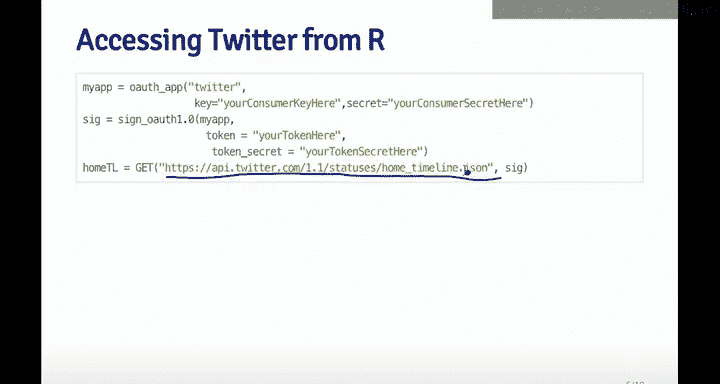

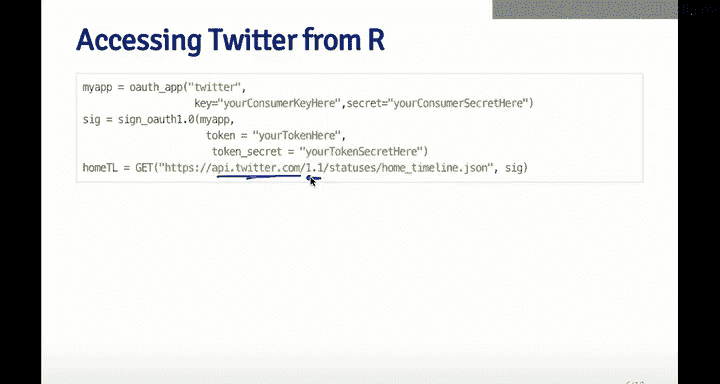

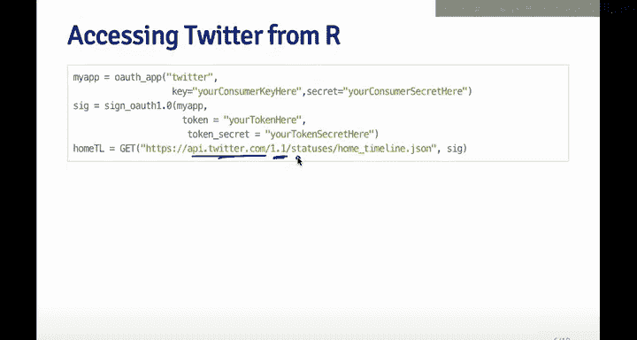

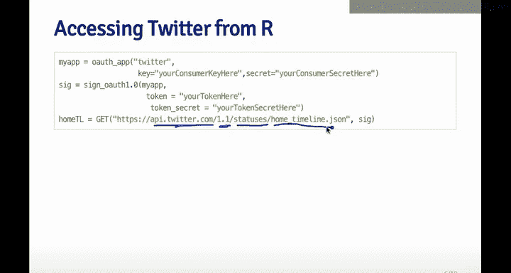

现在，我将使用`GET`命令。这与我之前从互联网读取数据时所做的非常相似。我将使用一个非常特定的URL，这个URL对应Twitter API。URL的这一部分`api.twitter.com/1.1`表示我正在使用的API版本（1.1，这是Twitter API的当前版本）。

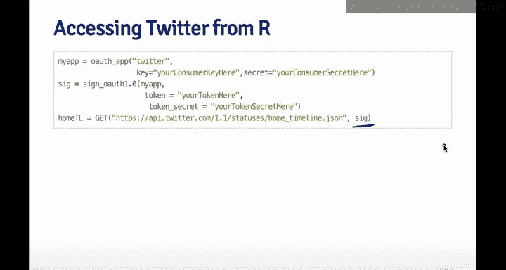

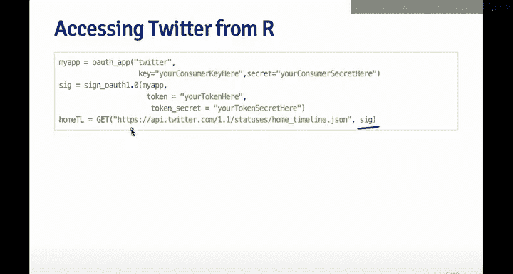

然后，我传递更多组件，这些组件对应我想要获取的数据。在本例中，我想获取我的主页时间线上的状态，并以JSON文件格式获取（这是Twitter目前唯一支持的数据格式）。

接着，我不使用用户名或密码进行身份验证，而是传递通过OAuth登录获得的认证信息。

我将得到的是对应此URL的页面，实际上就是一些JSON数据。

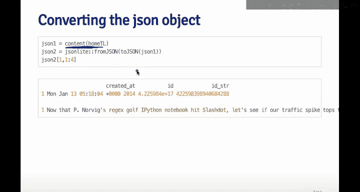

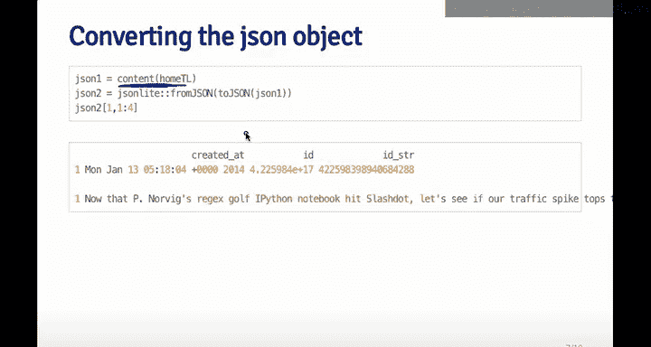

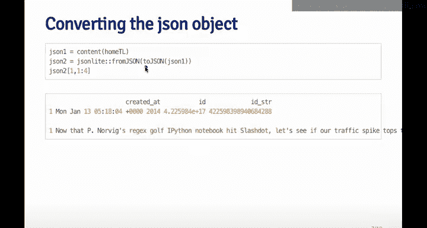

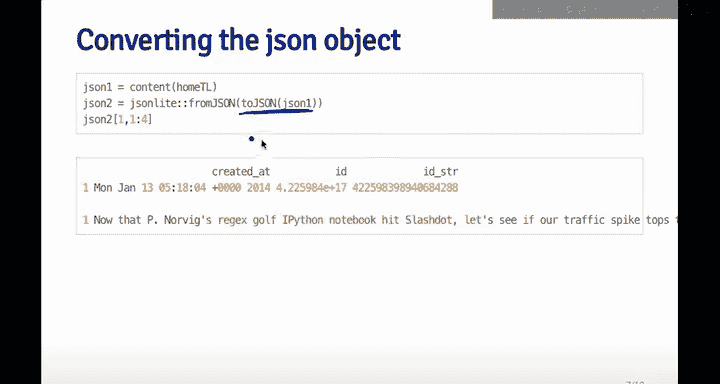

## 处理JSON数据

我可以使用`content`函数来提取JSON数据。`content`函数会识别出这是JSON数据，并使用`RJSONIO`包中的`fromJSON`函数。这将返回一个结构化的R对象，但可能有点难以阅读。

因此，我将使用`jsonlite`包将其重新格式化为数据框。具体做法是：获取从原始`content`命令中得到的JSON结构，将这个结构化的R对象转换回JSON，然后使用`jsonlite`版本的`fromJSON`参数来创建数据框。

现在，这个数据框的每一行都对应我主页时间线上的一条推文。

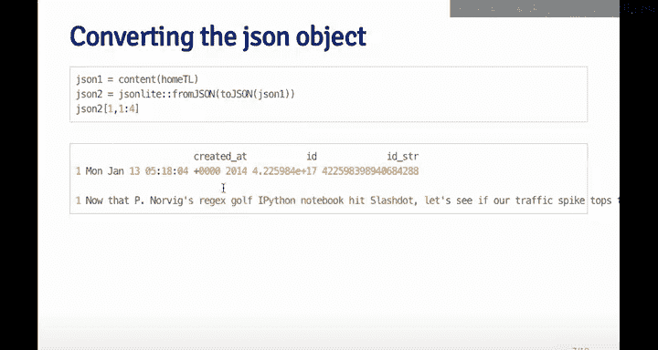

这里，我将查看这个数据框的第一行，它是我提取数据时主页时间线上最新的推文。我将查看前四列：推文创建的时间、推文的ID号、ID字符串，以及推文的实际文本内容。

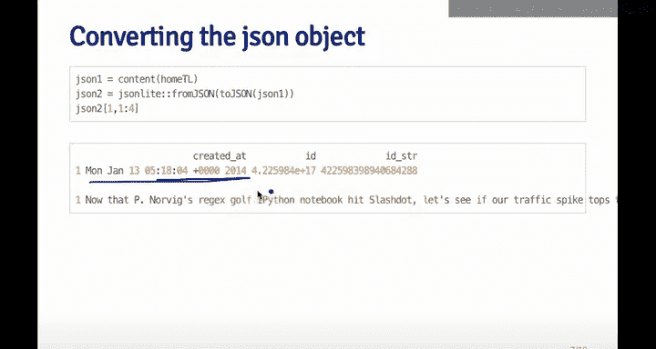

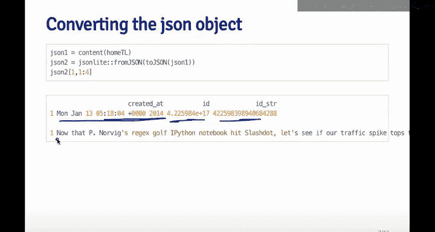

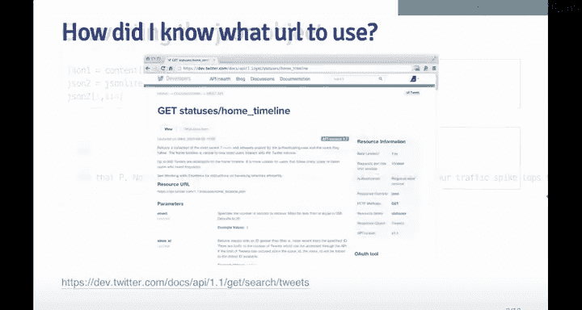

这就是我从互联网收集数据时最新的推文。你可以通过这种方式从Twitter提取信息。这实际上只是如何收集关于我的主页时间线信息的请求，但你还可以进行许多其他请求，通过Twitter访问各种不同的数据。

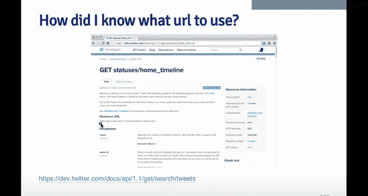

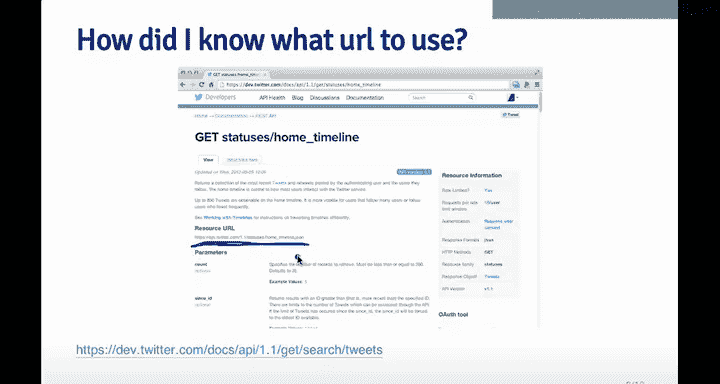

## 查阅API文档

那么，我是如何知道该使用哪个URL的呢？你需要查阅Twitter API的文档。这是之前提到的同一个网站。

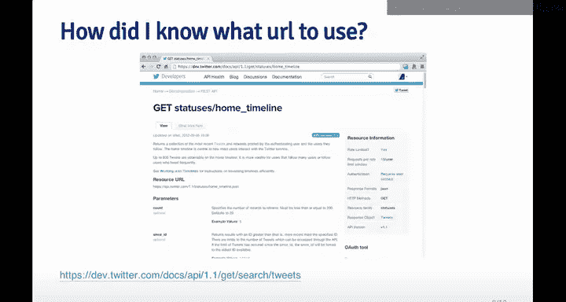

我将查看Twitter文档，我会看到这里写着“资源URL”，这就是我要传递给`GET`命令的URL。

文档下方还有许多参数。如果你查阅如何格式化发送给API的参数，你实际上可以发送许多不同的参数。例如，你可以告诉API要收集多少条推文、在什么时间收集等，具体取决于你访问的URL。

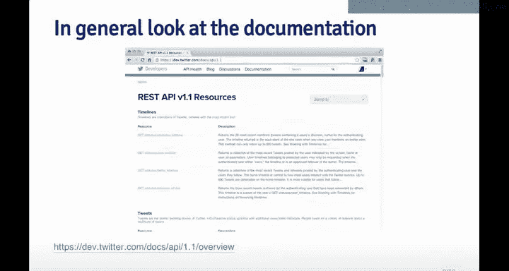

如果你想获取其他信息，不仅仅是关于主页时间线的信息，你可以访问Twitter的主要文档。这是API最新版本（1.1版）的文档，它会提供获取各种不同信息的方法。你可以获取关于提及、用户时间线、主页时间线、转推等所有类型的信息，也可以搜索Twitter feed，获取你感兴趣的特定标签或话题标签。

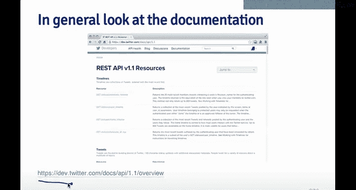

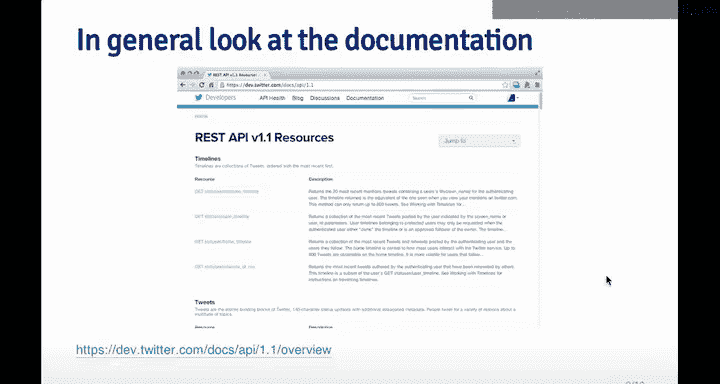

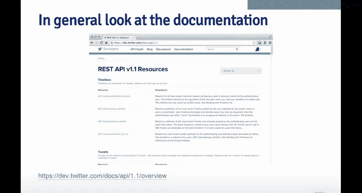

## 总结与扩展

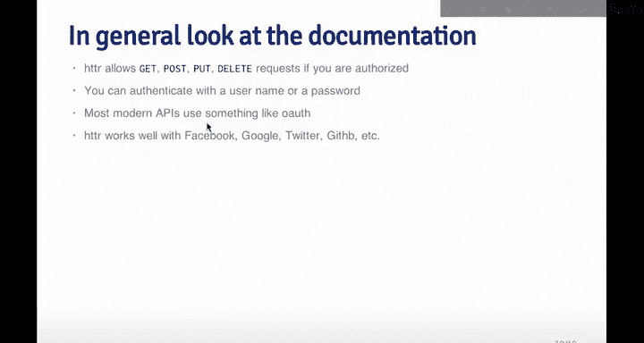

总的来说，你必须查阅API的文档。`httr`包允许在授权的情况下进行GET、POST、PUT、DELETE请求。正如你所见，我被授权对“simply stats”的时间线进行读写操作，因为我是通过它创建应用的。

在某些情况下，你也可以使用用户名和密码进行身份验证。不过，大多数现代API（如我们刚才看到的Twitter）都使用类似OAuth的机制。`httr`包与Facebook、Google、Twitter、GitHub等配合良好。如果你访问GitHub上的`httr`演示组件，你可以看到许多如何访问不同网站API的示例。实际上，本讲座就是基于Twitter API的演示建模的。

本节课中，我们一起学习了API的基本概念、如何创建Twitter开发者应用并获取密钥、如何在R中使用`httr`包进行OAuth认证，以及如何发送GET请求获取并解析JSON格式的Twitter数据。掌握从API获取数据是数据科学中连接外部数据源的关键技能。