# 课程07：RStudio导览 🧭

在本节课中，我们将学习RStudio集成开发环境（IDE）的基本布局和核心功能。我们将逐一介绍其四个主要区域以及菜单栏，帮助你熟悉这个强大的数据分析工具的工作界面。

## 概述

RStudio是专为R语言设计的集成开发环境，它将编码、数据管理、结果可视化和帮助文档等功能整合在一个直观的界面中。熟悉其布局是高效使用R进行数据科学工作的第一步。

## RStudio界面布局

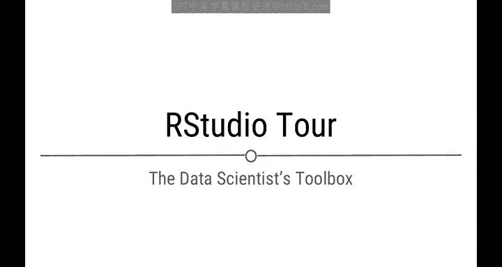

当你首次打开RStudio时，界面大致可被划分为四个象限，每个象限都有其特定的功能，此外还有一个主菜单栏。

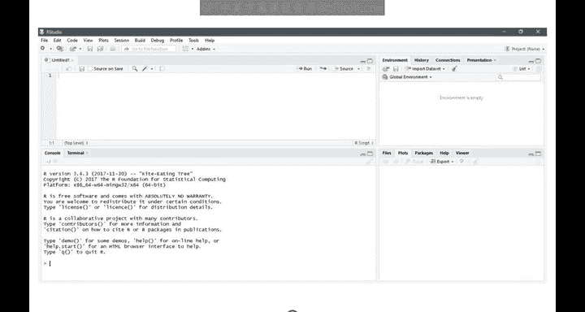

如果你的界面左上角象限缺失，整个左侧只有“控制台”区域，请按以下步骤操作：点击 **File** -> **New File** -> **R Script**。这样界面就会更接近标准布局。

你可以通过将鼠标悬停在象限之间的分隔线上，然后点击并拖动来调整各个区域的大小。


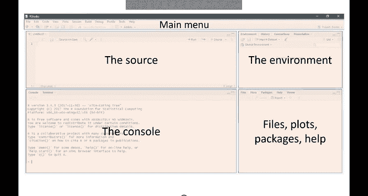

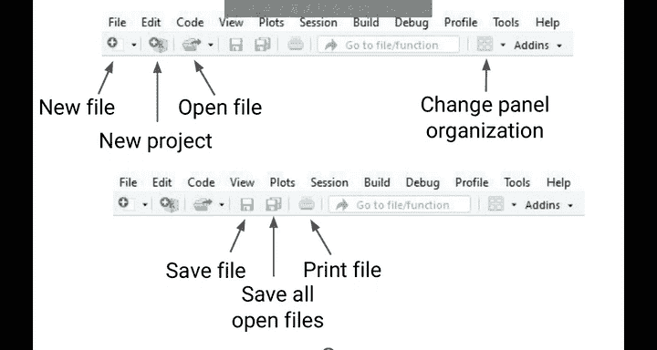

接下来，我们将逐一介绍这些区域及其主要功能。RStudio功能非常丰富，我们无法涵盖所有细节，因此强烈建议你在学习后自行探索。

## 菜单栏详解

菜单栏位于屏幕顶部，通常有两行。第一行是标准的菜单项，以 **File** 和 **Edit** 开始。其下方是一行图标，这些是常用功能的快捷方式。


以下是几个你将频繁使用的主要菜单：

**文件菜单 (File Menu)**
在这里，你可以打开新的或已保存的文件，也可以打开新的或已保存的项目（关于R项目，我们将在未来的课程中专门讲解）。你还可以保存当前文档或关闭RStudio。

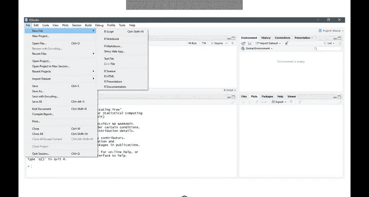

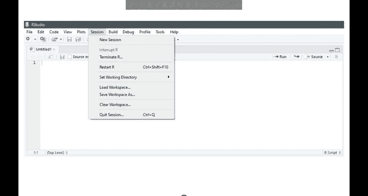

将鼠标悬停在 **New File** 上，会弹出一个子菜单，显示可创建的各种文件格式。R脚本和R Markdown文件是最常用的类型，但你也可以生成R Notebook、Web应用、网站或幻灯片演示文稿。点击其中任何一个，都会在“源代码”象限打开一个新标签页。我们将在后续课程中详细讲解R Markdown文件。

**会话菜单 (Session Menu)**
此菜单包含一些R特有的功能，例如你可以重启、中断或终止R会话。当R运行异常或卡住时，这些功能非常有用，可以让你停止当前操作并重新开始。


**工具菜单 (Tools Menu)**
这是一个功能宝库，值得你深入探索。目前你需要知道的是，你可以在这里安装新包（参见下一讲）、设置版本控制软件（参见未来关于链接GitHub和RStudio的课程），以及设置RStudio的外观和功能选项。目前我们可以暂时不修改这些设置，但建议你在对RStudio有更多经验后，自行探索并调整至最适合你偏好的状态。

## 控制台区域

控制台区域在你打开R时就会出现，它应该看起来很熟悉。这是你输入和执行命令的地方，也是命令输出显示的地方。

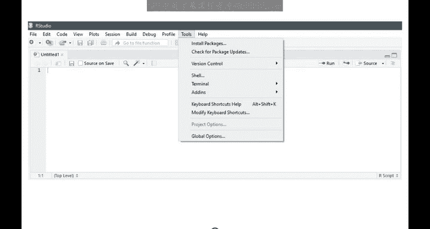

要执行你的第一个命令，请在大于号 `>` 提示符后输入 `1 + 1`，然后按回车键。你应该会看到输出 `[1] 2`，其中 `[1]` 表示索引，`2` 是计算结果。

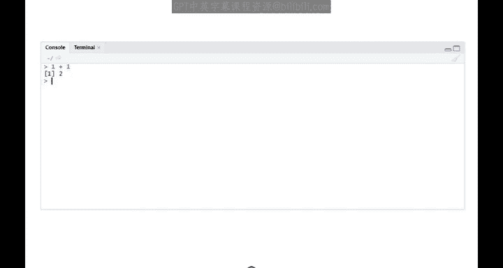


现在，将屏幕上的代码复制并粘贴到你的控制台中，然后按回车键：
```r
example <- matrix(1:8, nrow = 4, ncol = 2)
```
这段代码创建了一个4行2列的矩阵，其中包含数字1到8。

要查看这个矩阵，请先看向“环境”象限，你应该能看到一个名为 `example` 的数据集。点击 `example` 所在行的任意位置，源代码象限会打开一个新标签页，显示你创建的矩阵。

在RStudio中，你创建的任何数据框或矩阵都可以通过这种方式查看。同时，RStudio还会在环境象限中告诉你关于该对象的一些信息，例如它是列表还是数据框，或者它包含的是数字、整数还是字符。这些信息非常有用，因为某些函数只适用于特定类别的数据，而了解你拥有什么类型的数据是使用这些函数的第一步。

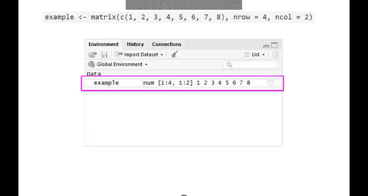
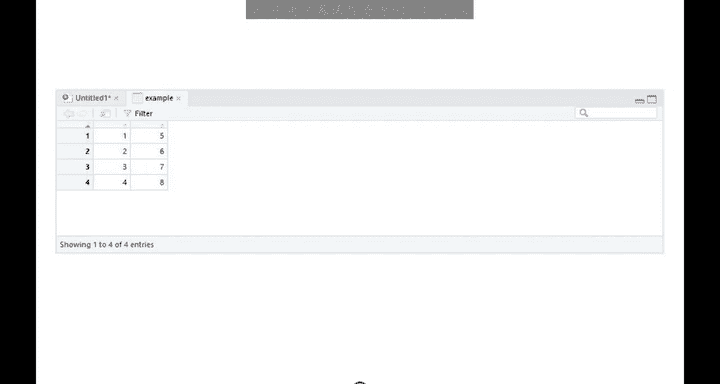


## 环境与历史标签页

环境象限顶部还有另外两个标签页。我们现在看一下 **History** 标签页。

你的历史标签页应该类似下图。这里会显示你在本次R会话中运行过的所有命令。点击其中任何一个命令，你可以选择 **To Console** 或 **To Source**，这将分别把该命令重新运行于控制台，或移动到源代码编辑器。

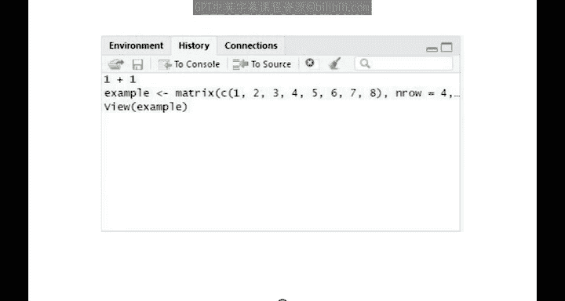


现在，请为你刚才创建的 `example` 矩阵执行此操作，将其发送到源代码编辑器。

## 源代码编辑器

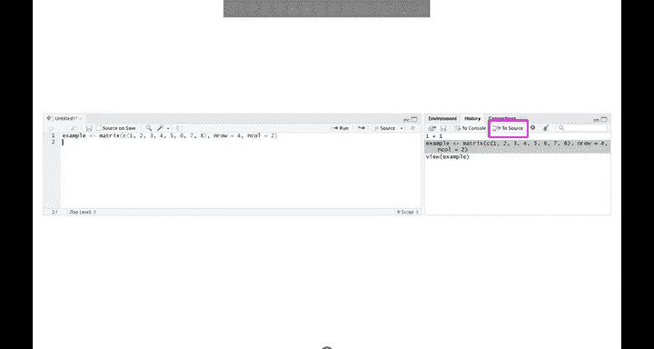

源代码面板是你在RStudio中花费大部分时间的地方。在这里，你可以保存你想留待后用的R命令，无论是作为所做工作的记录，还是作为重新运行代码的方式。当我们讨论R Markdown时，会在这个象限花费大量时间。

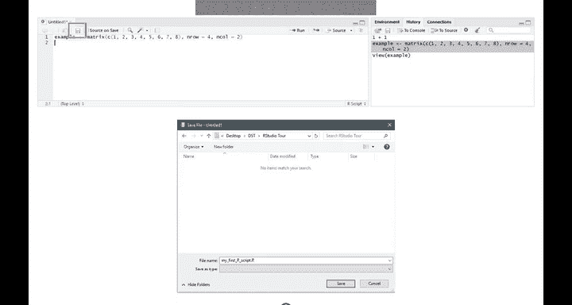


现在，请点击该象限顶部的保存图标，将脚本保存为 `my_first_R_script.R`。这样，你就永久保存了创建这个矩阵的记录。

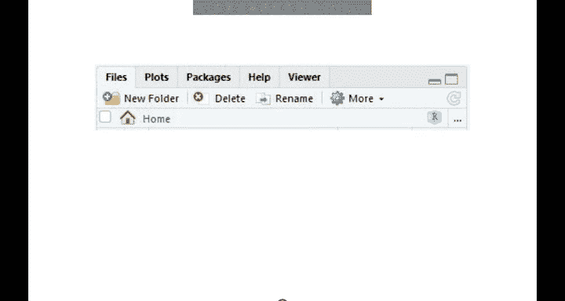


## 文件、绘图、包与帮助

最后要看的区域位于RStudio窗口的右下角。这个象限顶部有五个标签页：**Files**, **Plots**, **Packages**, **Help**, **Viewer**。


以下是各标签页的功能：

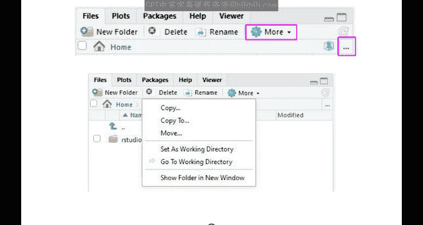

**文件标签页 (Files)**
在这里，你可以查看当前工作目录中的所有文件。如果这不是你想要保存或检索文件的位置，你也可以在此标签页中更改当前工作目录：使用最右侧的省略号（…）找到所需文件夹，然后在“更多”（齿轮图标）菜单下将此新文件夹设置为工作目录。

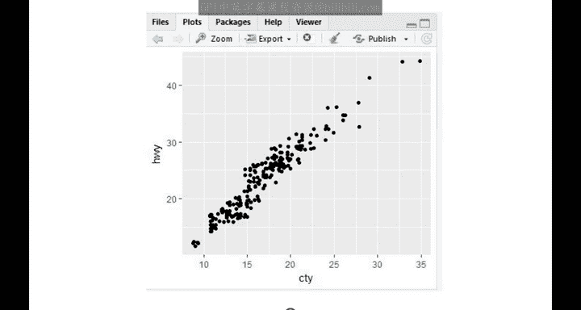

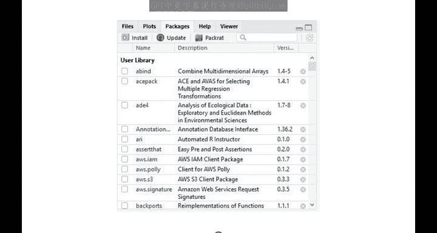

**绘图标签页 (Plots)**
如果你的代码生成了图形，它将显示在这里。你可以使用箭头浏览之前生成的图形。“Zoom”功能会在一个新窗口中打开图形，该窗口比象限区域大得多。“Export”是保存图形的方式，你可以将其保存为图像或PDF。“扫帚”图标会清除内存中的所有图形。

**包标签页 (Packages)**
这将在下一节关于R包的课程中更深入地探讨。在这里，你可以查看所有已安装的包，加载和卸载这些包，以及更新它们。


**帮助标签页 (Help)**
在这里，你可以找到R包和各种函数的文档。该面板的右上角有一个搜索功能，当你对特定函数或包有疑问时可以使用。

## 总结

在本节课中，我们游览了RStudio软件。我们熟悉了主菜单及其各项功能；查看了控制台，那里是我们输入和运行代码的地方；然后了解了环境面板，它列出了R会话中创建的所有对象，并允许你在源代码的新标签页中查看这些对象。在同一象限中，还有一个历史标签页，它保存了所有已运行命令的记录，并提供了在控制台中重新运行命令或将命令发送到源代码编辑器进行保存的选项。源代码编辑器是你保存R命令的地方。右下角的象限则包含了工作目录中所有文件的列表、显示生成的图形、列出已安装的包，并在你需要帮助时提供帮助文档。

请花些时间自行探索RStudio，以更好地掌握这个强大的工具。

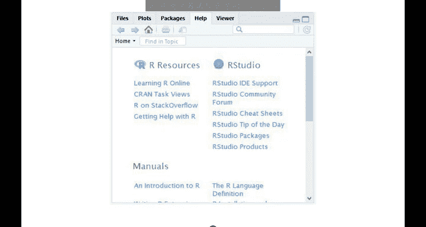

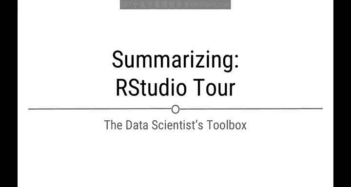


