# 课程 P97：正则表达式 II 🔍

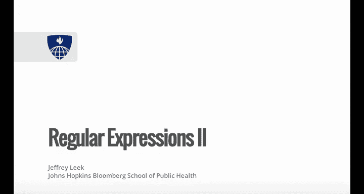

在本节课中，我们将继续学习正则表达式，深入探讨更多元字符的用法，包括点号、或运算符、括号、问号、星号、加号以及花括号等。这些工具能帮助我们构建更强大、更灵活的文本匹配模式。

---

上一节我们介绍了正则表达式的基本概念和部分元字符。本节中，我们来看看更多用于构建复杂匹配模式的元字符。

## 点号元字符 `.`

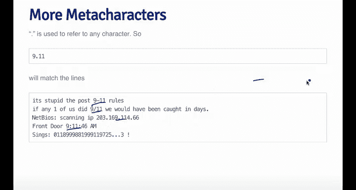

点号 `.` 是一个元字符，代表**任意一个字符**。

例如，模式 `9.11` 会匹配所有包含数字9，后接**任意一个字符**，再接着数字11的文本。

**公式表示：** `9.11` 匹配 `9` + 任意字符 + `11`

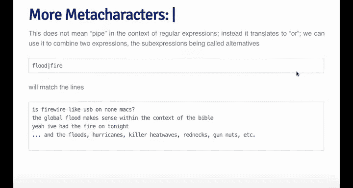

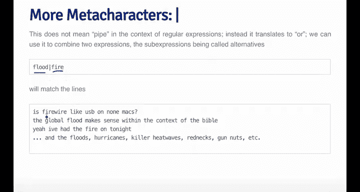

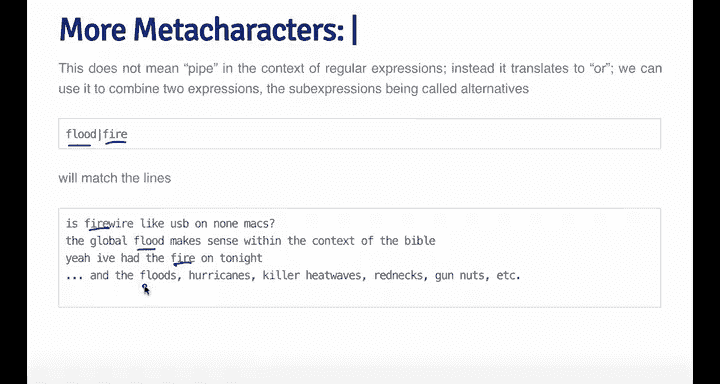

因此，它能匹配以下所有短语，因为每个例子中，9和11之间都恰好由一个字符分隔。

## 或运算符 `|`

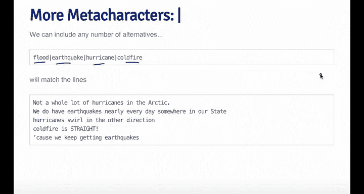

或运算符 `|` 用于组合两个不同的表达式，这两个子表达式称为“备选项”。

以下是其基本用法：

*   `flood|fire` 会匹配包含“flood”**或**“fire”的文本行。

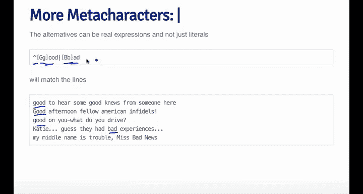

你可以包含任意数量的备选项。

*   例如，`flood|earthquake|hurricane|cold fire` 能匹配包含其中任何一个词的文本行。

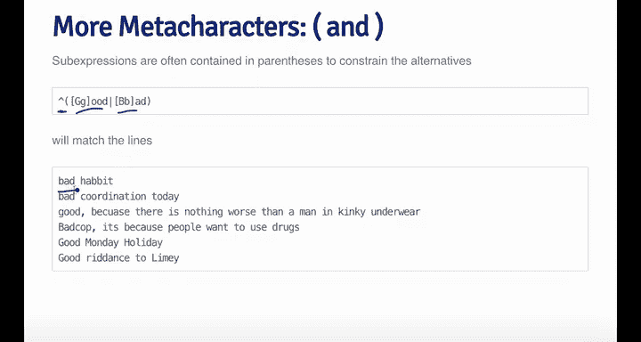

备选项本身也可以是复杂的正则表达式，而不仅仅是字面文本。

*   例如，模式 `^(Good|good)|bad` 表示：匹配行首的“Good”或“good”，**或者**匹配行中任意位置的“bad”。

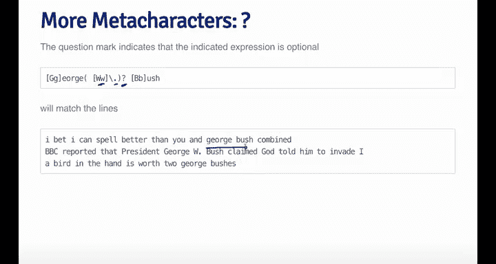

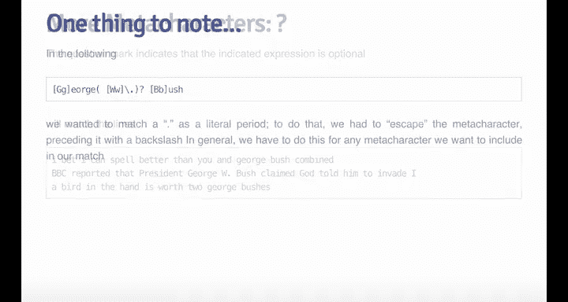

## 使用括号 `()` 分组

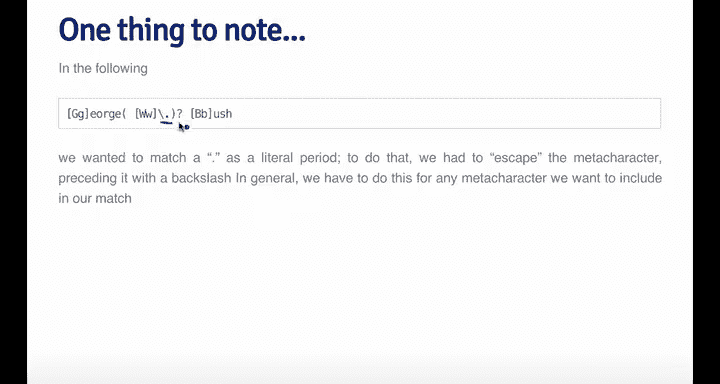

括号 `()` 可以用来对表达式进行分组，从而限制备选项的范围。

*   模式 `^(good|bad)` 表示：匹配行首的“good”**或**“bad”。这里，`^` 的作用范围被括号限定，因此“bad”也必须在行首才会被匹配。

## 问号 `?` 表示可选

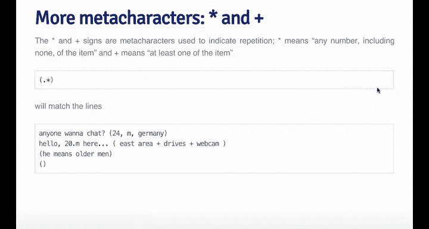

如果问号 `?` 紧跟在括号分组后面，则表示该分组内的表达式是**可选的**。

*   模式 `[Ww]\.? Bush` 会匹配“George Bush”，无论中间是否有“W.”。这里的 `\.?` 表示点号是可选的。注意，点号本身是元字符，要匹配字面意义的点号，需要使用反斜杠进行转义 `\.`。

## 星号 `*` 和加号 `+`

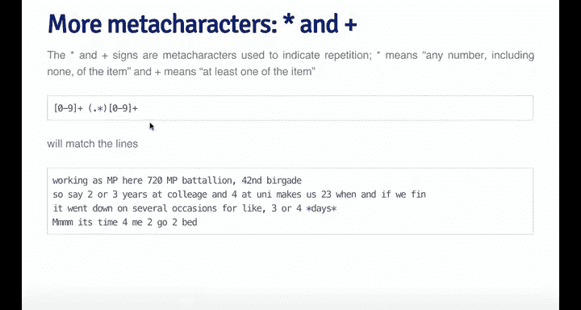

星号 `*` 表示前面的元素可以重复**任意次数（包括零次）**。
加号 `+` 表示前面的元素必须至少出现**一次**。

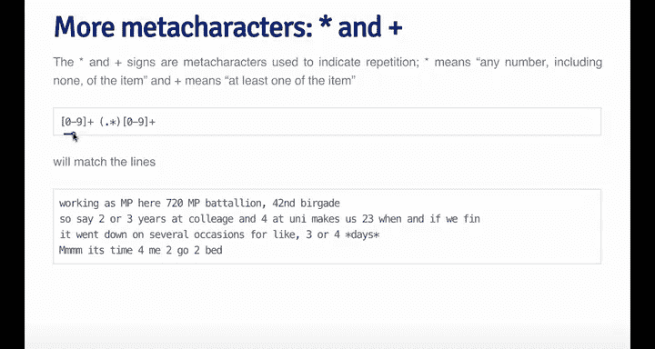

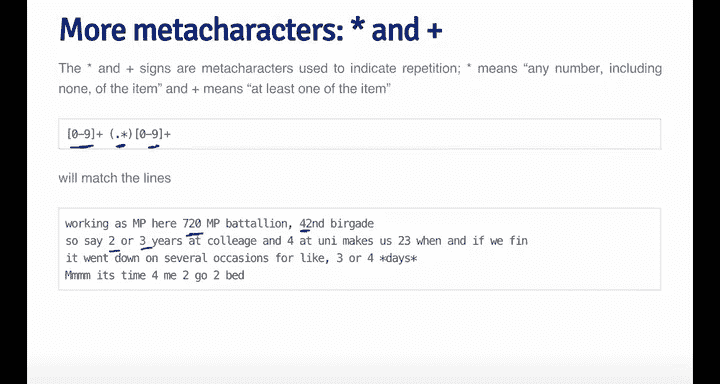

以下是具体示例：

*   `\(.*\)` 会匹配所有括号及其中的内容。因为 `.*` 表示“任意字符重复任意次数”，所以它能匹配从 `(something)` 到 `()` 的所有情况。

*   `[0-9]+.*[0-9]+` 会匹配至少一个数字，后接任意字符，再后接至少一个数字。这可以用来查找被非数字字符分隔的数字组合。

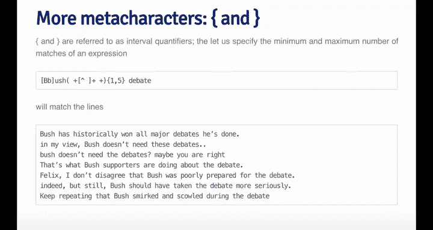

## 花括号 `{}` 区间限定符

花括号 `{}` 作为区间限定符，允许我们指定一个表达式匹配的**最小和最大次数**。

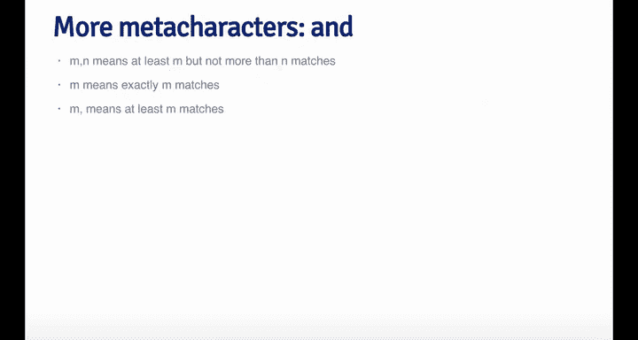

以下是其语法规则：

*   `{m,n}`：匹配至少 `m` 次，至多 `n` 次。
*   `{m}`：精确匹配 `m` 次。
*   `{m,}`：匹配至少 `m` 次。

例如，模式 `Bush( +[^ ]+){1,5} debate` 的匹配逻辑如下：
1.  查找“Bush”。
2.  随后查找“一个或多个空格 + 一个非空格字符”这个组合。
3.  要求这个组合出现 1 到 5 次。
4.  最后以“debate”结尾。
这可以匹配“Bush”和“debate”之间包含1到5个单词的句子。

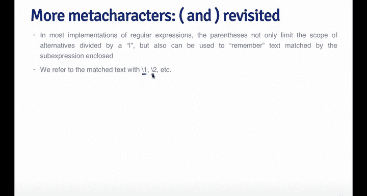

## 括号分组与反向引用 `\1, \2...`

在大多数正则表达式实现中，括号 `()` 不仅用于分组，还能“记住”括号内子表达式匹配到的文本。我们可以使用 `\1`, `\2` 等来引用这些被记住的文本，这称为**反向引用**。

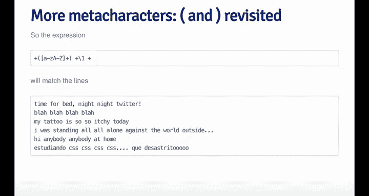

*   例如，模式 ` +([a-zA-Z]+) +\1` 会匹配一个空格，后接一个或多个字母（被括号捕获），再接一个空格，最后要求出现**刚才捕获的完全相同的字母序列**。这可以用来查找重复的单词或短语，如“night night”、“blah blah”。

## 贪婪匹配与非贪婪匹配

默认情况下，量词（如 `*` 和 `+`）是**贪婪**的，它们会匹配**尽可能长**的字符串。

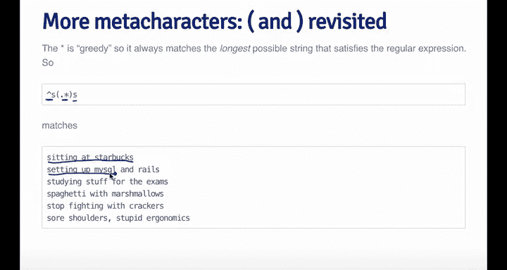

*   模式 `^s.*s$` 会匹配以‘s’开头、以‘s’结尾的**整个字符串**，因为它会吞掉中间的所有字符。

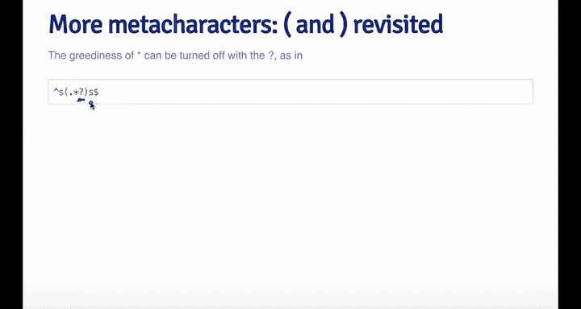

如果想进行**非贪婪**（尽可能短）匹配，可以在量词后面加上问号 `?`。

*   模式 `^s.*?s$` 会匹配以‘s’开头、以‘s’结尾的**最短可能字符串**。

---

## 总结 📝

本节课中我们一起学习了正则表达式更高级的元字符和概念：
1.  **点号 `.`**：匹配任意单个字符。
2.  **或运算符 `|`**：提供多个匹配备选项。
3.  **括号 `()`**：对表达式进行分组和限定范围，并可用于捕获文本以供反向引用。
4.  **问号 `?`**：使前面的元素变为可选，或将贪婪量词变为非贪婪。
5.  **星号 `*` 和加号 `+`**：分别表示重复任意次（含零次）和至少一次。
6.  **花括号 `{}`**：精确指定匹配次数区间。
7.  **反向引用 `\1`**：重用之前括号捕获的文本。
8.  **贪婪与非贪婪匹配**：理解了默认的贪婪行为以及如何使用 `?` 进行非贪婪匹配。

正则表达式是用于文本处理的强大工具，它由**字面文本**和**元字符**共同构成语法。在处理非结构化或格式不友好的文本数据时（如日志文件、网页抓取内容），正则表达式尤其有用。在R语言中，我们通常将正则表达式与 `grep()`、`grepl()`、`sub()`、`gsub()` 等函数结合使用，来进行字符串的搜索、提取和替换操作。

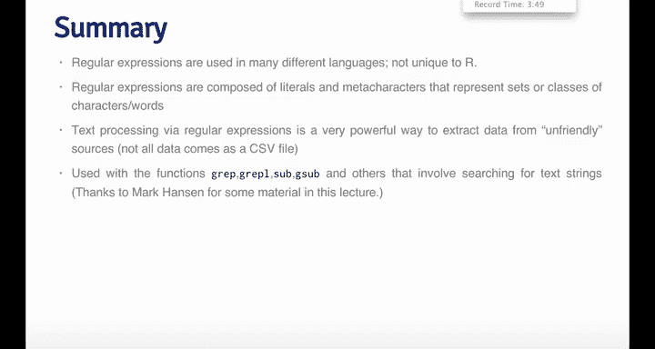

