# 📅 课程24：R语言中的日期处理

在本节课中，我们将学习如何在R语言中处理日期数据。日期数据有时会显得棘手，因为它们具有各种特性，例如在一周或一个月结束后重新开始计数。我们将从基础函数开始，逐步介绍如何创建、格式化、转换和计算日期，并介绍一个强大的扩展包来简化这些操作。

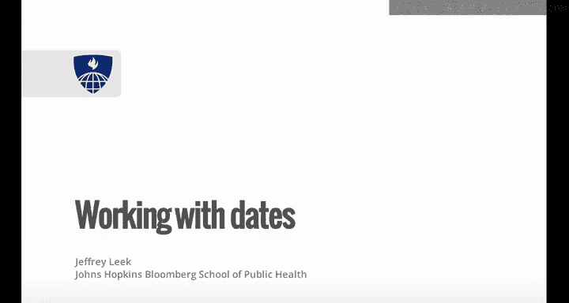

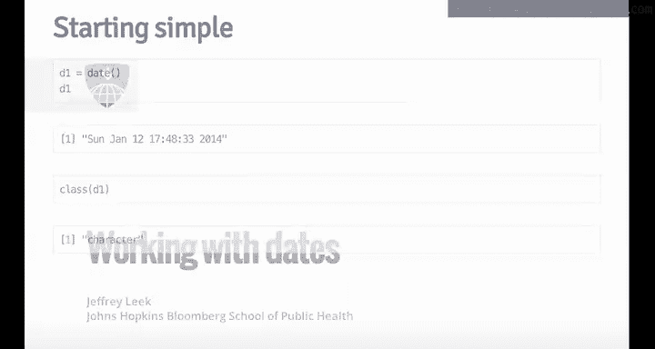

## 1️⃣ 基础日期函数

首先，我们来看R语言中最基础的日期函数 `date()`。

```r
current_time <- date()
print(current_time)
```

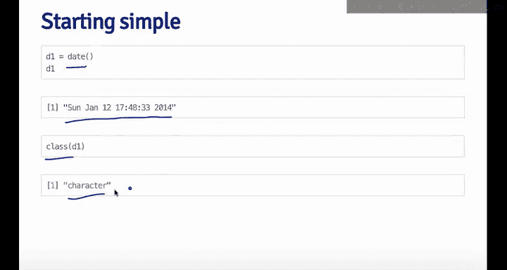

调用 `date()` 函数会返回一个表示当前日期和时间的**字符型**变量。例如，这可能是幻灯片被处理的时间点。

```r
class(current_time)
# 输出: "character"
```

`date()` 函数返回的是一个字符型变量，它只是简单地以文本形式提供日期和时间信息。

## 2️⃣ `Sys.Date()` 函数

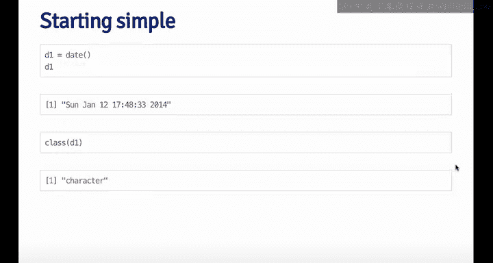

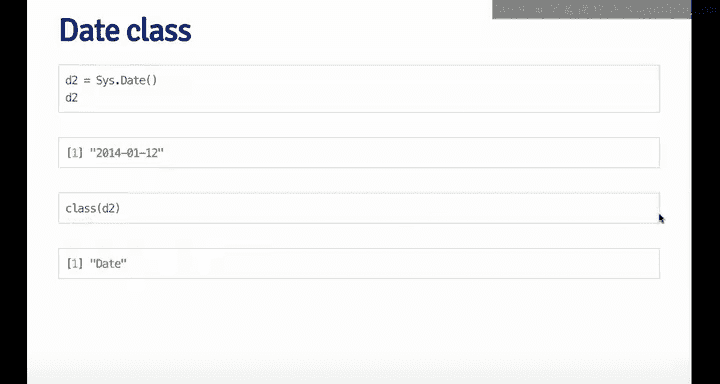

然而，处理日期并不总是这么简单。R语言提供了更专门的日期函数。

```r
today <- Sys.Date()
print(today)
```

`Sys.Date()` 函数返回一个看起来像日期的对象，但通常不包含具体时间。更重要的是，它的**类**是 `Date`。

```r
class(today)
# 输出: "Date"
```

`Date` 类变量具有特殊的属性，这使得它在分析日期数据时比纯文本更方便，但在某些方面处理起来也需要更多技巧。

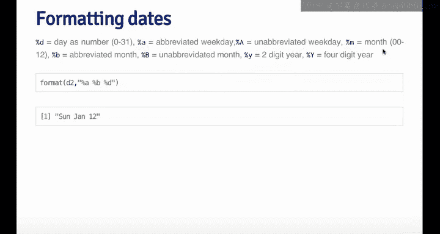

## 3️⃣ 格式化日期

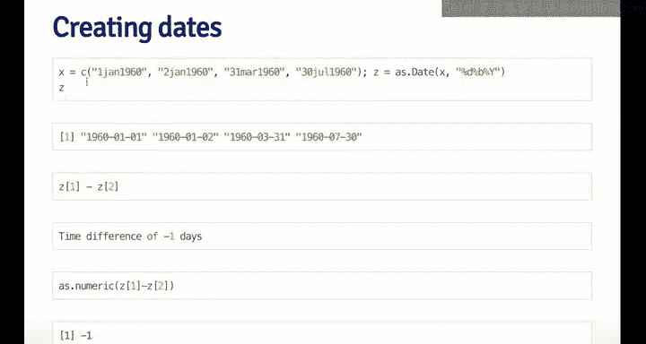

我们经常需要将日期转换为特定的显示格式。这时可以使用 `format()` 函数。

```r
formatted_date <- format(today, "%a %b %d")
print(formatted_date)
# 输出示例: "Sun Jan 12"
```

`format()` 函数允许我们使用特定的代码来定制日期格式：
*   `%a` 表示缩写的星期几。
*   `%b` 表示缩写的月份。
*   `%d` 表示月份中的日期（数字）。

以下是更多常用的格式代码：
*   `%A`: 完整的星期几名称。
*   `%m`: 月份（01-12）。
*   `%Y`: 四位数的年份（如 2023）。
*   `%y`: 两位数的年份（如 23）。

你可以组合这些代码，将日期转换成任何你喜欢的、视觉上美观的格式。

## 4️⃣ 将字符转换为日期

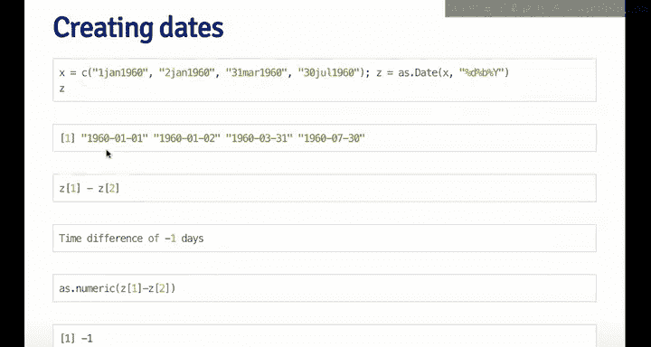

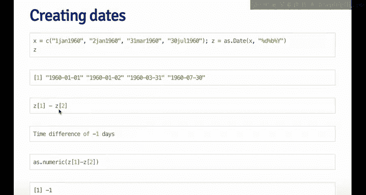

我们经常需要将存储在字符向量中的日期转换为 `Date` 类型，以便进行后续计算。


```r
date_strings <- c("1jan2014", "2jan2014", "31mar2014", "30jul2014")
converted_dates <- as.Date(date_strings, format = "%d%b%Y")
print(converted_dates)
```

`as.Date()` 函数是关键。你需要通过 `format` 参数告诉R，你的字符中哪部分是日（`%d`）、月（`%b`）和年（`%Y`）。

将字符转换为 `Date` 类的好处是，你可以轻松地对日期进行各种操作和计算。

## 5️⃣ 日期计算与提取信息


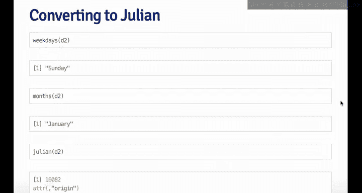

一旦日期被正确存储为 `Date` 类，我们就可以进行数学运算和提取特定信息。

**计算日期差：**
```r
date1 <- converted_dates[1]
date2 <- converted_dates[2]
time_diff <- date1 - date2
print(time_diff)
# 输出: Time difference of -1 days
```
你可以将日期相减，得到以天为单位的差值。这个差值可以很容易地转换为数值变量。

**提取日期组成部分：**
```r
weekdays(date1)   # 输出星期几，例如 "Sunday"
months(date1)     # 输出月份，例如 "January"
julian(date1)     # 输出儒略日（自原点1970-01-01以来的天数）
```
*   `weekdays()`: 返回日期对应的星期几。
*   `months()`: 返回日期对应的月份。
*   `julian()`: 返回自特定原点（通常是1970年1月1日）以来的天数。

## 6️⃣ 使用 `lubridate` 包简化操作

`lubridate` 包让日期处理变得比基础函数 `as.Date()` 更加简单和直观。

首先加载包：
```r
library(lubridate)
```

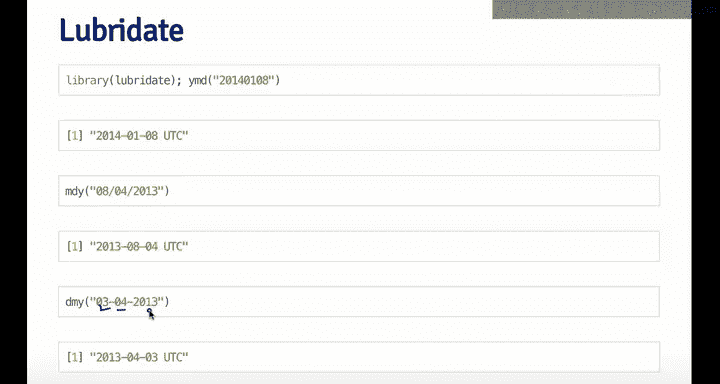

`lubridate` 提供了一系列智能函数，能自动解析多种常见日期格式，而无需预先指定格式：

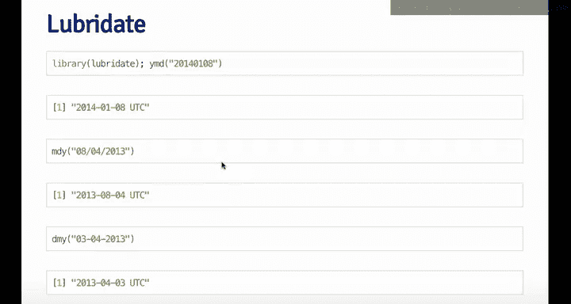

```r
ymd("20140108")      # 解析 年-月-日 格式
# 输出: "2014-01-08"

mdy("01/08/2014")    # 解析 月-日-年 格式
# 输出: "2014-01-08"

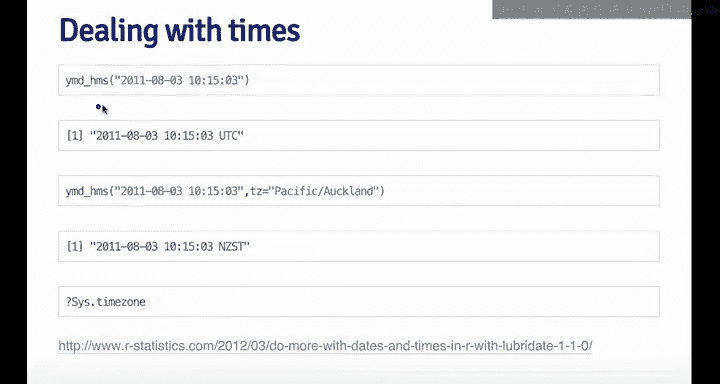

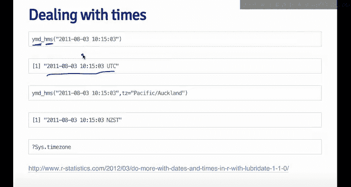

dmy("3-4-2013")      # 解析 日-月-年 格式
# 输出: "2013-04-03"
```
它的优势在于，你通常不需要在转换前严格统一字符的格式。

## 7️⃣ 处理日期时间

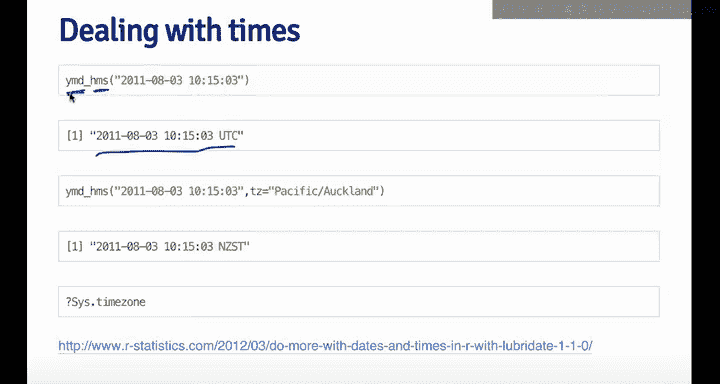

`lubridate` 同样能优雅地处理包含时间的日期时间数据。

```r
ymd_hms("2014-01-08_22:30:15")
```
这个函数会解析“年-月-日_时:分:秒”格式的字符串，并创建一个包含日期和时间的对象。

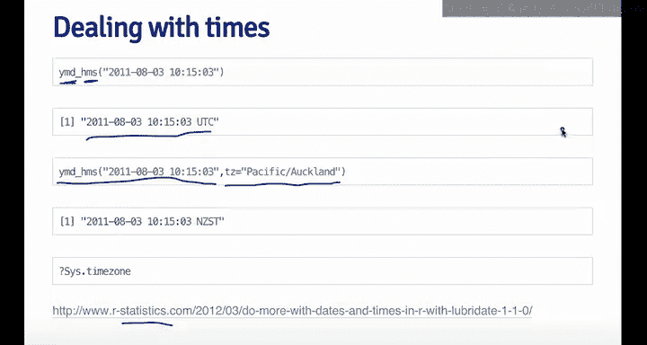

如果时间部分的顺序不同，也有对应的函数：
```r
ymd_hms("2014-01-08_15:30:00") # 时:分:秒
# 如果顺序是 秒:分:时，可以使用（但标准顺序更常见）
```

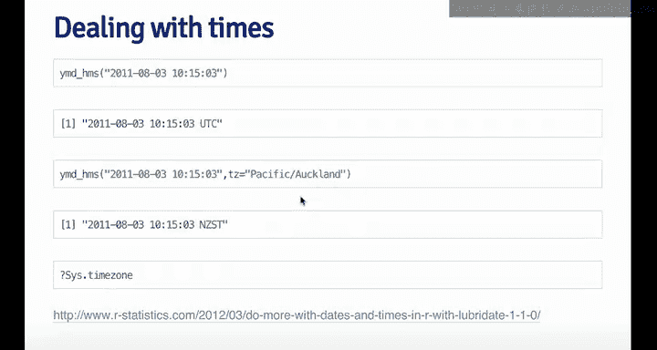

你还可以设置时区：
```r
ymd_hms("2014-01-08 22:30:15", tz = "America/New_York")
```
要了解更多关于R中时区设置的信息，可以查看帮助文档：`?Sys.timezone`。

## 8️⃣ `lubridate` 与基础函数的区别

一些函数在 `lubridate` 和基础R中的名称和用法略有不同。

**获取星期几：**
*   **基础R:** `weekdays(date_object)`
*   **lubridate:** `wday(date_object)`

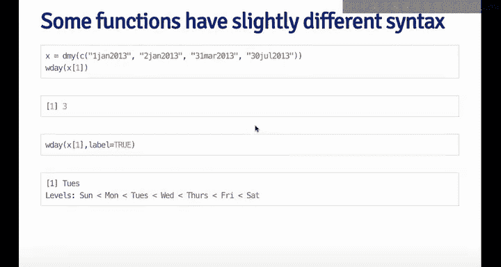

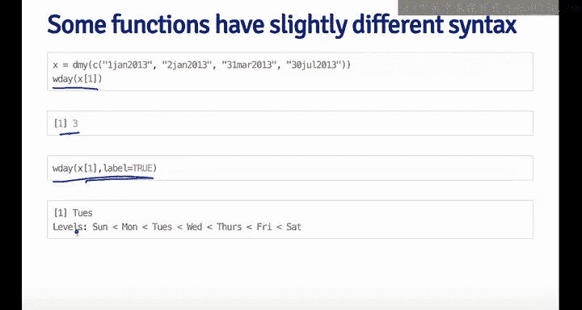

```r
my_date <- ymd("2014-01-08")
wday(my_date)                # 返回数字（1=周日，7=周六），例如 4
wday(my_date, label = TRUE)  # 返回缩写的星期几名称，例如 "Wed"
```
在 `lubridate` 中，使用 `wday()` 并设置 `label = TRUE` 可以直接得到星期几的名称。

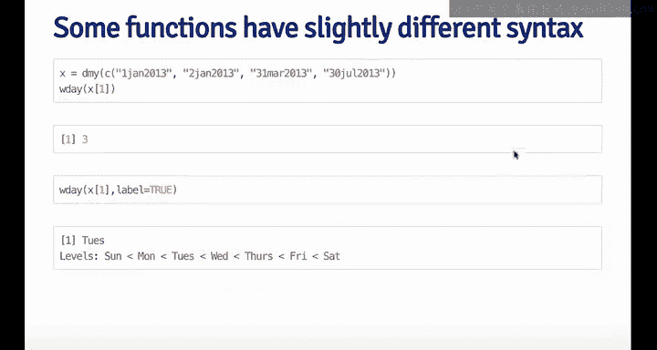

## 9️⃣ 总结与扩展资源

本节课中，我们一起学习了R语言中处理日期的基础和进阶方法。

**核心要点总结：**
1.  使用 `Sys.Date()` 获取当前日期（`Date` 类）。
2.  使用 `format()` 函数自定义日期显示格式。
3.  使用 `as.Date()` 将字符转换为日期，但需指定格式。
4.  **强烈推荐使用 `lubridate` 包**（如 `ymd()`, `mdy()` 函数），它能自动解析多种日期格式，极大简化工作。
5.  日期转换为 `Date` 类后，可进行减法运算（计算间隔天数）和使用 `weekdays()`、`months()` 等函数提取信息。
6.  处理含时间的日期时，使用 `ymd_hms()` 等函数并注意时区设置。

**最终目标**是让你的日期数据成为 `POSIXct` 或 `POSIXlt` 类（`lubridate` 和 `as.Date` 的某些输出即是），这对于后续进行与日期相关的建模和预测分析至关重要。你可以通过 `?POSIXlt` 查看更详细的信息。

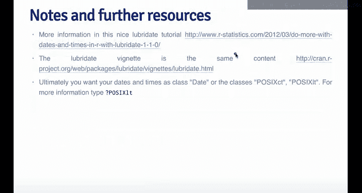

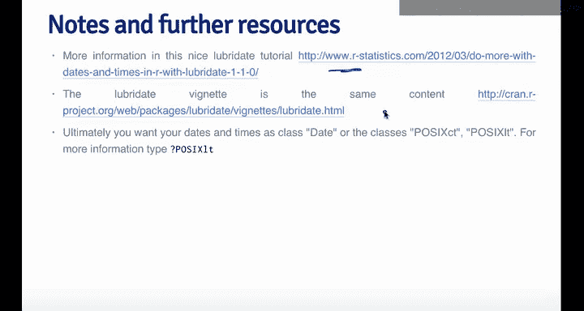

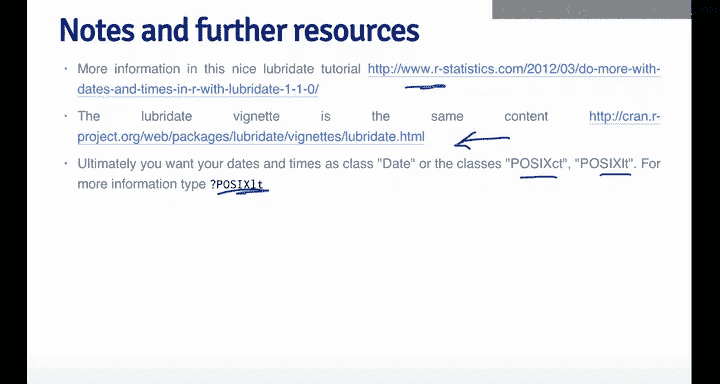

**扩展学习：**
*   更多关于 `lubridate` 包的详细教程和示例，可以参考其官方 `vignette`（`vignette(“lubridate”)`）或相关的在线教程。
*   本节课的部分示例和思路来源于一个非常优秀的 `lubridate` 教程。