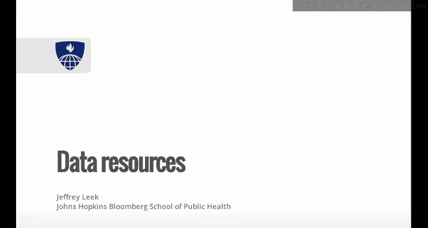
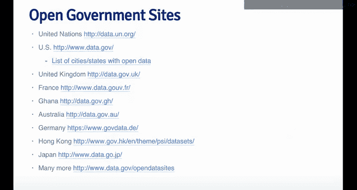
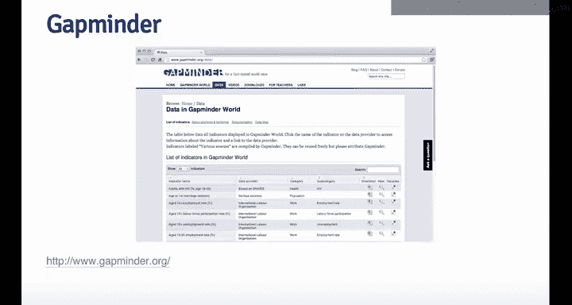
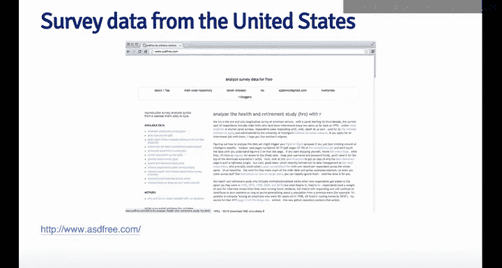
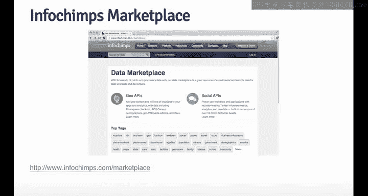
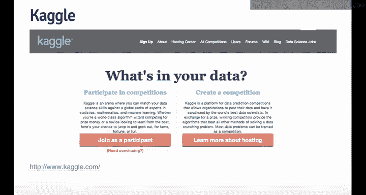
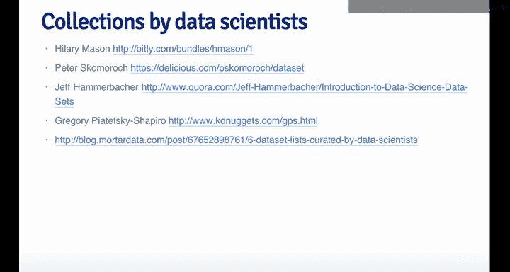
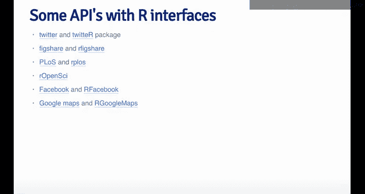

# 课程25：数据资源 📚

在本节课中，我们将学习如何寻找和获取免费的数据资源，以便在没有现成数据的情况下进行分析。

上一节我们介绍了数据获取的重要性，本节中我们来看看一些具体的数据来源。

## 政府与组织公开数据 🌐

以下是一些提供公开数据的政府与国际组织网站：

*   **联合国数据**：网站为 `data.un.org`，提供全球性的统计数据。
*   **美国数据门户**：网站为 `data.gov`，提供美国政府的公开数据。
*   **其他地区数据**：通过相关博客文章可以找到美国许多城市和州的开放数据门户。
*   **全球数据门户索引**：`data.gov/open-data-sites` 网站提供了世界各国政府开放数据站点的信息，是查找本国数据资源的起点。

## 专题数据网站 📊

除了政府数据，还有一些专注于特定领域的优秀数据平台。

**Gapminder** 网站（`gapminder.org`）提供了大量关于全球发展、人类健康等方面的数据集，非常适合用于社会与健康议题的分析。

## 调查数据与处理指南 📝

对于需要调查数据的研究者，美国的相关调查数据是重要资源。

以下网站不仅提供了数据访问途径，还详细介绍了如何在 **R** 语言中处理和操作这些通常庞大而复杂的数据集，这对数据分析实践非常有帮助。

## 数据市场与竞赛平台 🏆

以下平台汇集了各类数据集，部分免费，部分付费。

*   **InfoChimps Marketplace**：提供众多数据集，可按标签分类浏览，可用于发现感兴趣的数据。
*   **Kaggle**：一个举办数据科学竞赛的公司，通常会提供与竞赛相关的、非常有趣的数据集。这些数据既可用于练习，也可能帮助解决公司的实际问题。

## 数据科学家精选集 👨‍🔬

一些知名数据科学家也整理并分享了高质量的数据集。

例如，Hilary Mason、Jeff Hammerbacher 等人整理的研究级数据集就非常有用。这些资源通常来自相关的博客文章，其中也汇总了其他数据科学家精选的数据集。

## 专业领域数据存档 🧬

还有许多更专业的数据库，专注于特定学科领域。

以下是几个著名的专业数据存档：

*   **斯坦福大型网络数据集存档**：专注于网络数据和机器学习领域的数据集。
*   **UCI机器学习仓库**：提供多种可用于分类或预测练习的数据集。
*   **CMU StatLib**：最著名、最经典的数据集集合之一。
*   **基因表达综合数据库**：专注于人类基因组实验或其他生物基因组实验的数据集。
*   **亚马逊网络服务公共数据集**：在AWS上托管的一系列公共数据集。

## 利用API获取数据 🔌

通过本课程的学习，你已经掌握了使用API获取数据的方法。现在有许多R语言包可以简化这一过程。

例如，`twitteR` 包可以让你更便捷地访问Twitter API，而无需自己从头搭建应用程序。同样，你可以通过专门的包获取Figshare的数据或《PLOS ONE》等出版物的数据。

`rOpenSci` 项目提供了大量优秀的R包，用于访问专注于学术研究的各类数据源。此外，也有专门用于访问Facebook和Google Maps数据的R包。

所有这些资源意味着，对于任何你感兴趣的项目，你都能找到真实的数据进行分析，没有任何借口。

---

本节课中我们一起学习了多种免费数据资源的获取途径，包括政府公开数据、专题数据库、竞赛平台、专家精选集、专业领域存档以及利用API获取数据的方法。掌握这些资源将为你未来的数据分析项目打下坚实的基础。