# 001：统计推断介绍 📊

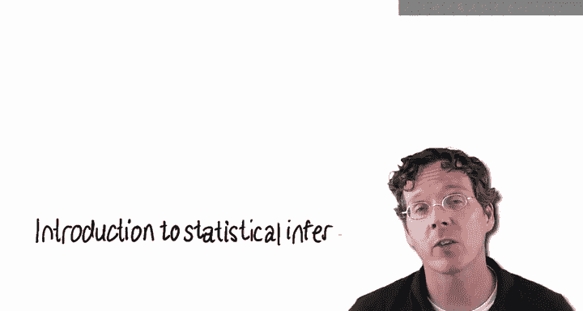

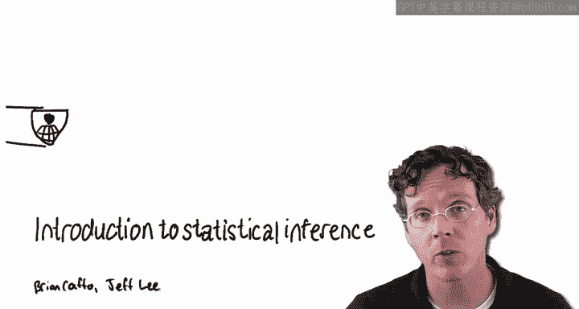

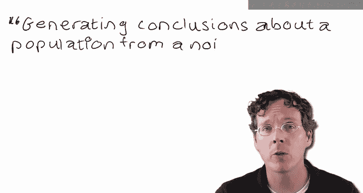

在本节课中，我们将学习统计推断的基本概念、其重要性以及本课程将采用的核心方法论。统计推断是从数据中获取新知识、做出超越样本本身的结论的关键过程。

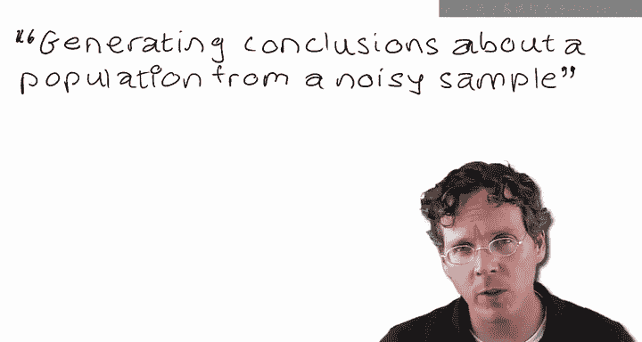

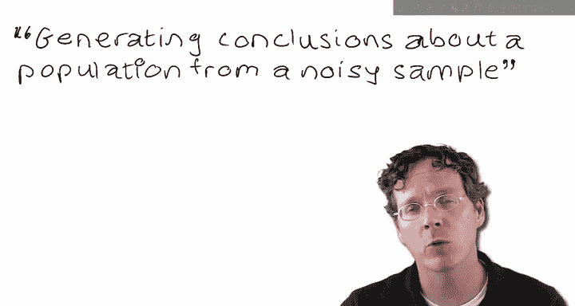

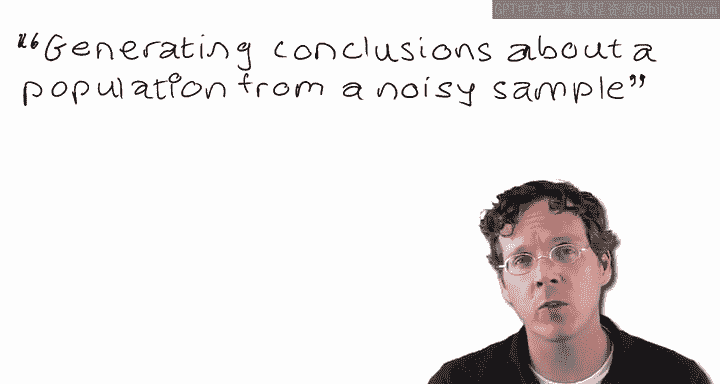

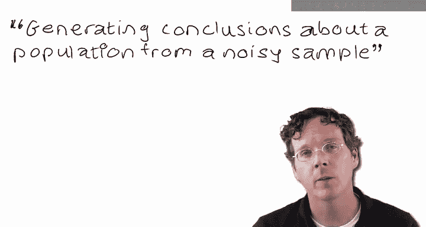

## 什么是统计推断？🤔

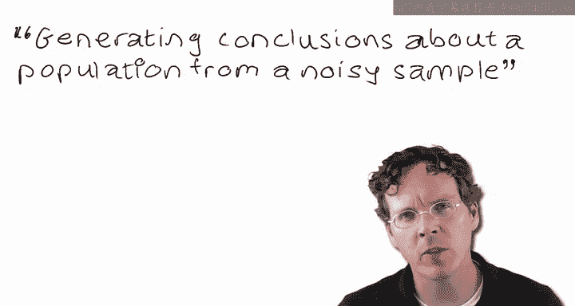

统计推断被定义为：**从一个有噪声的样本中，得出关于总体的结论的过程**。

如果没有统计推断，我们仅仅是停留在数据本身。而通过统计推断，我们试图生成新的知识，试图超越我们的数据，去回答关于总体的问题。我们的估计量所估计的，是真实存在的参数。事实上，统计推断是我们拥有的**唯一**正式的推断系统。

## 统计推断的实例 🌟

为了帮助理解，以下是几个统计推断在实际中的应用例子：

*   **选举预测**：在选举日之前，根据一个“可能投票选民”的样本来预测谁将获胜。这个样本是有噪声的——有些人可能最终不会投票，有些人可能改变主意，甚至有人可能故意误导。统计推断帮助我们整合所有这些不确定性，来预测选举结果。
*   **天气预报**：当气象预报员说“明天下雨的概率是70%”时，他们是在利用历史数据（特别是最近的数据）来预测明天的天气，并为其附上一个概率。这个概率所指的，就是一个潜在的“总体”（即所有可能的天气状况）。
*   **脑科学研究**：在功能性磁共振成像（fMRI）扫描中，当受试者执行特定任务（如用手指敲击）时，研究者试图预测大脑的哪些区域会被激活。通过比较执行任务和未执行任务时的扫描数据，并运用统计推断，可以找出与手指敲击相关的大脑区域。

这些例子展示了统计推断在不同领域的应用，尽管它们思考和处理随机性的方式各不相同，这也使得统计推断成为一个富有挑战性的学科。

## 统计推断的不同范式 🔄

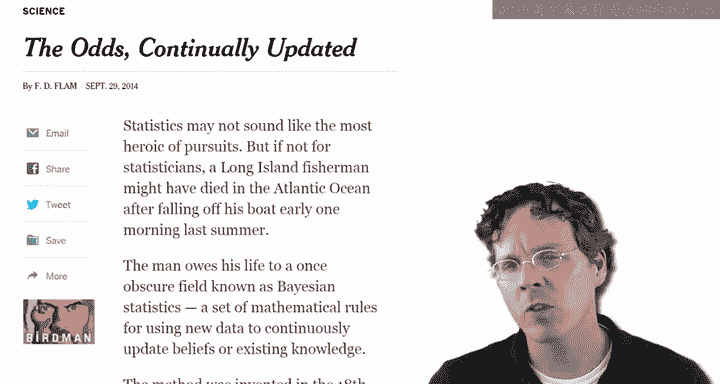

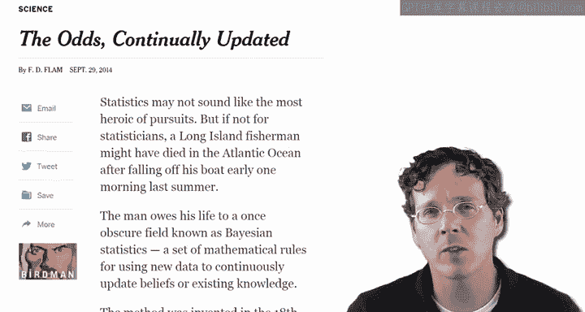

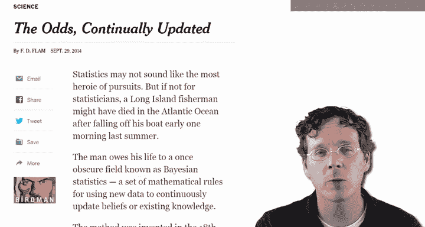

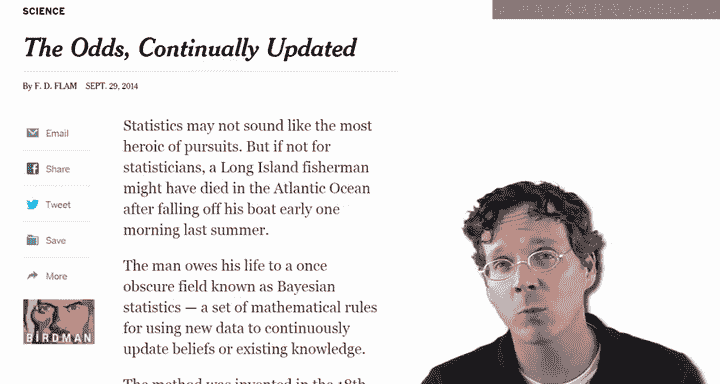

需要简要提及并尽早澄清的一点是，统计推断存在多种不同的范式。例如，最近《纽约时报》的一篇文章就描述了所谓的**贝叶斯学派**和**频率学派**这两种不同的推断范式。

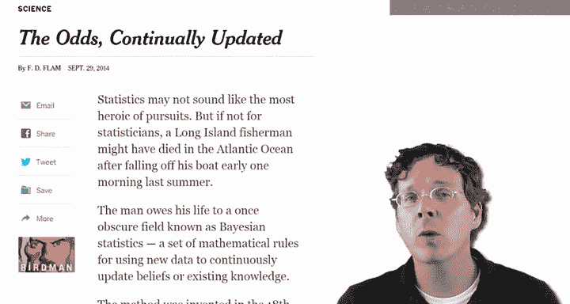

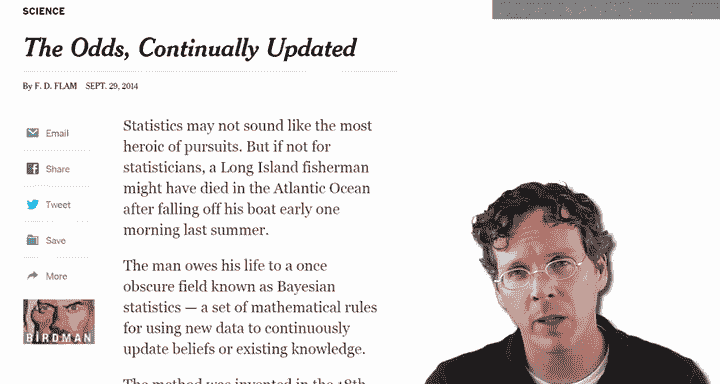

初学者可能会惊讶于思考统计学竟然不止一种方式。但事实上，即使在贝叶斯学派或频率学派内部，也存在许多不同的变体和细微差别。甚至有些贝叶斯学派的实践者，其行为方式也非常像频率学派。

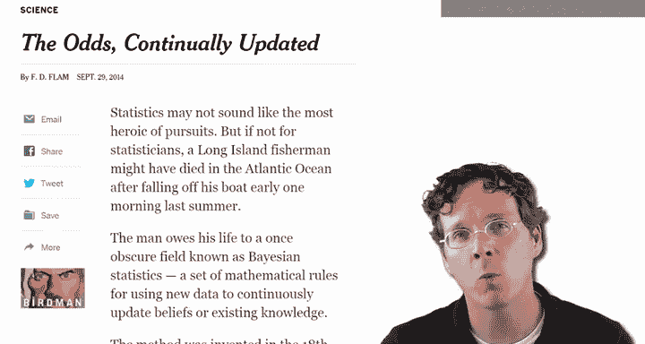

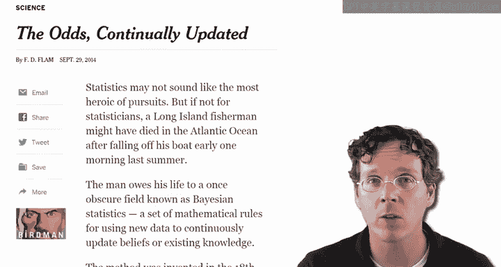

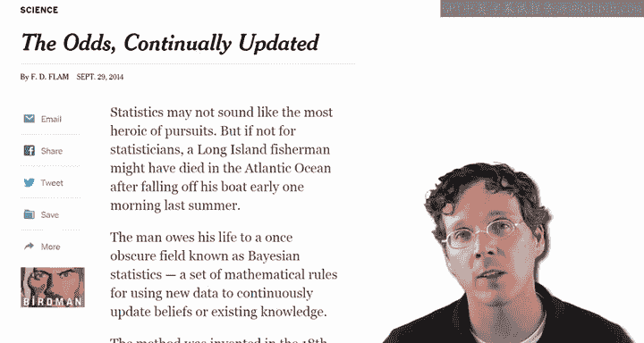

## 本课程的方法论 🎯

为了使课程尽可能清晰明了，我们将选择一个非常具体的范式：**频率学派范式**。

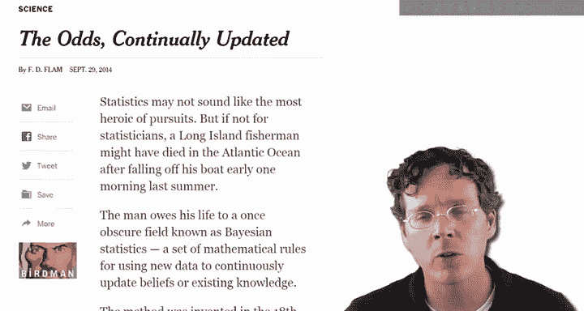

我们选择这个范式的原因是：
1.  它是入门统计学课程中最常教授的内容。
2.  它最可能是你在实践中会遇到的方式。
3.  一旦掌握了这些基础知识，你将能够将这些知识扩展到许多不同的领域，并在此基础上进行构建。

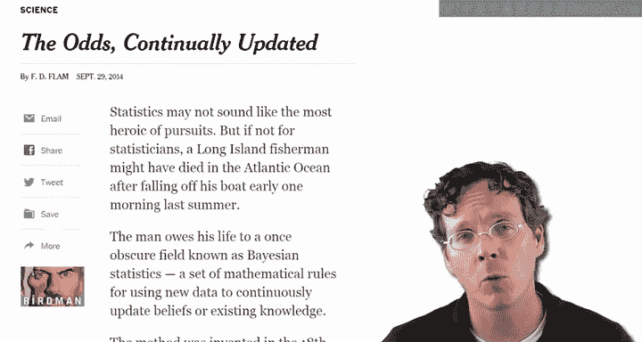

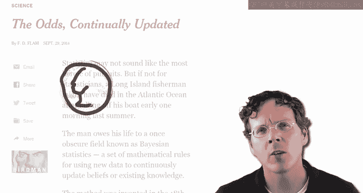

我们希望建立一个良好的基础，因此将采用**频率式思维**。所谓频率式思维，就是我们像思考赌博一样思考概率。例如，我们认为一枚硬币出现正面的概率，是指如果我们能无限次地抛掷这枚硬币，在所有这些随机抛掷中，出现正面的比例就定义了这枚硬币出现正面的内在概率。这是一种认为我们可以重复实验无数次，用某事件发生的频率来定义其概率参数的思维方式。

当然，思考概率和推断的方式不止一种，但本课程将特别聚焦于这种频率式推断，就像我们熟悉的抛硬币和所有赌博实验一样。我们将其他范式暂时搁置一旁。在课程笔记中，我提供了一些主题示例，供你在掌握了本课程的工具后进行拓展学习。

## 拓展学习的领域 🚀

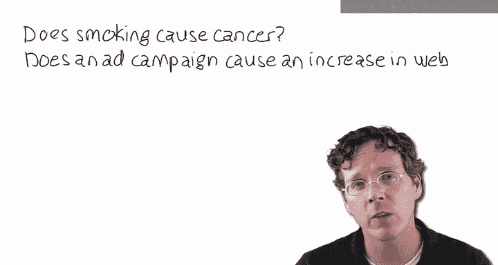

让我快速举一个例子。目前有一个活跃的研究领域，正试图探索如何利用有噪声的统计数据来推断**因果关系**，而不仅仅是关联。这是一个非常深刻的问题。

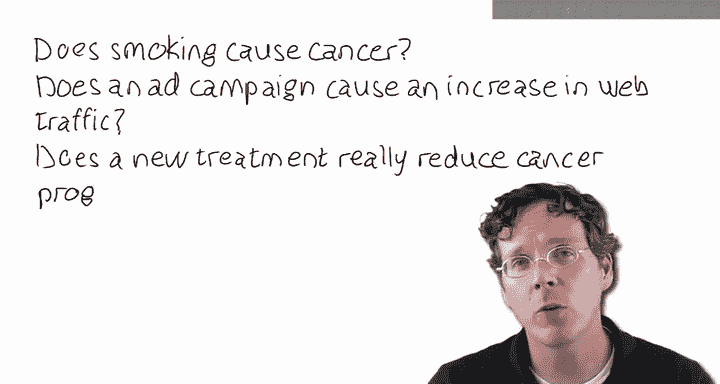

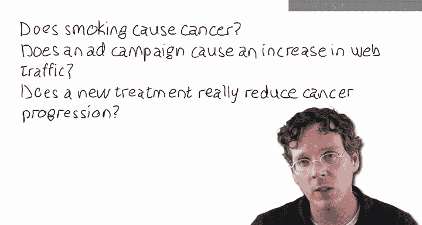

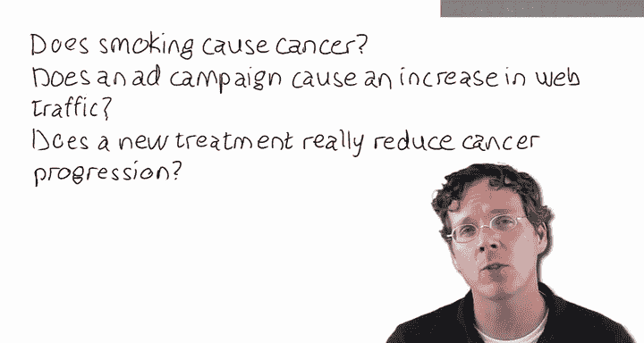

该领域的目标是阐明一系列假设、工具和统计研究设计，从而引导我们得出因果性结论，而非仅仅关联性结论。这要求我们定义“一件事导致另一件事”的具体含义。这是一个非常深入的领域。这只是课程笔记中提到的几个例子之一，其他还包括**调查抽样**、**流行病学研究**等，你都可以在打好基础后进行拓展。

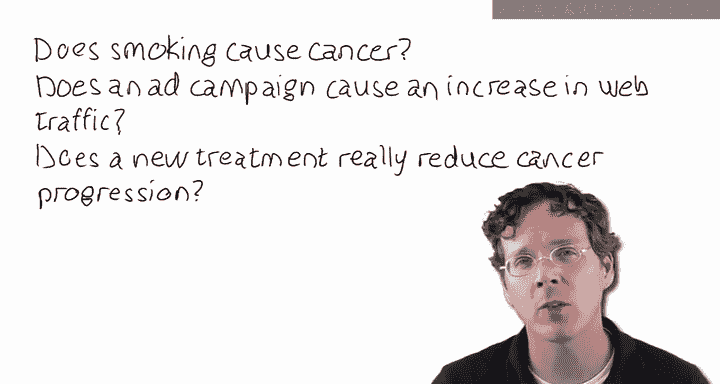

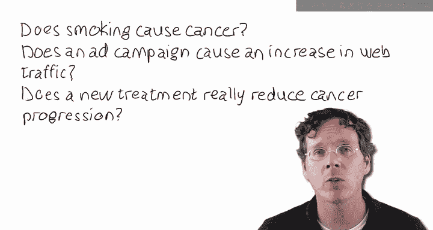

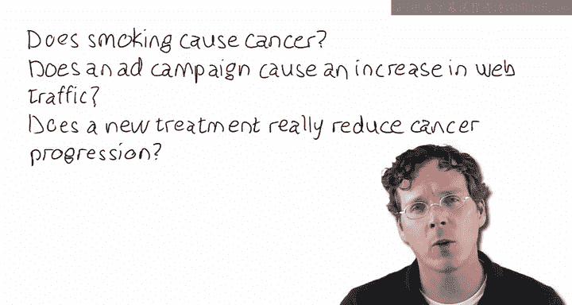

但再次强调，在这样一个短期课程中，我希望真正专注于在基础的频率式概率模型和检验方法上打下坚实的基础。

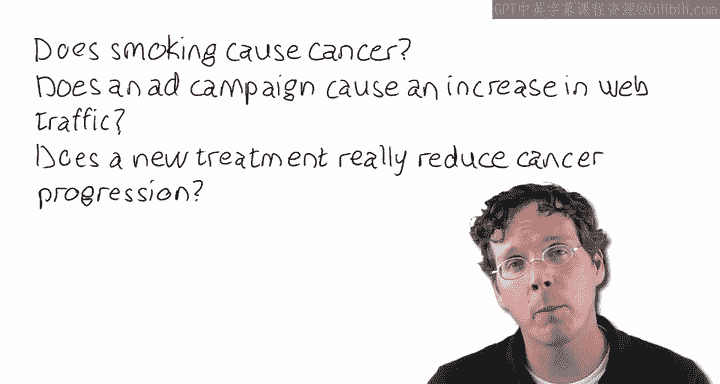

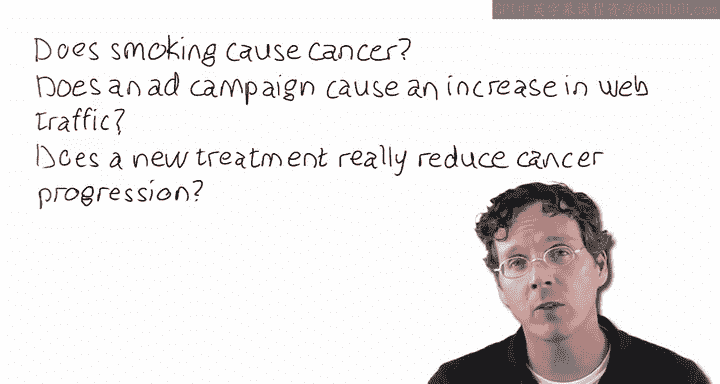

## 课程安排与建议 📅

欢迎来到本课程！关于本课程，你需要了解以下几点：

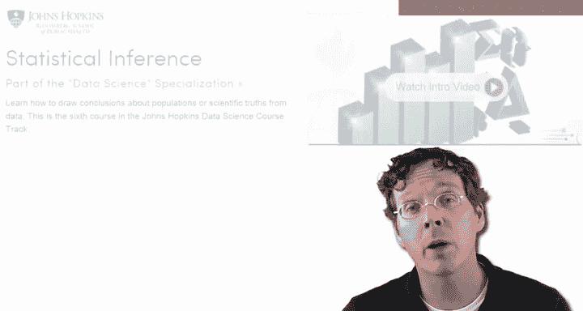

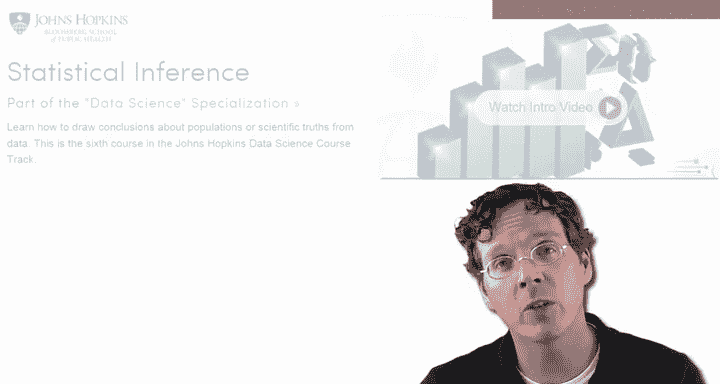

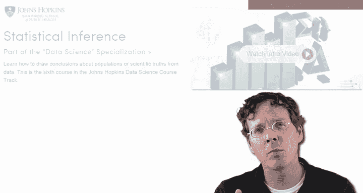

*   **课程节奏**：本课程设计为四周完成。但如果你在某些概念上遇到困难，完全不必感到沮丧，可以延长学习时间，甚至学习两遍。这些内容非常深刻，我认为其挑战性不在于数学本身（我认识很多数学家最初在思考统计推断时也会感到挣扎），而在于它是一种不同的世界观。
*   **课程评估**：课程包含四次测验和一个项目。
    *   **测验**：测验是自动评分的，理想情况下应在每周结束时完成，但你也可以从课程一开始就尝试所有测验。我布置了一些练习题，并将它们链接到了具体的测验题目，这样你可以在尝试测验之前进行练习。
    *   **项目**：项目真正有助于巩固一些核心的推断思想。我希望你能花相当多的时间思考这个项目，因为它能真正阐明**抽样分布**的含义以及**频率式统计推断**的本质。

我非常热衷于教授这门课程。统计推断是我最喜欢的学科，我研究它大概已有15年，每次思考都能学到新的东西。我衷心希望你能和我一起深入探索这个深刻而极其重要的领域。

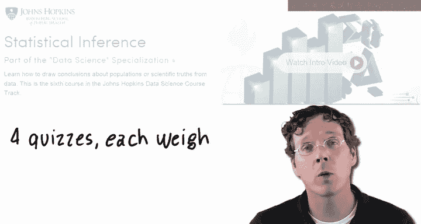

## 总结 📝

本节课我们一起学习了统计推断的核心定义——从有噪声的样本推断总体结论的过程。我们通过选举预测、天气预报和脑科学研究等实例了解了其广泛应用。课程明确了将采用**频率学派范式**作为方法论基础，通过类比赌博中的概率（如抛硬币）来建立频率式思维。最后，我们了解了课程节奏、测验与项目的安排，并认识到统计推断是一个需要深入思考和练习的深刻领域。