# 003：概率质量函数 (PMF) 🎲

在本节课中，我们将学习概率质量函数 (Probability Mass Function, PMF) 的概念。PMF 是描述离散随机变量概率分布的核心工具。我们将了解它的定义、性质，并通过经典例子（如抛硬币）来建立直观理解。

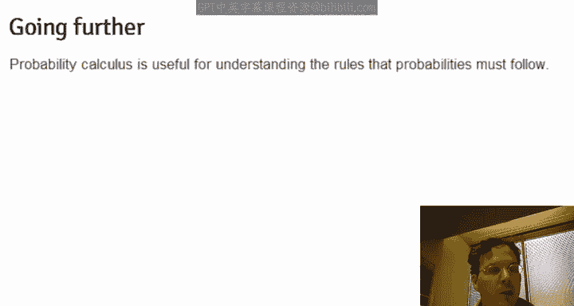

---

概率演算有助于理解概率必须遵循的规则，并构成所有概率思维的基础。

然而，对于实验的数值结果（这里“实验”一词是广义的），我们需要一种更易于处理的方法。

随机变量的密度函数和质量函数是处理此类问题的最佳起点。

我们只需要这些知识。或许最著名的密度函数例子就是所谓的钟形曲线。

在本课程中，你将真正理解“数据遵循钟形曲线”意味着什么。

你将真正理解钟形曲线代表什么，以及其他相关知识。

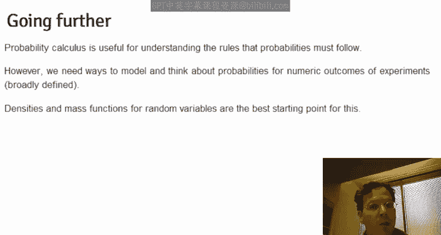

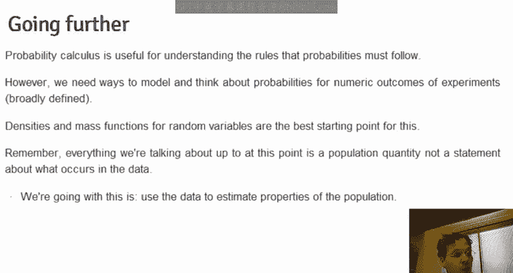

你会知道，当你谈论与钟形曲线或正态分布相关的概率时，你谈论的是总体量。

你谈论的不是关于数据中发生情况的陈述。

我们的工作方式和发展方向是：我们将收集数据，这些数据将用于估计总体的特性。

在我们开始处理数据之前，我们首先需要培养对总体量如何运作的直觉。

---

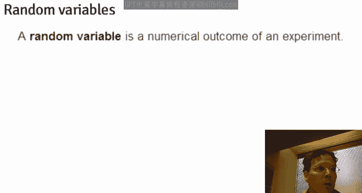

## 随机变量：离散与连续

随机变量是实验的数值结果。

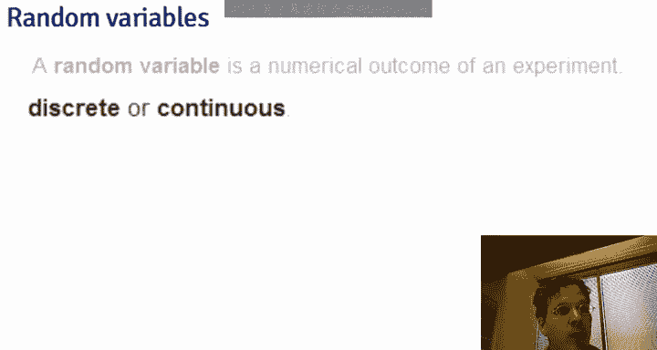

我们将研究的随机变量有两种类型：离散型或连续型。

离散型随机变量是可以计数的，例如网站访问次数、骰子可能出现的不同结果数量，甚至是非数值的事物，如发色。我们可以为其分配数值，例如：1代表金发，2代表棕色，3代表黑色等。

连续型随机变量可以在一个连续区间内取任何值。

我们处理离散随机变量的方式是为它们可以取的每个值分配一个概率。

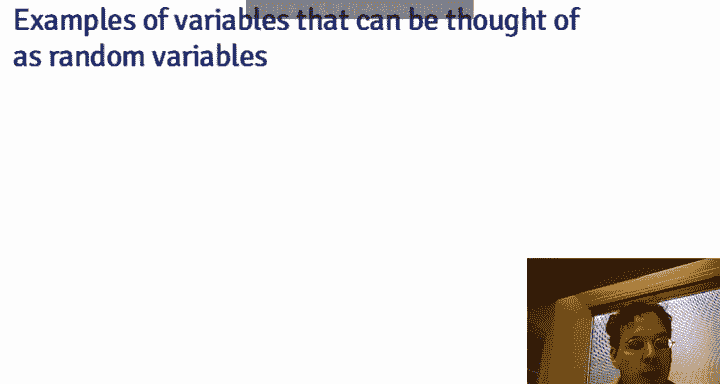

我们处理连续随机变量的方式是为它们可以取的范围分配概率。

---

## 随机变量示例

以下是一些可以被视为随机变量的简单例子，它们有助于建立我们的直觉。

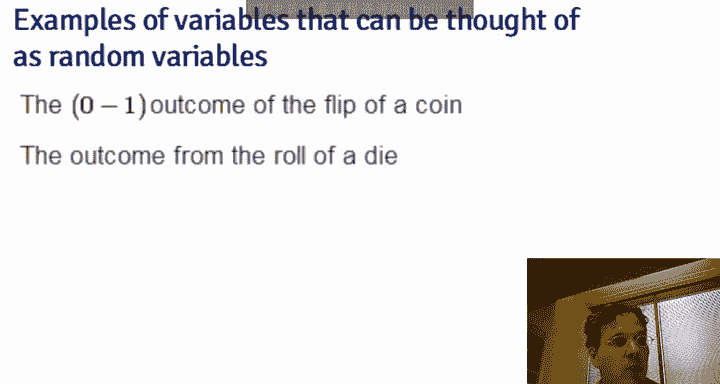

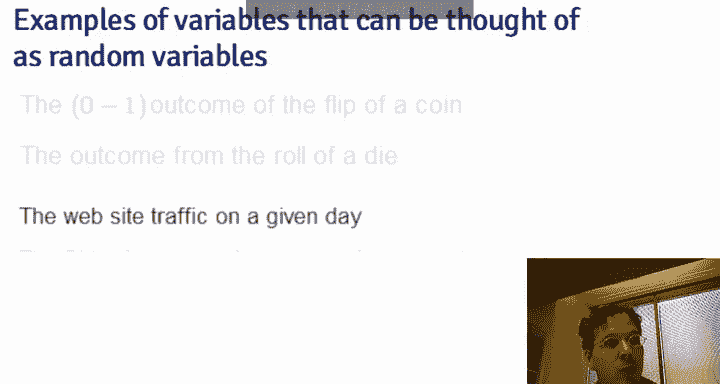

本课程中用于建立直觉的最重要例子是抛硬币，我们会说正面或反面，或者0或1。这是一个离散随机变量，因为它只能取两个值。

掷骰子的结果是另一个离散随机变量，因为它只能取六个可能值中的一个。

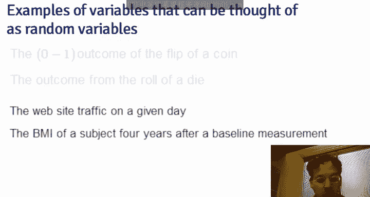

这些随机变量有些简单，因为它们的概率机制在概念上很简单。

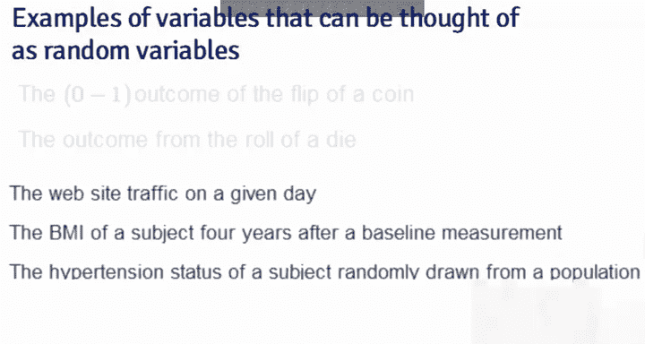

下面给出一些更复杂的随机变量例子。

例如，某一天网站的流量，即网页点击次数，是一个计数随机变量，我们很可能将其视为离散型。然而，它实际上没有上限。因此，这是一种有趣的离散随机变量。我们可能会使用泊松分布来建模。

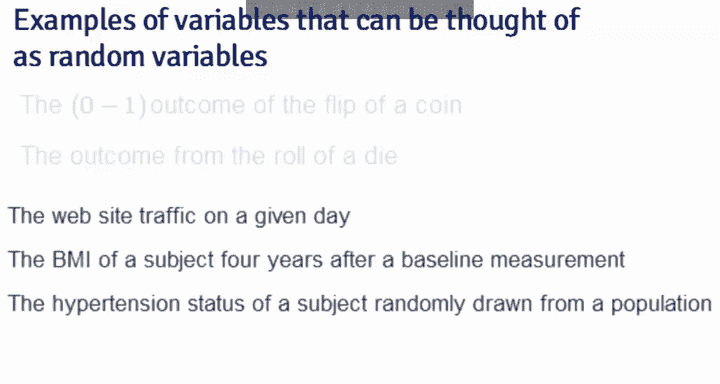

受试者在基线测量四年后的BMI（身体质量指数）是我想到的一个随机例子。在这种情况下，我们很可能将BMI建模为一个连续随机变量。

从总体中随机抽取的受试者的高血压状况可能是另一个随机变量。在这里，如果一个人患有高血压或被诊断为高血压，我们可能给他赋值1，否则赋值0。因此，这个随机变量很可能被建模为离散型。

点击广告的人数，这又是一个离散随机变量，但它是无界的。我们仍然会为0次点击、1次点击、2次点击、3次点击等分配概率。

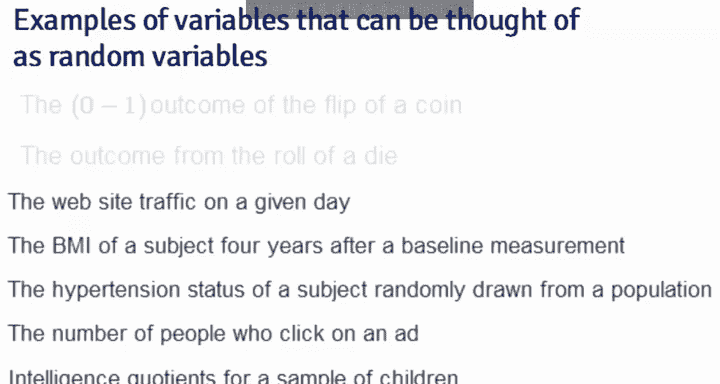

智商通常被建模为连续型。

---

## 概率质量函数 (PMF) 的定义

当我们讨论离散随机变量时，我们说处理其概率的方法是为它们可以取的每个值分配一个概率。

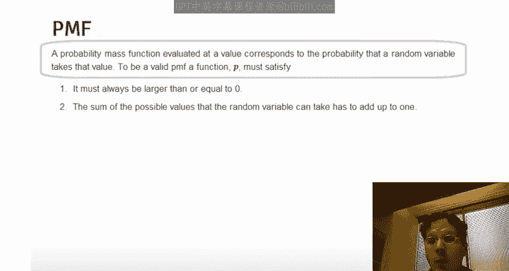

我们为什么不直接称之为函数呢？我们称之为概率质量函数。

这只是一个函数，它接受离散随机变量可以取的任何值，并赋予该随机变量取该特定值的概率。

例如，掷骰子的PMF会为值1分配概率1/6，为值2分配概率1/6，为值3分配概率1/6，依此类推。

---

## PMF 必须满足的规则

你可以总结出PMF必须满足的规则，以满足我们在课程开始时概述的概率基本规则。

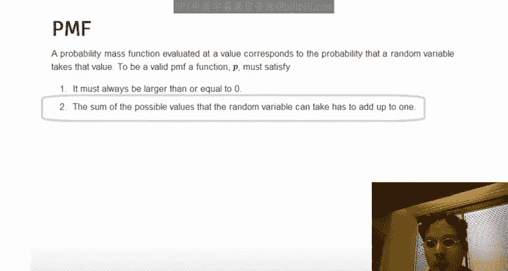

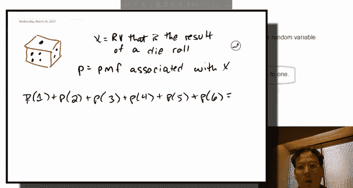

首先，它必须总是大于或等于0，因为我们已经知道概率必须是0到1之间（包括0和1）的数字。

其次，随机变量可以取的所有可能值的概率之和必须等于1。就像我把骰子取值为1的概率、取值为2的概率、取值为3、4、5、6的概率加起来，总和必须是1。否则，骰子取某个可能值的事件发生的概率总和就不会是1，这将违反我们概率的基本准则。

因此，所有PMF必须满足的就是这两条规则。我们不会过分担心这些规则。相反，我们将使用特别有用的概率质量函数，例如二项分布（抛硬币的经典分布）和泊松分布（建模计数的经典分布）。

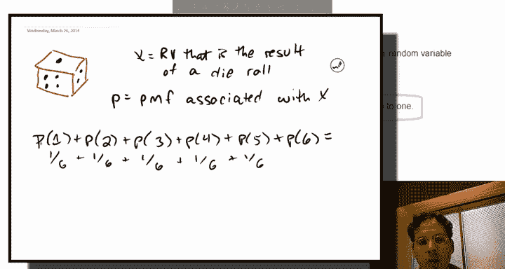

---

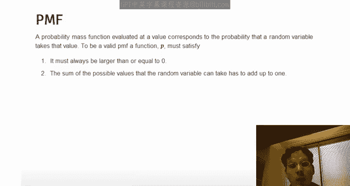

## 经典示例：伯努利分布

让我们回顾一下或许最著名的概率质量函数例子：抛硬币的结果，即所谓的伯努利分布。

让我们令大写字母 **X** 表示抛硬币的结果，其中 **X = 0** 代表反面，**X = 1** 代表正面。

在这里，我们使用的符号约定是：大写字母代表随机变量可能（但尚未实现）的值，因此谈论概率 **P(X = 0)** 和 **P(X = 1)** 是有意义的。而小写字母 **x** 只是一个占位符，我们将把具体的数字代入其中。

因此，在下面的PMF中，我们有：
`P(x) = (1/2)^x * (1/2)^(1-x)`

如果我们代入 **x = 0**，我们得到 `(1/2)^0 * (1/2)^1 = 1/2`。
如果我们代入 **x = 1**，我们得到 `(1/2)^1 * (1/2)^0 = 1/2`。
这仅仅表示随机变量取值为0的概率是1/2，取值为1的概率也是1/2。这是针对公平硬币的情况。

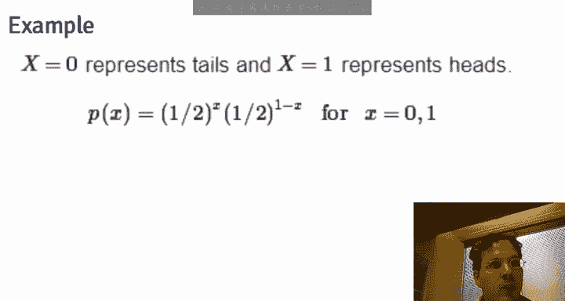

但是，如果我们有一个不公平的硬币呢？

让我们令 **θ** 代表出现正面的概率，**1 - θ** 代表出现反面的概率，其中 **θ** 是0到1之间的某个数字。

那么我们可以这样写我们的概率质量函数：
`P(x) = θ^x * (1-θ)^(1-x)`

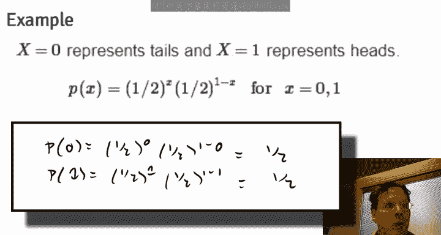

现在注意，如果我代入小写 **x = 1**，我们得到 **θ**。如果我代入小写 **x = 0**，我得到 **1 - θ**。

因此，对于这个总体分布，随机变量取值为0的概率是 **1 - θ**，取值为1的概率是 **θ**。

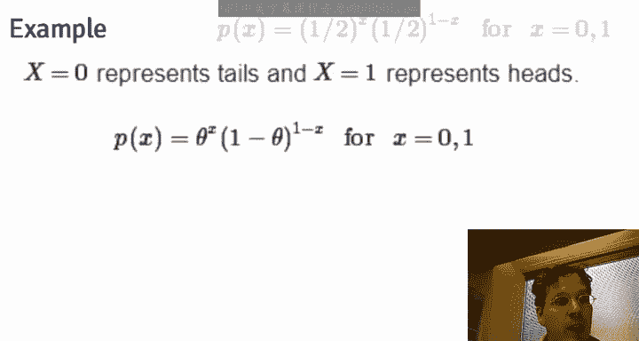

这非常有用，例如，用于建模某事物的流行率。例如，如果我们想建模高血压的流行率，我们可能会假设我们从中抽取样本的总体，类似于抛掷一枚有偏硬币，其成功概率为 **θ**。

为了与我们未来要做的事情联系起来，问题在于我们不知道 **θ**，所以我们将使用我们的数据来估计这个总体比例。

---

## 总结

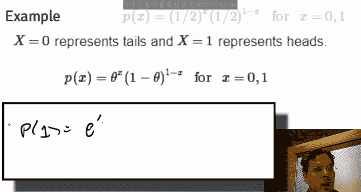

本节课中，我们一起学习了概率质量函数 (PMF) 的核心概念。我们了解到：

1.  PMF 是描述**离散随机变量**概率分布的函数。
2.  PMF 为随机变量每一个可能的取值分配一个概率。
3.  PMF 必须满足两条基本规则：所有概率值非负 (`P(x) ≥ 0`)，且所有可能取值的概率之和为1 (`Σ P(x) = 1`)。
4.  我们通过**伯努利分布**（抛硬币模型）这个经典例子，具体看到了PMF的形式和应用，并理解了参数 **θ** 的含义。

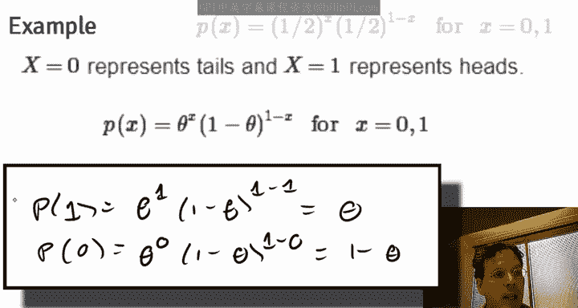

理解PMF是学习更复杂概率分布和进行统计推断的重要基础。在接下来的课程中，我们将利用这些概念，通过收集的数据来估计像 **θ** 这样的总体参数。