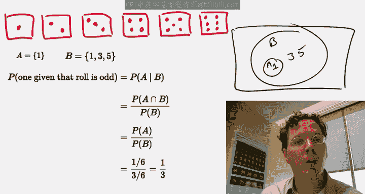

# 005：条件概率 🎲

在本节课中，我们将要学习条件概率的概念。条件概率是统计学和概率论中的一个核心思想，它描述了在已知某些信息（即某个事件已经发生）的情况下，另一个事件发生的概率。理解条件概率对于后续学习贝叶斯统计和机器学习至关重要。

## 概述

上一节我们介绍了概率的基本概念。本节中我们来看看，当获得新的信息时，如何更新我们对事件发生可能性的判断。这就是条件概率要解决的问题。

## 一个生动的例子

为了直观理解条件概率，我们先看一个漫画例子。漫画中，两人在雷暴天气中站在树旁。一人说：“我们应该进屋。”另一人则引用统计数据：“被闪电击中的概率只有大约七百万分之一，所以我们很安全。”漫画的标题点明了关键：“知道这个统计数据的人的死亡率是六分之一。”

这个漫画强调，第二个人没有根据他所处的具体情境（“在雷暴中站在树旁”）来更新他的概率判断。如果**条件**于这个具体信息，被闪电击中的概率将远高于七百万分之一。

## 一个简单的概念示例

掷一个标准骰子，得到点数为1的概率是 **1/6**。

现在，假设你获得了额外信息：掷出的点数是**奇数**（即1、3或5）。条件于这个新信息，你不再会说点数为1的概率是1/6。现在，在1、3、5这三个等可能的结果中，点数为1的概率是 **1/3**。

这就是条件概率的作用：它根据已知信息更新了概率。

## 条件概率的定义

以下是条件概率的正式定义。

设事件B发生的概率大于零（`P(B) > 0`），这一点很重要，因为我们不能对一个不可能发生的事件进行条件化。

事件A在给定事件B已发生条件下的条件概率，记作 **P(A|B)**，其定义为：

**P(A|B) = P(A ∩ B) / P(B)**

其中：
*   `P(A|B)` 读作“给定B时A的概率”。
*   `P(A ∩ B)` 是事件A和事件B同时发生的概率（交集）。
*   `P(B)` 是事件B发生的概率。

如果事件A和B是**统计独立的**（我们将在后续课程中定义），那么 `P(A|B)` 就等于 `P(A)`。这意味着，知道B发生并没有提供任何关于A发生可能性的新信息。

## 验证骰子例子

让我们用定义来验证骰子例子中的答案。

*   设事件 **B** = {掷出点数为奇数} = {1, 3, 5}
*   设事件 **A** = {掷出点数为1}

我们想求 `P(A|B)`，即已知点数为奇数时，点数为1的概率。

根据公式：
`P(A|B) = P(A ∩ B) / P(B)`

在这个例子中，事件A（点数为1）完全包含在事件B（点数为奇数）中，因此 `A ∩ B = A`。

所以：
`P(A ∩ B) = P(A) = 1/6`
`P(B) = P({1, 3, 5}) = 1/6 + 1/6 + 1/6 = 3/6 = 1/2`

代入公式：
`P(A|B) = (1/6) / (1/2) = (1/6) * (2/1) = 1/3`

计算结果与我们之前的直观判断一致：条件概率为 **1/3**。

## 总结

本节课中我们一起学习了条件概率。我们了解到，条件概率 `P(A|B)` 衡量了在已知事件B发生的情况下，事件A发生的可能性。其核心公式是 **P(A|B) = P(A ∩ B) / P(B)**。通过漫画和骰子的例子，我们看到，忽略条件信息可能导致严重错误的判断，而正确使用条件概率则能让我们根据新证据做出更准确的概率评估。这是进行统计推断和数据分析的一块基石。