# 007：6_03 独立性 📊

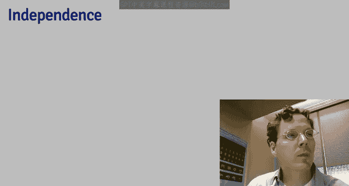

在本节课中，我们将要学习概率论中的一个核心概念——独立性。我们将探讨独立性的定义、计算方法，以及它在实际应用中的重要性，特别是如何避免错误地应用独立性假设。

## 独立性的定义

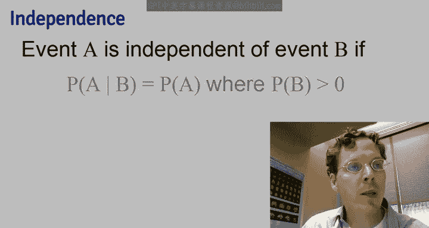

上一节我们介绍了条件概率，本节中我们来看看独立性。独立性是指一个事件的发生不影响另一个事件发生的概率。

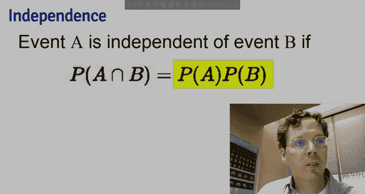

以下是独立性的两种等价定义：

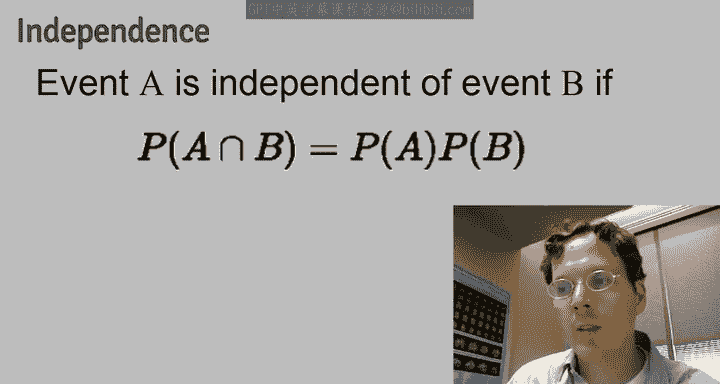

*   如果事件B的概率为正，且事件A在给定B发生条件下的概率等于A自身的概率，即 **P(A|B) = P(A)**，则称事件A独立于事件B。
*   事件A与事件B独立，当且仅当它们同时发生的概率等于各自概率的乘积，即 **P(A ∩ B) = P(A) × P(B)**。

## 独立性的计算与注意事项

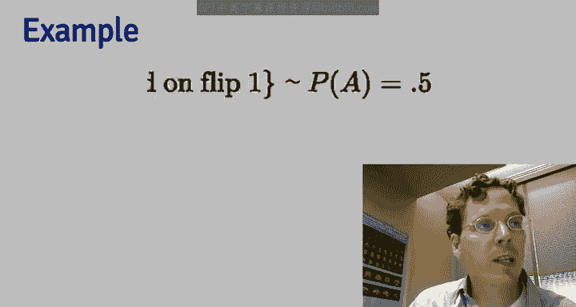

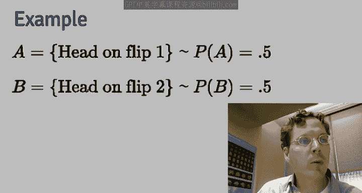

基于第二个定义，我们可以得出一个非常重要的结论：**不能随意地将概率相乘**。只有在事件相互独立的前提下，才能将它们的概率相乘。

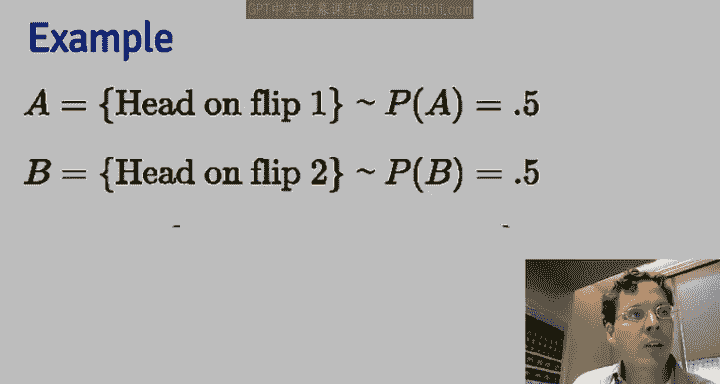

让我们通过一个数值例子来理解。假设我们抛掷一枚均匀的硬币，求连续两次得到正面的概率。

*   定义事件A为“第一次抛掷得到正面”，P(A) = 0.5。
*   定义事件B为“第二次抛掷得到正面”，P(B) = 0.5。
*   事件A ∩ B 表示“第一次和第二次都得到正面”。

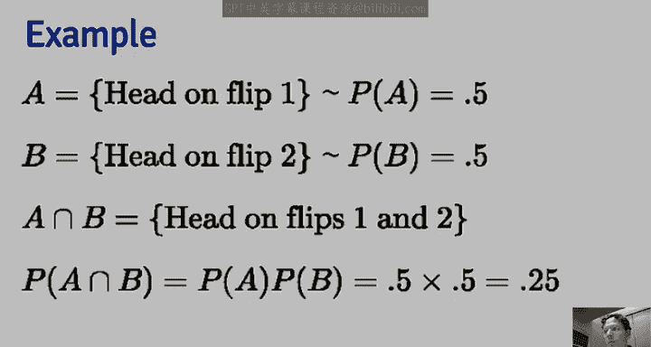

在这个例子中，两次抛掷是独立的。因此，我们可以使用乘法规则：
**P(A ∩ B) = P(A) × P(B) = 0.5 × 0.5 = 0.25**

人们通常会自然地完成这个计算。问题在于，人们有时会在不应该相乘的时候错误地相乘概率。

## 错误应用独立性的案例

一个因错误相乘概率而导致的严重后果，记录在《科学》杂志第309卷中。该报告涉及一位在刑事审判中提供专家证词的医生。

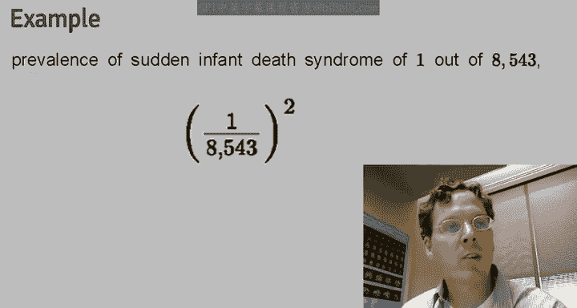

案件涉及一位母亲，她的两个孩子均死于婴儿猝死综合征（SIDS）。专家证词将SIDS的患病率定为1/8500，然后将这两个概率相乘，得出同一母亲的两个孩子都患SIDS的概率。基于此证据（以及推测的其他证据），受审的母亲被判定犯有谋杀罪。

与本课程相关的是，这个错误的核心在于**对不一定独立的事件概率进行了相乘**。在这个案例中，假设事件独立是不合理的，因为任何具有遗传或家庭环境因素的生物过程，在家庭内部很可能是相关的（即非独立的）。

## 独立同分布（IID）的概念

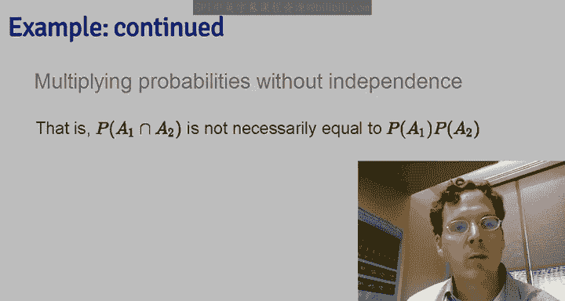

在本课程中，我们使用独立性的主要方式是假设一组随机变量是独立且来自相同分布的。我们称这样的随机变量为**独立同分布**。

例如，你可以将多次抛硬币视为IID，因为一次抛掷的结果与下一次是独立的，并且它们都来自相同的分布：正面概率为0.5，反面概率为0.5。

## IID作为随机样本的默认模型

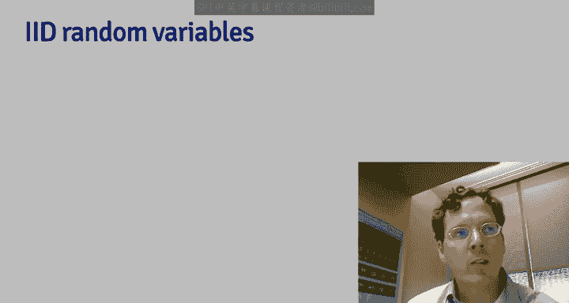

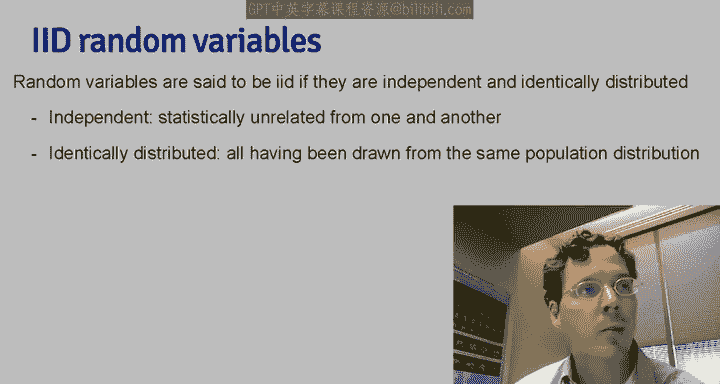

IID抽样是我们对随机样本的默认模型。无论我们是否拥有真正的随机样本，我们经常使用随机抽样或IID模型作为分析数据的概念模型。这将是本课程的主要分析模式。

---

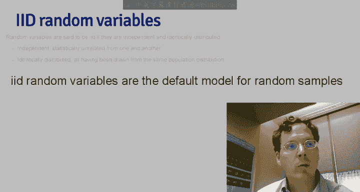

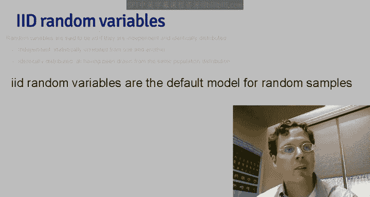

本节课中我们一起学习了：
1.  独立性的两种等价定义。
2.  计算独立事件联合概率的正确方法：**P(A ∩ B) = P(A) × P(B)**。
3.  错误应用独立性（即在不独立的事件上滥用概率乘法）可能导致的严重谬误。
4.  独立同分布（IID）是统计学中描述随机样本的核心模型。