# 008：期望值 📊


## 概述

在本节课中，我们将要学习统计学推断中的一个核心概念——**期望值**。我们将探讨期望值如何描述随机变量的中心位置，以及它如何与样本均值、方差等概念联系起来。通过理解期望值，我们可以更好地从有噪声的数据中推断出总体特征。

---

## 统计推断与分布特征

上一节我们介绍了统计推断的基本概念，即基于从总体中抽取的有噪声数据来对总体做出结论。本节中我们来看看描述这些总体分布特征的关键工具。


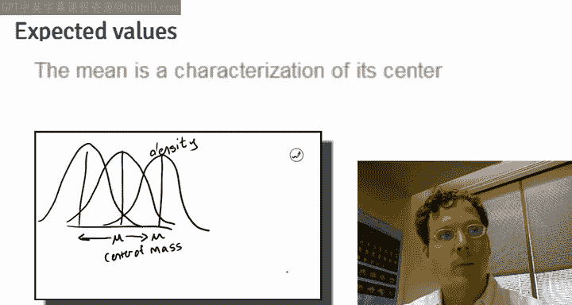

我们假设总体及其样本的随机性由概率密度函数或概率质量函数描述。我们无需讨论整个函数，而是关注这些函数（以及从中抽取的随机变量）的某些特征。其中最有用的特征就是**期望值**，尽管我们也讨论过其他特征，例如样本分位数。

期望值中的**均值**是最有用的一个，它代表了分布的中心。你可以想象，当均值变化时，整个分布会随之向左或向右移动。

**方差**是分布的另一个特征，它描述了分布的离散程度。

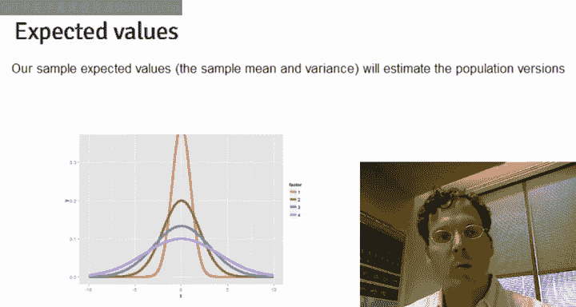

正如样本分位数用于估计总体分位数一样，样本期望值也将用于估计总体期望值。因此，样本均值将是我们总体均值的估计，样本方差将是我们总体方差的估计，样本标准差将是我们总体标准差的估计。

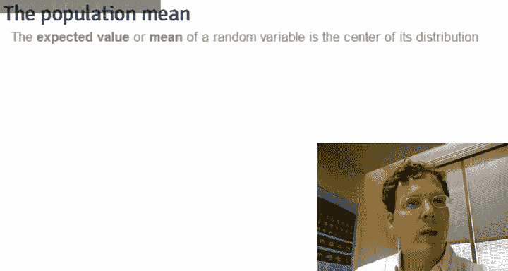

---

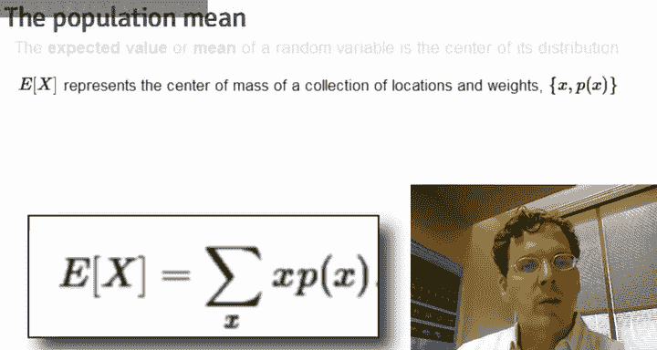

## 期望值的定义与直观理解

期望值或随机变量的均值是其分布的中心。

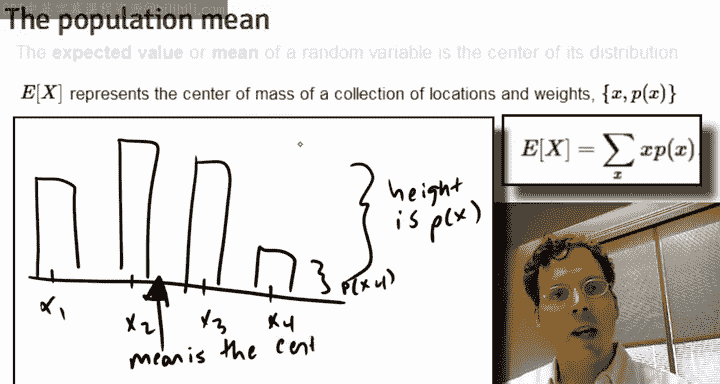

对于一个具有概率质量函数 **p(x)** 的离散随机变量 **X**，其期望值 **E[X]** 定义为：

**E[X] = Σ x * p(x)**


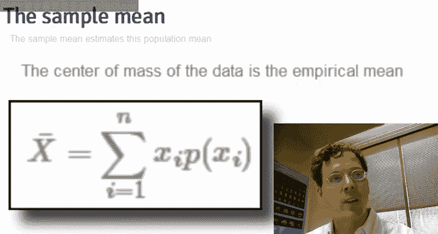

其中求和遍历 **X** 所有可能的取值。

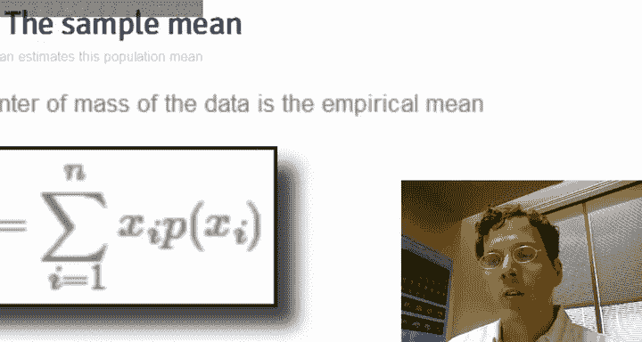

期望值的概念来源于物理中的**质心**思想。如果把概率想象成权重，把随机变量的取值想象成在数轴上的位置，那么期望值就是这些权重系统的质心。我们稍后会通过一些例子来说明这一点。

这种质心的思想在定义**样本均值**时也很有用。请记住，本讲座讨论的是由样本均值估计的**总体均值**。但有趣的是，如果我们把每个数据点视为等可能（即每个数据点 **Xi** 的概率为 **1/n**），那么数据的质心恰好就是样本均值 **X̄**。

因此，即使在使用样本均值时，我们也在直观地运用质心这一思想。

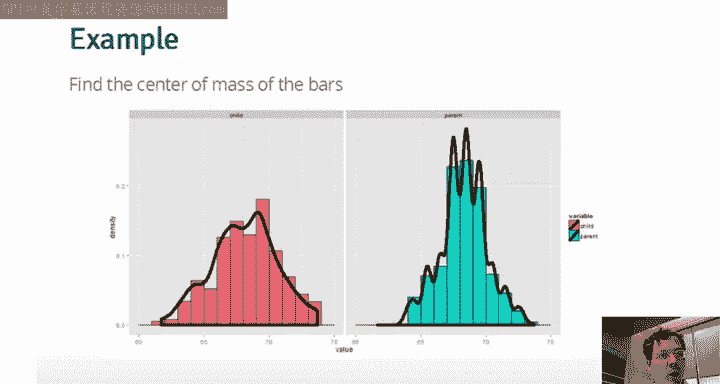

---

## 示例：样本均值作为质心

以下是使用R语言代码展示样本均值如何作为数据直方图质心的一个示例。代码可以在与幻灯片关联的GitHub上的Markdown文件中找到。

```r
# 示例：展示样本均值如何平衡直方图
library(manipulate)
data(Galton) # 假设数据已加载
# ... (此处省略具体绘图和manipulate函数调用代码)
```

在这个例子中，我们有一个关于父母身高和子女身高的配对数据集。我们绘制了子女身高的直方图，并叠加了一个连续的密度估计曲线。

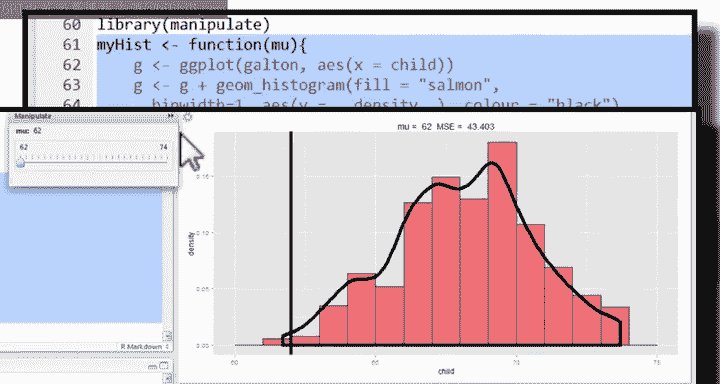

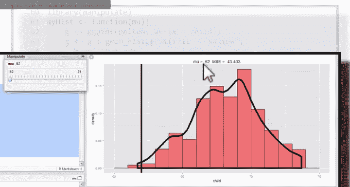

通过使用 `manipulate` 函数，我们可以在图中动态移动一条代表当前均值估计值的垂直线。当我们移动这条线时，可以观察到一个称为“均方误差”的指标（衡量不平衡程度）的变化。当垂直线移动到样本均值的位置时，这个误差最小，直方图在视觉上达到最佳的“平衡”状态。这直观地说明了经验均值（样本均值）是平衡经验分布的点，而我们将用这个概念来讨论平衡总体分布的总体均值。

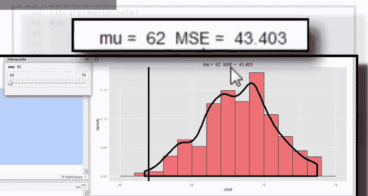

---

## 总结

本节课中我们一起学习了**期望值**这一核心概念。我们了解到：
*   期望值，特别是均值，是描述随机变量分布中心的关键特征。
*   对于离散随机变量，期望值是其所有可能取值以其概率为权重的加权和。
*   期望值的直观理解来源于物理中的**质心**概念。
*   **样本均值**是总体均值的估计，它本身也是样本数据点的质心。
*   通过动态示例，我们看到了样本均值如何最小化某种“不平衡”度量，从而在直观上平衡数据的分布。

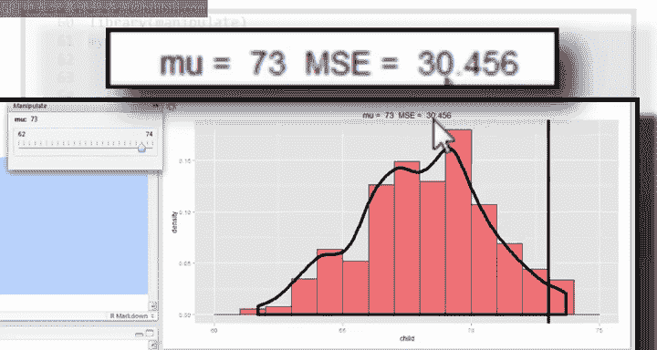

理解期望值为我们后续学习方差、协方差以及更复杂的统计推断方法奠定了重要基础。