# 009：期望值简单示例 🎲

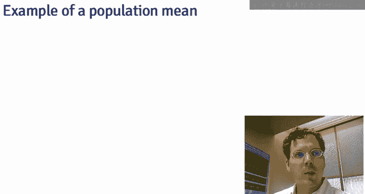

在本节课中，我们将通过几个简单的例子来学习如何计算随机变量的期望值。期望值是概率论中的一个核心概念，它描述了随机变量在大量重复试验中的平均结果。

---

## 抛硬币的期望值

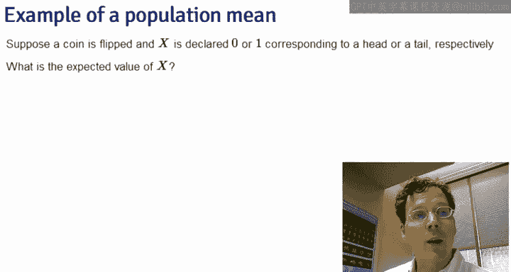

上一节我们介绍了期望值的概念，本节中我们来看看一个最简单的例子：抛硬币。

假设抛一枚硬币，随机变量 **X** 定义为：正面朝上时 **X = 1**，反面朝上时 **X = 0**。那么 **X** 的期望值是多少？

根据期望值的定义公式，它是所有可能取值乘以其对应概率的总和。对于一枚公平硬币，其概率分布如下：

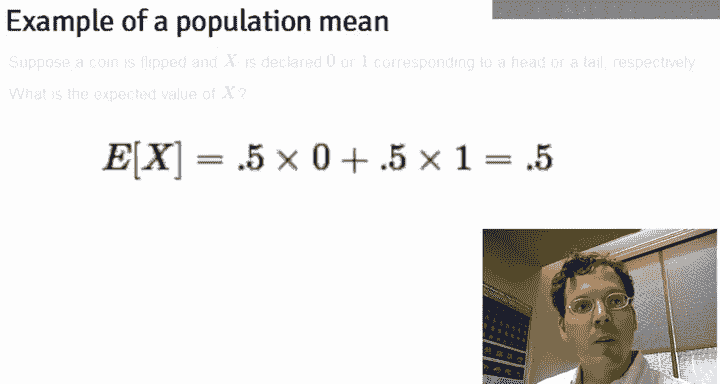

以下是公平硬币的概率分布：
*   取值为 0（反面）的概率是 0.5。
*   取值为 1（正面）的概率是 0.5。

因此，期望值的计算过程为：
`E[X] = (0.5 × 0) + (0.5 × 1) = 0.5`

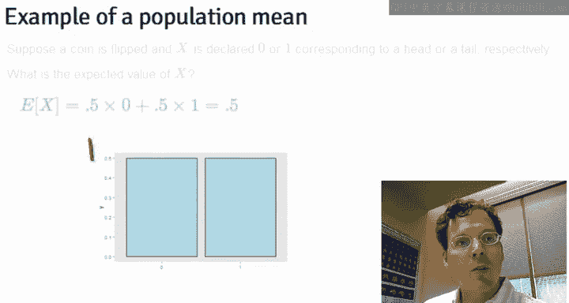

计算结果 0.5 是一个有趣的数字，它本身并不是硬币可以取到的值（0 或 1）。然而，如果我们从几何角度思考，这个结果就很直观：想象两个高度相等的柱子，分别位于 0 和 1 的位置，要找到一个支点使其平衡，这个支点必然在正中间，即 0.5。

---

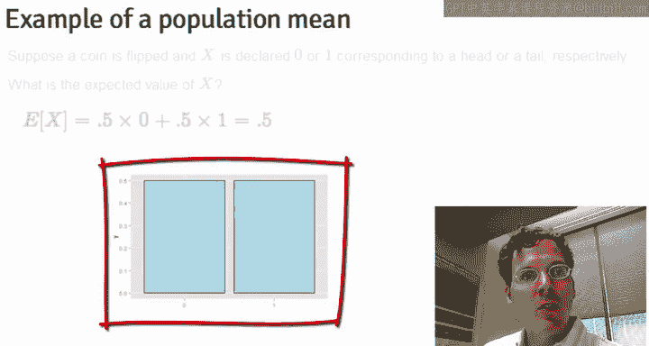

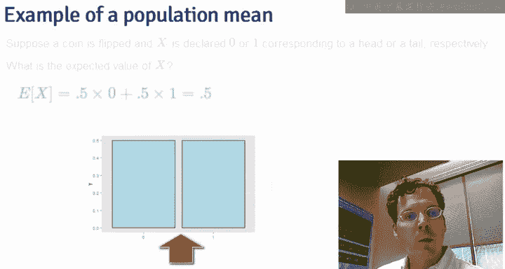

## 有偏硬币的期望值

现在，让我们考虑一个更一般的情况：一枚有偏的硬币。

假设随机变量 **X** 取值 1 的概率是 **p**，取值 0 的概率是 **1 - p**。这代表一枚正面朝上概率为 **p** 的不均匀硬币。

其期望值计算如下：
`E[X] = ( (1 - p) × 0 ) + ( p × 1 ) = p`

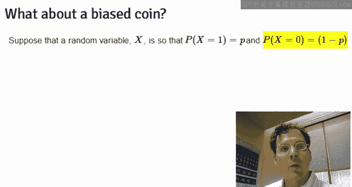

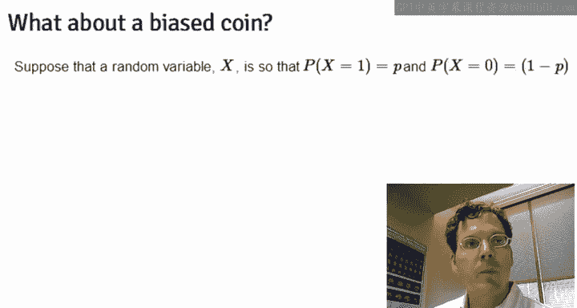

这个结果表明，即使是对于有偏硬币，其期望值也正好等于在一次抛掷中得到正面的真实长期比例 **p**。这再次印证了期望值作为“长期平均结果”的含义。

---

## 掷骰子的期望值

最后，我们来看一个多值离散随机变量的例子：掷一个标准的六面骰子。

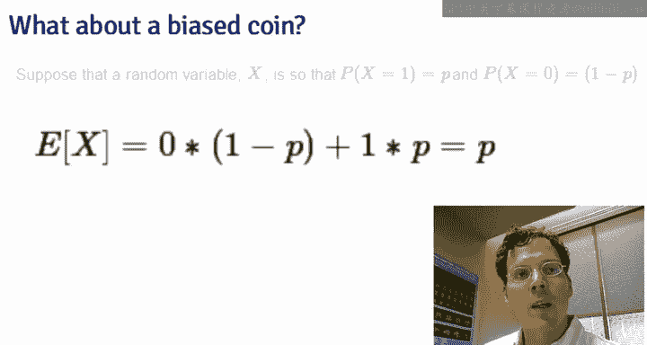

假设掷一枚骰子，随机变量 **X** 表示朝上的点数。**X** 的期望值是多少？

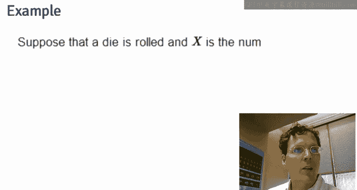

以下是骰子取每个值的概率（均匀分布）：
*   取值为 1, 2, 3, 4, 5, 6 的概率均为 1/6。

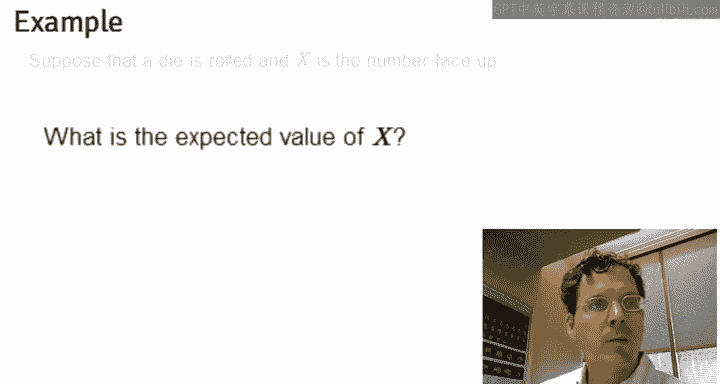

根据公式，我们将每个可能取值乘以其概率 (1/6) 并求和：
`E[X] = (1/6)×1 + (1/6)×2 + (1/6)×3 + (1/6)×4 + (1/6)×5 + (1/6)×6 = 3.5`

和硬币的例子类似，计算结果 3.5 并不是骰子能掷出的点数。但从几何平衡的角度看，六个等概率、等间距的柱子，其平衡点必然位于它们的中心，即 3 和 4 的中间点 3.5。

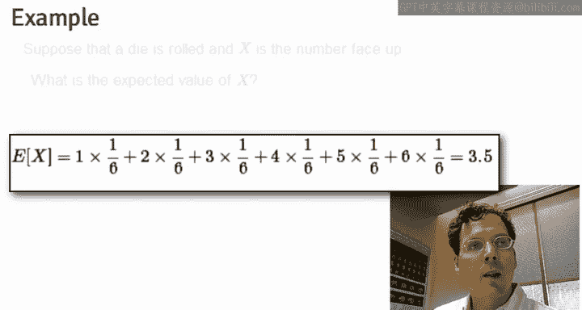

---

## 总结

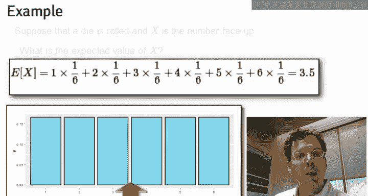

本节课中我们一起学习了如何计算离散随机变量的期望值。我们通过三个经典示例——公平硬币、有偏硬币和标准骰子——演示了期望值的计算过程 `E[X] = Σ (x_i × P(X=x_i))`。我们发现，期望值代表了随机变量的“重心”或长期平均值，它本身不一定等于随机变量可能取得的某个具体值。理解这些简单例子是掌握更复杂概率模型的重要基础。