# 010：概率密度函数的期望值 📊

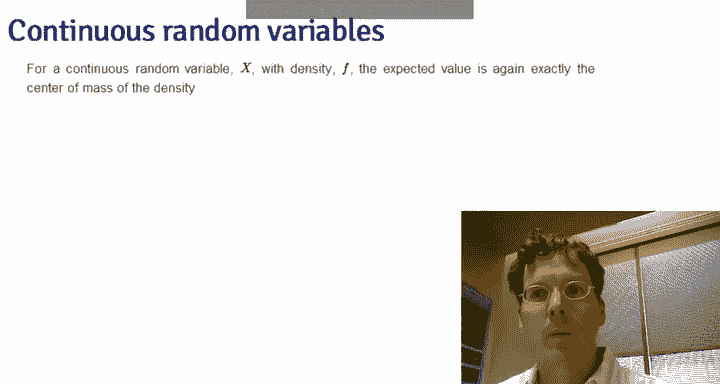

在本节课中，我们将学习连续型随机变量期望值的概念，理解其作为概率分布“质心”的物理意义，并通过模拟实验直观感受样本均值的分布特性及其与总体均值的关系。

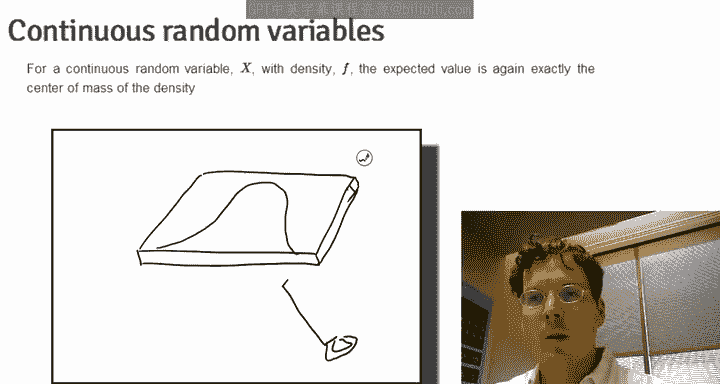

---

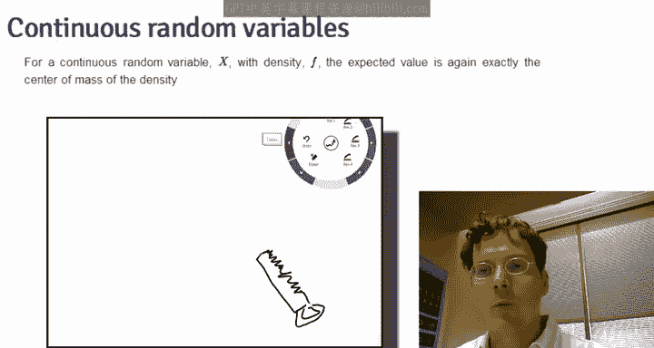

## 概述

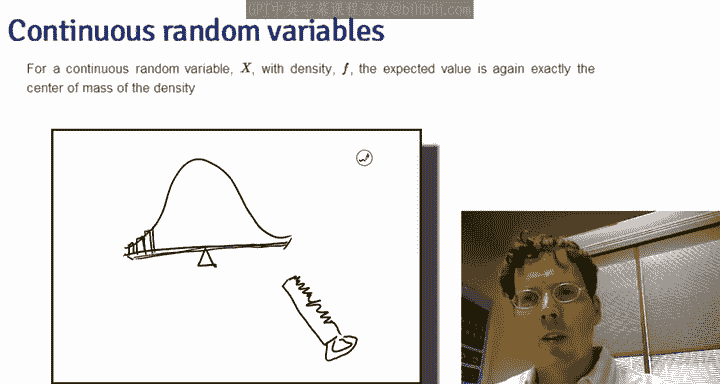

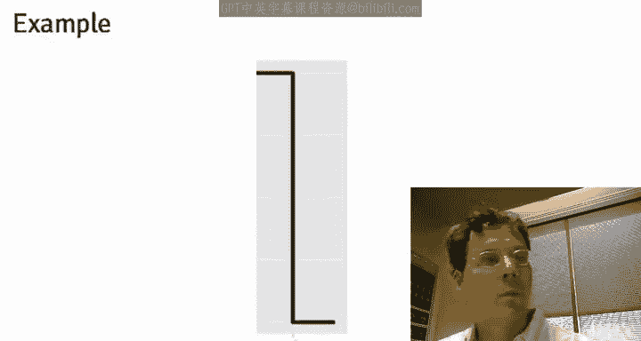

上一节我们讨论了离散型随机变量的期望值。本节中，我们将把期望值的概念扩展到连续型随机变量。我们会通过一个具体的均匀分布例子来理解其计算，并深入探讨样本均值作为总体均值估计量的重要性质。

---

## 期望值的物理意义 🪵

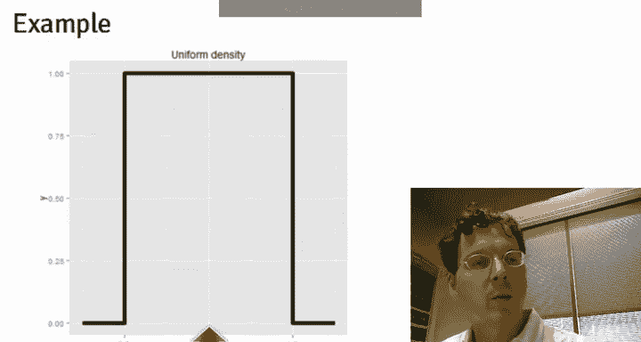

对于连续型随机变量，你可以想象将概率密度函数图形从一块木板上切割下来。如果你试图用手指在底部托住这块木板使其平衡，那么平衡点就是这块形状的质心。**这个质心就是连续型随机变量的期望值**。

在概率质量函数的语境中，当概率条柱变得越来越细、越来越密时，其平衡点的概念就自然地过渡到了连续情形下的期望值。

接下来，我们将通过一个例子来具体说明。

---

## 一个例子：均匀分布

考虑一个在0到1之间取值为1的密度函数。这里有一个问题：这是一个有效的密度函数吗？答案是肯定的，这是一个著名的密度函数，称为**均匀密度函数**。

那么，它的期望值是多少？如果我们把这块密度函数图形从木板上切下来，应该把手指放在哪里才能让它平衡？答案当然是正中间的 **0.5**。这正是均匀分布的期望值。

其计算公式为：
\[
E[X] = \int_{0}^{1} x \cdot 1 \, dx = \frac{1}{2}
\]

---

## 期望值的重要事实 🔍

现在，让我们转向推断统计学的核心话题。以下是关于期望值的一些重要事实。

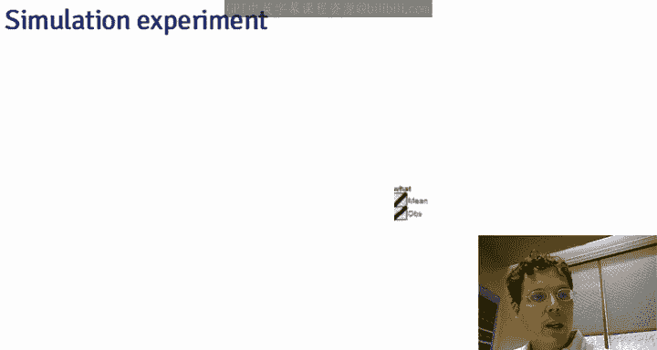

首先，回忆一下，期望值是**分布的属性**，它是分布的质心。

其次，请注意，随机变量的**平均值本身也是一个随机变量**。例如，我掷六次骰子并计算其平均值，这个平均值就是一个随机变量。我可以通过反复掷六次骰子并反复计算平均值来从这个分布中重复抽样。

因为它是一个随机变量，它也有一个分布，而这个分布也有一个期望值。**这个分布（样本均值的分布）的质心，与原始总体的分布质心是相同的**。

我将通过一些模拟示例来讲解，因为这对于理解推断统计学至关重要。这个结论是：**样本均值的期望值恰好等于它试图估计的总体均值**。

换句话说，样本均值的分布，其总体分布的质心与抽取数据的原始总体的质心位置相同。当一个估计量具有这种性质时，我们称该估计量是**无偏的**。

让我们尝试一些模拟例子来更好地理解这一点。

---

## 模拟示例一：正态分布

以下是通过模拟来理解这一概念的几个例子。

我这里的蓝色密度曲线是来自标准正态分布的数千次模拟结果。因为模拟次数非常多，所以它能很好地近似真实分布。这告诉我们，如果我从一个总体（此处是标准正态分布）中收集大量数据，我可以很好地近似它来自的分布。

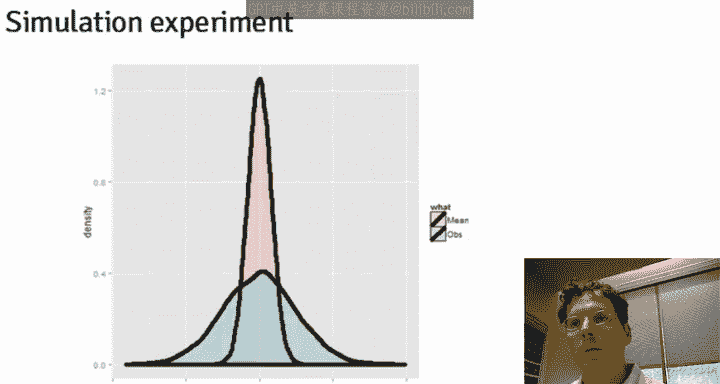

当然，这个分布的质心，即平衡点，是零。从图形上看也确实如此。如果我能模拟无限多的数据，它就会精确地为零。

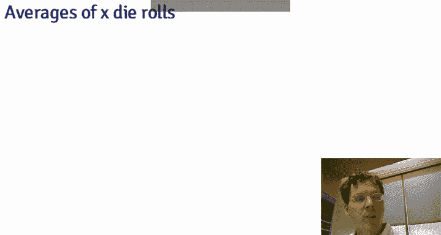

现在，假设我不是取一大堆单独的正态随机变量，而是模拟10个标准正态随机变量，计算它们的平均值，然后一遍又一遍地重复这个过程。接着，我为这组“10个正态变量平均值”的模拟结果绘制直方图或密度估计。

那将是一个不同的分布。因为它不再是标准正态的分布，而是**10个标准正态变量平均值的分布**。

这就是我们看到的三文鱼色（橙色）分布。它有一些有趣的性质：一是它变得更集中在零附近（我们稍后会讨论）。现在，我们只想指出，它恰好也以0点为中心。这正是上一张幻灯片想要说明的观点：**来自总体的平均值分布，其中心将与原始总体分布的中心相同**。

因此，10个标准正态变量平均值的分布将以0为中心。我们不需要做任何计算或模拟就能知道这一点，尽管模拟有助于我们进行概念性理解。

---

## 模拟示例二：掷骰子 🎲

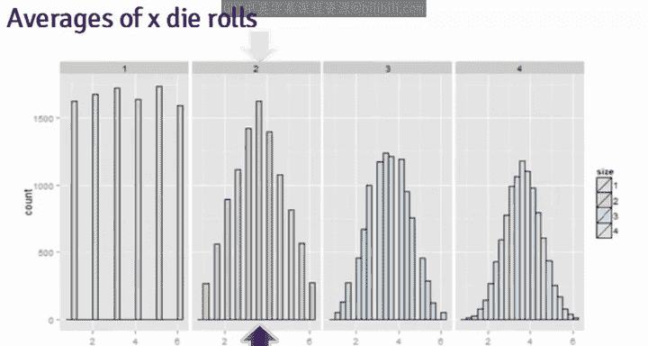

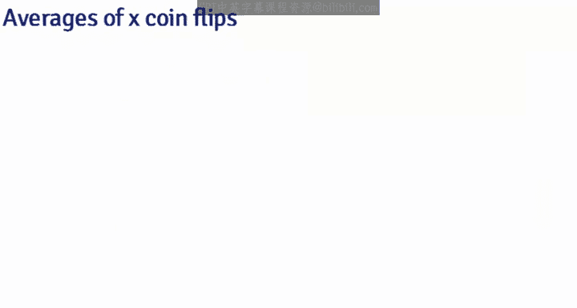

想象一下，如果我掷一个骰子几千次（事实上，在R语言中，我在第一个面板里正是这样做的）。如果我绘制它们结果的直方图，大约有六分之一的投掷结果会是数字1到6中的每一个。

如果我掷的次数越来越多，这些条形图的质心，即平衡点，会是3.5。现在不完全是因为我还没有模拟无限次投掷，但如果我做了，它会在3.5处平衡。

现在，想象一下，如果我掷骰子两次，取这两个数字的平均值，然后一遍又一遍地重复这个过程。那么我将得到的不是骰子点数的分布，而是**两次投掷平均值的分布**。这就是我们在第二个面板中看到的情况。

请注意，它看起来更接近高斯分布（正态分布），并且更集中。但最重要的是，请注意，它**以相同的位置为中心**。两次投掷平均值的总体均值与单次投掷点数的总体均值完全相同。

我接着对三次和四次投掷的平均值做了同样的模拟。

---

## 模拟示例三：抛硬币 🪙

如果我抛一枚硬币很多次，大约50%的时间我会得到0（反面），大约50%的时间我会得到1（正面）。我们知道这些条形图会在大约0.5处平衡。

现在，如果我只抛几次，我的样本比例可能离0.5有点远。但如果我抛得足够多，我知道模拟的变异性将变得微不足道，结果会接近精确的0.5。

那么，如果我改为抛硬币10次，取平均值，然后一遍又一遍地重复这个过程呢？那么我的模拟将让我了解**10次抛硬币平均值的分布**。

我在这里展示了10次、20次和30次抛硬币平均值的分布。在每种情况下我们都会看到，随着平均值由更多次抛硬币构成，其分布变得更集中在均值附近；然而，其分布**始终以相同的位置（0.5）为中心**。

---

## 本节总结 📝

本节课中我们一起学习了以下内容：

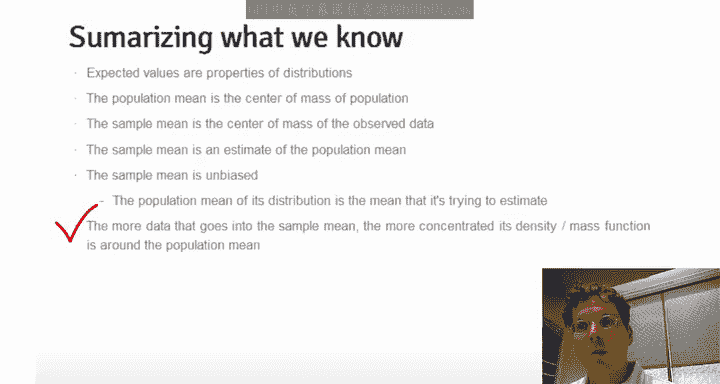

*   **期望值是分布的属性**：总体均值是该总体的质心，如果它移动，分布就会移动。
*   **样本均值是观测数据的质心**：样本均值是总体均值的估计量。
*   **样本均值是无偏的**：这意味着样本均值分布的总体均值，恰好等于它试图估计的总体均值。
*   **无偏性的重要性**：如果我们收集大量数据，实际上可以很好地估计总体分布，但我们只得到一个样本均值。我们无法从数据本身获得关于样本均值分布的信息（我们只有一个样本均值），因此了解样本均值的这些性质非常有用。
*   **数据量对估计的影响**：进入样本均值的数据越多，其密度函数在总体均值周围就越集中。我们还看到，即使在抛硬币和掷骰子这些特殊情况下，随着数据量增加，分布也看起来更接近高斯分布。我们将在后续课程中更多地讨论这些问题。