# 013：均值的标准误差 📊

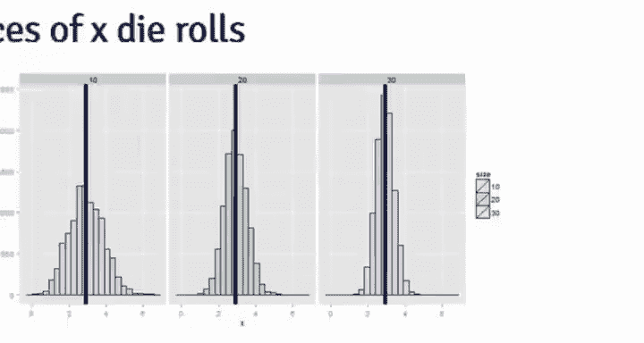

在本节课中，我们将要学习一个核心概念：**均值的标准误差**。我们将探讨样本均值的分布特性，理解其方差与原总体方差的关系，并通过模拟实验验证相关理论。

---

## 概述

我们已经讨论了方差，并初步了解了样本方差的分布。本节我们将再次聚焦于**样本均值的分布**。样本均值本身是一个随机变量，拥有自身的总体均值和方差。我们将学习如何通过样本数据估计其变异性，并引入“标准误差”这一重要概念。

---

## 样本均值的分布

上一节我们介绍了方差，本节中我们来看看样本均值的分布特性。

从总体中抽取样本并计算其平均值，这个平均值本身是一个随机变量。它有自己的总体均值（μ）和总体方差（σ²）。

我们知道，样本均值的总体均值等于原始总体的均值 μ。更重要的是，样本均值的方差与原始总体方差存在明确的关系：

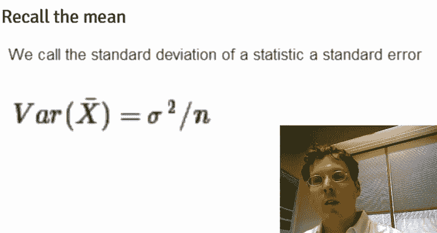

**样本均值的方差 = σ² / n**


其中，σ² 是原始总体的方差，n 是样本容量。这个公式表明，随着样本量 n 的增加，样本均值的方差会减小并趋近于零。这符合我们的直觉：收集的数据越多，样本均值作为总体均值的估计就越集中、越精确。

在实际数据分析中，我们通常只有一个数据集，因此只能得到一个样本均值，无法像模拟实验那样获得多个版本来研究其变异性。然而，我们可以通过样本数据估计 σ²（使用样本方差 S²），并利用上述公式来推断样本均值的分布特性。

---

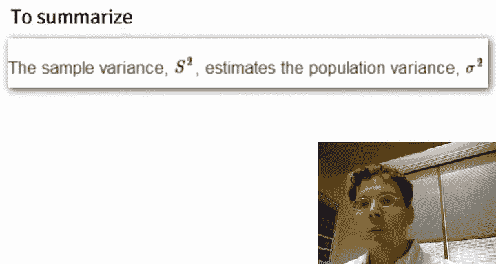

## 标准误差的定义

基于以上理论，我们引入一个关键的统计量：**均值的标准误差**。

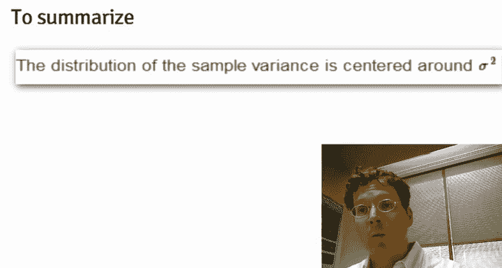

标准误差是统计量（如样本均值）分布的标准差。我们使用“标准误差”这个术语来特指统计量的变异性。例如，“均值的标准误差”描述的是样本均值的变异性，“回归系数的标准误差”描述的是回归系数的变异性。

对于样本均值，其标准误差的理论值为：

**理论标准误差 = σ / √n**

在实际应用中，由于总体标准差 σ 通常是未知的，我们使用样本标准差 S 来估计它。因此，**样本均值的标准误差**的估计值为：

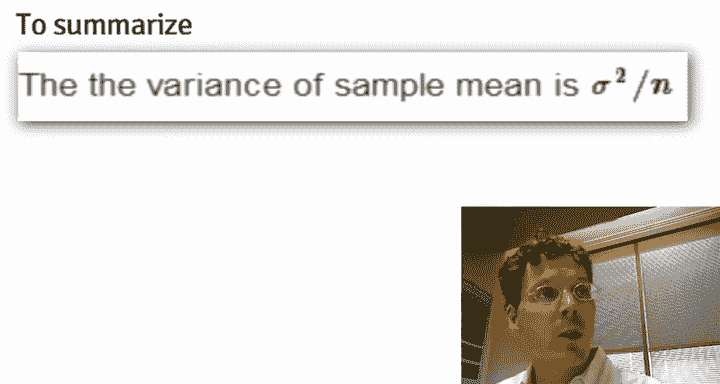

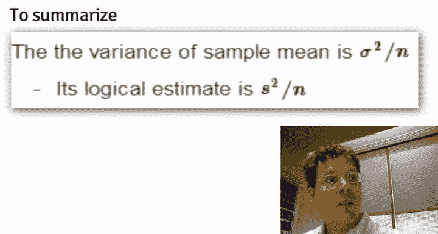

**估计标准误差 = S / √n**

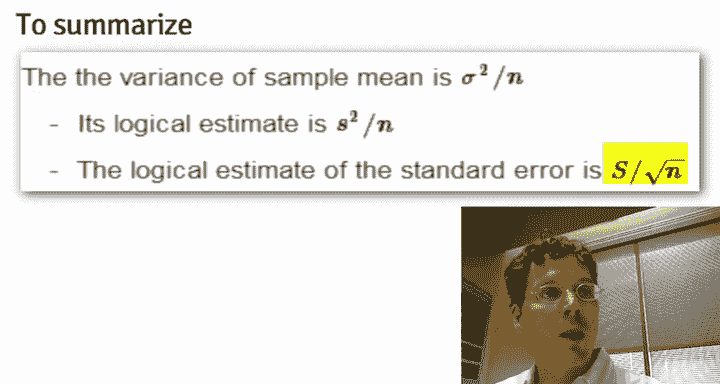

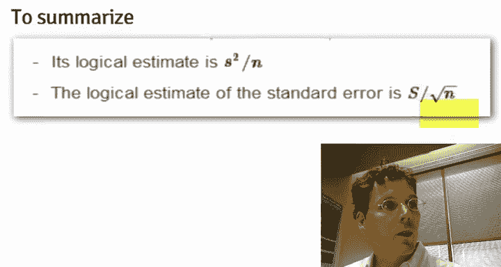

这个量 S/√n 极其重要，它被称为**均值的（样本）标准误差**。

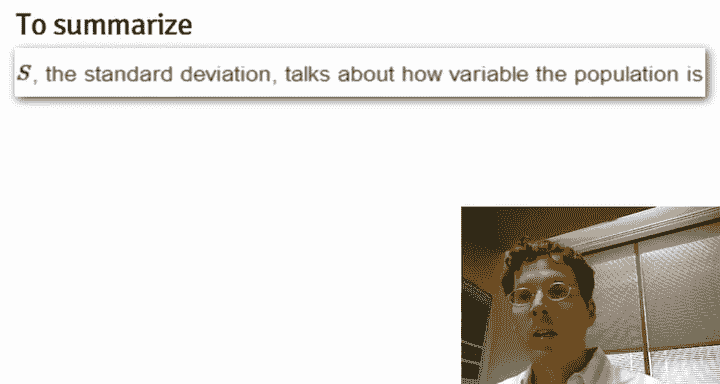

---

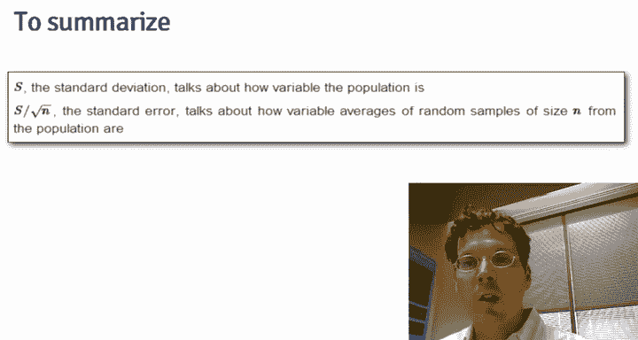

## 标准误差与标准差的区别

理解标准误差（SE）与标准差（SD）的区别至关重要。

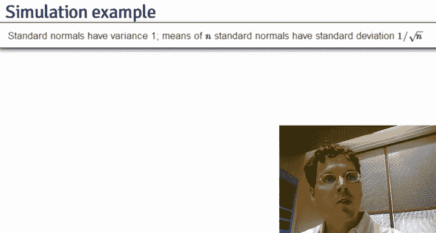

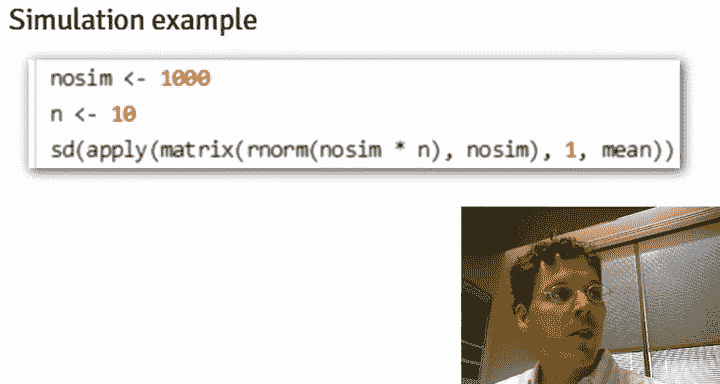

*   **标准差 (S)**：估计的是**总体中个体观测值**的变异性。它回答的问题是：“总体中的数据点有多分散？”
*   **标准误差 (S/√n)**：估计的是**样本统计量（此处是均值）** 的变异性。它回答的问题是：“如果我们从同一总体中反复抽取大小为 n 的样本，计算出的这些样本均值会有多大波动？”

简而言之，标准差描述数据本身的波动，而标准误差描述统计量（如均值）的抽样波动。

---

## 模拟验证

现在，让我们通过几个模拟实验来验证均值的标准误差公式。以下是几个不同分布的示例：

### 示例 1：标准正态分布

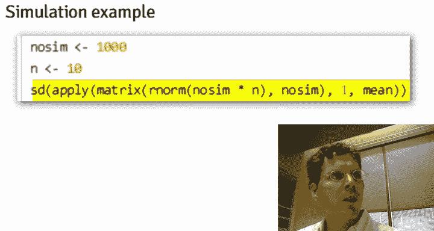

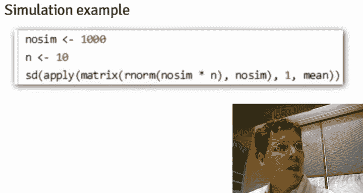

标准正态分布的方差 σ² = 1，标准差 σ = 1。根据理论，大小为 n 的样本均值的标准差应为 1/√n。

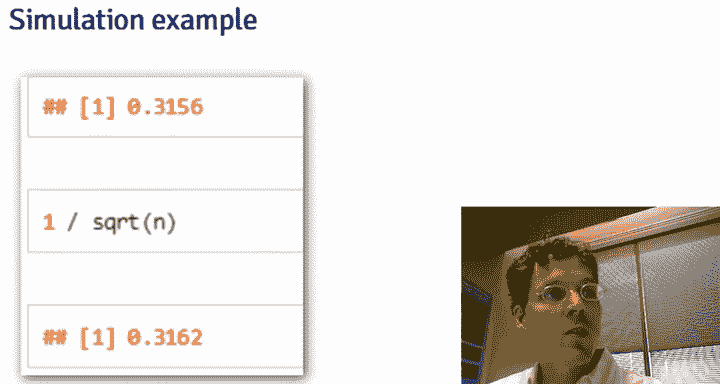

**模拟代码（R语言示例）:**
```r
n_sim <- 1000  # 模拟次数
n <- 10        # 样本量
sim_means <- replicate(n_sim, mean(rnorm(n))) # 生成1000个样本均值
sd(sim_means)  # 计算这些均值的标准差
1 / sqrt(n)    # 理论值
```
模拟结果的标准差约为 0.316，理论值 1/√10 ≈ 0.316，两者吻合。

### 示例 2：标准均匀分布

在 [0,1] 区间上的均匀分布，其方差 σ² = 1/12。因此，样本均值的理论标准差为 √(1/12) / √n = 1/√(12n)。

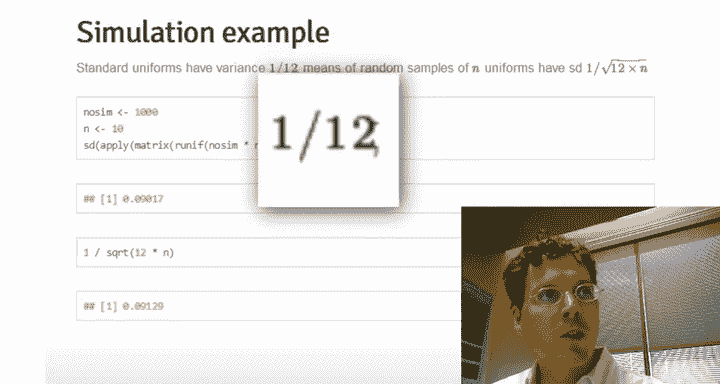

**模拟结果：**
当 n=10 时，模拟得到的样本均值标准差约为 0.091，理论值 1/√(12*10) ≈ 0.091，结果一致。

### 示例 3：泊松分布

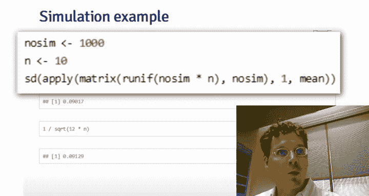

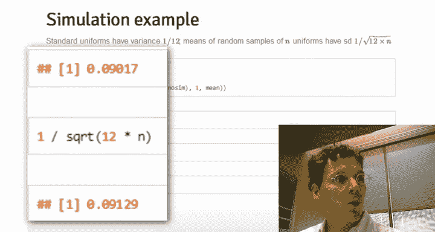

参数 λ=4 的泊松分布，其方差 σ² = 4。因此，样本均值的理论标准差为 √4 / √n = 2/√n。

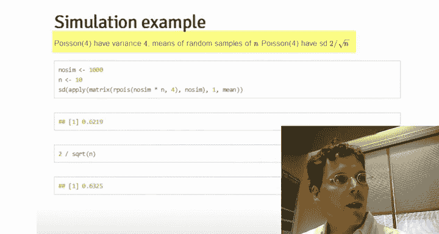

**模拟结果：**
当 n=10 时，模拟得到的样本均值标准差约为 0.632，理论值 2/√10 ≈ 0.632，验证成功。

### 示例 4：抛硬币（伯努利分布）

对于一枚公平硬币（正面概率 p=0.5），单次抛掷的方差为 p(1-p) = 0.25。因此，n 次抛掷的样本均值（即正面比例）的理论标准差为 √0.25 / √n = 0.5/√n。

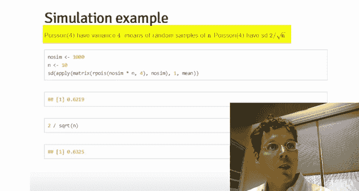

**模拟结果：**
当 n=10 时，模拟得到的正面比例的标准差约为 0.158，理论值 0.5/√10 ≈ 0.158，再次验证了公式。

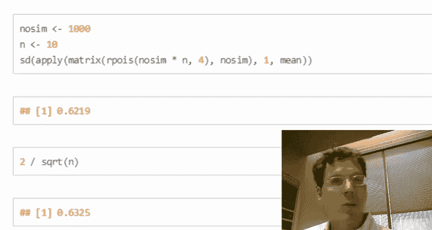

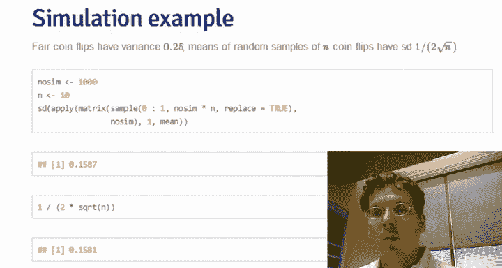

这些模拟实验仅在像本课程这样的学习环境中需要，目的是帮助大家直观理解均值标准误差的含义及其计算公式。

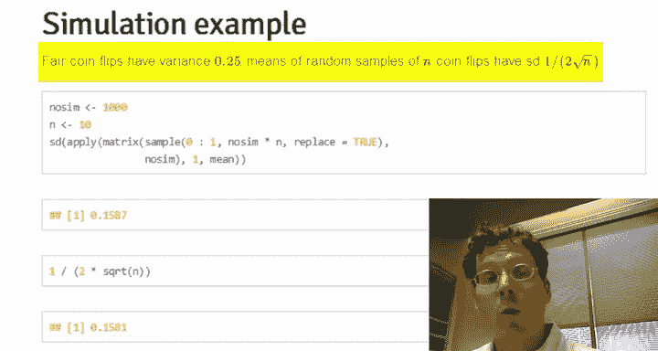

---

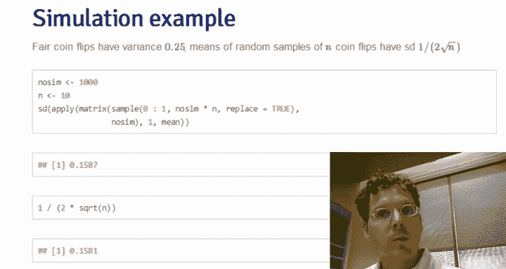

## 总结

本节课中我们一起学习了**均值的标准误差**这一核心概念。

我们首先回顾了样本均值作为一个随机变量的分布特性，其方差等于总体方差除以样本量（σ²/n）。由此推导出，衡量样本均值变异性的理论标准误差是 σ/√n。

在实际应用中，我们用样本标准差 S 代替未知的总体标准差 σ，从而得到**估计的标准误差 S/√n**。我们明确了标准差（描述数据波动）与标准误差（描述统计量抽样波动）的根本区别。

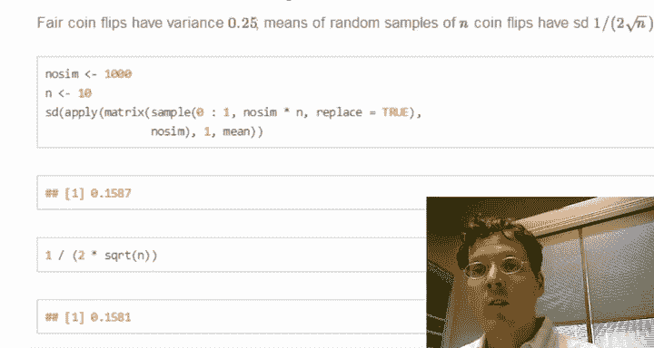

最后，我们通过多个分布的模拟实验，直观验证了标准误差公式的正确性。掌握标准误差对于理解参数估计的精确性和后续的统计推断（如构建置信区间和假设检验）至关重要。