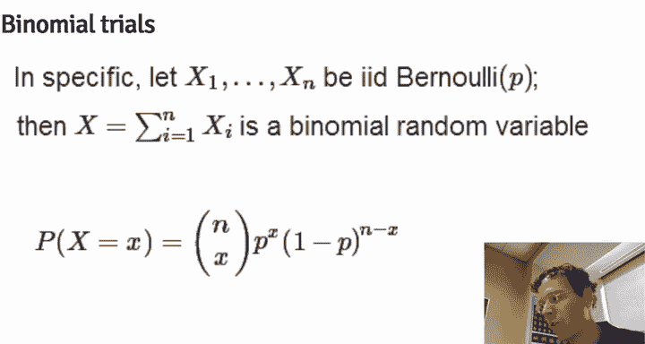
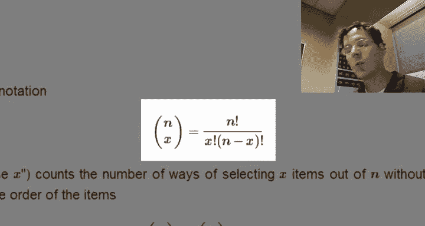
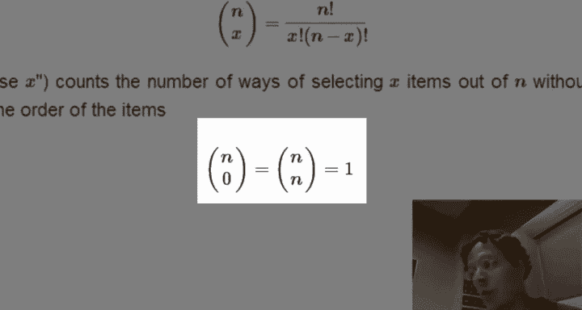
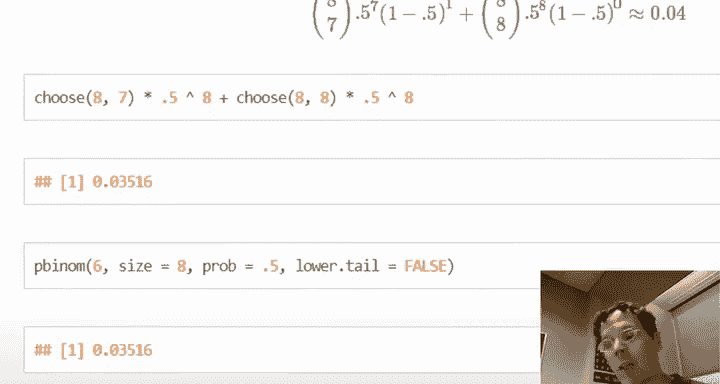

# 015：二项分布 🎲

在本节课中，我们将学习统计学中两种基础且重要的概率分布：伯努利分布和二项分布。我们将从最简单的伯努利分布开始，然后自然地过渡到由其衍生出的二项分布，并通过一个具体例子来理解其应用。

## 伯努利分布

伯努利分布以数学家雅各布·伯努利命名。它描述了最简单的随机试验——抛硬币。

一次伯努利试验（如抛一次硬币）的结果只有两种可能：成功（记为1）或失败（记为0）。假设成功的概率是 `p`，失败的概率就是 `1-p`。

伯努利分布的概率质量函数可以写为：
`P(X = x) = p^x * (1-p)^(1-x)`，其中 `x` 只能是0或1。


一个伯努利随机变量的均值（期望值）是 `p`，方差是 `p * (1-p)`。在统计中，我们通常将结果 `X=1` 称为“成功”，`X=0` 称为“失败”，这与日常语境中的成功与否无关。

## 二项分布

上一节我们介绍了单次试验的伯努利分布。本节中我们来看看，当进行多次独立的伯努利试验时，会得到什么分布。

二项分布随机变量是一系列独立同分布的伯努利随机变量之和。通俗地说，它描述了在 `n` 次抛硬币（可能是不均匀的）试验中，出现正面（成功）的总次数。

数学上，设 `X1, X2, ..., Xn` 是服从伯努利分布 `Bernoulli(p)` 的独立随机变量，那么它们的和 `X = X1 + X2 + ... + Xn` 就是一个二项分布随机变量，记作 `X ~ Binomial(n, p)`。

二项分布的概率质量函数如下：
`P(X = x) = C(n, x) * p^x * (1-p)^(n-x)`，其中 `x` 可以取 0, 1, 2, ..., n。

这里的 `C(n, x)` 是组合数，计算公式为：
`C(n, x) = n! / [x! * (n-x)!]`
它表示从 `n` 个不同元素中不计顺序地选取 `x` 个元素的方法数。`C(n, 0)` 和 `C(n, n)` 都等于1。

## 二项分布计算示例

为了更直观地理解二项分布，我们来看一个具体的计算例子。



假设你的一位朋友有8个孩子，其中7个是女孩，并且没有双胞胎。如果每次生育的性别是独立的，且生女孩的概率为50%，那么得到7个或更多女孩（即7个或8个女孩）的概率是多少？

我们可以直接代入二项分布公式进行计算：
- 得到恰好7个女孩的概率：`P(X=7) = C(8,7) * (0.5)^7 * (0.5)^1`
- 得到恰好8个女孩的概率：`P(X=8) = C(8,8) * (0.5)^8 * (0.5)^0`
- 总概率为两者之和：`P(X>=7) = P(X=7) + P(X=8)`





计算结果显示，这个概率大约为4%。

在R语言中，可以方便地计算这个概率。以下是计算代码：

```r
# 计算二项分布概率
# pbinom(q, size, prob) 计算累积概率 P(X <= q)
# 这里我们计算 P(X >= 7) = 1 - P(X <= 6)
p <- 1 - pbinom(6, size=8, prob=0.5)
print(p)

# 或者分别计算 P(X=7) 和 P(X=8) 再相加
p_exact <- dbinom(7, size=8, prob=0.5) + dbinom(8, size=8, prob=0.5)
print(p_exact)
```

与大多数常见分布一样，R语言提供了 `dbinom`（概率质量函数）、`pbinom`（累积分布函数）等函数来处理二项分布的计算。

## 总结

本节课中我们一起学习了两种基础的离散概率分布。
1.  **伯努利分布**：描述单次二元随机试验（成功/失败）。
2.  **二项分布**：描述 `n` 次独立伯努利试验中成功次数的分布。它是伯努利分布的推广，其概率由组合数、成功概率和试验次数共同决定。



理解这些分布是学习更复杂统计模型和进行统计推断的重要基石。