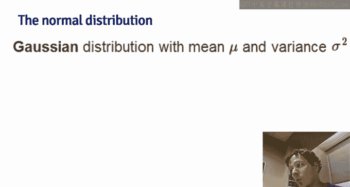
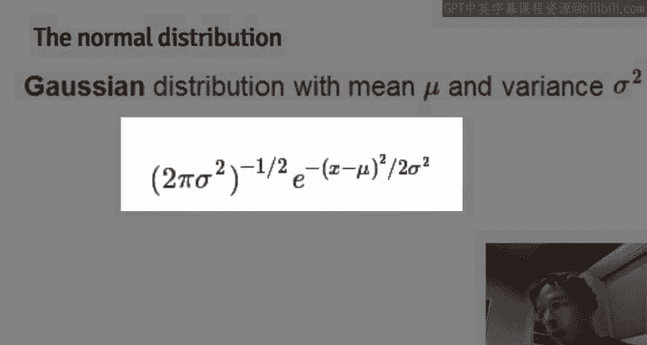
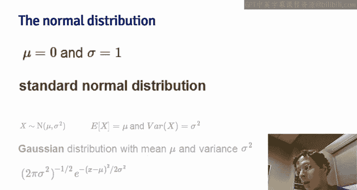
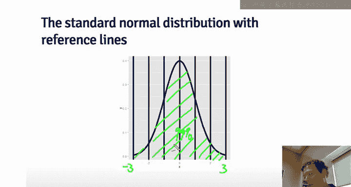
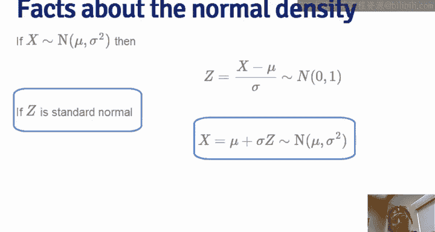
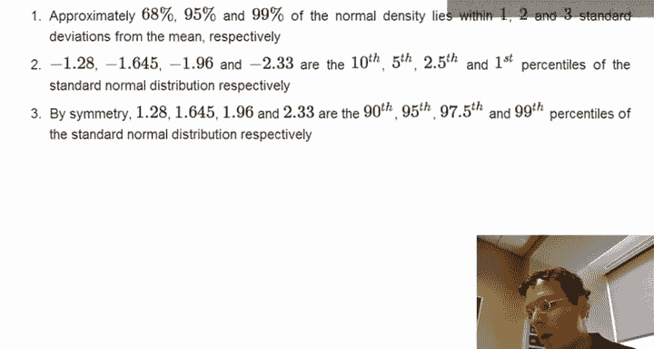
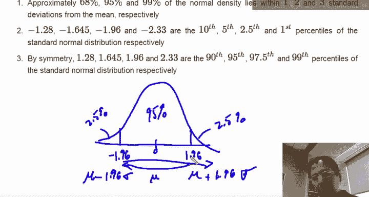
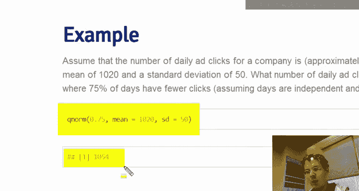

# 016：正态分布 📊

在本节课中，我们将要学习统计学中最重要的分布之一——正态分布。我们将了解其定义、关键特性、标准正态分布的概念，以及如何计算相关的概率和分位数。





正态分布无疑是所有分布中最重要的一个。在后续课程中，我们会看到它如此重要的原因。可以说，如果所有分布要选出一个代表，那必定是正态分布。



## 正态分布的定义与特性 📈

上一节我们提到了正态分布的重要性，本节中我们来看看它的具体定义。

如果一个随机变量 **X** 服从均值为 **μ**、方差为 **σ²** 的正态（或高斯）分布，那么它的概率密度函数就是著名的钟形曲线，其公式如下：

**f(x) = (1 / √(2πσ²)) * e^(-(x-μ)²/(2σ²))**

如果 **X** 是具有此密度的随机变量，那么 **X** 的期望值 **E[X] = μ**，方差 **Var(X) = σ²**。我们通常简写为：

**X ~ N(μ, σ²)**

当 **μ = 0** 且 **σ = 1** 时，得到的分布称为**标准正态分布**。标准正态随机变量通常用 **Z** 表示。

## 标准正态分布与“钟形曲线” 🔔



了解了基本定义后，我们来看看标准正态分布的具体形态。

下图绘制了标准正态密度函数，即著名的钟形曲线。对于标准正态分布，其均值为 0，标准差和方差均为 1。图中标注了均值上下 1、2、3 个标准差的位置。

标准正态的单位可以看作是“标准差单位”。例如，向均值的一侧移动一个单位，就是移动了一个标准差。





值得注意的是，对于非标准正态分布，统计学家习惯于通过谈论“距离均值的标准差数”来将其转换回标准正态。例如，想知道一个非标准正态变量落在 **μ ± 1σ** 范围内的概率，这完全等同于标准正态变量落在 **±1** 范围内的概率。本质上，所有正态分布的形状都相同，唯一改变的是坐标轴上的单位。当谈论正态概率时，如果将其转换为“距离均值的标准差数”，那么所有的概率计算都会回归到标准正态的计算上。

## 关键概率参考值 🎯

我们已经知道可以通过标准差来理解正态分布，以下是几个需要牢记的关键概率参考值。

以下是关于标准正态分布（或任何正态分布）在特定标准差范围内概率质量的总结：

*   **1个标准差内**：大约 68% 的概率质量落在均值上下一个标准差范围内。
*   **2个标准差内**：大约 95% 的概率质量落在均值上下两个标准差范围内。
*   **3个标准差内**：大约 99% 的概率质量落在均值上下三个标准差范围内。

这些参考概率在构建置信区间时会经常用到，请务必熟记。



## 标准与非标准正态的转换规则 🔄

上一节我们介绍了关键概率，本节中我们来看看如何在标准正态和非标准正态之间进行转换。

以下是标准正态与非标准正态随机变量之间的转换规则：

*   如果 **X ~ N(μ, σ²)**，那么通过将其单位转换为“距离均值的标准差数”，即计算 **Z = (X - μ) / σ**，得到的随机变量 **Z** 就是一个标准正态变量。
*   反之，如果我们有一个标准正态变量 **Z**，并通过 **X = μ + σZ** 转换回原始数据的单位，那么得到的随机变量 **X** 就是一个均值为 **μ**、方差为 **σ²** 的非标准正态变量。

## 重要的标准正态分位数 📍

除了整体概率，掌握一些关键的分位数（quantiles）也至关重要。

以下是几个需要记住的标准正态分位数及其含义：

*   **-1.28**：对于标准正态，这是使得 10% 的密度落在其下方、90% 落在其上方的点。对于非标准正态 **N(μ, σ²)**，对应的点是 **μ - 1.28σ**。
*   **1.28**：由对称性，这是使得 10% 的密度落在其上方、90% 落在其下方的点。对于非标准正态，对应点是 **μ + 1.28σ**。
*   **±1.96**：这是非常重要的分位数。**-1.96** 是使得 2.5% 的密度落在其下方的点，**1.96** 是使得 2.5% 的密度落在其上方的点。这意味着两者之间有 95% 的密度。对于非标准正态，对应的区间是 **[μ - 1.96σ, μ + 1.96σ]**。

## 概率与分位数计算示例 🧮

掌握了基本概念和规则后，我们通过一些计算示例来巩固理解。

**示例1：计算分位数**
问题：正态分布 **N(μ, σ²)** 的第95百分位数（95th percentile）是多少？即，找出点 **x_0.95**，使得 95% 的分布落在该点下方。

**方法一（使用R语言）**：
```r
qnorm(0.95, mean = mu, sd = sigma)
```
注意：`sd` 参数应输入标准差 **σ**，而非方差 **σ²**。

**方法二（利用记忆的分位数）**：
我们知道对于标准正态，使得95%落在下方的点是 **1.645**（即距离均值1.645个标准差）。因此，对于非标准正态，该点就是 **μ + 1.645σ**。

**示例2：计算概率**
一个更通用的问题是：对于正态分布 **N(μ, σ²)**，其值大于某个数 **x** 的概率是多少？

**方法一（使用R语言）**：
```r
pnorm(x, mean = mu, sd = sigma, lower.tail = FALSE)
```
或者 `1 - pnorm(x, mean = mu, sd = sigma)`。

**方法二（概念性计算）**：
将 **x** 转换为距离均值的标准差数：**z = (x - μ) / σ**。然后考虑 **z** 在标准正态分布中所处的尾部位置。例如，如果 **z ≈ 2**，我们知道大约有 2.5% 的概率在更远的尾部。

**具体情境示例**：
假设一家公司每日广告点击量近似服从正态分布，均值 **μ = 1020** 次/天，标准差 **σ = 50** 次/天。
1.  **问题A**：某天点击量超过 1160 次的概率是多少？
    *   计算：1160 距离均值 (1160-1020)/50 = 2.8 个标准差。
    *   由于 2.8 接近 3，我们知道这个概率很小（因为3个标准差外只有约0.3%）。
    *   R计算：`pnorm(1160, mean=1020, sd=50, lower.tail=FALSE)` 得到约 0.003。
    *   等价于计算标准正态下大于 2.8 的概率：`pnorm(2.8, lower.tail=FALSE)`。

2.  **问题B**：点击量达到多少，才能使得 75% 的天数点击量低于该值？
    *   思路：均值1020对应第50百分位数。我们需要一个高于1020的数。
    *   考虑一个标准差以上（1070）：我们知道约84%的数据低于1070（因为均值到+1σ间约34%，加上左侧50%）。
    *   因此，第75百分位数应在1020和1070之间。
    *   R计算：`qnorm(0.75, mean=1020, sd=50)` 得到约 1054。

---




本节课中我们一起学习了正态分布的核心知识。我们定义了正态分布及其参数，认识了标准正态分布和关键的“68-95-99.7”经验法则。我们掌握了标准与非标准正态之间的转换规则，并记忆了几个重要的分位数（如1.28、1.96）。最后，我们通过具体示例演练了如何计算正态分布的概率和分位数。理解正态分布是学习许多统计推断和机器学习方法的基础。