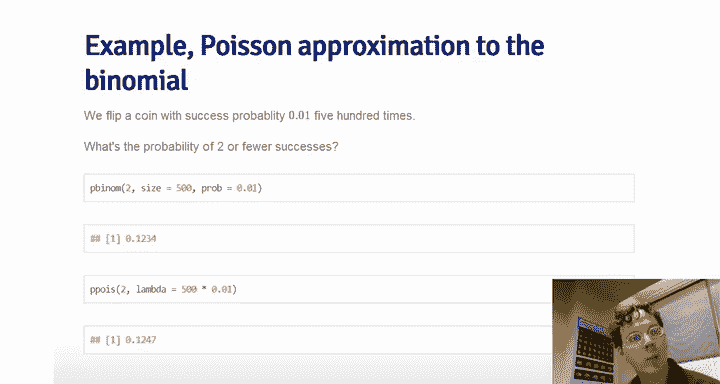
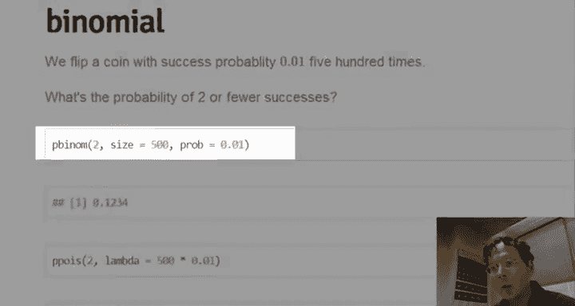
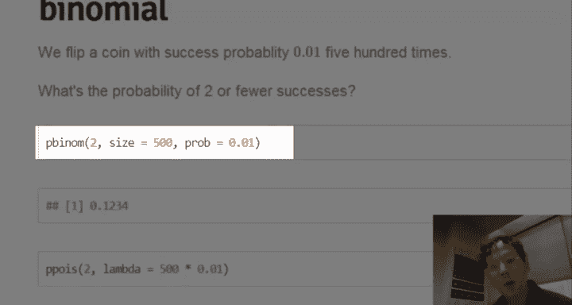
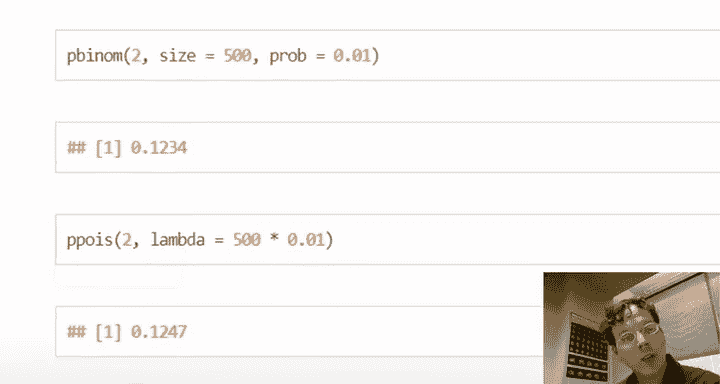
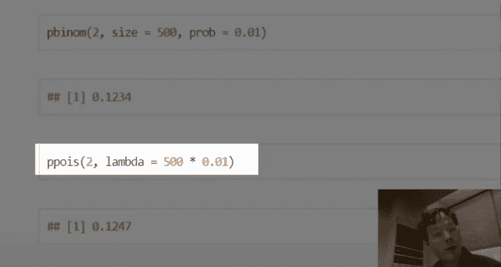
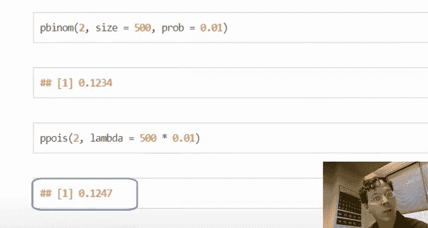

# 017：泊松分布 📊

在本节课中，我们将要学习泊松分布。这是一种用于建模计数数据的概率分布，在统计学和数据科学中应用非常广泛。我们将介绍其定义、特性、应用场景，并探讨它如何作为二项分布的近似。

## 概述

泊松分布是统计学中最重要的分布之一，尤其在处理计数数据时。它的概率质量函数由一个参数λ决定，并且其期望和方差相等。本节将详细解释泊松分布的核心概念、公式及其在实际问题中的应用。

## 泊松分布的定义与特性

上一节我们介绍了正态分布，本节中我们来看看泊松分布。泊松分布用于对计数进行建模。

泊松概率质量函数的公式如下：

**P(X = x) = (λ^x * e^{-λ}) / x!**

其中：
*   **x** 定义在非负整数上（0, 1, 2, …）。
*   **λ** 是分布的参数。

泊松随机变量的均值是 **λ**，其方差也是 **λ**。这是一个需要注意的特性：当你用泊松分布建模时，数据的均值与方差必须相等。如果你有重复的泊松数据，这是一个可以检验的假设。

## 泊松分布的应用场景

泊松分布在许多领域都有应用。以下是其主要应用场景：

*   **通用计数数据**：任何你想对计数数据建模时，泊松分布都是一个候选模型，特别是当这些计数没有上限时。
*   **事件时间或生存数据**：在生物统计学领域，例如癌症临床试验中，你需要对症状复发的时间进行建模。处理这种“删失”问题的特殊统计技术与泊松分布有深刻联系。
*   **列联表数据**：当你对人群抽样并按某些特征（如发色和种族）进行分类计数时，会得到列联表。泊松分布是建模列联表数据的默认分布，并且与其他模型（如多项分布、二项分布和伯努利分布）有深刻联系。
*   **流行病学中的近似**：当二项分布中的 **n** 很大而 **p** 很小时，泊松分布常被用作近似。这在流行病学中非常常见，例如研究大城市中空气污染与新增呼吸道疾病病例数的关系时，总人口数 **n** 很大，但事件数往往很小。

## 泊松分布用于建模速率

泊松分布也常用于对速率进行建模。例如，令 **X ~ Poisson(λt)**。这里需要注意，**λ** 是有单位的，它是单位时间内的平均事件数，而 **t** 是以该时间单位表示的总监测时间。因此，**λ** 是单位时间的期望计数。

**举例**：假设到达公交车站的人数服从泊松分布，均值为每小时2.5人。我们观察车站4小时，问在整个时间段内，有3人或更少人到达的概率是多少？

我们需要计算 **X=0, 1, 2, 3** 的泊松概率之和。此时的速率不是2.5，因为那是每小时的速率。我们观察了4小时，所以应使用的速率是 **2.5 * 4 = 10**。计算得到的概率约为 **0.01**（1%）。

## 泊松分布作为二项分布的近似

当 **n** 很大且 **p** 很小时，泊松分布可以相当准确地近似二项分布。

定义：令 **X ~ Binomial(n, p)**，并定义 **λ = n * p**。在 **n** 非常大且 **p** 非常小的条件下，**X** 的二项分布概率可以用参数为 **λ** 的泊松概率来很好地近似。

**举例**：假设我们抛一枚成功概率为 **0.01** 的硬币 **500** 次。求成功次数为2次或更少的概率。

这是一个二项分布问题，**n=500**（大），**p=0.01**（小）。我们可以进行二项分布计算，也可以使用泊松近似。

*   **二项分布计算**：`P(X ≤ 2) ≈ 0.123`（约12.3%）。
*   **泊松近似计算**：`λ = n * p = 500 * 0.01 = 5`。计算 `P(X ≤ 2)` 得到约 **0.125**（12.5%）。

可以看到，两种方法的结果非常接近。

## 总结

本节课中我们一起学习了泊松分布。我们了解了其概率质量函数、均值与方差相等的特性，并探讨了它在计数数据、生存分析、列联表以及流行病学等领域的广泛应用。最后，我们学习了泊松分布如何作为二项分布（当n很大、p很小时）的有效近似，并通过实例验证了其近似效果。掌握泊松分布对于理解和分析现实世界中的计数数据至关重要。