# 018：渐近性与大数定律 📈

在本节课中，我们将学习统计学中的渐近性概念，并深入探讨大数定律。渐近性描述了当样本量趋于无穷大时，统计量的行为。大数定律则是理解概率频率解释的基础。

---

## 什么是渐近性？🔍

上一节我们介绍了课程背景，本节中我们来看看渐近性的定义。

渐近性是指当样本量或其他相关量趋于无穷大时，统计量的行为。在某些情况下，也可能指其他量趋于零时的行为。本课程我们只讨论样本量趋于无穷大的情况。

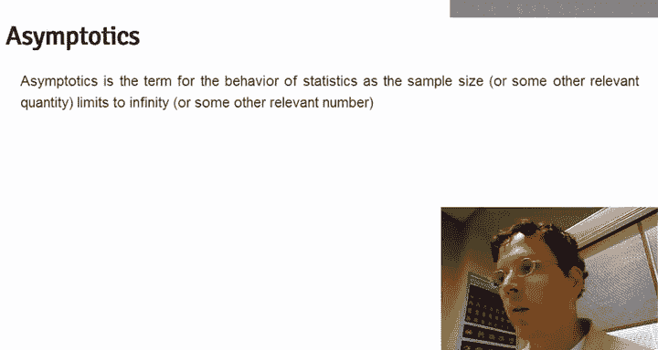

---

## 渐近的理想国 🌟

上一节我们定义了渐近性，本节中我们来看看一个相关的概念——“渐近的理想国”。

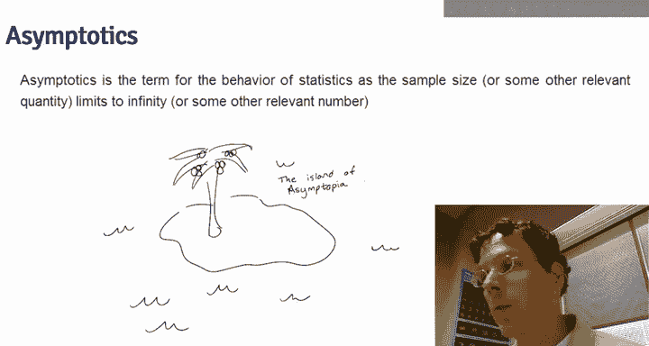

“渐近的理想国”是我对渐近性领域的称呼，在那里一切都运作良好。这理应如此，因为在渐近的理想国中，数据量是无限的。

---

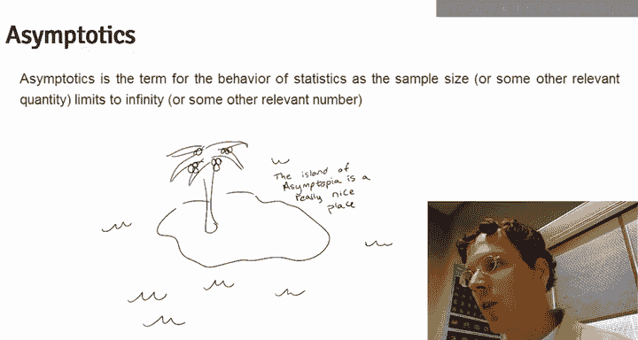

## 渐近性的用途 🛠️

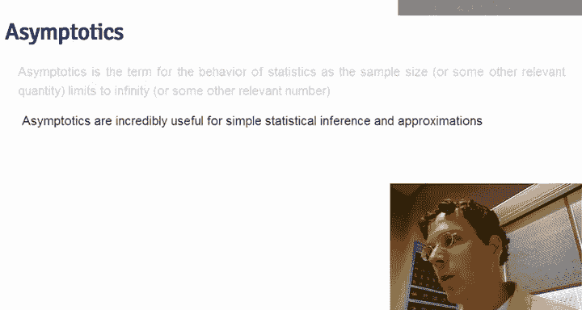

上一节我们了解了渐近的理想国，本节中我们来看看渐近性的实际用途。

渐近性对于简单的统计推断和近似非常有用。它就像一把瑞士军刀，无需大量计算，就能探究许多统计量的统计性质。

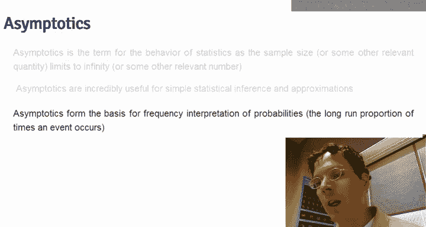

---

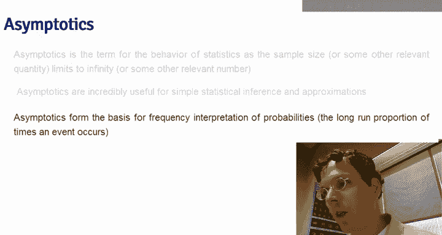

## 概率的频率解释基础 📊

上一节我们探讨了渐近性的用途，本节中我们来看看它如何为概率的频率解释奠定基础。

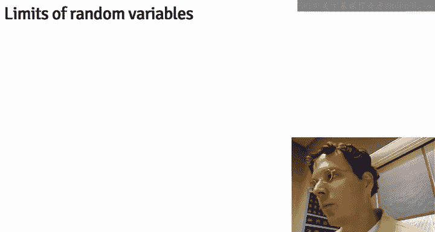

渐近性构成了概率频率解释的基础。例如，人们凭直觉知道，如果反复抛一枚公平的硬币，正面朝上的比例会趋于0.5。

这个性质就是我们即将探讨的所谓**大数定律**。

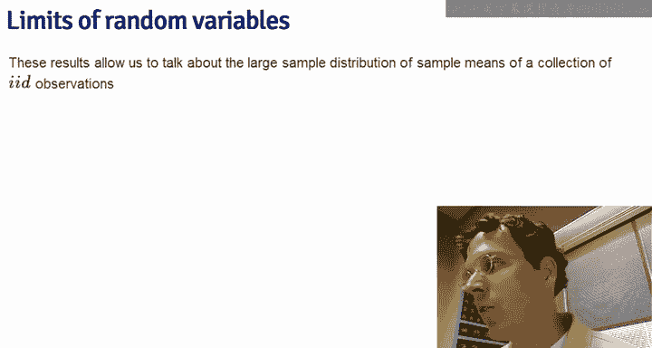

---

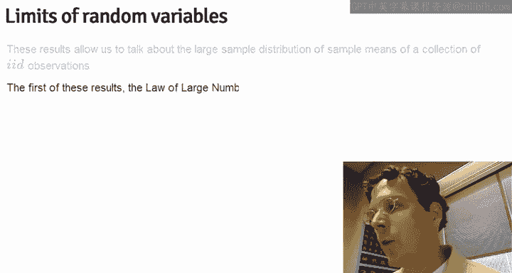

## 强大的工具集 💪

幸运的是，我们无需深入研究随机变量极限的数学，而是可以依赖一套强大的工具。

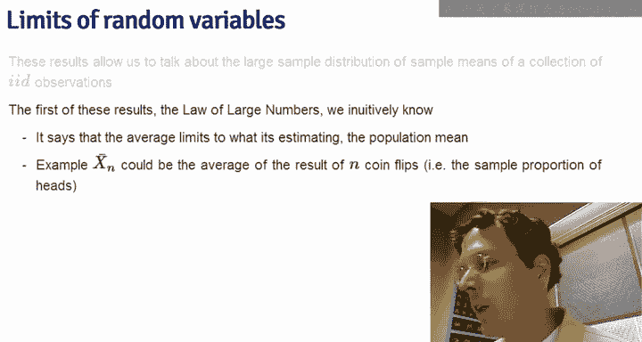

这些结果使我们能够讨论独立同分布观测值的样本均值在大样本下的分布和行为。

---

## 大数定律 ⚖️

上一节我们提到了强大的工具，本节中我们来看看第一个工具——大数定律。

第一个工具我们已经凭直觉知道，即所谓的大数定律。

它指出，样本均值会趋于它所估计的总体均值。例如，样本均值可以是N次抛硬币的结果，即样本中正面朝上的比例。

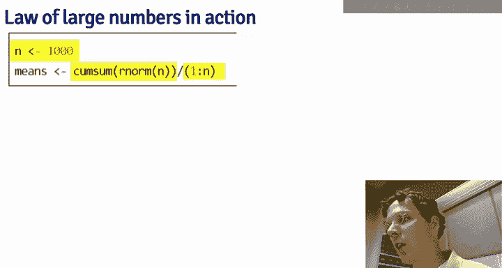

随着我们反复抛一枚公平的硬币，这个比例最终会收敛到真实的正面概率。

---

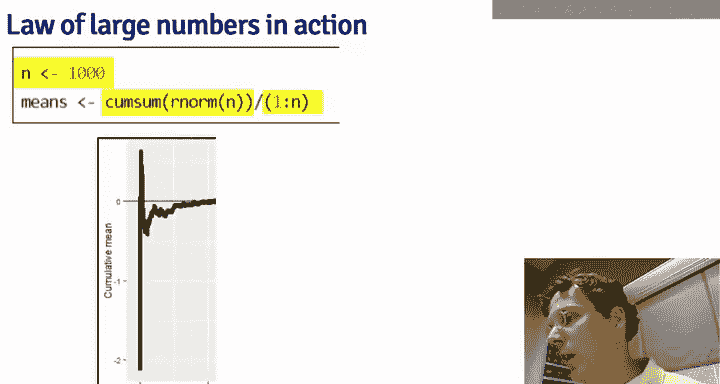

## 大数定律的演示 🎬

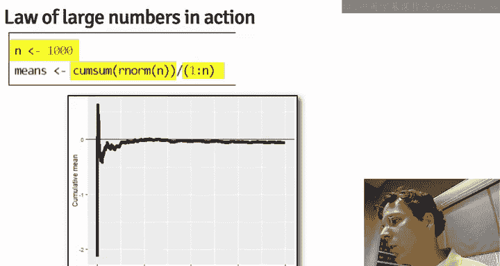

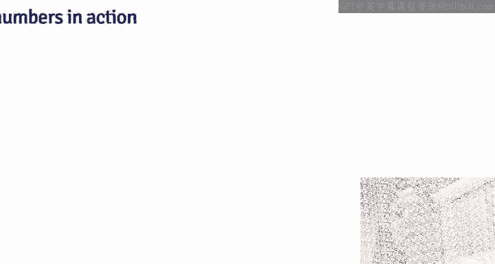

让我们来演示大数定律的作用。

我将模拟次数设为1000。然后，生成1000个随机正态变量，并计算它们的累积和。接着，用累积和除以1到n，得到累积均值。换句话说，就是第一个观测值自身的均值，然后是前两个观测值的均值，接着是前三个观测值的均值，依此类推。

当你绘制累积均值随索引变化的图时，你会看到：在初期，均值有很大的变异性；但随着模拟次数（而非时间）的增加，我们越来越接近真实的总体值，即零。

让我们再做一次，但这次让R抛硬币，而不是生成标准正态变量。

`sample`函数在给定参数0和1时，以相等概率从元素0和1中抽样。这里我想要1000个样本，`replace = TRUE`意味着我希望有放回地抽样。因此，这条命令正是抛硬币1000次，其中0代表反面，1代表正面。

我再次计算累积和，然后除以1到n得到累积均值。当我绘制累积均值图时，我再次看到：在初期，样本比例有变异性；但随着用于计算样本比例的抛硬币次数趋于无穷大，它收敛到真实值，即0.5。

---

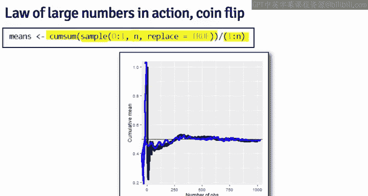

## 一致性估计量 ✅

让我们进行一个简短的讨论。

如果一个估计量收敛于你想要估计的量，我们就定义它为**一致的**。

例如，来自独立同分布抛硬币的样本比例，对于硬币的真实成功概率是一致的。随着你反复抛硬币，正面朝上的样本比例会收敛到该硬币得到正面的概率。

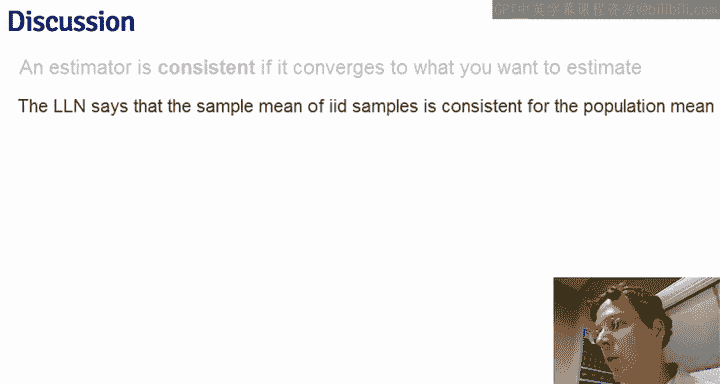

大数定律指出，独立同分布样本的样本均值是总体均值的一致估计量。

这是一个非常好的性质，因为它基本上是说，如果我们不辞辛劳地收集无限量的数据，我们就能得到完全正确的答案。但不仅样本均值是一致的，独立同分布随机变量的样本方差和样本标准差也是一致的。

---

## 总结 📝

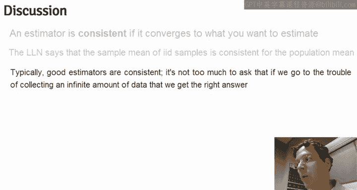

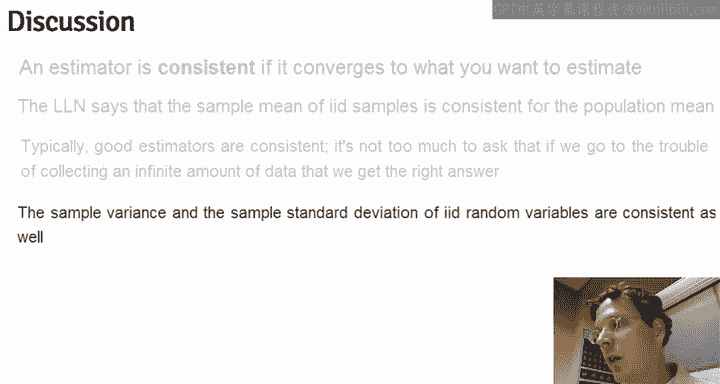

本节课中，我们一起学习了渐近性的概念及其在统计学中的重要性。我们探讨了“渐近的理想国”，并详细介绍了大数定律，它表明随着样本量增加，样本均值会收敛于总体均值。我们还通过模拟演示了大数定律的作用，并讨论了一致性估计量的定义。这些工具为理解统计推断和概率的频率解释提供了坚实的基础。