# 019：渐近性与中心极限定理 📊


在本节课中，我们将学习统计学中最重要的定理之一——中心极限定理。我们将了解它的定义、核心公式，并通过模拟实验来直观地理解它如何工作。

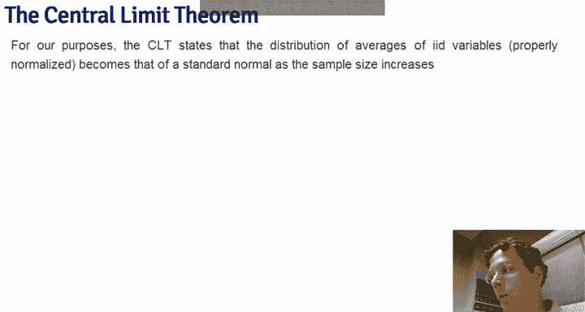

---

## 中心极限定理概述

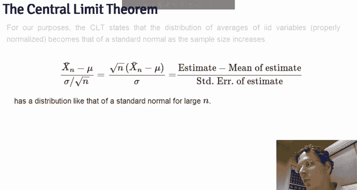

中心极限定理指出，对于独立同分布的随机变量，其样本均值的分布会随着样本量的增加而趋近于标准正态分布。该定理对总体的要求相对宽松，因此适用于几乎无穷无尽的各种场景。

上一节我们介绍了统计推断的基本概念，本节中我们来看看描述样本均值分布行为的核心定理。

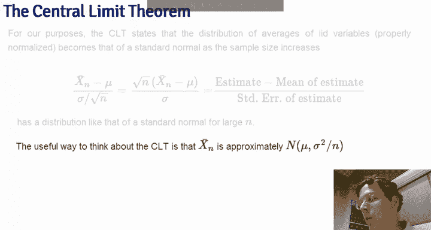

---

## 定理的核心表述

中心极限定理的基本结论是：如果我们取样本均值 `x̄`，减去其总体均值 `μ`，再除以其标准误 `σ/√n`，那么这个随机变量的分布会趋近于标准正态分布。

其核心公式可以表示为：

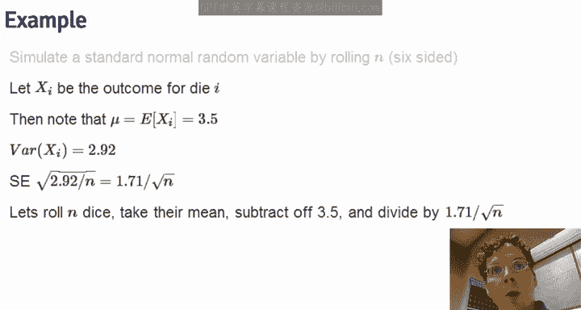

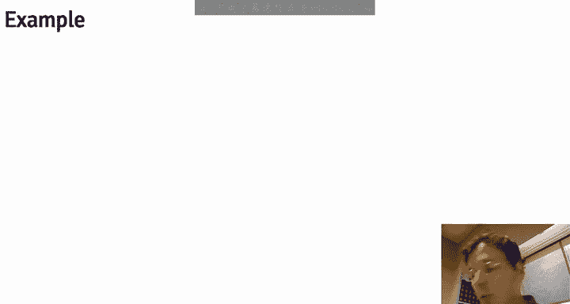

```
(x̄ - μ) / (σ/√n) → N(0, 1)
```

此外，用已知的样本标准差 `s` 替换未知的总体标准差 `σ`，并不会改变中心极限定理的结论。

---

## 定理的实用理解方式

理解中心极限定理最有用的方式是：样本均值 `x̄` 近似服从正态分布，其均值等于总体均值 `μ`，其方差等于均值的标准误的平方 `(σ²/n)`。

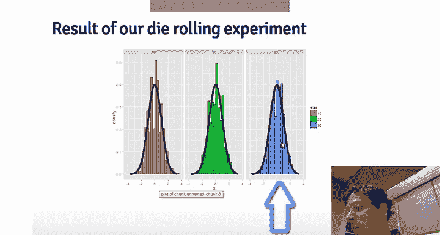

用公式描述为：

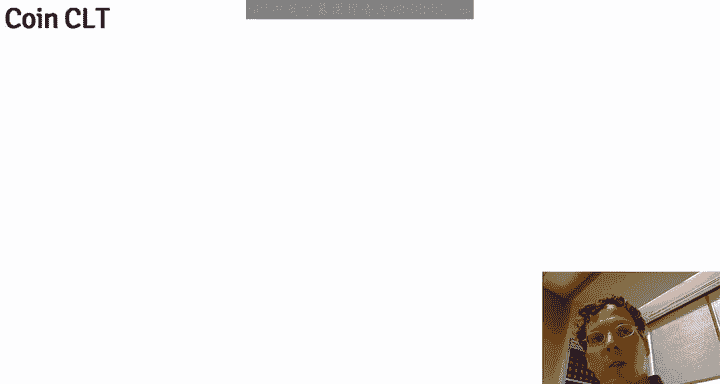

```
x̄ ~ N(μ, σ²/n)
```

---

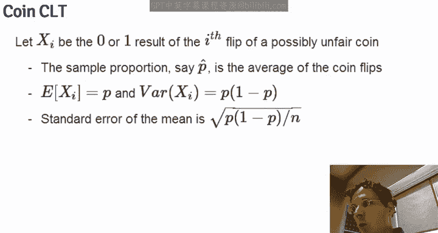

## 模拟实验：掷骰子 🎲

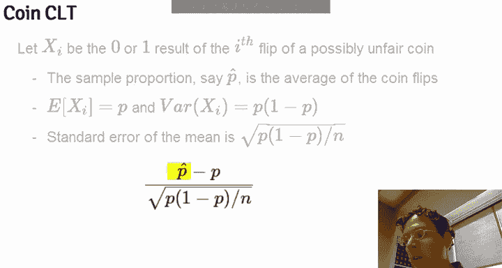

为了通过模拟说明中心极限定理，我们首先从掷一个标准骰子开始。这个思想实验的有趣之处在于，它模拟了计算机出现之前，统计学家如何生成正态随机变量来研究统计量（如卡方统计量）的行为。

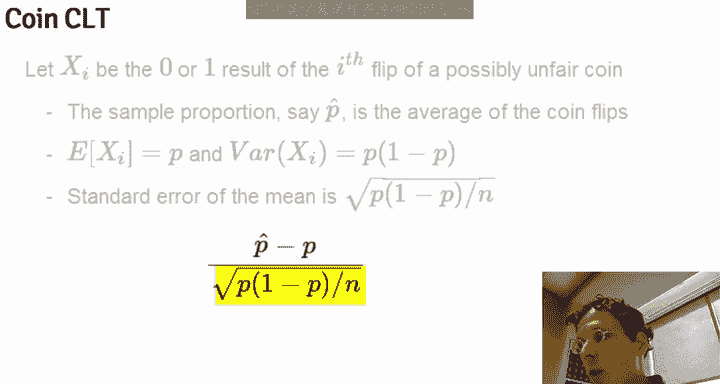

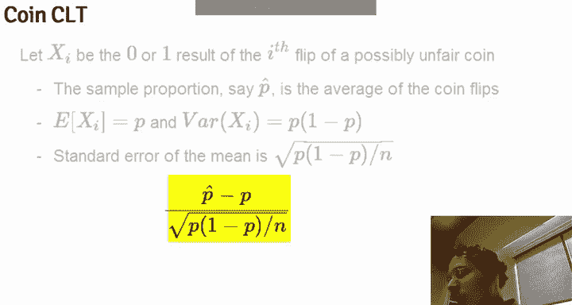

以下是实验设置：
*   令 `Xi` 为第 `i` 次掷骰子的结果。
*   已知掷骰子结果的总体均值 `μ = 3.5`，方差 `σ² ≈ 2.92`。
*   因此，均值的标准误为 `√(2.92/n)`。

实验步骤是：掷 `n` 次骰子，计算其均值 `x̄`，然后计算标准化后的值 `(x̄ - 3.5) / (1.71/√n)`。将此过程重复多次。如果中心极限定理正确，这些标准化均值的分布应看起来像标准的钟形曲线。

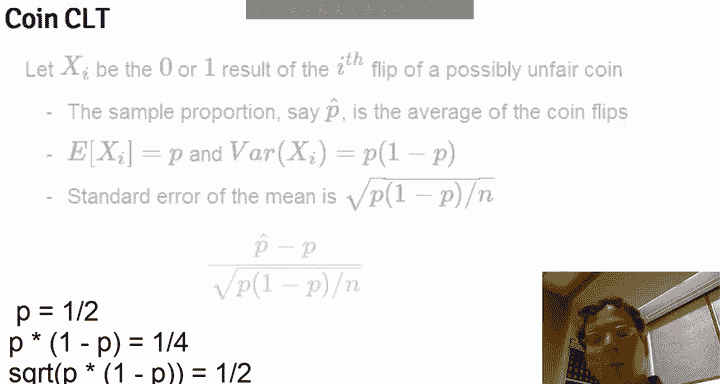

以下是模拟结果的关键观察：
*   我们进行了多次实验，每次掷10次、20次和30次骰子。
*   标准化后的均值分布始终以0为中心（因为我们减去了均值3.5）。
*   随着掷骰次数 `n` 从10增加到30，其分布形状越来越接近标准正态分布的钟形曲线。即使对于仅10次掷骰，近似效果已经很好。

---

## 模拟实验：抛硬币 🪙

抛硬币是一个有趣的案例，因为它回到了中心极限定理最初的发展——作为样本比例分布的近似。

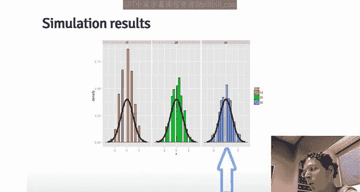

以下是实验设置：
*   令 `Xi` 为第 `i` 次抛硬币的结果（0代表反面，1代表正面）。
*   样本比例 `p̂` 就是这些结果的均值（即正面朝上的比例）。
*   已知 `Xi` 的期望值 `E[X] = p`，方差 `Var(X) = p(1-p)`。
*   因此，比例 `p̂` 的标准误为 `√[p(1-p)/n]`。

根据中心极限定理，统计量 `(p̂ - p) / √[p(1-p)/n]` 在大样本下近似服从标准正态分布。

如果硬币是公平的（`p = 0.5`），则标准误简化为 `1/(2√n)`。因此，实验步骤变为：抛硬币 `n` 次，计算正面比例 `p̂`，然后计算 `(p̂ - 0.5) * 2√n`。

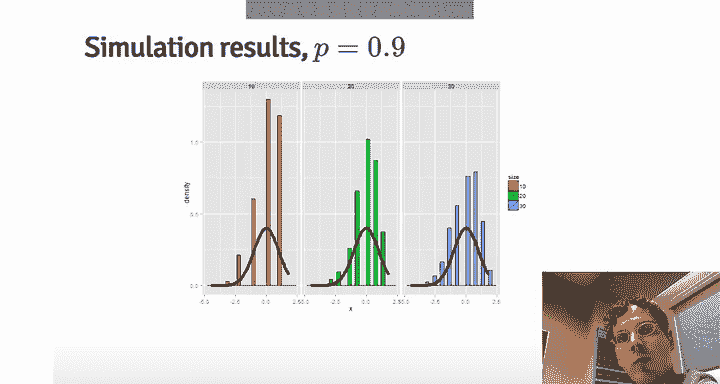

以下是模拟结果的关键观察：
*   对于10次抛硬币，标准化比例的分布已初具正态雏形，但由于结果离散（只有有限种组合），分布图上仍能看到一些“台阶”。
*   当抛硬币次数增加到20次或30次时，分布看起来就非常接近高斯（正态）分布了。

需要强调的是，标准化后的抛硬币结果收敛到正态分布的速度，取决于硬币的偏差程度。例如，对于一个正面概率为0.9的偏倚硬币，即使抛30次，其分布与正态分布的近似程度也远不如公平硬币。中心极限定理并不保证正态分布一定是个好近似，只保证当试验次数趋于无穷时，最终会是一个好近似。

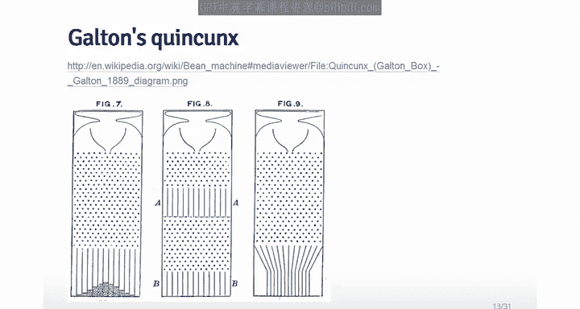

---

## 趣味应用：高尔顿钉板

作为一个有趣的补充，高尔顿钉板是一个能在科学博物馆见到的装置，它巧妙地用类似“弹珠机”的游戏演示了中心极限定理。

其工作原理如下：
*   一颗小球从顶部落下，撞击第一排的钉子。
*   撞击后，小球以相等概率向左或向右弹开，然后落到下一排的钉子上。
*   这个过程在每一排重复，小球不断做出“左”或“右”的二元选择，就像一系列抛硬币实验。
*   最终，小球会落入底部的一列收集槽中。

每一排钉子相当于一次抛硬币。小球最终落入哪个槽，取决于它在所有“层级”上“向右”的总次数。根据中心极限定理，这个“总成功次数”（或比例）近似服从正态分布。因此，当大量小球落下后，它们在底部收集槽中堆积出的轮廓，会非常接近一条正态分布曲线。博物馆的装置通常会叠加画出这条曲线，当小球堆满后，装置会清空重新开始，生动展示了中心极限定理。

---

## 总结

本节课中，我们一起学习了中心极限定理。我们了解了它的核心表述：标准化后的样本均值在大样本下趋近于标准正态分布。我们通过掷骰子和抛硬币的模拟实验，直观地看到了样本均值分布如何随着样本量增加而逐渐呈现正态形状。我们还探讨了收敛速度受总体分布影响，并介绍了一个有趣的实际应用——高尔顿钉板。中心极限定理是连接样本与总体、进行统计推断的基石，其重要性不言而喻。