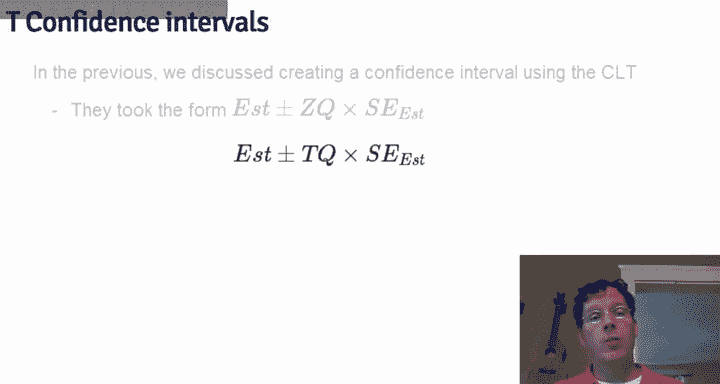
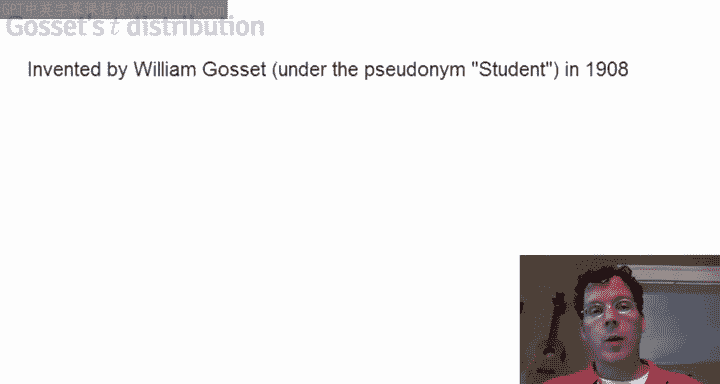
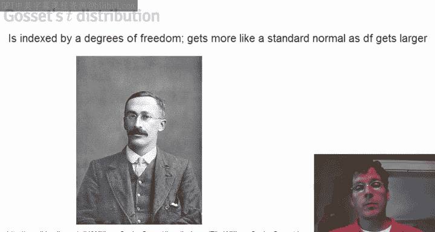
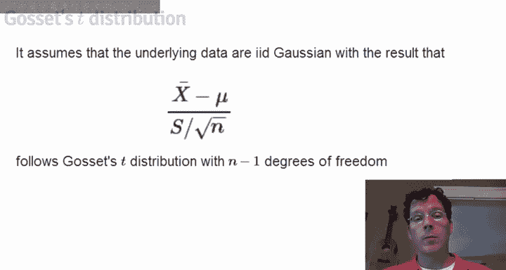
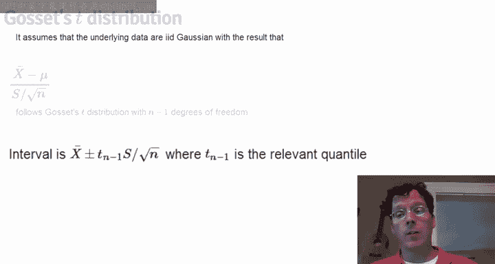
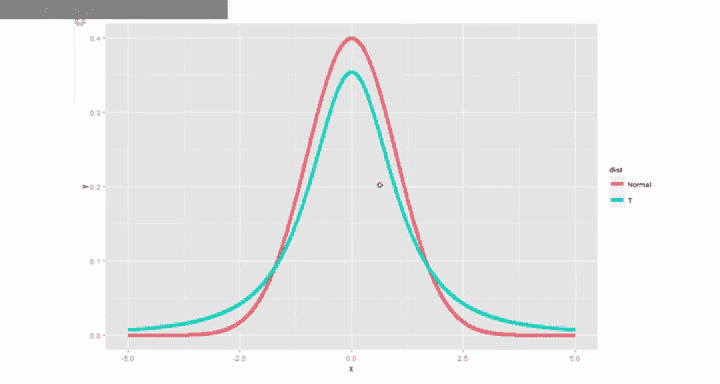
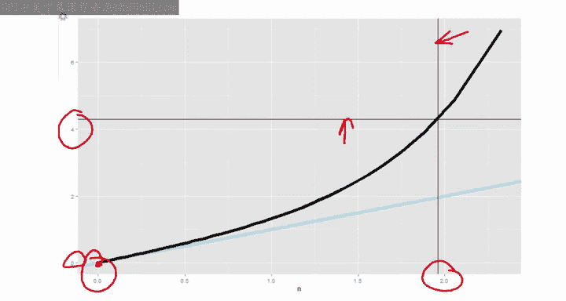
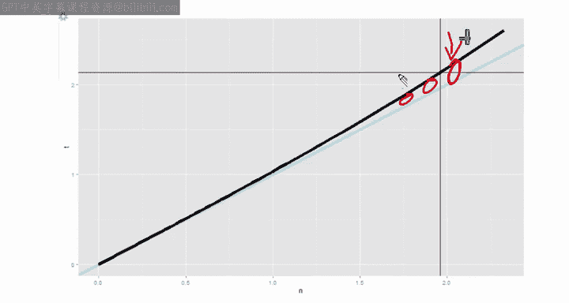
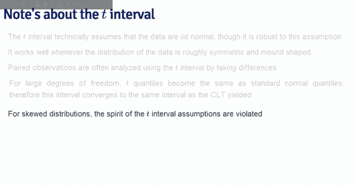

# 021：t置信区间 📊

在本节课中，我们将学习如何为小样本数据构建置信区间。我们将重点介绍学生t分布（Student‘s t-distribution）以及如何利用它来创建t置信区间。这些区间在统计学中非常实用，尤其适用于样本量较小的情况。

---

在上一讲中，我们讨论了如何使用中心极限定理来构建置信区间。我们讨论的所有区间都遵循以下形式：**估计值 ± 标准正态分布的分位数 × 估计值的标准误**。

在本节中，我们将讨论一些适用于小样本的方法。具体来说，我们将探讨学生t分布（也称为戈塞特t分布）和t置信区间。

这些区间的形式将变为：**估计值 ± t分位数 × 估计值的标准误**。唯一的改变是将Z分位数替换为T分位数。t分布比正态分布具有更厚的尾部，因此这些区间会稍微宽一些。这些是统计学中最方便的区间之一。

如果你需要在t区间和Z区间都可用的场景中进行选择，只需使用t区间。因为随着收集的数据越来越多，t区间最终会变得越来越像Z区间。本节课我们将涵盖单组和两组情况的t区间，在回归课程中还会介绍其他有用的t区间。

t分布由威廉·戈塞特（William Gosset）于1908年以笔名“Student”发表。他当时在吉尼斯啤酒厂工作，公司不希望他以真名发表，因此他使用了“Student”这个笔名。所以我们常称之为“学生t分布”或“学生t检验”。

---

t分布比正态分布的尾部更厚。与由均值和方差两个参数定义的正态分布不同，t分布通常围绕零中心化，其尺度有标准公式。它只由一个参数索引，即所谓的**自由度**。随着自由度的增加，t分布会越来越接近标准正态分布。

使用t分布的原因如下：如果我们取样本均值 `X̄`，减去总体均值 `μ`，再除以独立同分布高斯数据的**估计标准误**，其分布实际上并非高斯分布。如果我们用总体标准差 `σ` 代替样本标准差 `S`，那么它将是精确的标准正态分布。然而，当我们用 `S` 代替 `σ` 时，它就不再具有标准正态分布，而是具有t分布。

随着样本量 `n` 的增加，这种差异变得无关紧要。但对于小样本量，差异可能相当大。因此，如果对小样本使用标准正态分布，可能会得到过窄的置信区间。

我们的区间最终形式为：**`X̄ ± t_{n-1} × (S/√n)`**，其中 `t_{n-1}` 是自由度为 `n-1` 的t分布分位数。我们将通过一些例子来掌握它。

---

为了直观展示，我们可以使用R语言的 `manipulate` 函数来观察t分布与正态分布在不同自由度下的叠加情况。例如，在20个自由度时，两者非常相似。随着自由度降低，t分布的尾部会变得更厚。虽然它看起来仍然像正态分布，但如果你“挤压”它的中心部分，多余的质量就会转移到尾部。

由于图中大部分区域都集中在分布的峰值部分（在那里它们实际上相当相似），因此尾部差异的影响有时难以看清。

让我们绘制分位数图。这张图显示的是t分布的分位数相对于正态分布分位数的关系，从第50百分位数开始。例如，我们从0开始，因为两个分布都关于0对称，所以0是第50百分位数，因此该图经过点(0,0)。我没有绘制低于第50百分位数的分位数，因为分布是对称的，这些信息是冗余的。

图中绘制了97.5分位数的参考线。对于标准正态分布，这个值始终在1.96左右，但对于t分布，它可能大得多。例如，在2个自由度时，t分位数超过4。需要强调的是，2个自由度意味着你只有3个数据点来估计方差，这确实太少了。

让我们将自由度增加到20。现在我们可以看到，t分位数非常接近正态分位数。图中浅蓝色的参考线是恒等线。如果t分位数与正态分位数完全相同，它们就会落在这条线上。我再次在1.96处和相关的t分位数处显示了参考线。这里的距离正是两种区间之间的区别。

对于t区间，我们将使用一个略大于2的分位数，而对于Z区间，我们将使用一个略小于2的分位数。这可能会对区间宽度产生相当大的影响，甚至可能决定区间是否包含零。这就是我们使用t分布的原因。在这个分位数图中，t分位数总是位于蓝色参考线上方，这实际上意味着t置信区间总是比正态区间更宽。这是合理的，因为我们多估计了一个参数（标准差），这种不确定性自然会导致区间更宽。

---

以下是关于t区间的几点说明：

1.  **假设**：t区间在技术上假设数据是独立同分布的正态数据，但它对这个假设非常稳健。基本上，只要分布大致对称且呈钟形，t区间就能很好地工作。
2.  **配对观测**：如果你有配对观测值（例如，对同一单位在不同时间点进行两次测量），可以通过计算差值（或对数尺度上的差值）来使用t区间分析这类数据。
3.  **大样本情况**：对于大自由度，t分位数变得与标准正态分位数完全相同，因此t区间收敛于中心极限定理得到的正态区间。正因为如此，与其在t区间和正态区间之间选择，我总是建议直接使用t区间。
4.  **偏态分布**：对于偏态分布，t区间的假设精神被违背。你可以尝试对数据进行对数变换（取对数通常能处理数据的偏度），或者使用其他方法（例如，自举法构建置信区间）。对于高度离散的数据（如二项分布或泊松分布数据），有其他可用的区间，使用它们可能比t区间更合适。

---

本节课中，我们一起学习了t置信区间。我们了解到，当样本量较小时，使用基于t分布的置信区间比基于正态分布的区间更准确，因为它考虑了用样本标准差估计总体标准差所带来的额外不确定性。t区间形式为 `估计值 ± t分位数 × 标准误`，其宽度总是大于对应的Z区间。我们讨论了t分布的背景、性质、适用场景以及注意事项。记住，在可能的情况下，优先使用t区间是一个稳妥的选择。